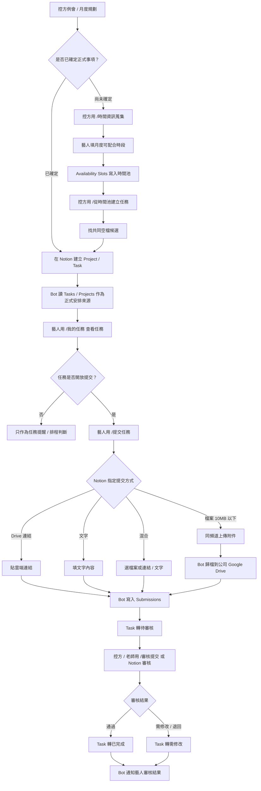
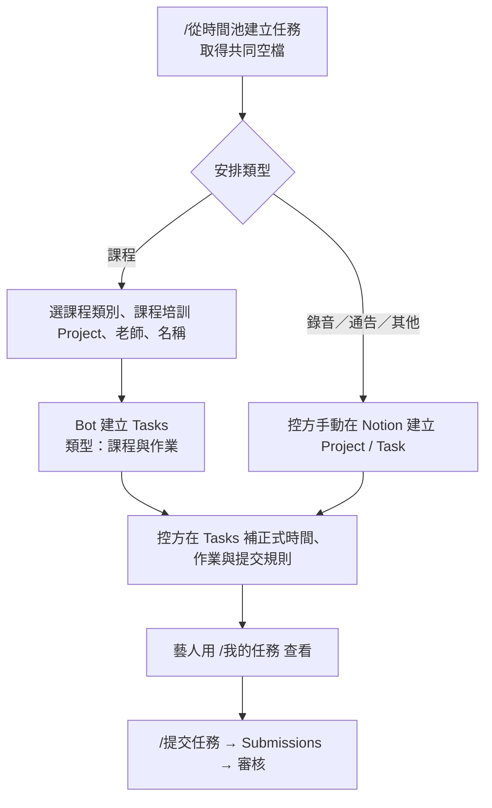
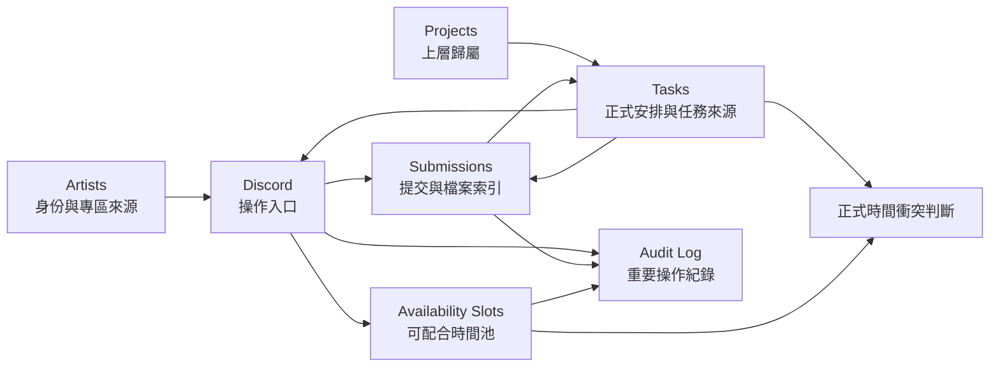

# KariKari AI Ops Mermaid Flowchart

這份圖給人和 AI 協作者快速理解目前系統主流程。  
KariKari 是第一個測試站；流程設計仍以可平轉到其他公司為前提。

## 主營運流程

## 課程／錄音／通告安排流程

## 資料庫責任分界

## 快速判斷

- `Availability Slots`：只代表藝人可配合時間，不是正式行程。
- `Tasks`：正式安排、任務查詢、提醒、提交狀態的主要來源。
- `Projects`：上層歸屬與提醒來源，不直接封鎖整段時間。
- `Submissions`：每一次作業 / 作品提交與審核結果。
- 課程場次細節：集中記錄在 `Tasks` 的「課程與作業」任務，不再使用獨立資料庫。
