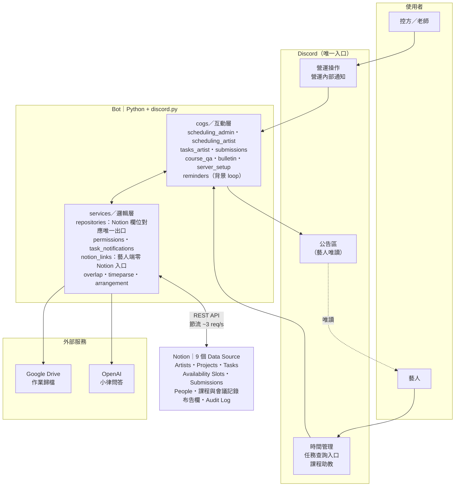
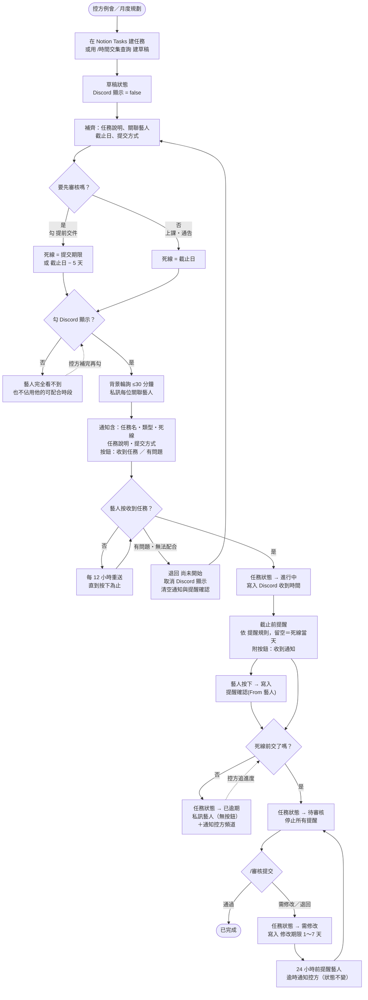
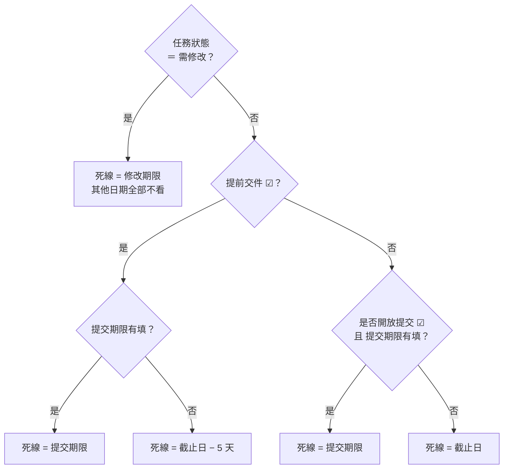
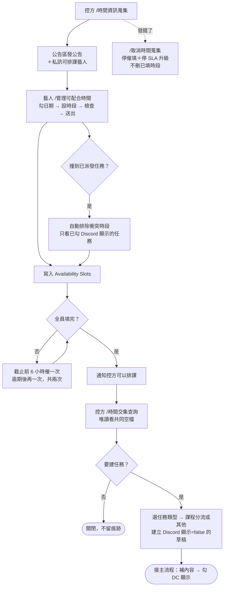
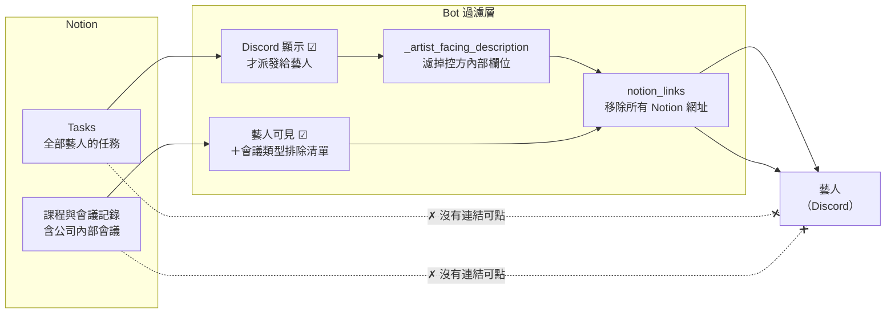
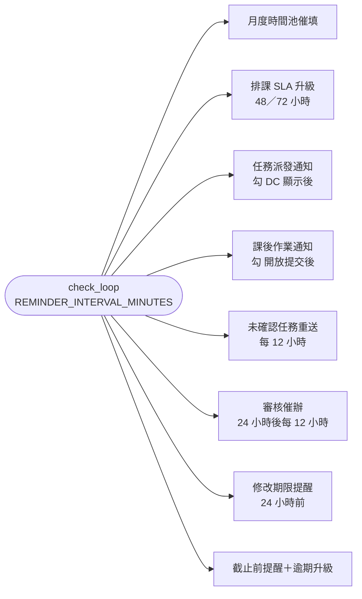
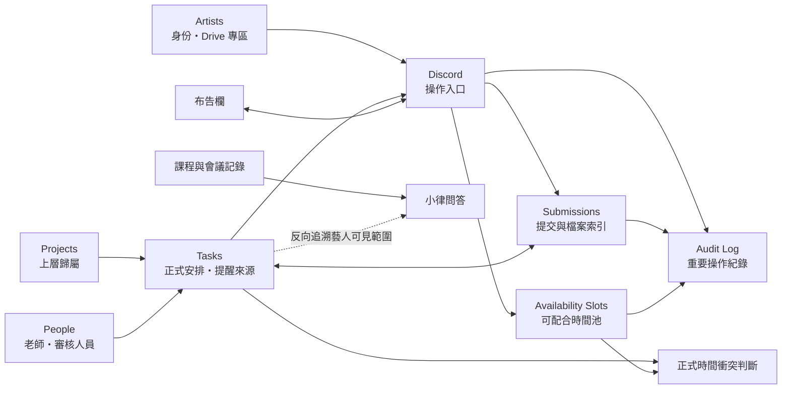

# 系統架構與流程圖

LURASUPA 營運系統的整體樣貌。**這份圖描述的是目前程式碼的實際行為**，不是規劃；
改功能時要一起更新，否則下一個接手的人會照著錯的圖做事。

最後校準：2026-09-24（M-1 藝人端資料隔離、M-2 時間回報可見性、T-5 提醒確認都已落地）

---

## 一、系統架構

三層：Discord 是**唯一**的操作入口，Bot 是邏輯層，Notion 是資料真相。

**關鍵邊界**

- 藝人**只透過 Discord**取得資訊，拿不到任何 Notion 網址（見第四節）
- `repositories.py` 是中文欄位名 → API payload 的唯一對應處；Notion 改欄位名只改這裡
- 公司特定值（Data Source ID、頻道、用語、SLA）全部從 `config.get_tenant()` 注入

---

## 二、主流程：一個任務的一生

會議 2026-09-12 指定要呈現的那條線：**行政建任務 → 是否提前交件 → 派發／DC 顯示 → 提醒 → 完成**。

### 死線判定（決定提醒與逾期發生在哪一天）

> ⚠️ 只填 `提交期限`、但 `提前交件` 和 `是否開放提交` 都沒勾 → **提交期限被忽略**，死線退回 `截止日`。
> 8 種情境的完整對照表在 [控方 SOP](../sop/ADMIN_SOP.md)。

---

## 三、月度排課流程

> 控方端比對共同空檔時**會**把未勾 `Discord 顯示` 的草稿算成已佔用，避免把排掉的時段當空檔推出去；
> 藝人端則看不到草稿（見下一節）。兩邊用同一支函式、不同旗標。

---

## 四、藝人端資料邊界（2026-09-18 起）

Demo 要驗收的重點。**規則：藝人看得到的任何輸出，都不含 Notion 網址。**

**為什麼連結不能給**：Notion 的逐頁權限管不到頁面上方的導覽列。藝人拿到任何一個頁面網址，
就能往上翻到整個資料庫——一筆任務的網址翻上去就是所有藝人的 Tasks。

已移除的 12 個入口：任務通知／未確認提醒的「查看任務內容」按鈕、按「收到任務」後的回覆、
審核結果與批改檔 DM、公告區的公開公告與布告欄同步、小律的附件索引／月份總覽／回答來源／LLM context。

守門測試：`tests/test_artist_no_notion_links.py`（每次跑測試都會擋）。

> 控方與老師的頻道**不受限**，`/審核提交` 詳情、營運內部通知仍保留 Notion 連結。

---

## 五、背景自動化（每 30 分鐘一輪）

`cogs/reminders.py` 的 `check_loop`，依序跑 8 項：

另有獨立的布告欄同步（預設 5 分鐘）與小律問答（即時觸發）。

**去重機制**：排課類在記憶體 `_sent`（重啟最多重發一次，可接受）；
任務逾期用 Notion 狀態 `已逾期` 持久化（重啟不重複轟炸）。

---

## 六、資料庫責任分界

### 快速判斷

| 資料庫 | 是什麼 | 不是什麼 |
|---|---|---|
| `Availability Slots` | 藝人**可配合**的時間 | 不是正式行程 |
| `Tasks` | 正式安排、提醒、提交狀態的主要來源 | 不是草稿暫存區（未勾 DC 顯示才是草稿） |
| `Projects` | 上層歸屬與提醒來源 | 不直接封鎖整段時間 |
| `Submissions` | 每一次提交與審核結果 | 不覆蓋歷史版本（`是否最新版` 控制） |
| `課程與會議記錄` | 小律的唯一知識來源 | 不是藝人的 Notion 入口 |

---

## 待辦（會影響這份圖）

- `/從時間池建立任務` 已被 `/時間交集查詢` 完全覆蓋，預定移除（M-5）
- `/伺服器初始化` 預定從指令清單隱藏，程式保留供平轉用（M-6）
