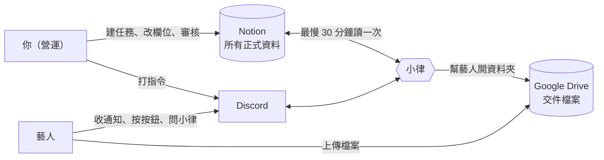
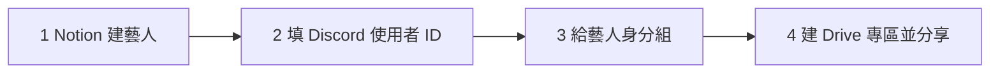
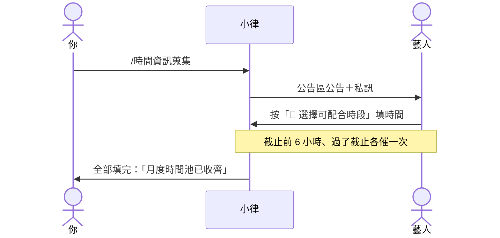
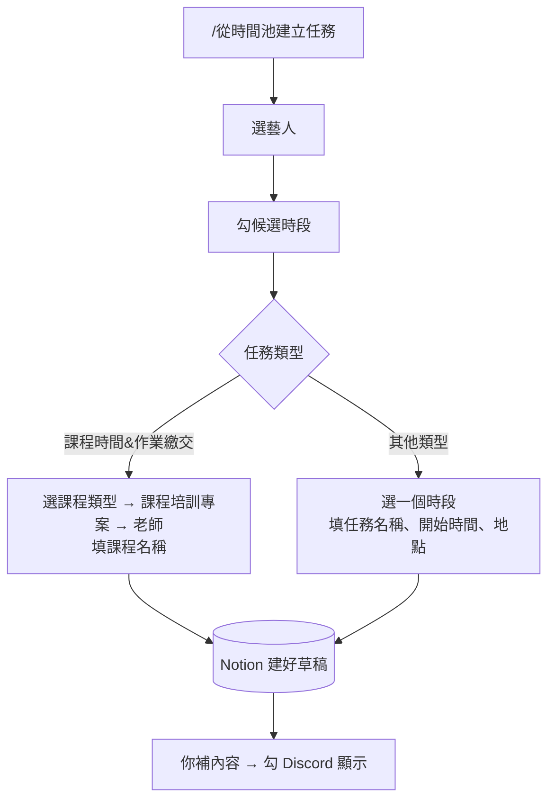
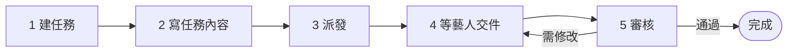
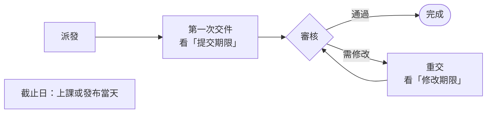
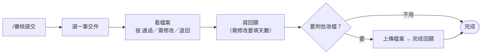
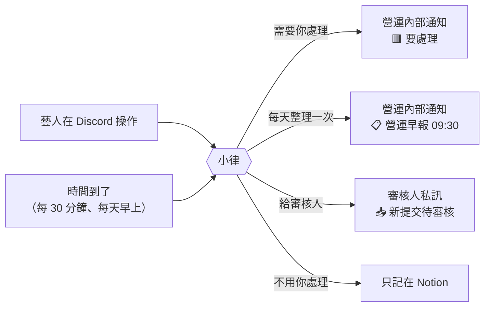

# 營運操作 SOP

<!-- 這個檔案由 scripts/build_sop.py 從 docs/sop/ops/ 產生，不要直接改；改分頁後重新執行。 -->

LURASUPA 營運的操作手冊：每一篇講一件事，照「我想做什麼」編排，一步一個動作。藝人看到的是什麼，見 [藝人 SOP](ARTIST_SOP.md)；系統內部怎麼運作，見 [工程版](ENGINEERING_SOP.md)。

## 目錄

- [系統怎麼運作](#系統怎麼運作)：Notion、小律、Discord、Google Drive 各做什麼；六個頻道；幾條一定要記得的原則
- [新藝人上線](#新藝人上線)：新藝人要在 Notion、Discord、Google Drive 各設好什麼，才收得到通知、交得了作業
- [新同仁、老師、審核人上線](#新同仁老師審核人上線)：讓同仁收到任務知會、讓老師和審核人收到審核通知，要設好什麼
- [發起每月時間收集](#發起每月時間收集)：請藝人回報下個月可以配合的時間，系統會公告、私訊、催填，收齊後通知你
- [取消時間收集](#取消時間收集)：時間收集發錯了，停掉催填；藝人已經填的時段會保留
- [查共同空檔](#查共同空檔)：只看幾位藝人在某個月有哪些共同空檔，不建任何東西
- [從時間池建立任務草稿](#從時間池建立任務草稿)：從藝人回報的共同空檔挑時間，一路選到底，在 Notion 建一筆還不會通知藝人的草稿
- [派一筆任務給藝人](#派一筆任務給藝人)：通告、演出、發文、出席這類不用交檔案的任務：在 Notion 建好，勾一下就發給藝人
- [派一筆要交作業的任務](#派一筆要交作業的任務)：從建任務、藝人收到、交件，到你審核通過，一次走完
- [寫任務內容](#寫任務內容)：任務頁面的內文就是藝人看到的任務說明：怎麼寫、哪些看得到、哪些看不到
- [改了任務內容，重新通知藝人](#改了任務內容重新通知藝人)：任務發出後改了時間或內容，用指令重送一筆，或在 Notion 一次勾很多筆
- [延期](#延期)：任務要延後：改哪個日期欄位、已逾期的任務怎麼處理、三個日期欄位的差別
- [結案、封存](#結案封存)：任務做完了怎麼結案、不做了怎麼封存；哪些系統會自動結案、哪些要你來
- [在 Discord 審核作業](#在-discord-審核作業)：用 /審核提交 審一份交件：選結果、寫回饋、給修改期限、附批改檔
- [在 Notion 審核作業](#在-notion-審核作業)：不用 Discord 指令，直接在 Notion 的提交頁面審核；老師、同仁都可以
- [交件的檔案存在哪裡](#交件的檔案存在哪裡)：藝人交件和老師批改檔放在 Drive 哪裡、資料夾怎麼命名、要注意的分享權限
- [看營運早報](#看營運早報)：每天 09:30 一則，列出今天要你處理的事；每一區怎麼看、怎麼處理
- [看到這則通知，我要做什麼](#看到這則通知我要做什麼)：藝人做了什麼、系統發了什麼通知，你各要怎麼處理
- [處理藝人回報的問題](#處理藝人回報的問題)：藝人按了「有問題・無法配合」：看原因、改任務、重新發出，回頻道按已處理
- [隨時看所有人的進度](#隨時看所有人的進度)：用 /任務總覽 一次看全部還沒結案的任務，依急迫程度分區
- [發布公告](#發布公告)：在 Notion 布告欄新增一筆，5 分鐘內同步到 Discord 公告區
- [處理藝人的使用回饋](#處理藝人的使用回饋)：藝人對公告或小律的回答按「回報」，會記在 Notion 布告欄，要定期去看
- [本月排程](#本月排程)：公告區固定一則「本月排程」，列出這個月的通告和演出，系統自動更新
- [小律會回答藝人什麼](#小律會回答藝人什麼)：藝人問小律時看得到哪些任務資料、哪些話是 AI 寫的、怎麼調整小律的語氣
- [初始化 Discord 伺服器](#初始化-discord-伺服器)：第一次架伺服器，或頻道權限被改亂時，一鍵建立或對齊六個頻道與兩個身分組
- [時間與期限一覽](#時間與期限一覽)：系統每天幾點做什麼、自動通知的時機、各種操作畫面多久會失效
- [指令一覽](#指令一覽)：所有 Discord 指令：在哪裡打、做什麼、會不會改 Notion
- [出問題怎麼查](#出問題怎麼查)：依症狀找原因：收不到通知、交不了件、審核沒通知、排課找不到人、指令不能用

---

## 系統怎麼運作

整套系統有三個地方，中間由 Discord 上的機器人「小律」串起來。你在 Notion 建任務、改欄位；小律把結果通知藝人，藝人在 Discord 回應、在 Drive 交檔案。



| 地方 | 用來做什麼 | 誰會用 |
|---|---|---|
| **Notion** | 任務、專案、藝人、交件紀錄的正式資料。有衝突時**以 Notion 為準** | 營運、審核人。**藝人不會進 Notion** |
| **Discord** | 收通知、按按鈕、交件、問小律、打管理指令 | 所有人 |
| **Google Drive** | 藝人交的檔案、老師的批改檔 | 營運、藝人（只看得到自己的資料夾） |

> 💡 **記住這一句**：你在 Notion 改的東西，小律最慢 30 分鐘內會照著做；你在 Discord 打的指令，小律馬上做。

### 六個頻道

| 頻道 | 誰看得到 | 做什麼 |
|---|---|---|
| `營運操作` | 營運 | 打管理指令。**管理指令只能在這裡打** |
| `營運內部通知` | 營運 | 小律發給你的通知：營運早報、🟥 要處理、系統警告 |
| `公告區` | 所有人（只能看） | 公告、時間收集、通告與演出、本月排程 |
| `時間管理` | 藝人 | 回報每個月可配合的時間 |
| `任務查詢入口` | 藝人 | 查任務、交作業 |
| `課程助教` | 藝人 | 問小律、跟小律聊天 |

誰看得到哪些頻道，由 Discord 身分組決定：有 `控方` 身分組的人看得到營運的兩個頻道，有 `藝人` 身分組的人看得到藝人的四個頻道。

### 一定要記得的原則

- **藝人拿不到 Notion 連結**。從任何一個 Notion 頁面都能往上翻到整個資料庫，看到別人的資料，所以小律給藝人的訊息從不附 Notion 連結。
- **任務頁面的內文，藝人會整頁看到**。內部備註請放在子頁面。
- **藝人回報的「可配合時間」不是正式行程**。正式安排一律是 Notion 的任務。
- **不要改 Notion 欄位的名稱、不要刪欄位**。小律是照名稱找欄位的，改了就讀不到。新增資料、新增選項都沒問題。
- **不要刪 Notion 頁面**，用「已封存」。
- **TimeTree 不會自動同步**。任務發出後自己補登；兩邊不一樣時以 Notion 為準。

### 下一步

- 「新藝人上線」
- 「派一筆任務給藝人」

---

## 新藝人上線

> 💡 **誰可以做**：能編輯 Notion「Artists」、能管理 Discord 身分組、能在公司 Drive 建資料夾的人。
>
> **大約要多久**：10 分鐘。

小律靠 Notion 上的 Discord 使用者 ID 認人。下面四步**系統都不會幫你做**，少一步藝人就會卡住。



### 1. 在 Notion 建藝人

1. 打開 Notion 的 **Artists**，按 **New**。
2. **藝人名稱**：小律會用這個名字叫藝人，例如「方晨同學」。
3. **合約狀態**：選目前的狀態。選 **未簽**、**暫停**、**封存** 的藝人，不會被算進每月時間收集，也不能用小律。

### 2. 填 Discord 使用者 ID

1. 請藝人加入公司的 Discord 伺服器。
2. 在你的 Discord：**使用者設定 → 進階 → 打開「開發者模式」**。
3. 在藝人的名字上按右鍵 → **複製使用者 ID**。這是一串 17～19 位的數字，不是帳號名稱。
4. 貼到 Notion 那位藝人的 **Discord User ID**。

> ⚠️ ID 貼錯人，小律會把這位藝人的任務私訊給別人。貼完請再核對一次。

### 3. 給藝人身分組

1. Discord **伺服器設定 → 成員**，找到藝人。
2. 加上 **藝人** 身分組。

加完後，藝人就看得到 `時間管理`、`任務查詢入口`、`課程助教`、`公告區`。

### 4. 建 Drive 專區並分享給藝人

1. 在公司 Drive 的總資料夾裡，建一個以藝人名稱命名的資料夾。
2. 按 **共用**，加入藝人的 Google 帳號，權限選 **編輯者**。
3. 複製資料夾連結，貼到 Notion 那位藝人的 **Google Drive 資料夾**。

之後藝人每次交件，小律都會在這個資料夾底下自動開新資料夾（見「交件的檔案存在哪裡」）。

> ⚠️ **小律不會幫資料夾設定分享**。沒分享的話，藝人點開交件連結會被拒絕。

### 怎麼確認成功

請藝人到 `任務查詢入口` 打 `/我的任務`：
- 出現他的任務清單，或「🎉 目前沒有進行中的任務。」→ 成功
- 出現「❌ 找不到你的藝人資料」→ Discord User ID 沒填對

### 常見問題

| 狀況 | 怎麼做 |
|---|---|
| 藝人說看不到頻道 | 沒給 **藝人** 身分組 |
| 藝人說收不到任何通知 | Discord User ID 沒填、填成帳號名稱，或多了空白。重新複製貼上 |
| 藝人打不開交件資料夾 | Drive 專區沒分享給他，或他登入的是別的 Google 帳號 |
| 時間收集沒有找他 | 合約狀態是未簽、暫停或封存 |
| 藝人改名了 | Notion 的藝人名稱可以改；只要 Google Drive 資料夾有填，交件資料夾不受影響 |

### 下一步

- 「新同仁、老師、審核人上線」
- 「派一筆任務給藝人」

---

## 新同仁、老師、審核人上線

> 💡 **誰可以做**：能編輯 Notion「People」、能管理 Discord 身分組的人。

### 1. 在 Notion 建人員

1. 打開 Notion 的 **People**，按 **New**。
2. **姓名 / 名稱**：填名字。
3. **身份類型**：
   - 公司同仁選 **公司成員**
   - 老師選 **老師**

   只有這兩種人，可以被選為審核人員、負責老師。
4. **Discord User ID**：照「新藝人上線」第 2 步的方法複製貼上。

> ⚠️ **沒填 Discord User ID 的人，什麼通知都收不到，系統也不會提醒你。**

### 2. 要操作系統的人：給 `控方` 身分組

會打管理指令的人（例如用 `/審核提交` 審核、用 `/任務通知重送`），要在 Discord 加上 **控方** 身分組。加完就看得到 `營運操作`、`營運內部通知`。

只收通知、不操作的人（例如只是知會的同仁、只在 Notion 審核的老師）**不用**給身分組，通知都是私訊。

### 他們會收到什麼

| 在任務上被填在 | 會收到 |
|---|---|
| **相關同仁** | 任務派發時一則知會「👥 同仁知會」；每天 09:00 一則同仁早報（只列已逾期、需修改、快到期的）。沒有按鈕 |
| **審核人員** | 藝人交件時「📥 新提交待審核」；超過 24 小時沒審，每天 10:00 再提醒一次 |
| **負責老師**（課程任務） | 課程結束 2 小時後「📝 課後提醒」，請老師到論壇發布作業與評語；之後每天 10:00 一次，最多 7 天 |

### 常見問題

| 狀況 | 怎麼做 |
|---|---|
| 審核人沒收到交件通知 | People 沒填 Discord User ID，或身份類型不是公司成員／老師。那筆交件會改發到 `營運內部通知` |
| 排課時選不到這位老師 | 身份類型不是老師或公司成員 |
| 同仁說沒收到知會 | 沒填 Discord User ID。補上後，用 `/任務通知重送` 重送那筆任務 |

### 下一步

- 「派一筆要交作業的任務」

---

## 發起每月時間收集

> 💡 **誰可以做**：有 `控方` 身分組的人。
>
> **建議時間**：每月固定一天，例如 25 號前收集下個月。



### 開始前

- [ ] 要收集的藝人，在 Notion「Artists」都有 **Discord User ID**，合約狀態不是未簽、暫停、封存

### 步驟

1. 到 `營運操作` 頻道，打 **`/時間資訊蒐集`**。
2. 填三個欄位：
   - **月份**：要收集哪個月，格式像 `2026-11`
   - **截止天數**：幾天內要填完，預設 1 天（24 小時）
   - **說明**（選填）：例如「請優先填週末」
3. 送出。看到「✅ 已建立 **2026-11** 月度可配合時段收集。」就完成了。

> 💡 如果出現「⚠️ DM 未送達：…」，那幾位藝人關了私訊。請私下提醒他們到 `公告區` 按按鈕填。

### 接下來會發生什麼

| 時間 | 誰收到什麼 |
|---|---|
| 馬上 | `公告區` 出現「📅 2026-11 可配合時間回報」，標記所有藝人，下面有 **📅 選擇可配合時段** 按鈕；每位藝人也收到一則私訊 |
| 截止前 6 小時 | 還沒填的藝人收到「⏰ 2026-11 月度可配合時段即將截止」 |
| 過了截止 | 還沒填的藝人收到「🔴 2026-11 月度可配合時段已截止，你還沒有完成回填」 |
| 每天 09:30 | 營運早報的「🗓 時間池」寫出：已填幾位、誰還沒填、截止時間 |
| 全部填完 | `營運內部通知` 收到「✅ 2026-11 月度時間池已收齊」 |
| 截止 12 小時還沒排課 | `營運內部通知` 收到「⏰ 2026-11 時間池已截止超過半天」 |

藝人怎麼填，見藝人版的「回報下個月可配合時間」。

> 💡 系統只催兩次，避免打擾藝人。截止天數設得長的話，中間不會再提醒，需要時請自己在群組提醒。

### 你下一步

收齊後，用「從時間池建立任務草稿」排課。

### 常見問題

| 狀況 | 怎麼做 |
|---|---|
| 有藝人沒填 | 請他到 `公告區` 按 **📅 選擇可配合時段**，或到 `時間管理` 打 `/管理可配合時間` 補。**不用重發公告** |
| 發錯月份或日期 | 見「取消時間收集」 |
| 系統說可排課藝人 0 位 | 藝人都沒有 Discord User ID，或合約狀態都是未簽、暫停、封存 |

---

## 取消時間收集

> 💡 **誰可以做**：有 `控方` 身分組的人。

### 步驟

1. 到 `營運操作` 打 **`/取消時間蒐集`**。
2. 從 **選擇要取消的收集…** 選要取消的那一筆。每一筆會寫月份、截止時間、已填幾位。
3. 按 **🛑 確認取消收集**。不想取消就按 **✖️ 取消**。
4. 看到「🛑 已取消 2026-11 的時段收集」就完成了。

### 接下來會發生什麼

- 不會再催藝人填，也不會再有排課時效提醒
- **藝人已經填的時段會保留**，之後排課照樣用得到
- **已經發出去的公告和私訊收不回來**

### 你下一步

1. 到 `公告區` 刪掉那則公告。
2. 在群組跟藝人說一聲。
3. 需要的話，用「發起每月時間收集」重新發一次。

> 💡 全部填完、或已經過了截止的收集，系統會自己結束，不用取消。

---

## 查共同空檔

只想看看有沒有空檔，還沒要排。這個指令**不會改 Notion 任何東西**。

> 💡 **誰可以做**：有 `控方` 身分組的人。

### 步驟

1. 到 `營運操作` 打 **`/時間交集查詢`**。
2. 填 **月份**（例如 `2026-11`）和 **時長分鐘**（例如 `120` 代表 2 小時）。
3. 從 **選擇要查詢交集的藝人（可多選）…** 勾要比對的藝人。
4. 小律列出共同空檔，依日期分組：

```discord
2026-11 時間池比對｜需要 2 小時
比對藝人：方晨、SOMA
已填月度時段：2/2 位

11/4（三）
・13:30–15:30
・14:00–16:00
```

5. 空檔很多時會分頁：用 **上一頁**、**下一頁**，或從 **跳到指定頁…** 直接選日期範圍。
6. 想直接排，按 **📝 直接建立任務**，接著照「從時間池建立任務草稿」第 4 步以後做。看完就按 **✖️ 關閉**。

### 空檔怎麼算

- 依你填的時長切好，起點每 30 分鐘一個，例如 `13:30–15:30`、`14:00–16:00`
- 會扣掉藝人已經有的正式行程：錄音、演出、會議溝通，以及有填課程類別的課。作業、企劃、行政這類不擋時間
- 還沒派發的草稿也算佔用，不會把同一段時間推給你兩次

### 常見問題

| 狀況 | 怎麼做 |
|---|---|
| 「目前沒有符合條件的共同空檔」 | 縮短時長、少選幾位藝人，或請藝人補時段 |
| 寫「⚠️ 未填：某某」 | 那位藝人這個月還沒回報時間 |
| 藝人超過 25 位 | 選單只列前 25 位，分兩次查 |

---

## 從時間池建立任務草稿

> 💡 **誰可以做**：有 `控方` 身分組的人。
>
> **建好的是草稿**：藝人**不會**收到通知，要你補完內容、勾「Discord 顯示」才會發出。



### 開始前

- [ ] 這個月的時間收集已經收齊（見「發起每月時間收集」）
- [ ] 排課程的話：Notion 有一筆專案類型是 **課程培訓** 的專案；老師在 People 的身份類型是 **老師** 或 **公司成員**

### 步驟

1. 到 `營運操作` 打 **`/從時間池建立任務`**，填 **月份** 和 **時長分鐘**。
2. 從 **選擇要比對的藝人（可多選）…** 勾藝人。小律會先整理藝人的時段（合併重疊、清掉重複），再列出共同空檔。
3. 從 **選擇候選時段…** 勾想排的時段，可以翻頁勾。勾好按 **確認候選時段**。要換藝人就按 **↩️ 返回藝人選擇**。
4. 從 **選擇 Notion 任務類型…** 選類型。選項跟 Notion 的「任務類型」同步。

**排課程**（選 **課程時間&作業繳交**）

5. 從 **選擇課程類型…** 選，例如歌唱課。
6. 從 **選擇課程培訓 Project…** 選這堂課屬於哪個專案。
7. 從 **選擇老師／確認對象…** 選老師。
8. 跳出 **課程安排設定**，填 **課程名稱**（例如「八月歌唱課｜Johnny Chenhua」），送出。

**排其他行程**（錄音、通告、會議…）

5. 從 **選擇候選時段…** 選定案的那一個時段。
6. 跳出 **建立安排 Task 草稿**，填：
   - **任務名稱**，例如「八月錄音安排」
   - **開始時間**：已經幫你填好，通常不用改
   - **地點／連結（選填）**
7. 送出。

每一層都可以回上一步：**↩️ 返回候選時段**、**↩️ 返回任務類型**、**↩️ 返回課程類型**、**↩️ 返回 Project**。**走到最後一步送出之前，什麼都不會建立。**

### 接下來會發生什麼

小律回你「✅ 已建立…」和一個 Notion 連結。Notion「Tasks」多了一筆草稿：

| 欄位 | 內容 |
|---|---|
| 任務名稱、任務類型、關聯藝人 | 你剛剛選的 |
| 任務狀態 | 尚未開始 |
| Discord 顯示、是否開放提交 | **都沒勾**（所以藝人收不到） |
| 開始日、截止日 | 排其他行程才有；**排課程的要自己填** |
| 頁面內文 | 安排來源、候選時段等資訊，**藝人看不到** |

### 你下一步

1. 點連結打開這筆任務。
2. 排課程的：填 **開始日**、**截止日**（上課時間）。
3. 在頁面內文**另起一行**寫給藝人看的內容（見「寫任務內容」）。系統寫的那段藝人看不到，不寫的話藝人會收到「尚未填寫任務說明」。
4. 勾 **Discord 顯示** 發出去（見「派一筆任務給藝人」）。
5. 自己補登 TimeTree。

> ⚠️ **談定就盡快派發**。藝人填時間時看不到草稿，可能把同一段時間又回報成「可以配合」。

### 常見問題

| 狀況 | 怎麼做 |
|---|---|
| 選不到老師 | 老師在 People 的身份類型不是老師或公司成員 |
| 選不到課程專案 | 沒有專案類型是課程培訓、而且還沒結案的專案 |
| 「❌ 此時間超出候選窗」 | 開始時間改成預設那個 |
| 收到「🔴 排課流程已超過 48 小時」 | 草稿建了很久還沒派發。派發後就不會再提醒 |

---

## 派一筆任務給藝人

這篇講**不用交檔案**的任務，例如通告、演出、發文、會議。要交作業的，見「派一筆要交作業的任務」。

> 💡 **誰可以做**：能編輯 Notion「Tasks」的人。
>
> **大約要多久**：5 分鐘。藝人最慢 30 分鐘內收到。

### 開始前

- [ ] 藝人已經上線（見「新藝人上線」）
- [ ] 有上層企劃的，Notion「Projects」已經有那個專案

### 1. 建任務

1. 打開 Notion 的 **Tasks**，按 **New**。
2. **任務名稱**：藝人看到的標題，例如「10/31 發布：萬聖節短影音」。
3. **任務類型**：選最接近的類型。
   - 選 **通告** 或 **演出**，除了私訊藝人，也會貼到 `公告區`，列進本月排程
   - 選 **錄音**、**演出**、**會議溝通**，會佔掉藝人的時間，排課時不會再排到這段
4. **關聯藝人**：要去做這件事的藝人。
5. **開始日**／**截止日**：這件事的時間，也是提醒和逾期的依據。
6. **相關同仁**（選填）：只需要知道這件事的老師或同仁。他們會收到知會，但沒有按鈕。
7. **關聯專案**（選填）：屬於哪個專案。
8. **提醒規則**（選填）：不勾也會在截止前 5 天、3 天提醒；勾了是**額外再加**提醒（3 天前、1 天前、當天）。

### 2. 寫任務內容

點進任務，在頁面內文寫清楚要做什麼（見「寫任務內容」）。

### 3. 發出去

勾 **Discord 顯示**。

### 接下來會發生什麼

最慢 30 分鐘內：

- **藝人**收到私訊：

```discord
📌 方晨同學，有一筆新任務來囉！
任務：10/31 發布：萬聖節短影音
類型：發布上架
截止：10/31

任務內容
拍 15 秒短影音，10/31 晚上 8 點發在 IG。

看完沒問題就按「收到任務」，小律會幫你告訴公司；不行的話按「有問題・無法配合」跟小律說。
[收到任務] [有問題・無法配合]
```

- **相關同仁**收到「👥 同仁知會：你是這個任務的相關同仁，這則僅供通知，不需要按收到。」
- 類型是通告或演出的，`公告區` 出現「📢 通告公告」
- 同一位藝人這一輪有好幾筆，會合併成一則「📌 任務通知（N）」

| 藝人的反應 | 你會看到 | 你要做什麼 |
|---|---|---|
| 按 **收到任務** | 任務狀態變成「進行中」 | 不用做事 |
| 按 **有問題・無法配合** | `營運內部通知`：「🟥 要處理｜藝人回報任務問題」 | 見「處理藝人回報的問題」 |
| 一直沒按 | 隔天早報會先請他確認；3 天後營運早報列出 | 私下聯絡，或重送 |

### 你下一步

這類任務藝人做完，系統不會知道。過了截止日，營運早報會列在「⏳ 已過截止，等你確認結案」，請照「延期」或「結案、封存」處理。

### 常見問題

| 狀況 | 怎麼做 |
|---|---|
| 藝人說沒收到 | 確認 **Discord 顯示** 有勾、**關聯藝人** 有他、他在 Artists 有 Discord User ID |
| 營運內部通知：「🟥 任務通知送不出去」 | 關聯藝人和相關同仁都沒有 Discord User ID。補上後勾 **重送通知** |
| 營運內部通知：「🟥 有藝人收不到任務」 | 訊息裡那幾位藝人沒有 Discord User ID。補上後 30 分鐘內會自動補發給他們，其他人不會重收 |
| 發出去才發現寫錯 | 見「改了任務內容，重新通知藝人」 |

---

## 派一筆要交作業的任務

> 💡 **誰可以做**：能編輯 Notion「Tasks」的人。在 Discord 用 `/審核提交` 審核，要有 `控方` 身分組；沒有的話一樣可以在 Notion 審核。
>
> **大約要多久**：建任務 5 分鐘。藝人最慢 30 分鐘內收到通知。



### 開始前

- [ ] 藝人在 Notion「Artists」有填 **Discord User ID**
- [ ] 藝人的 Drive 專區已經**分享給藝人**（見「新藝人上線」）
- [ ] 審核人在 Notion「People」有填 **Discord User ID**

### 1. 在 Notion 建任務

1. 打開 Notion 的 **Tasks**，按 **New** 新增一筆。
2. **任務名稱**：藝人會看到的標題，例如「11/5 編曲作業：仿作一首」。
3. **任務類型**：選最接近的類型。課程請選 **課程時間&作業繳交**。
4. **關聯藝人**：選要交作業的藝人（可以多選）。
5. **截止日**：事情發生的那天，例如上課日。
6. **提交期限**：藝人最晚哪天要交。
7. **審核人員**：選誰來審。老師、公司同仁都可以。
8. **關聯專案**：選這個任務屬於哪個專案。交件的檔案會放在這個專案的 Drive 資料夾。

> ⚠️ 作業期限填在「提交期限」，**不要填在「截止日」**。截止日是上課或發布那天，提醒會照錯的日子發。

### 2. 寫任務內容

1. 點進任務，在頁面內文直接寫作業要求。
2. 寫清楚四件事：**做什麼、做多少、交什麼格式、什麼時候交**。

```notion
仿作 Tom Misch〈Movie〉前 16 小節。
交 WAV 檔＋專案檔，檔名寫自己的名字。
11/3 前交。
```

> 💡 這一頁**藝人會整頁看到**。內部備註請放在子頁面裡，子頁面藝人看不到。

### 3. 派發給藝人

1. 回到任務欄位，勾 **Discord 顯示**。
2. 作業現在就能交的話，**是否開放提交**也一起勾。要等上完課才開放的，先只勾 Discord 顯示，之後再回來勾。

**接下來會發生什麼**：最慢 30 分鐘內，藝人會收到小律的私訊。

```discord
📚 方晨同學，作業開放囉，可以開始交了！
任務：11/5 編曲作業：仿作一首
截止：11/03

作業要求
仿作 Tom Misch〈Movie〉前 16 小節。…
[收到任務] [有問題・無法配合]
```

藝人按 **收到任務** 之後，Notion 上的「任務狀態」會變成「進行中」，你不用做任何事。

| 藝人的反應 | 你會看到 | 你要做什麼 |
|---|---|---|
| 按「收到任務」 | 「任務狀態」變成「進行中」 | 不用做事 |
| 按「有問題・無法配合」 | 營運內部通知出現 `🟥 要處理｜藝人回報任務問題` | 見「處理藝人回報的問題」 |
| 3 天都沒按 | 營運早報出現「📌 藝人還沒按收到超過 3 天」 | 私下聯絡藝人，或重送通知 |

### 4. 等藝人交件

藝人會在 Discord 打 `/我的任務` → **提交任務**，把檔案傳到小律給的 Drive 資料夾。

**藝人交件後**：
- Notion 上的「任務狀態」變成「待審核」
- 審核人收到小律的私訊：

```discord
📥 新提交待審核（Drive 資料夾）
任務：11/5 編曲作業：仿作一首｜方晨｜2 個檔案（12.4MB）
Drive：（這次交件的資料夾）
Notion：（這筆提交的頁面）

怎麼審（擇一）
・Notion：打開上面的提交頁，先在 審核回饋 寫幾句，再把 審核狀態 改成「通過」或「需修改」。
・Discord：到 營運操作 頻道打 /審核提交，選這筆提交，按「通過」或「需修改」，再填回饋。
```

> 💡 沒填審核人員，或審核人沒有 Discord ID 的話，這則改發到營運內部通知，標成 🟥 要處理。

### 5. 審核

兩種方式結果一樣，選順手的用。

**在 Notion 審**
1. 點私訊裡的 Notion 連結，打開這筆提交。
2. 在 **審核回饋** 寫給藝人的話。
3. 把 **審核狀態** 改成 **通過** 或 **需修改**。
4. 1 分鐘內，藝人會收到結果。

> ⚠️ **先寫回饋，再改狀態**。只改狀態、不寫回饋的話，藝人不會收到通知。

**在 Discord 審**
1. 到 `營運操作` 頻道打 `/審核提交`。
2. 從 **選擇要審核的提交…** 選這一筆。
3. 點 Drive 連結看過檔案，按 **通過**、**需修改** 或 **退回**。
4. 填 **給藝人的回饋**。選需修改的話，再填 **修改期限**（1～7 天）。
5. 送出後，問你要不要附批改檔：不用就按 **不需補批改檔**；要附就按 **附批改檔**，把檔案上傳到同一個頻道，再按 **完成回饋**。

**接下來會發生什麼**

| 結果 | 藝人收到 | Notion 上 |
|---|---|---|
| 通過 | 「🎉 方晨同學，「11/5 編曲作業：仿作一首」通過了！」 | 任務狀態變「已完成」 |
| 需修改 | 「🛠 …公司給了一些修改建議」＋修改期限 | 任務狀態變「需修改」。在 Notion 審、沒填修改期限的話，系統自動給 3 天 |

藝人改好重交後，會回到第 4 步。

### 常見問題

| 狀況 | 怎麼做 |
|---|---|
| 藝人說沒收到通知 | 確認「Discord 顯示」有勾、「關聯藝人」有他、他在 Artists 有 Discord User ID。都有的話打 `/任務通知重送` |
| 藝人說提交清單裡沒有這筆 | 「是否開放提交」還沒勾，或任務已經是「待審核」「已完成」 |
| 藝人打不開 Drive 資料夾 | 他的 Drive 專區沒有分享給他。到 Drive 分享（編輯者） |
| 改了審核狀態，藝人沒收到 | 「審核回饋」沒寫。補寫後 1 分鐘內會發出 |
| 任務發出去後內容要改 | 先改 Notion，再打 `/任務通知重送`（見「改了任務內容，重新通知藝人」） |

### 下一步

- 「處理藝人回報的問題」
- 「改了任務內容，重新通知藝人」
- 「在 Discord 審核作業」
- 「延期」

---

## 寫任務內容

藝人拿不到 Notion 連結，**任務頁面的內文就是他唯一看得到的任務說明**。派發卡、截止前提醒、早報的「看任務內容」、小律回答問題，讀的都是這一頁。

### 步驟

1. 點進任務，在頁面內文直接寫，不用加標題。
2. 寫清楚四件事：**做什麼、做多少、交什麼格式、什麼時候交**。
3. 重點寫在最前面。太長會被截斷：派發卡約 900 字、小律和「看任務內容」約 1,500 字。

```notion
聽力訓練：50 題音程、20 題三和弦，做完截圖。
歌唱課：用老師教的換氣技巧練〈小幸運〉副歌，錄一段影片。
10/25 前交。
```

### 藝人看得到、看不到

| 看得到 | 看不到 |
|---|---|
| 一般段落、標題、條列、待辦清單、引用、提示框 | **子頁面**：內部備註、報價、參考資料請放這裡 |
| 切換清單和分欄裡面的文字 | **圖片、檔案、PDF**：要給檔案，請貼 Drive 連結 |
| 表格（每列會變成「欄｜欄」） | **Notion 連結**：會被自動拿掉 |
| Drive、YouTube 等網址 | 系統寫的「藝人回覆」「Drive 資料夾索引」兩段 |
|  | 時間池草稿的系統資訊：安排來源、課程類別、負責老師、需要時長、候選時段、「此為營運草稿」、還沒填的「地點／連結：待補」 |

> ⚠️ 開頭是「安排來源：」「課程類別：」「負責老師：」「需要時長：」這種格式的行，系統會當成內部資訊濾掉。要交代這類事情，請寫成一句話，例如「這週改由 B 老師上課」。

> ⚠️ **時間只看欄位**。內文寫的時間不會被當成正式時間，改時間請改「開始日」「截止日」。

### 時間池建的課程任務一定要補一段

從時間池建的課程任務，內文長這樣，**藝人一行都看不到**：

```notion
安排來源：/從時間池建立任務
課程類別：舞蹈課
負責老師：lurasupa
需要時長：2 小時
候選時段（由營運最後確認）：
2026-09-17 19:30~21:30
```

在下面另起一行寫給藝人的內容，上面那段不用刪：

```notion
這週練上次那支編舞的後半段，記得帶練習服。
```

### 已經發出去才改內容

改內文**不會**更新已經發出去的私訊。要藝人看到新版本，見「改了任務內容，重新通知藝人」。早報和小律下次讀到的就是新內容。

### 常見問題

| 狀況 | 怎麼做 |
|---|---|
| 藝人收到「Notion 尚未填寫任務說明」 | 內文是空的、只有子頁面或圖片，或全部是會被濾掉的行。補一段文字後重送 |
| 藝人看到不該看的內容 | 移到子頁面，再重送。**已經送出的私訊收不回來** |
| 小律回答細節說「請問公司」 | 內文沒寫那個細節。補上後藝人再問就會有 |

---

## 改了任務內容，重新通知藝人

已經發出去的私訊**不會自己更新**。改完 Notion 後要重送，藝人才會看到新版本。

> 💡 **誰可以做**：重送一筆要有 `控方` 身分組；一次重送很多筆，只要能編輯 Notion。

### 開始前

**一定先改 Notion，再重送。** 重送的內容是當下從 Notion 讀的。

- 改時間：改「開始日」「截止日」「提交期限」欄位（只改內文寫的時間沒用）
- 改內容：改頁面內文

### 重送一筆（馬上送出）

1. 到 `營運操作` 打 **`/任務通知重送`**。任務很多時，加上關鍵字縮小範圍，例如 `/任務通知重送 關鍵字:編曲`。
2. 從 **選擇要重新通知的任務…** 選那一筆。每一筆會標：
   - **⏳ 未確認**：藝人還沒按收到
   - **✅ 已確認**：藝人按過了，一樣可以重送
3. 按 **✅ 確認重送**。不送了就按 **✖️ 取消**。
4. 看到「✅ 已重新通知：…（N 位藝人）」就完成了。

### 一次重送很多筆（最慢 30 分鐘）

1. 在 Notion「Tasks」把要重送的任務勾 **重送通知**（可以一次勾很多筆）。
2. 最慢 30 分鐘內，小律會一起重送，並**自動取消勾選**。
3. `營運內部通知` 會收到一則「🔁 批次重送結果」，每一筆寫 ✅ 已重送、⏭️ 略過或 ❌ 失敗。

### 接下來會發生什麼

- 藝人收到新的任務卡，**舊的那張會被刪掉**，私訊裡只留最新版
- 同一位藝人重送好幾筆，會合併成一則
- 藝人要**再按一次「收到任務」**。內容變了，舊的確認不算數
- 通告、演出**不會**在公告區重貼一次；本月排程會自己更新

### 常見問題

| 狀況 | 怎麼做 |
|---|---|
| 清單裡找不到那一筆 | 「Discord 顯示」沒勾，或任務已經結案 |
| 選單說「僅列出前 25 筆」 | 加關鍵字縮小範圍 |
| 藝人退回的任務改好了 | 不用重送，**重新勾「Discord 顯示」**就會重新派發 |
| 批次結果出現 ⏭️ 略過 | 那筆沒勾「Discord 顯示」或已經結案 |

> 💡 不建議用「取消勾 Discord 顯示、再勾回來」的方式重送：要等 30 分鐘才生效，中間藝人在 `/我的任務` 也看不到這筆。

---

## 延期

> 💡 **誰可以做**：能編輯 Notion「Tasks」的人。

### 先分清楚三個日期

| 欄位 | 是什麼 | 誰填 |
|---|---|---|
| **截止日** | 事情發生的那天：上課日、發布日、演出日 | 你 |
| **提交期限** | 第一次交件的期限 | 你 |
| **修改期限** | 審核退回後，重交的期限 | 審核時決定（Discord 選 1～7 天；Notion 沒填就自動給 3 天） |



### 要延哪一個

| 任務現在的狀態 | 要改的欄位 |
|---|---|
| 要交作業、還沒交 | **提交期限** |
| 不用交作業（通告、發文、出席…） | **截止日** |
| 需修改（審核退回了） | **修改期限** |

### 步驟

1. 打開那筆任務，改上表對應的日期欄位。
2. 如果任務狀態是 **已逾期**，**把任務狀態改回「進行中」**。
3. 要讓藝人收到新日期，用 `/任務通知重送` 重送（見「改了任務內容，重新通知藝人」）。不重送的話，藝人會在隔天的早報看到新日期。

> ⚠️ 第 1、2 步**兩個都要做**：只改狀態不延期，30 分鐘內又會被改回「已逾期」；只延期不改狀態，任務會一直停在「已逾期」。

### 接下來會發生什麼

- 截止前 5 天、3 天的提醒，會照新日期重新算
- 隔天的營運早報不會再列這筆逾期

### 「提前交件」是什麼

要先給公司審、再對外發布的任務（影片、貼文、企劃），可以勾 **提前交件**：

- 沒填提交期限 → 交件期限自動是 **截止日前 5 天**
- 有填提交期限 → 用你填的

藝人看到的會是「交件 9/25」，不是「截止 9/30」。9/25 沒交，9/26 就算逾期。發布日當天系統不會再提醒，發布請自己盯。**上課、通告不要勾。**

### 常見問題

| 狀況 | 怎麼做 |
|---|---|
| 改回進行中，又變成已逾期 | 期限沒延。先延期限，再改狀態 |
| 提醒在錯的日子發 | 作業期限填在「截止日」了。作業期限請填「提交期限」 |
| 填了提交期限但沒用 | 「提前交件」和「是否開放提交」都沒勾的話，系統只看截止日。勾其中一個 |

---

## 結案、封存

> 💡 **誰可以做**：能編輯 Notion「Tasks」的人。

### 什麼時候要你結案

| 任務 | 誰結案 |
|---|---|
| 要交作業的任務 | 審核通過時**系統自動**改成「已完成」，你不用做 |
| 不用交作業的任務（通告、出席、行政…） | **你**。過了截止日，營運早報會列在「⏳ 已過截止，等你確認結案」 |
| 發文任務 | 審核通過後是「已完成」；確認真的發布了，**你**改成「已完成發文」 |
| 課程任務 | **你**。確認老師已經在論壇發布作業與評語後改成「已完成」。系統只會催老師，不會自己判斷 |

### 步驟

1. 打開那筆任務。
2. 把 **任務狀態** 改成：
   - 做完了 → **已完成**
   - 發文已經發布 → **已完成發文**
   - 不做了、取消了 → **已封存**

> ⚠️ **不要刪除任務頁面**，用「已封存」。刪了就查不到紀錄。

### 接下來會發生什麼

結案或封存後：
- 不再提醒，也不再出現在早報、`/我的任務`、小律的回答裡
- 「已完成」的通告、演出還會留在本月排程；「已封存」的會被拿掉

### 過了截止日、還不確定有沒有做完

營運早報的「⏳ 已過截止，等你確認結案」會每天列出來：

| 確認結果 | 怎麼改 | 之後 |
|---|---|---|
| 做完了 | 改「已完成」 | 不再列 |
| 沒做，希望他補 | 延後「截止日」（見「延期」） | 回到正常提醒 |
| 沒做，要正式記一筆 | 改「已逾期」 | 藝人早報列在「🔴 已經過期限」 |
| 還不確定 | 先不動 | 每天繼續列 |

不用交件的任務，系統**不會**自動改成「已逾期」，因為它不知道藝人做完沒有。

---

## 在 Discord 審核作業

> 💡 **誰可以做**：有 `控方` 身分組的人。沒有的話請用「在 Notion 審核作業」，結果一樣。



### 步驟

1. 到 `營運操作` 打 **`/審核提交`**。
2. 從 **選擇要審核的提交…** 選一筆。清單只列還沒審、而且是最新一版的交件，最多 25 筆。
3. 小律列出這筆交件的 Drive 連結、Notion 頁面、關聯任務。**先點 Drive 連結看過檔案。**
4. 按 **通過**、**需修改** 或 **退回**。選錯了按 **↩️ 返回審核清單**。
5. 跳出審核視窗：
   - **給藝人的回饋（選填）**：例如「這次節奏很穩」或「請重修副歌音準」
   - **修改期限（天數，1～7）**：選需修改或退回時才有，必填
6. 送出。小律馬上私訊藝人結果，並問你要不要附批改檔。
7. 不用附就按 **不需補批改檔**，審核完成。

### 附批改檔

1. 按 **附批改檔**。
2. 在**同一個頻道**直接上傳批改檔，可以傳好幾個。每個檔案要在 **10MB 以下**。
3. 傳完按 **完成回饋**。

| 狀況 | 怎麼做 |
|---|---|
| 檔案超過 10MB | 先傳到小律給的「老師回饋」Drive 資料夾，再按 **貼 Drive 連結補回饋**，在 **Drive 批改檔或資料夾連結（必填）** 貼上連結，**補充回饋（選填）** 可以再寫一段 |
| 訊息不見了（切去 Drive 再回來時） | 3 小時內在同一個頻道隨便打一句話，例如「好了」，按鈕會再出現 |
| 想改成不附檔 | 按 **↩️ 返回回饋選擇** |
| 超過 3 小時 | 沒有 Discord 入口了。把 Drive 連結貼到那筆提交的「審核回饋」，並自己私訊藝人 |

只有原本審核的那個人能操作這些按鈕。

### 接下來會發生什麼

| 結果 | 藝人收到 | 任務狀態 |
|---|---|---|
| 通過 | 「🎉 方晨同學，「11/5 編曲作業」通過了！」＋回饋 | 已完成 |
| 需修改 | 「🛠 …公司給了一些修改建議」＋回饋＋「修改期限：10/29（四）」 | 需修改 |
| 退回 | 「↩️ …這次先退回了」＋回饋＋修改期限 | 需修改 |
| 附了批改檔 | 第二則「📎 老師補充了批改檔」，附連結 | 不變 |

批改檔會放在任務資料夾裡的「老師回饋」資料夾（見「交件的檔案存在哪裡」）。

### 你下一步

- 通過：不用做事
- 需修改：等藝人重交，你會再收到一次「📥 新提交待審核」。過了修改期限還沒交，營運早報會列在「🛠 修改期限已過」

### 常見問題

| 狀況 | 怎麼做 |
|---|---|
| 「❌ 這個指令僅限管理者使用。」 | 你沒有 `控方` 身分組。改用 Notion 審核 |
| 「目前沒有待審核提交。」 | 都審完了，或藝人還沒按「我已上傳到 Drive」 |
| 「❌ 修改期限只能填 1～7 的整數天數」 | 只能填 1 到 7 的數字 |

---

## 在 Notion 審核作業

> 💡 **誰可以做**：能編輯 Notion「Submissions」的人。不需要 Discord 身分組，老師也可以。

### 步驟

1. 打開審核私訊「📥 新提交待審核」裡的 **Notion** 連結。也可以到 Notion 的 **Submissions**，找 **審核狀態** 是「待審核」的那一筆。
2. 點 **Drive URL** 看藝人交的檔案。
3. 在 **審核回饋** 寫給藝人的話。
4. 把 **審核狀態** 改成 **通過**、**需修改** 或 **退回**。
5. （需修改或退回時，選填）到關聯的任務頁面，填 **修改期限**。沒填的話，系統自動給 3 天。

> ⚠️ **先寫審核回饋，再改審核狀態。** 順序反過來的話，藝人可能先收到沒有回饋的結果。只改狀態、什麼回饋都沒寫的話，系統會當成舊資料，**不會通知藝人**。

### 接下來會發生什麼

**1 分鐘內**：
- 藝人收到審核結果私訊（跟「在 Discord 審核作業」一樣）
- 任務狀態：通過 → 已完成；需修改、退回 → 需修改
- 提交頁面的 **審核通知時間** 會寫上時間，代表已經通知藝人了

### 要附批改檔

在 Notion 審核沒有上傳按鈕。請把批改檔放到 Drive 的「老師回饋」資料夾，把連結貼在 **審核回饋** 裡，再改審核狀態。

### 常見問題

| 狀況 | 怎麼做 |
|---|---|
| 改了狀態，藝人沒收到 | 「審核回饋」沒寫。補寫後 1 分鐘內會發出 |
| 審核通知時間已經有值 | 這筆已經通知過了，再改狀態也不會重發 |
| 藝人說修改期限太趕 | 改任務頁面的「修改期限」 |

---

## 交件的檔案存在哪裡

藝人按「提交任務」、選了任務的那一刻，小律才會在 Drive 開資料夾，並把連結給藝人。派發任務、勾開放提交時都不會先建。

### 資料夾長這樣

```text
方晨（藝人專區）/
  方晨 2610 課程/                    ← 任務的「關聯專案」；沒掛專案就叫「未分專案」
    2026.10.25_編曲作業/             ← 截止日＋任務名稱
      編曲作業_2026.10.20_ver.1/     ← 第一次交件（日期是藝人打開交件入口那天）
      編曲作業_2026.10.23_ver.2/     ← 修改後重交
      老師回饋/
        老師回饋_2026.10.24_ver.1/   ← 審核時附的批改檔
```

### 小律怎麼決定放哪裡

| 順序 | 看什麼 | 放哪裡 |
|---|---|---|
| 1 | 任務的 **Google Drive Folder** 有填 | 直接放在那個資料夾裡 |
| 2 | 藝人的 **Google Drive 資料夾**（藝人專區）有填 | 專區 / 專案 / 任務資料夾 |
| 3 | 都沒填 | 在公司 Drive 總資料夾下，建一個用藝人名稱命名的專區 |

只有一位藝人的任務，第一次交件後，小律會把任務資料夾的連結填進任務的 **Google Drive Folder**。之後專案改名，交件也不會跑掉。好幾位藝人的任務，每人在自己的專區各有一個資料夾，連結會寫在任務頁面最下面的「Drive 資料夾索引」。

### 要注意

> ⚠️ **小律不會設定分享權限。** 新資料夾的權限跟著上一層走，所以藝人專區一定要先分享給藝人（見「新藝人上線」）。第 3 種情況是小律自己建的專區，**要你去分享**。

- 你手動填任務的 Google Drive Folder 的話，那個資料夾也要分享給藝人；好幾位藝人的任務填了它，大家會交到同一個資料夾，互相看得到
- 任務沒掛 **關聯專案**，檔案會進「未分專案」
- 資料夾是照名稱找的，專案、藝人改名就會開新資料夾。建好後盡量不要改名

### 常見問題

| 狀況 | 怎麼做 |
|---|---|
| 藝人說打不開資料夾 | 到 Drive 把藝人專區分享給他（編輯者） |
| 檔案跑到「未分專案」 | 任務沒掛專案。掛上專案，已經交的檔案自己在 Drive 搬 |
| `營運內部通知` 出現「⚙️ 系統警告｜Google Drive 健康檢查失敗」 | Drive 連不上，藝人交不了件。當天處理，照訊息裡的「怎麼修」做或找工程端 |

---

## 看營運早報

每天 09:30，小律在 `營運內部通知` 發一則「📋 營運早報」，把今天要你處理的事列在一起。前一天的早報會自動刪掉。

> 💡 **建議**：每天早上照順序看一遍，處理完就好。沒事的那天會寫「✅ 今天沒有需要注意的事。」

### 怎麼看

1. 打開 `營運內部通知`，找最新一則「📋 10/26（一）營運早報」。
2. 每一筆的任務名稱都是 Notion 連結，點了直接開那筆任務。
3. 想在 Discord 看某一筆的內容，從下方 **看某一筆的詳細…** 選。內容會展開在同一則訊息下面。
4. 照下表處理每一區。

### 每一區怎麼處理

| 區塊 | 意思 | 你要做什麼 |
|---|---|---|
| ⏳ 已過截止，等你確認結案 | 不用交件的任務過了截止日，系統不知道做完沒有 | 做完了改「已完成」；沒做就延後截止日，或改「已逾期」 |
| 🔴 新逾期 | 要交件的任務從昨天起逾期了 | 跟藝人確認。要延期就改「提交期限」，**並把狀態改回進行中** |
| 🔴 仍逾期 | 之前就逾期、還沒處理的，依藝人列筆數 | 同上，或結案 |
| 🛠 修改期限已過 | 審核退回後，藝人沒在期限內重交 | 催藝人，或延後「修改期限」 |
| 📮 待審核超過 24 小時，沒人負責 | 交件沒人審：沒指定審核人，或審核人一直收不到私訊 | 用 `/審核提交` 審；補「審核人員」 |
| 📌 藝人還沒按收到超過 3 天 | 派發 3 天了，藝人還沒按「收到任務」 | 私下聯絡，或用 `/任務通知重送` 再送一次 |
| 👀 昨天的早報沒看 | 藝人昨天沒按「我看完了」 | 需要的話私下提醒 |
| 🎓 老師的課後作業 | 老師沒有 Discord ID 收不到提醒，或已經催滿 7 天 | 轉告老師；確認發布後把任務改「已完成」 |
| 🗓 時間池 | 時間收集的進度：已填幾位、誰還沒填 | 快截止還有人沒填，私下提醒 |
| 📣 發文待確認發布（只有週一） | 發文任務審核通過、停在「已完成」超過 3 天 | 確認真的發布了，改「已完成發文」 |

### 要知道的事

- 早報一天只發一次，是 09:30 那一刻的狀態。你處理完的事今天還會列著，**明天就不會再出現**
- 每一區最多列 8 筆，其他寫「…另有 N 筆」。完整清單用 `/任務總覽`
- 早報上的選單只是讓你看，**不會改 Notion**

---

## 看到這則通知，我要做什麼

> 💡 **怎麼用**：找到你看到的那則訊息開頭（例如 `🟥 要處理｜藝人回報任務問題`），照「你要做什麼」那一欄處理。



### 藝人做了什麼 → 你要做什麼

| 藝人做了什麼 | 你會看到 | 在哪裡、多久 | 你要做什麼 |
|---|---|---|---|
| 按「收到任務」或「全部收到」 | 「任務狀態」變成「進行中」 | Notion，立刻 | 不用做事 |
| 按「有問題・無法配合」並寫原因 | `🟥 要處理｜藝人回報任務問題：任務名稱` | 營運內部通知，立刻 | 見「處理藝人回報的問題」 |
| 交件，任務有指定審核人 | 審核人收到 `📥 新提交待審核` | 審核人私訊，立刻 | 審核人照私訊裡的「怎麼審」審核 |
| 交件，任務沒指定審核人 | `🟥 要處理｜新提交待審核（Drive 資料夾）（沒有指定審核人）` | 營運內部通知，立刻 | 用 `/審核提交` 審；之後這類任務記得填「審核人員」 |
| 按早報的「👌 我看完了」 | 不會通知你；任務的「提醒確認(From 藝人)」多一行 | Notion | 不用做事 |
| 昨天的早報沒按「我看完了」 | 營運早報「👀 昨天的早報沒看：名字」 | 隔天 09:30 | 需要的話私下提醒 |
| 回報完可配合時間，所有人都填完了 | `✅ 2026-11 月度時間池已收齊` | 營運內部通知，立刻 | 打 `/從時間池建立任務` 排課 |
| 在小律的回答下方按「回報問題」 | 不會即時通知你；「布告欄」多一筆「🙋 使用回饋」，狀態是「未處理」 | Notion | 定期到布告欄看「未處理」，處理完改狀態 |
| 在公告下方按「回報／留言」 | 同上 | Notion | 同上 |

### 系統自動發的通知 → 你要做什麼

| 你看到的訊息 | 為什麼會出現 | 你要做什麼 |
|---|---|---|
| `📋 營運早報` | 每天 09:30，列出今天要處理的事 | 逐區處理，見下方「營運早報每一區」 |
| `🟥 要處理｜任務通知送不出去：任務名稱` | 勾了「Discord 顯示」，但所有藝人和同仁都沒有 Discord User ID | 到 Artists／People 補 Discord User ID，再勾「重送通知」 |
| `🟥 要處理｜有藝人收不到任務：任務名稱` | 其他人收到了，但訊息裡寫的那幾位藝人沒有 Discord User ID | 到 Artists 補上 Discord User ID。下一輪（最多 30 分鐘）只會補發給他們，已收到的人不會重收 |
| `🔁 批次重送結果` | 你在 Notion 勾了「重送通知」 | 看有沒有 ❌，有的話照那行的說明處理 |
| `⏰ 2026-11 時間池已截止超過半天` | 時間收集截止 12 小時了，還沒排課 | 打 `/從時間池建立任務` |
| `⚙️ 系統警告｜Google Drive 健康檢查失敗` | 每天 10:00 檢查 Drive，發現連不上 | **當天處理**，不然藝人交不了件。照訊息裡的「怎麼修」做，或找工程端 |
| `🟢 系統恢復｜Google Drive 恢復正常` | Drive 修好了 | 不用做事 |
| `⚙️ 系統警告｜Notion 選項和程式對不上` | 有人把 Notion 的選項改名或刪掉 | 把訊息裡列出的選項改回原名 |

### 營運早報每一區

| 區塊 | 意思 | 你要做什麼 |
|---|---|---|
| ⏳ 已過截止，等你確認結案 | 不用交件的任務過了截止日，系統不知道做完沒有 | 做完了→改「已完成」；沒做→延後「截止日」或改「已逾期」 |
| 🔴 新逾期 | 要交件的任務昨天起逾期了 | 跟藝人確認；要延期就改「提交期限」，**並把狀態改回「進行中」** |
| 🔴 仍逾期 | 之前就逾期、還沒處理的筆數 | 同上，或結案 |
| 🛠 修改期限已過 | 審核退回後，藝人沒在期限內重交 | 催藝人，或延後「修改期限」 |
| 📮 待審核超過 24 小時，沒人負責 | 交件沒人審：沒指定審核人，或審核人一直收不到私訊 | 用 `/審核提交` 審；補「審核人員」 |
| 📌 藝人還沒按收到超過 3 天 | 派發 3 天了，藝人還沒按「收到任務」 | 私下聯絡，或打 `/任務通知重送` |
| 👀 昨天的早報沒看 | 藝人昨天沒按「我看完了」 | 需要的話私下提醒 |
| 🎓 老師的課後作業 | 老師沒有 Discord ID，或已經催滿 7 天還沒結案 | 轉告老師；確認老師發布後，把任務改「已完成」 |
| 🗓 時間池 | 時間收集的進度：已填幾位、誰還沒填 | 快截止還有人沒填，就私下提醒 |
| 📣 發文待確認發布（每週一） | 發文任務審核通過、停在「已完成」超過 3 天 | 確認真的發布了，就改「已完成發文」 |

> 💡 早報一天只發一次，內容是 09:30 那一刻的狀態。你處理完的事今天還會列著，明天就不會再出現。

### 下一步

- 「處理藝人回報的問題」
- 「看營運早報」

---

## 處理藝人回報的問題

藝人在任務卡、合併通知或早報按「有問題・無法配合」、填了原因，`營運內部通知` 會馬上出現：

```discord
🟥 要處理｜藝人回報任務問題：11/5 編曲作業
藝人：方晨
回饋：那天有課沒辦法，想延到 11/7
狀態：已退回「尚未開始」，並取消 Discord 顯示。請修改任務後重新勾選「Discord 顯示」，Bot 會重新通知藝人。
🔗 （任務的 Notion 連結）
[🙋 我來處理] [✅ 已處理]
```

> 💡 **誰可以做**：看得到 `營運內部通知` 的人。

### 系統已經先做了什麼

- 任務狀態退回「尚未開始」，**Discord 顯示**被取消，暫停提醒藝人
- 藝人寫的原因，記在任務頁面最下面的「藝人回覆」
- 藝人那邊顯示「⚠️ 小律已轉告公司，等調整」

> 💡 **已逾期的任務例外**：狀態維持「已逾期」，Discord 顯示也不取消，訊息會寫「維持已逾期」。請你決定要延期還是結案。

### 步驟

1. 按 **🙋 我來處理**，讓同事知道你接手了。訊息會多一行「👤 你的名字 處理中」。
2. 點 🔗 打開任務，看頁面最下面的「藝人回覆」。
3. 跟藝人或相關的人確認後，改任務：時間、內容，或換人。
4. 重新勾 **Discord 顯示**。最慢 30 分鐘內，藝人會收到新的任務卡。
5. 回到那則訊息，按 **✅ 已處理**。訊息會收成一行「✅ 已處理｜…｜你的名字 時間」。

> ⚠️ 頻道上的按鈕**不會改 Notion**；你在 Notion 改完，那則訊息也**不會**自己收起來。兩邊都要做。

### 常見問題

| 狀況 | 怎麼做 |
|---|---|
| 同事已經按了「我來處理」 | 不用重複處理，等他按「已處理」 |
| 決定不做這件事了 | 把任務改「已封存」，再按「已處理」 |
| 藝人說交件後才發現有問題 | 已經交件或修改中的任務，藝人不能用按鈕回報，會請他直接找你 |
| 想查誰處理了某則 | 收起來的那一行有名字和時間；訊息被刪了就查 Notion 的 Audit Log |

---

## 隨時看所有人的進度

不用等早報，隨時想看現在的狀況，就打這個指令。**只會讀資料，不會改任何東西。**

> 💡 **誰可以做**：有 `控方` 身分組的人。

### 步驟

1. 到 `營運操作` 打 **`/任務總覽`**。
2. 小律列出所有還沒結案的任務，分成：
   - 🔴 已逾期
   - 🛠 需修改
   - ⏳ 已過截止，等公司確認
   - ⏰ 三天內截止
   - 📋 進行中／待提交
   - 📮 待審核（已提交，等公司確認）
3. 任務多時會分頁：用 **上一頁**、**下一頁**，或從 **跳到指定頁…** 直接跳到某一區。

每一筆會寫：任務名稱｜類型｜期限｜藝人。有早報紀錄的，會多一行「提醒確認（10/20 早報）：1/2 ✓（方晨）」，代表最近一次早報有幾位藝人按了「我看完了」。

### 怎麼判斷藝人的進度

任務狀態是系統照藝人的實際動作改的，不是藝人自己填的：

| 任務狀態 | 代表 |
|---|---|
| 尚未開始 | 藝人還沒按「收到任務」 |
| 進行中 | 藝人收到了 |
| 待審核 | 藝人已經交件 |
| 需修改 | 審核退回，等藝人重交 |

---

## 發布公告

> 💡 **誰可以做**：能編輯 Notion「布告欄」的人。

### 步驟

1. 打開 Notion 的 **布告欄**，按 **New**。
2. 填：
   - **Name**：公告標題
   - **類別**：📢 公告、💬 待討論 或 📝 會議摘要
   - **狀態**、**Date**、**人員**
   - 要釘在上面就勾 **📌 置頂**
3. 等 5 分鐘。想馬上發，到 `營運操作` 打 **`/布告欄同步`**。

### 接下來會發生什麼

`公告區` 出現一則「📌 營運布告欄」，下方有 **回報／留言** 按鈕。

- 之後改了標題、類別、狀態、日期、人員、置頂，**同一則**會跟著更新，不會另發
- 只改頁面內文的話，Discord 上的那則**不會**更新
- 刪掉 Notion 那一筆，Discord 上的那則不會自己消失，要自己刪
- 類別是「🙋 使用回饋」的**不會**貼到公告區（那是藝人回報給公司的，見「處理藝人的使用回饋」）

`/布告欄同步` 打完會回你「✅ 布告欄同步完成：新增 1、更新 0、未變更 5。」

---

## 處理藝人的使用回饋

藝人有兩個地方可以回報：

- 公告下方的 **回報／留言**（或直接回覆那則公告）
- 小律回答下方的 **回報問題**，例如小律列錯任務、日期不對

送出後，Notion 的 **布告欄** 會多一筆，**類別**是「🙋 使用回饋」，**狀態**是「未處理」。

> ⚠️ **這些回報不會即時通知你**，也不會貼到公告區。請定期去看。

### 步驟

1. 打開 Notion 的 **布告欄**，篩選 **類別** = 🙋 使用回饋、**狀態** = 未處理。
2. 點進去看內容：
   - 公告的回報：寫了是誰、回報哪一則公告、內容
   - 小律的回報：名稱是「AI 回報｜藝人｜時間」，內容有 Discord 回答的連結和回報說明
3. 處理完把 **狀態** 改成 **處理中** 或 **已結案**。

> 💡 小律回報裡沒有存藝人的原始問題和小律的完整回答。要看的話，點 Discord 回答的連結。

---

## 本月排程

`公告區` 每個月有一則「🗓️ 2026 年 11 月排程（通告／演出）」，你不用做任何事，小律每 5 分鐘檢查一次，有變就改同一則。

```discord
🗓️ 2026 年 11 月排程（通告／演出）
最後更新 11/02 10:05｜個人任務請用 /我的任務 查看
• 11/05（四） 19:00–21:00｜演出｜Live House 專場｜方晨
• 11/12（四） 14:00–16:00｜通告｜電台訪問｜SOMA
```

### 一筆任務要出現在這裡

- **Discord 顯示** 有勾
- **任務類型** 是 **通告** 或 **演出**
- **開始日**（或截止日）在這個月
- 沒有被封存

已完成的還會留著；改成已封存就會被拿掉。

> 💡 這則被刪掉的話，5 分鐘內會自動補發。

---

## 小律會回答藝人什麼

藝人在 `課程助教` 按 **💬 開始問小律**，會有一個只有他自己看得到的討論串，可以在裡面問任務、也可以聊天。

### 小律看得到什麼

| 藝人問的 | 小律怎麼回答 |
|---|---|
| 「這週有什麼任務」「還有哪些沒交」 | 列出**他自己的**、已派發、還沒結案的任務 |
| 「第 2 個的詳細內容」「編曲作業的要求是什麼」 | 讀那筆任務的頁面內文，最多 1,500 字，不附 Notion 連結 |
| 「聽力要做幾題」 | 只照頁面內文回答，沒寫的會請他問公司 |
| 打招呼、說累、練習方法、推薦歌 | 像一般聊天；有今天到期這種要緊的事才順便提 |
| 合約、酬勞、排程怎麼排、公司規定 | 不回答，請他直接問公司 |

- 小律**只能查、不能操作**：交件、按收到還是要用 `/我的任務`
- 每次問都重新讀 Notion，你剛改的內容馬上問得到
- 看不到別的藝人的任務

> ⚠️ 所以**任務內文要寫清楚**，也**不要放不想讓藝人看到的東西**（見「寫任務內容」）。

### 哪些話是 AI 寫的

任務、日期、筆數、審核回饋**永遠照 Notion**；AI 只寫語氣那一兩句：

| 地方 | AI 寫的部分 |
|---|---|
| 每日早報 | 開頭一句、看完後的結尾一句 |
| 審核結果 | 第二行那一句（看藝人最近的表現） |
| 問小律、聊天 | 清單上面那段話、回答與聊天內容 |
| 任務卡、交件流程 | 沒有，全部固定 |

AI 連不上或用量到上限時，改用固定的範本句，訊息照常準時發。

### 想調整小律的語氣

把方向告訴工程端，例如「再活潑一點」「逾期時不要太輕鬆」「不要用表情符號」。改完隔天生效，不用重開 bot。

### 常見問題

| 狀況 | 怎麼做 |
|---|---|
| 藝人說查不到某筆任務 | 那筆還沒派發，或已經結案 |
| 小律說錯話 | 截圖給工程端 |
| 藝人回報小律答錯 | 會記在布告欄，見「處理藝人的使用回饋」 |
| 藝人在頻道裡直接打字 | 頻道大家都看得到，小律會把訊息收掉，並幫他開私人討論串 |

---

## 初始化 Discord 伺服器

通常只做一次。頻道或權限被改亂時，也可以再做一次對齊回來。**只會動 Discord，不會碰 Notion 和 Drive。**

> 💡 **誰可以做**：Discord 伺服器管理員。

### 步驟

1. 打 **`/伺服器初始化`**。
2. 小律先列出預覽：會建立或調整哪些頻道、身分組。**這時候還沒動任何東西。**
3. 確認沒問題，5 分鐘內按 **確認初始化**。不做了就按 **✖️ 取消**。
4. 完成後，小律回傳一份頻道清單和設定，**交給工程端**。

### 會建立什麼

- 身分組：**控方**、**藝人**
- 六個頻道，權限如下：

| 頻道 | 控方 | 藝人 | 其他人 |
|---|---|---|---|
| `營運操作`、`營運內部通知` | 看得到、能打指令 | 看不到 | 看不到 |
| `時間管理`、`任務查詢入口` | 看得到 | 看得到、能打指令 | 看不到 |
| `課程助教` | 看得到 | 看得到，能開自己的討論串 | 看不到 |
| `公告區` | 看得到 | 只能看、能按按鈕 | 看不到 |

已經有同名的頻道會沿用，只更新設定，不會重建。

之後每位新成員的身分組都要手動給（見「新藝人上線」「新同仁、老師、審核人上線」）。

---

## 時間與期限一覽

時間要調整請找工程端。

### 每天

| 時間 | 發生什麼 | 詳見 |
|---|---|---|
| 09:00 | 藝人早報、同仁早報（私訊） | 藝人版「每天早上的任務提醒」 |
| 09:30 | 營運早報 | 「看營運早報」 |
| 10:00 | 審核人催辦、課後提醒老師、檢查 Drive | 「看到這則通知，我要做什麼」 |
| 每週一 09:30 | 營運早報多一區「📣 發文待確認發布」 | 「結案、封存」 |

> 💡 系統每 30 分鐘檢查一次，所以「09:00」實際上可能是 09:00～09:29 之間。

### 隨時

| 多久 | 做什麼 |
|---|---|
| 最慢 30 分鐘 | 派發任務、作業開放通知、判斷逾期、批次重送 |
| 1 分鐘 | 偵測你在 Notion 改的審核結果，通知藝人 |
| 5 分鐘 | 同步布告欄、更新本月排程 |

### 自動提醒的時機

| 提醒 | 什麼時候 |
|---|---|
| 截止前提醒 | 期限前 5 天、3 天，加上任務「提醒規則」勾的時間點，排進當天的藝人早報 |
| 判定逾期 | 要交件的任務過了期限還沒交，下一輪改成「已逾期」 |
| 審核人催辦 | 交件 24 小時還沒審，每天 10:00 一次 |
| 課後提醒老師 | 課程結束 2 小時後第一次，之後每天 10:00，最多 7 天 |
| 時間收集催填 | 截止前 6 小時一次、過了截止一次 |
| 排課時效 | 時間池截止 12 小時還沒排課提醒一次；草稿 48 小時、72 小時還沒派發各提醒一次 |

### 每次操作時決定的

| 項目 | 預設 | 在哪裡決定 |
|---|---|---|
| 時間收集截止 | 1 天 | `/時間資訊蒐集` 的「截止天數」 |
| 修改期限 | Discord 審核要選 1～7 天；Notion 審核沒填就 3 天 | 審核時 |
| 提前交件 | 截止日前 5 天 | 任務填了「提交期限」就以它為準 |

### 操作畫面多久會失效

按鈕和選單放著不動會失效，重打指令就好，**已經送出的資料不會不見**。

| 畫面 | 多久 |
|---|---|
| 一般選單、任務清單、審核清單 | 10 分鐘 |
| 審核結果、批改檔選擇、伺服器初始化 | 5 分鐘 |
| 重送確認、取消時間收集 | 3 分鐘 |
| 藝人交件的上傳入口、附批改檔 | 3 小時 |
| 藝人回報可配合時間 | 2 小時 |
| 小律回答下方的「回報問題」 | 24 小時 |

---

## 指令一覽

### 營運指令（在 `營運操作` 打，要有 `控方` 身分組）

| 指令 | 做什麼 | 會改 Notion 嗎 | 詳見 |
|---|---|---|---|
| `/時間資訊蒐集` | 請藝人回報下個月可配合時間 | 不會（藝人填的時段才會寫進去） | 「發起每月時間收集」 |
| `/取消時間蒐集` | 停掉發錯的時間收集 | 不會 | 「取消時間收集」 |
| `/時間交集查詢` | 看幾位藝人的共同空檔 | **不會** | 「查共同空檔」 |
| `/從時間池建立任務` | 從共同空檔建任務草稿 | 會：建一筆草稿，整理藝人的時段 | 「從時間池建立任務草稿」 |
| `/任務總覽` | 看所有還沒結案的任務 | **不會** | 「隨時看所有人的進度」 |
| `/任務通知重送` | 重新通知藝人一筆任務 | 會：清掉通知與收到紀錄 | 「改了任務內容，重新通知藝人」 |
| `/審核提交` | 審核一份交件 | 會：審核結果、任務狀態、修改期限 | 「在 Discord 審核作業」 |
| `/布告欄同步` | 馬上把布告欄同步到公告區 | **不會** | 「發布公告」 |
| `/伺服器初始化` | 建立或對齊頻道與身分組（任何頻道都能打，限伺服器管理員） | **不會** | 「初始化 Discord 伺服器」 |

在 `營運操作` 以外的頻道打營運指令，小律會請你換頻道。

### 藝人指令

| 指令 | 在哪裡打 | 做什麼 |
|---|---|---|
| `/我的任務` | `任務查詢入口` | 看自己的任務、交作業 |
| `/管理可配合時間` | `時間管理` | 回報、修改、刪除可配合時間 |

### 在 Notion 勾一下就會觸發的事

| 你在 Notion 做的事 | 小律會做什麼 | 多久 |
|---|---|---|
| 勾 **Discord 顯示** | 派發給關聯藝人和相關同仁 | 最慢 30 分鐘 |
| 取消 **Discord 顯示** | 收回派發，藝人看不到這筆、不再提醒 | 最慢 30 分鐘 |
| 勾 **是否開放提交** | 通知藝人「作業開放囉」，藝人可以交件 | 最慢 30 分鐘 |
| 勾 **重送通知** | 重送並自動取消勾選 | 最慢 30 分鐘 |
| 改 **審核狀態**（先寫審核回饋） | 通知藝人審核結果 | 1 分鐘 |
| 布告欄新增或修改 | 同步到公告區 | 5 分鐘 |
| 改日期欄位 | 提醒照新日期算；已經發出的私訊不會更新 | 最慢 30 分鐘 |

---

## 出問題怎麼查

找到符合的症狀，照順序檢查。

### 通知

| 狀況 | 依序檢查 |
|---|---|
| 藝人沒收到任務 | ① 任務的 **Discord 顯示** 有勾嗎？② **關聯藝人** 有他嗎？③ 他在 Artists 有 **Discord User ID** 嗎？④ 都有的話打 `/任務通知重送` |
| 同仁沒收到知會 | ① 任務的 **相關同仁** 有他嗎？② 他在 People 有 **Discord User ID** 嗎？（沒填一定收不到，系統不會提醒你） |
| 老師沒收到課後提醒 | ① 任務屬於「課程培訓」專案嗎？② **負責老師** 有填嗎？③ 老師有 **Discord User ID** 嗎？ |
| 勾了開放提交，藝人沒收到 | 等 30 分鐘；**Discord 顯示** 也要勾 |
| 藝人收到「尚未填寫任務說明」 | 任務內文是空的、只有子頁面或圖片，或都是會被濾掉的系統文字。見「寫任務內容」 |
| 通知內容是舊的 | 改完 Notion 要重送，見「改了任務內容，重新通知藝人」 |
| 通知沒有時間 | 任務的 **開始日**、**截止日** 是空的 |

### 交件與審核

| 狀況 | 依序檢查 |
|---|---|
| 藝人看不到「提交任務」 | ① **是否開放提交** 有勾嗎？② 任務狀態是不是已經「待審核」「已完成」「已封存」？ |
| 藝人打不開交件資料夾 | Drive 藝人專區有分享給他嗎？他登入的是同一個 Google 帳號嗎？ |
| 藝人說「小律現在打不開公司的 Drive」 | Drive 授權失效，`營運內部通知` 應該有 ⚙️ 警告。請工程端處理 |
| 審核人沒收到交件通知 | ① 任務的 **審核人員** 有填嗎？② 那個人的身份類型是公司成員或老師嗎？③ 有 **Discord User ID** 嗎？ |
| Notion 改了審核狀態，藝人沒收到 | **審核回饋** 有寫嗎？ |

### 排課與時間收集

| 狀況 | 依序檢查 |
|---|---|
| 可排課藝人 0 位 | 藝人有 **Discord User ID** 嗎？合約狀態是不是未簽、暫停、封存？ |
| 找不到共同空檔 | 月份對嗎？有人沒填嗎？時長太長嗎？ |
| 選不到老師 | 老師的身份類型是老師或公司成員嗎？ |

### 指令與頻道

| 狀況 | 依序檢查 |
|---|---|
| 看不到管理指令 | 有 **控方** 身分組嗎？小律在線上嗎？ |
| 藝人說 `/我的任務` 沒反應 | 他是不是在 `任務查詢入口` 打的？有 **藝人** 身分組嗎？ |
| 按鈕按了沒反應 | 小律可能剛好重開。等一下再按；太久的畫面會失效，重打指令 |

### 都查不出來

1. 打開 Notion 的 **Audit Log**，裡面有每個動作成功或失敗的紀錄。
2. 還是看不出來的話，把畫面上的錯誤訊息和時間給工程端。
