# 控方操作 SOP

<!-- 這個檔案由 scripts/build_sop.py 從 docs/sop/ops/ 產生，不要直接改；改分頁後重新執行。 -->

LURASUPA 營運系統的控方操作手冊，照實際工作順序編排。每個流程都標明系統會在 Notion 寫什麼，出狀況時你知道去哪裡看。藝人看到的是什麼，見 [藝人 SOP](ARTIST_SOP.md)；工程端的設定見 [設定與技術細節](../operations/SETTINGS.md)。

## 目錄

- [系統地圖與頻道](#系統地圖與頻道)：Notion、小律、Discord、Google Drive 怎麼分工；六個頻道；幾條不能忘的原則
- [新藝人、新同仁上線](#新藝人新同仁上線)：新人進來要在 Notion、Discord、Google Drive 各設好什麼，少一項會卡在哪
- [每月收集可配合時間](#每月收集可配合時間)：發起收集 → 藝人填 → 催填 → 收齊；有人沒填、發錯取消
- [排課](#排課)：查共同空檔 → 選時段 → 建任務草稿；系統寫進 Notion 的內容
- [建立任務](#建立任務)：在 Notion 建一筆任務：要填哪些欄位、每個欄位讓系統做什麼、內頁怎麼寫
- [派發與藝人回應](#派發與藝人回應)：勾 Discord 顯示 → 藝人收到任務卡 → 收到、有問題、沒反應三種結果，每一種 Notion 怎麼變、你要做什麼
- [交件與審核](#交件與審核)：開放交件 → 藝人上傳到 Drive → 審核 → 重交，每一步 Notion、Discord、Drive 各做什麼
- [改任務內容與重送](#改任務內容與重送)：任務發出後要改時間或內容：先改 Notion，再用指令或勾欄位重送；一筆、很多筆、被退回的三種做法
- [每天的提醒與早報](#每天的提醒與早報)：09:00 藝人與同仁早報、09:30 營運早報、10:00 催辦：各讀哪些欄位、寫回什麼、你要看什麼
- [期限、逾期與結案](#期限逾期與結案)：任務狀態怎麼變、三個日期欄位系統追哪一天、什麼時候自動逾期、怎麼延期與結案
- [處理營運內部通知](#處理營運內部通知)：營運早報、🟥 要處理、⚙️ 系統警告三種訊息；按鈕不改 Notion，處理一定要到 Notion 做
- [布告欄、本月排程與使用回饋](#布告欄本月排程與使用回饋)：Notion 布告欄怎麼同步到公告區、本月排程怎麼產生、藝人回報的問題寫到哪
- [小律：問任務、聊天與語氣](#小律問任務聊天與語氣)：藝人問小律時讀了 Notion 哪些資料、哪些話是 AI 寫的、送了什麼給 AI、怎麼調整語氣
- [伺服器初始化（一次性）](#伺服器初始化一次性)：/伺服器初始化 建立或對齊六個頻道與兩個身分組
- [指令與 Notion 對照](#指令與-notion-對照)：每個指令、每個按鈕、每個 Notion 欄位分別會讓系統做什麼，一張表查完
- [時間與期限一覽](#時間與期限一覽)：每天固定時間、每次操作決定的期限、畫面逾時、各種自動通知的觸發條件
- [出問題怎麼查](#出問題怎麼查)：依症狀找原因：通知、交件、審核、排課、指令；最後查 Audit Log

---

## 系統地圖與頻道

整套系統由三個地方組成，中間由小律（Discord bot）串起來。這份 SOP 每一條流程，都會寫清楚這三個地方各自發生什麼事。

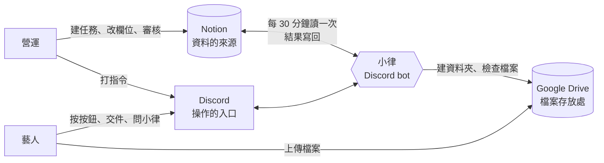

| 系統 | 負責什麼 | 誰會打開它 |
|---|---|---|
| 📒 **Notion** | 所有正式資料：任務、專案、藝人、提交紀錄、時段。**有衝突時一律以 Notion 為準** | 營運、審核人員。**藝人完全不進 Notion** |
| 💬 **Discord** | 操作入口：營運打指令、藝人收通知、按按鈕、交件、問小律 | 所有人 |
| 📁 **Google Drive** | 交件檔案與老師批改檔。資料夾由小律自動建立 | 營運、藝人（只看得到自己的專區） |

> 💡 **一句話判斷**：你在 Notion 改的欄位，小律下一輪（最多 30 分鐘）照著做；你在 Discord 打的指令，小律馬上做，並把結果寫回 Notion。

### 九個 Notion 資料庫

| 資料庫 | 存什麼 | 誰會寫 |
|---|---|---|
| `Tasks` | 每一筆要做的事 | 營運建立；小律改狀態、通知時間 |
| `Projects` | 上層企劃，決定交件放哪個 Drive 資料夾 | 營運 |
| `Artists` | 藝人資料、`Discord User ID`、Drive 專區 | 營運 |
| `People` | 公司同仁、老師、審核人員 | 營運 |
| `Submissions` | 每一次交件與審核結果 | 小律建立；審核人填結果 |
| `Availability Slots` | 藝人回報的可配合時間（不是正式行程） | 小律 |
| `Audit Log` | 每個重要動作的紀錄，查問題用 | 小律 |
| `布告欄` | 公告、待討論、使用回饋 | 營運；小律寫使用回饋 |
| `課程與會議記錄` | 會議紀錄（小律目前不讀） | 營運 |

### 六個頻道

**管理指令一律在 `營運操作` 打**，在別的頻道會被擋下來並提示你換頻道。

| 頻道 | 誰看得到 | 做什麼 |
|---|---|---|
| `營運操作` | 營運 | 打所有管理指令 |
| `營運內部通知` | 營運 | 系統通知：營運早報、🟥 要處理、系統警告 |
| `公告區` | 全體（只能看） | 公開任務、時間收集公告、布告欄、本月排程 |
| `時間管理` | 藝人 | 回報可配合時間 |
| `任務查詢入口` | 藝人 | 查任務、交作業 |
| `課程助教` | 藝人 | 問小律、跟小律聊天（各自的私人討論串） |

誰看得到哪個頻道，由 Discord 身分組決定：`控方` 看營運的兩個頻道並能打管理指令，`藝人` 看藝人的四個頻道。設定方式見「新藝人、新同仁上線」。

> 💡 每個指令的參數與分支細節見 [DISCORD_COMMANDS.md](../operations/DISCORD_COMMANDS.md)。

### 不能忘的原則

- **藝人零 Notion 入口**：藝人從任何一個 Notion 頁面都能往上翻到整個資料庫、看到別人的任務，所以小律給藝人的訊息**一律不附 Notion 連結**，任務內頁貼的 Notion 網址也會被拿掉。
- **任務內頁就是藝人看到的任務說明**，整頁都會被看到；內部資訊放子頁面。
- **`Availability Slots` 不是正式行程**。正式安排一律在 `Tasks`；候選空檔、藝人補填的時段都不算。
- **改欄位名稱會讓系統失效**。新增資料、新增選項都安全；**改名、刪欄位、改型別、刪掉重建資料庫會出事**，動之前先問工程端。
- **不要硬刪 Notion 資料**，用封存。改時間要保留紀錄，不要刪頁面重建。
- **TimeTree 不會自動同步**：正式任務確認、通知發出後人工補登；兩邊不一致以 Notion 為準。
- **課程時間有異動**：沒有自動的老師確認表單，你和老師協調好後，直接改同一筆任務的 `開始日`／`截止日`，再重送（見「改任務內容與重送」）。

---

## 新藝人、新同仁上線

**什麼時候用**：簽了新藝人、來了新同仁或老師、有人換了 Discord 帳號。

> 💡 **一句話看懂**：小律靠 Notion 上的 `Discord User ID` 認人，靠 Discord 身分組決定誰看得到哪些頻道，靠 Drive 專區的分享權限決定藝人能不能交件。三樣都要設，**系統不會幫你設任何一樣**。

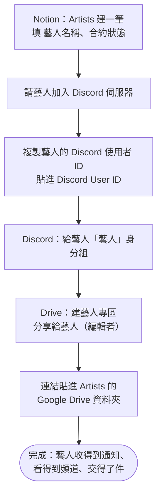

### 藝人上線

| 步驟 | 你要做的 | 📒 Notion | 💬 Discord | 📁 Drive |
|---|---|---|---|---|
| 1 | 在 `Artists` 建一筆 | `藝人名稱`（小律用這個名字叫藝人，也是 Drive 專區的預設名稱）、`合約狀態` | — | — |
| 2 | 請藝人加入伺服器，複製他的使用者 ID | 貼進 `Discord User ID` | — | — |
| 3 | 給藝人 `藝人` 身分組 | — | 看得到 `時間管理`、`任務查詢入口`、`課程助教`、`公告區` | — |
| 4 | 在公司 Drive 建藝人專區，**分享給藝人的 Google 帳號（編輯者）** | 專區連結貼進 `Google Drive 資料夾` | — | 之後的交件資料夾都建在這底下 |

**怎麼複製 Discord 使用者 ID**：Discord 設定 → 進階 → 打開「開發者模式」→ 在成員名字上按右鍵 →「複製使用者 ID」。是一串 17～19 位的數字，不是帳號名稱。

`合約狀態` 決定藝人會不會被算進每月時間收集：`未簽`、`暫停`、`封存` 的不會；其他（含 `洽談中`、`已簽約`、沒填）都會。任務通知不看合約狀態，只要任務的 `關聯藝人` 有他就會收到。

### 同仁、老師、審核人員上線

| 步驟 | 你要做的 | 📒 Notion | 💬 Discord |
|---|---|---|---|
| 1 | 在 `People` 建一筆 | `姓名 / 名稱`、`身份類型`（`公司成員` 或 `老師`，排課時才選得到他）、`Discord User ID` | — |
| 2 | 要操作系統的人（營運、會用 `/審核提交` 的審核人）給 `控方` 身分組 | — | 看得到 `營運操作`、`營運內部通知`，能打管理指令 |

只收通知、不操作的人（例如只是 `相關同仁`、只在 Notion 審核的老師）**不用**給身分組：知會、早報、審核提醒都是私訊。

### 做完怎麼確認成功

| 看哪裡 | 應該看到 |
|---|---|
| Notion `Artists` | `Discord User ID` 是一串數字、`Google Drive 資料夾` 有連結 |
| Discord | 藝人看得到 `任務查詢入口`，打 `/我的任務` 有回應（沒有任務也會說沒有） |
| Google Drive | 專區的「共用」裡有藝人的帳號，權限是編輯者 |

### 出錯怎麼辦

| 狀況 | 原因 | 怎麼做 |
|---|---|---|
| 藝人收不到任何通知 | `Discord User ID` 沒填、填成帳號名稱，或多打空白 | 重新複製使用者 ID 貼上 |
| 藝人說看不到頻道 | 沒給 `藝人` 身分組 | Discord 伺服器設定 → 成員 → 加上身分組 |
| 藝人打開交件資料夾說沒有權限 | 專區沒分享給他，或分享到別的 Google 帳號 | 到 Drive 重新分享；請藝人確認登入的帳號 |
| 時間收集沒有找他 | `合約狀態` 是 `未簽`／`暫停`／`封存`，或沒有 `Discord User ID` | 改合約狀態、補 ID |
| 排課選不到這位老師 | `People` 的 `身份類型` 不是 `老師` 或 `公司成員` | 改身份類型 |
| 同仁說沒收到知會 | `People` 沒填 `Discord User ID`。**系統不會提醒你** | 補 ID，再重送那筆任務 |
| 藝人專區名稱跟藝人改名後不一樣 | Drive 照名稱找資料夾，改名＝開新專區 | 有填 `Google Drive 資料夾` 就不受影響，所以第 4 步一定要做 |

> ⚠️ `Discord User ID` 填錯人，小律會把這位藝人的任務私訊給別人。換帳號或貼 ID 時務必再核對一次。

---

## 每月收集可配合時間

**什麼時候用**：每個月固定一次（例如 25 號前收集下個月），讓藝人回報哪些時間可以排課、排行程。

> 💡 **一句話看懂**：你打 `/時間資訊蒐集` → 小律在公告區發公告、私訊每位藝人 → 藝人用 `/管理可配合時間` 填 → 每一段寫進 Notion `Availability Slots` → 全員填完通知你排課。

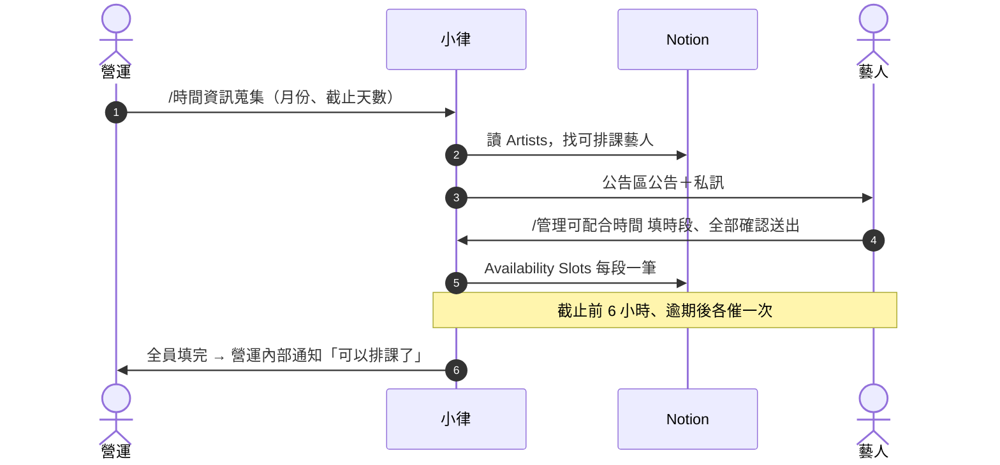

### 開始前要準備好

| 要準備的 | 在哪裡設 | 少了會怎樣 |
|---|---|---|
| 藝人有 `Discord User ID` | Notion `Artists` | 不會被算進這次收集 |
| `合約狀態` 不是 `未簽`／`暫停`／`封存` | Notion `Artists` | 不會被算進這次收集 |

### 階段 1　營運發起

**你要做的**：在 `營運操作` 打 **`/時間資訊蒐集`**。

| 參數 | 填什麼 |
|---|---|
| `月份` | 要收集的月份，例如 `2026-11` |
| `截止天數` | 幾天內要填完，預設 1（24 小時） |
| `說明` | 選填，例如「請優先填週末」 |

| 系統 | 發生什麼 |
|---|---|
| 📒 Notion | 讀 `Artists` 找出可排課藝人；`Audit Log` 記一筆 |
| 💬 Discord | `公告區` 發公告並標記這些藝人；每位藝人另收一則私訊 |
| 📁 Drive | 不動 |

### 階段 2　藝人填時段

**藝人做的**：在 `時間管理` 打 `/管理可配合時間` → 選月份 → 勾日期、設時段 → 「檢查全部時段」→「全部確認送出」。按送出之前都只是草稿。

| 系統 | 發生什麼 |
|---|---|
| 📒 Notion | `Availability Slots` 每一段寫一筆：`可用時段名稱`、`填寫藝人`、`填寫人名稱`、`身份`=藝人、`來源`=Discord、`可用開始時間`、`可用結束時間`、`提交時間`、`是否逾期提交`、`備註`（收集月份與藝人備註）。藝人刪掉的時段會被封存 |
| 💬 Discord | 藝人看到確認畫面。檢查時會自動排除跟**已派發任務**衝突的時間、合併重疊的時段 |
| 📁 Drive | 不動 |

### 階段 3　催填與收齊

| 時間點 | 💬 Discord |
|---|---|
| 截止前 6 小時 | 還沒填的藝人收一則私訊 |
| 過了截止 | 還沒填的藝人再收一則私訊 |
| 每天 09:30 | 營運早報列「已填幾位、還沒填誰」 |
| 全員填完 | `營運內部通知` 立刻收到「收齊了」，這次收集自動結束 |

> 💡 **只催兩次是刻意的**，避免騷擾藝人。截止天數設得長（例如 3 天），中間會有一大段不提醒，需要的話自己在群組補一句。

收齊後接著做「排課」。

### 有人沒填

請他自己打 `/管理可配合時間` 補，**不用重發公告**。藝人私訊失敗（例如關了私訊）時，手動提醒他到 `時間管理` 補。

### 發錯了要取消

打 **`/取消時間蒐集`** → 選那一筆 → 確認。

| 系統 | 發生什麼 |
|---|---|
| 📒 Notion | **不動**藝人已填的時段，之後排課照樣可用 |
| 💬 Discord | 停掉催填、逾期通知、排課時效提醒。**已發出的公告和私訊收不回來**，請自己到 `公告區` 刪掉那則公告，並在群組說一聲 |

已經收齊、或逾期通知發過的收集會自己結束，不需要取消。

### 做完怎麼確認成功

| 看哪裡 | 應該看到 |
|---|---|
| `營運內部通知` | 「收齊了」那則 |
| Notion `Availability Slots` | 依 `填寫藝人` 篩選，每位藝人都有這個月的時段 |

### 出錯怎麼辦

| 狀況 | 原因 | 怎麼做 |
|---|---|---|
| 可排課藝人 0 位 | 藝人都沒有 `Discord User ID`，或合約狀態都是未簽／暫停／封存 | 補資料；都對的話請工程端確認 Notion 權限 |
| 藝人填錯時間 | — | 請他用 `/管理可配合時間` 修改單日、修改整組或移除 |
| 藝人說他填的時段變少了 | 跟已派發的任務衝突的部分被自動排除 | 正常；草稿任務不會排除，談定的時間要盡快派發 |

---

## 排課

**什麼時候用**：時間收集完，要找幾位藝人（和老師）都有空的時段，排課程、錄音、會議。

> 💡 **一句話看懂**：`/時間交集查詢` 只看不寫；`/從時間池建立任務` 會先整理時段，再讓你一路選到底，最後在 Notion 建一筆**草稿任務**（`Discord 顯示` 不勾，藝人收不到）。補完內容後，照「建立任務」與「派發與藝人回應」把它發出去。

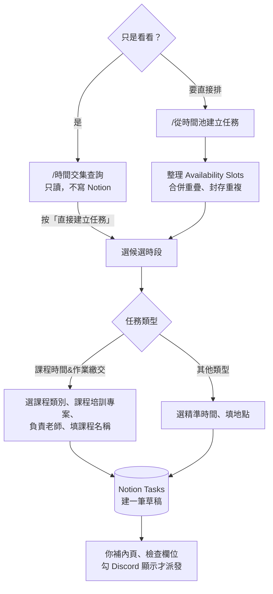

### 開始前要準備好

| 要準備的 | 在哪裡設 | 少了會怎樣 |
|---|---|---|
| 這個月的時間已收齊 | 「每月收集可配合時間」 | 比對不到空檔 |
| 老師在 `People` 的 `身份類型` 是 `老師` 或 `公司成員` | Notion `People` | 選不到負責老師 |
| 課程有一筆 `專案類型`=`課程培訓` 的專案 | Notion `Projects` | 選不到課程專案 |

### 階段 1　找共同空檔

**只想看看**：打 **`/時間交集查詢`** → 選月份、時長、勾藝人 → 看共同空檔。

| 系統 | 發生什麼 |
|---|---|
| 📒 Notion | **只讀，完全不寫入** |
| 💬 Discord | 只有你看得到的候選清單。多的話會分頁，下方有**跳頁選單**，每頁標日期範圍 |

**要直接排**：打 **`/從時間池建立任務`**，參數一樣（月份、時長分鐘）。差別是它會先整理時間池：

| 系統 | 發生什麼 |
|---|---|
| 📒 Notion | `Availability Slots` 合併重疊、封存重複；`Audit Log` 記一筆 |
| 💬 Discord | 候選清單，接著選時段 |

**候選時段怎麼算**

- 依需要的時長切好，起點每 30 分鐘一個，例如 `13:30-14:30`、`14:00-15:00`
- 會扣掉 `Tasks` 裡有正式時間的硬性任務：`錄音`、`演出`、`會議溝通`，以及有 `課程類別` 的課程。作業、創作交付、企劃、行政、發布上架只提醒，不擋時段
- **草稿也算佔用**：還沒派發的草稿，這裡仍會當成已排掉，不會把同一段推給你兩次

### 階段 2　選時段與類型

選完候選時段，選 `任務類型`（選項直接讀 Notion，Notion 新增選項這裡就有）。

- **`課程時間&作業繳交`** → 依序選課程類別、課程培訓專案、負責老師，最後填課程名稱
- **其他類型** → 選精準時間、填地點等資訊

每一層都能「返回上一步」，取消也不會寫入任何東西。**只有走到最後一步才會真的建立。**

### 階段 3　系統建立草稿

| 系統 | 發生什麼 |
|---|---|
| 📒 Notion `Tasks` | 新增一筆，見下表 |
| 💬 Discord | 回覆你這筆任務的 Notion 連結，直接點進去編輯。**藝人收不到任何東西** |
| 📁 Drive | 不動 |

| 欄位 | 寫入值 |
|---|---|
| `任務名稱` | 你填的 |
| `任務狀態` | `尚未開始` |
| `任務類型` | 你選的 |
| `關聯藝人` | 你勾的藝人 |
| `Discord 顯示` | **不勾**（草稿） |
| `是否開放提交` | 不勾 |
| `課程類別`／`負責老師`／`關聯專案` | 課程流程才有 |
| `開始日`／`截止日` | 有選精準時間才有 |
| 任務內頁 | `## 任務說明` 標題底下寫安排來源、候選時段等資訊 |

> ⚠️ **內頁那些資訊藝人一行都看不到**（系統會濾掉 `安排來源：`、`課程類別：` 這類開頭的行）。派發前一定要在下面另起一行寫給藝人的內容，寫法見「建立任務」。

> ⚠️ **談定就要盡快派發**。藝人填時段時看不到草稿，可能把同一段回報成「可以配合」。

### 階段 4　補完、派發、補登行事曆

1. 補內頁、檢查欄位（見「建立任務」）
2. 勾 `Discord 顯示` 派發（見「派發與藝人回應」）
3. 派發後人工補登 TimeTree。兩邊不一致以 Notion 為準

### 拖太久系統會提醒

| 時間 | 💬 Discord（`營運內部通知`） |
|---|---|
| 收集截止後半天還沒比對 | 提醒你排課 |
| 整個流程超過 48 小時 | 升級通知 |
| 超過 72 小時 | 提示候選時段可能已經失效 |

### 出錯怎麼辦

| 狀況 | 原因 | 怎麼做 |
|---|---|---|
| 比對不到共同空檔 | 月份選錯、有人沒填、時長太長、既有任務佔滿 | 縮短時長、改選藝人，或請藝人補時段 |
| 有人沒填 | — | 請他用 `/管理可配合時間` 補 |
| 選單選不到老師 | `People` 的 `身份類型` 不對 | 改成 `老師` 或 `公司成員` |
| 藝人收到通知卻沒內容 | 只有系統寫的那段，沒補給藝人看的內容 | 補內頁後重送（見「改任務內容與重送」） |

---

## 建立任務

**什麼時候用**：例會或討論確定了一件要做的事，要排給藝人（或通知同仁）。系統從時間池建的草稿也照這頁補完。

> 💡 **一句話看懂**：任務只在 Notion 建。欄位決定**誰收到、什麼時候提醒、要不要交件**；內頁就是藝人看到的任務內容。這一頁全部做完，再勾 `Discord 顯示` 派發。

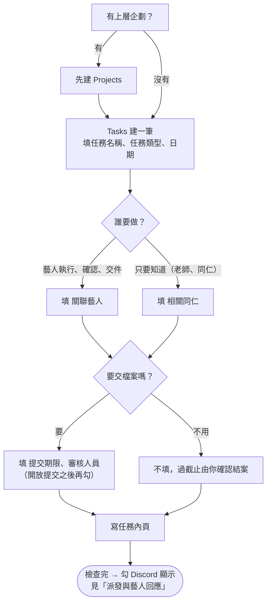

### 開始前要準備好

| 要準備的 | 在哪裡設 | 少了會怎樣 |
|---|---|---|
| 藝人、同仁都已上線（有 `Discord User ID`） | 「新藝人、新同仁上線」 | 收不到通知 |
| 有上層企劃就先建 `Projects` | Notion `Projects` | 交件檔案進「未分專案」資料夾 |

> ⚠️ 例會確認的正式事項**不要寫成 Availability Slot**，一律建 `Projects`／`Tasks`。

### 階段 1　填欄位

#### 一定要填

| 欄位 | 讓系統做什麼 |
|---|---|
| `任務名稱` | 藝人看到的標題；前後空白、換行會自動拿掉 |
| `任務類型` | 決定要不要擋藝人的時段（`錄音`、`演出`、`會議溝通`）、要不要發公告區（`通告`、`演出`）。課程固定選 `課程時間&作業繳交`，再填 `課程類別` |
| `關聯藝人` | **收到任務卡、早報、可以交件的人**。沒填就沒有藝人會收到 |
| `開始日`／`截止日` | 正式行程時間（上課日、發布日、演出日），也是提醒與逾期的依據。**作業期限不要填在 `截止日`**，填 `提交期限` |
| `關聯專案` | 交件檔案放在 Drive 的哪個專案資料夾；沒掛進「未分專案」 |

`任務狀態` 不用選，空白時系統當成 `尚未開始`。

#### 任務相關對象：`關聯藝人` 和 `相關同仁`

| 對象 | 填哪一欄 | 💬 Discord 收到什麼 | 能改任務狀態嗎 |
|---|---|---|---|
| 藝人：要執行、確認、交件 | `關聯藝人`（連到 `Artists`） | 任務卡（收到任務／有問題）、每日早報、交件與審核結果 | 可以（按按鈕） |
| 老師、公司同仁：只要知道 | `相關同仁`（連到 `People`） | 派發時一則純知會、每日同仁早報，沒有按鈕 | 不可以 |

同一筆可以兩欄都填。`相關同仁` 不是 `負責老師` 的替代欄位。

#### 要交件才填

| 欄位 | 讓系統做什麼 |
|---|---|
| `提交期限` | 第一輪交件的死線，提醒和逾期照它算（詳見「期限、逾期與結案」） |
| `審核人員` | 藝人交件時私訊這幾位；待審核超過 24 小時每天 10:00 再提醒。不填就發到 `營運內部通知` 由營運審 |
| `提前交件` | 勾了，交件死線自動變成 `截止日` 前 5 天（或你填的 `提交期限`）。**上課、通告不要勾** |
| `是否開放提交` | **建立時先不用勾**。勾下去藝人就能交件，並收到「作業開放」通知（見「交件與審核」） |

> 💡 交件一律上傳到公司 Drive，沒有「提交方式」可以選；文字內容請藝人存成檔案上傳。

#### 選填

| 欄位 | 讓系統做什麼 |
|---|---|
| `提醒規則` | **不勾也會在死線前 5 天、3 天提醒**（系統預設）。勾的是額外再加：`3 天前`／`1 天前`／`當天`／`逾期`。只能加，不能減 |
| `負責老師`／`課程類別` | 課程任務用。課程結束 2 小時後小律私訊負責老師去論壇發布作業 |
| `Google Drive Folder` | 通常留空讓系統填。手動填的話，藝人交件改進這個資料夾，**要自己分享給藝人** |

#### 這些欄位不要動

| 欄位 | 為什麼 |
|---|---|
| `Discord 通知時間`、`Discord 收到時間` | 小律寫的，記錄通知與藝人按收到的時間 |
| `最新提交 URL` | 小律寫的，指向最新一筆提交 |
| `提醒確認(From 藝人)` | 小律寫的早報已讀紀錄。**欄位名稱不能改**（半形括號、From 後一個空格），改了系統寫不進去 |

### 階段 2　寫任務內頁

點進任務，直接在內頁寫。**整頁就是藝人看到的任務內容**：派發卡、截止前提醒、早報「看內容」、小律回答細節，讀的都是這一頁。

寫清楚**做什麼、做多少、用什麼形式交、什麼時候交**，例如「聽力訓練：50 題音程／截圖」。藝人沒有別的地方可以查。

| 會讀到 | 不會讀到 |
|---|---|
| 段落、標題、條列、待辦、引用、callout、切換清單裡面、分欄裡面、表格（每列變「欄｜欄」）、書籤和嵌入的網址；巢狀最多 3 層 | **子頁面、連結的資料庫**（內部資料放這裡）；**圖片、檔案、PDF**（要給檔案請貼 Drive 連結）；系統寫的「藝人回覆」「Drive 資料夾索引」兩段 |

| ⚠️ 注意 | 為什麼 |
|---|---|
| 整頁都會被藝人看到 | 內部備註、報價、其他藝人的資訊放子頁面 |
| Notion 網址會被拿掉 | 藝人零 Notion 入口；Drive、YouTube 等其他網址保留 |
| `名稱：` 開頭的行會被濾掉 | `安排來源：`、`課程類別：`、`負責老師：`、`需要時長：`、`候選時段` 開頭的行是營運欄位。要交代就寫成一句話：「這週改由 B 老師上課」 |
| 太長會被截斷 | 派發卡約 900 字、截止前提醒 700 字、小律和「看內容」1,500 字。重點寫最前面 |
| 時間寫在內頁不算數 | 正式時間只看 `開始日`／`截止日` 欄位 |
| 不要改系統段落的標題 | 「藝人回覆」「Drive 資料夾索引」改名後，會被當成任務內容念給藝人 |

**課程任務一定要自己補一段**。時間池建的內頁長這樣，濾完是空的：

```notion
安排來源：/從時間池建立任務
課程類別：舞蹈課
負責老師：lurasupa
需要時長：2 小時
候選時段（由營運最後確認）：
2026-09-17 19:30~21:30
```

在下面另起一行寫給藝人的內容，上面那段不用刪：

```notion
這週練上次那支編舞的後半段，記得帶練習服。
```

### 做完怎麼確認

派發前對一次：

- [ ] `任務名稱`、`任務類型`、`開始日`／`截止日` 都對
- [ ] `關聯藝人` 是要做事的人；只要知道的放 `相關同仁`
- [ ] 要交件的填了 `提交期限`、`審核人員`
- [ ] 內頁有寫給藝人看的內容，沒有內部資訊
- [ ] 有上層企劃的掛了 `關聯專案`

全部打勾就到「派發與藝人回應」。

---

## 派發與藝人回應

**什麼時候用**：任務建好、檢查完，要讓藝人知道。

> 💡 **一句話看懂**：勾 `Discord 顯示` → 最多 30 分鐘內小律私訊任務卡 → 藝人按「收到任務」，`任務狀態` 變 `進行中`；按「有問題」，任務退回給你、`營運內部通知` 跳一則 🟥。

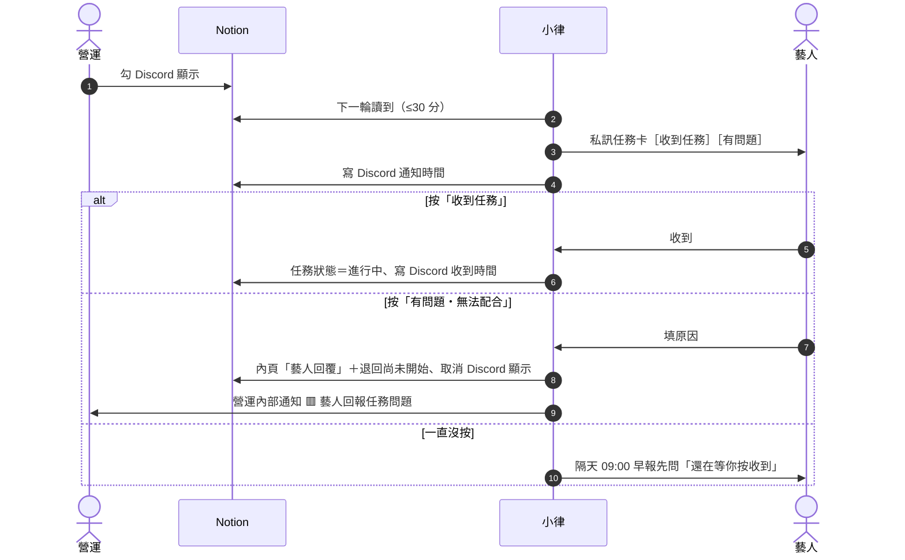

### 開始前要準備好

| 要準備的 | 在哪裡設 | 少了會怎樣 |
|---|---|---|
| 「建立任務」的檢查清單都打勾 | Notion `Tasks` | 藝人收到錯的或空白的內容 |
| `關聯藝人`、`相關同仁` 都有 `Discord User ID` | `Artists`／`People` | 送不出去，`營運內部通知` 跳 🟥 |

### 階段 1　營運派發

**你要做的**：勾 **`Discord 顯示`**。

| 系統 | 發生什麼 |
|---|---|
| 📒 Notion | 送出後寫 `Discord 通知時間` |
| 💬 Discord | **最多 30 分鐘內**私訊每位 `關聯藝人`：任務名稱、類型、截止日、內頁內容，附「收到任務」「有問題・無法配合」兩顆按鈕。`相關同仁` 收一則純知會。`任務類型` 是 `通告`／`演出` 的另外發到 `公告區`、列進本月排程 |
| 📁 Drive | 不動 |

**同一輪好幾筆會合併**：同一位藝人這一輪有 2 筆以上，只收**一則**「📌 任務通知（N）」：清單＋「看任務內容」選單＋「✅ 全部收到」＋「⚠️ 哪一筆不行？」。同仁也合併成一則「👥 同仁知會（N）」。

> 💡 **作業分兩段發**：課程、需要先上課才交的作業，不要建兩筆任務。先只勾 `Discord 顯示`（藝人知道有這件事），上完課再補作業要求、`提交期限`、`審核人員`，勾 `是否開放提交`，藝人才收到「📚 作業開放」通知。見「交件與審核」。

### 階段 2　藝人回應

| 藝人做了什麼 | 📒 Notion 怎麼變 | 💬 Discord 怎麼變 | 你要做的 |
|---|---|---|---|
| 按「**收到任務**」或「**✅ 全部收到**」 | `任務狀態` → `進行中`；`Discord 收到時間` → 按的時間 | 那則收成一行「✅ 任務收好了」，後面留「有問題」入口；同任務的舊通知刪掉 | 不用做事 |
| 按「**有問題・無法配合**」「**哪一筆不行？**」或早報的「**這筆不行**」，填原因 | 原因**追加**到內頁「藝人回覆」段落；`任務狀態` → `尚未開始`；`Discord 顯示` 取消；`Discord 通知時間`、`Discord 收到時間`、`提醒確認(From 藝人)` 清空 | 藝人那則標「⚠️ 小律已轉告公司」；`營運內部通知` 一則 🟥 藝人回報任務問題 | 見階段 3 |
| **一直沒按** | 不變（停在 `尚未開始`） | 隔天 09:00 早報先問「有 N 筆任務還在等你按收到喔」；超過 3 天列在營運早報 | 私下聯絡，或重送（見「改任務內容與重送」） |

**例外**

| 任務狀態 | 藝人按「有問題」會怎樣 |
|---|---|
| `待審核`、`需修改` | 不能用按鈕回報，小律請他直接聯絡公司（避免打亂審核） |
| `已逾期` | 可以回報，原因寫進「藝人回覆」，但**不退回**：狀態維持 `已逾期`、`Discord 顯示` 不取消。🟥 會寫「維持已逾期，沒有退回」，由你決定延期或結案 |

### 階段 3　處理藝人回報的問題

1. 在 `營運內部通知` 那則 🟥 按「🙋 我來處理」（讓同事知道你接了）
2. 點 🔗 打開任務，看內頁「藝人回覆」
3. 改任務：時間、內容、換人
4. **重新勾 `Discord 顯示`**，下一輪重新派發
5. 回頻道按「✅ 已處理」

> ⚠️ 頻道的按鈕**不會改 Notion**；在 Notion 改完，那則 🟥 也**不會**自己收起來。兩邊都要做。見「處理營運內部通知」。

### 做完怎麼確認成功

| 看哪裡 | 應該看到 |
|---|---|
| Notion `Tasks` | `Discord 通知時間` 有值；藝人按收到後 `任務狀態`=`進行中`、`Discord 收到時間` 有值 |
| `/任務總覽` | 這筆在「📋 進行中」 |

### 出錯怎麼辦

| 狀況 | 原因 | 怎麼做 |
|---|---|---|
| 藝人沒收到 | `Discord 顯示` 沒勾、沒有 `關聯藝人`、藝人沒有 `Discord User ID` | 補好後重送 |
| 等了 30 分鐘還沒發 | 剛好錯過一輪 | 再等一輪，或用 `/任務通知重送` 立刻發 |
| `營運內部通知` 跳「任務通知送不出去」 | 對象都沒有 `Discord User ID` | 補 ID，勾 `重送通知` |
| 藝人收到「Notion 尚未填寫任務說明」 | 內頁空白、只有子頁面或圖片、或全是 `名稱：` 開頭的行 | 補內頁後重送 |
| 同仁沒收到 | `People` 沒填 `Discord User ID`，系統**不會**提醒你 | 補 ID 後重送 |

---

## 交件與審核

**什麼時候用**：任務需要藝人交檔案（課後作業、Demo、錄音、企劃書…），交了之後要有人審。

> 💡 **一句話看懂**：營運勾 `是否開放提交` → 藝人在 Discord 拿到一個 Drive 資料夾、把檔案傳進去 → 小律在 Notion 記一筆提交、通知審核人 → 審核人給結果 → 小律通知藝人。需修改就再交一輪。

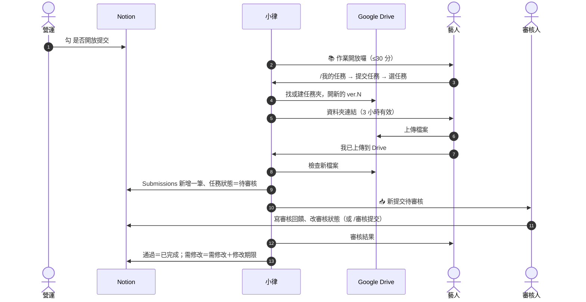

### 開始前要準備好

| 要準備的 | 在哪裡設 | 少了會怎樣 |
|---|---|---|
| 藝人的 `Discord User ID` | Notion `Artists` | 認不出藝人，收不到通知、看不到任務 |
| 藝人專區已建好、**已分享給藝人（編輯者）** | Google Drive，連結貼在 `Artists` 的 `Google Drive 資料夾` | 藝人點開資料夾會被拒絕，無法上傳 |
| 任務掛好 `關聯藝人`、`關聯專案` | Notion `Tasks` | 沒掛藝人＝沒人收到；沒掛專案＝檔案進「未分專案」 |
| 任務填好 `審核人員`，審核人在 `People` 有 `Discord User ID` | Notion `Tasks`／`People` | 審核人收不到私訊，改發到 `營運內部通知` |
| 任務已派發（`Discord 顯示` 已勾） | Notion `Tasks` | 藝人看不到這筆任務 |

### 流程總覽

| 階段 | 誰做 | 在哪做 | `任務狀態` |
|---|---|---|---|
| 1. 開放交件 | 營運 | Notion | 不變 |
| 2. 打開交件入口 | 藝人 | Discord `/我的任務` | 不變 |
| 3. 上傳檔案 | 藝人 | Google Drive | 不變 |
| 4. 確認交件 | 藝人 | Discord | → `待審核` |
| 5. 審核 | 審核人 | Notion 或 Discord | → `已完成` 或 `需修改` |
| 6. 附批改檔（選用） | 審核人 | Discord | 不變 |
| 7. 重交（需修改時） | 藝人 | 回到階段 2 | → `待審核` |

---

### 階段 1　營運開放交件

**你要做的**：打開那筆任務，補好作業要求（內頁）、`提交期限`、`審核人員`，勾 **`是否開放提交`**。

| 系統 | 發生什麼 |
|---|---|
| 📒 Notion | 小律讀到勾選，不改任何欄位；`Audit Log` 記一筆「課後作業通知｜任務名稱」 |
| 💬 Discord | **最多 30 分鐘內**私訊 `關聯藝人`：「📚 老師的作業開放囉，可以開始交了！」，附截止日與作業要求。同一位藝人這一輪好幾筆就合併成一則。**每筆任務只通知一次** |
| 📁 Drive | 還沒有動作，資料夾要等藝人打開交件入口才建 |

> ⚠️ 沒勾 `是否開放提交` 的任務，藝人在 Discord **完全交不了**，過了截止也不會被判逾期（改列在營運早報「等你確認結案」）。

### 階段 2　藝人打開交件入口

**藝人做的**：在 `任務查詢入口` 打 `/我的任務` → 按「提交任務」→ 選這筆任務。

清單只會出現 `是否開放提交` 已勾，而且 `任務狀態` 是 `尚未開始`／`進行中`／`待提交`／`需修改`／`已逾期` 的任務。`待審核`、`已完成`、`已封存` 的不會出現。

| 系統 | 發生什麼 |
|---|---|
| 📁 Drive | 找到或建好這筆任務的資料夾，在裡面**開一個新的交件夾** `任務名稱_YYYY.MM.DD_ver.N`（規則見下方） |
| 📒 Notion | 單一藝人的任務：第一次建好任務夾時，連結寫進 `Tasks` 的 `Google Drive Folder`。多位藝人的任務：改在內頁最下面「Drive 資料夾索引」加一行（藝人、小律都看不到這段） |
| 💬 Discord | 只有藝人看得到的訊息：資料夾連結＋「我已上傳到 Drive」，**3 小時內有效** |

#### 資料夾建在哪

小律照順序找：

| 順序 | 看哪個欄位 | 結果 |
|---|---|---|
| 1 | `Tasks` 的 `Google Drive Folder` 有填 | 交件夾開在這個資料夾裡 |
| 2 | `Artists` 的 `Google Drive 資料夾`（藝人專區） | `專區 / 專案名稱 / YYYY.MM.DD_任務名稱 / 交件夾` |
| 3 | 都沒有 | 在公司 Drive 總資料夾下建一個**以藝人名稱命名**的專區，再往下建。**這個專區沒分享給藝人，要你去分享**；也不會寫回 `Artists` |

```text
方晨（藝人專區）/
  方晨 2610 課程/                    ← 關聯專案 的名稱；沒掛 → 未分專案
    2026.10.25_編曲作業/             ← 截止日＋任務名稱（沒截止日用建立日）
      編曲作業_2026.10.20_ver.1/     ← 第一次交件（日期＝藝人打開入口那天）
      編曲作業_2026.10.23_ver.2/     ← 需修改後重交
      老師回饋/
        老師回饋_2026.10.24_ver.1/   ← 審核人附的批改檔
```

> ⚠️ **小律不會設定任何分享權限。** 新資料夾的權限跟著上一層走，所以藝人專區一定要先分享給藝人。手動填 `Google Drive Folder` 的話，那個資料夾也要分享；多位藝人的任務填了它，所有人會交到同一個資料夾、彼此看得到。

- 資料夾是**照名稱找**的：同名就沿用，名稱變了就開新的。專案、藝人名稱建好後盡量不要改
- 名稱裡 Drive 不接受的字元（`/ \ : * ? " < > |`）會換成 `_`，太長截在 70 字
- 讀不到專案時小律**不會**亂放，會請藝人稍後再試

### 階段 3　藝人上傳檔案

**藝人做的**：點資料夾連結，把檔案傳進去（可以多個）。

這一步只發生在 Google Drive，Notion 和 Discord 都沒有變化。訊息消失的話，**3 小時內**回 `/我的任務` 選同一筆任務，會回到**同一個** `ver.N`，已傳的檔案都還在。

### 階段 4　藝人確認交件

**藝人做的**：回到 Discord 按「**我已上傳到 Drive**」。

小律去交件夾找**入口打開之後新增的檔案**。找不到會請藝人確認後再按；找到就往下走：

| 系統 | 發生什麼 |
|---|---|
| 📒 Notion `Submissions` | 新增一筆：`提交名稱`、`提交藝人`、`關聯任務`、`提交來源`=Discord、`提交類型`=檔案、`檔案類型`（依任務類型自動選）、`審核狀態`=**待審核**、`權限等級`=藝人本人、`是否最新版`=勾、`提交時間`、`Drive URL`（交件夾）、`Drive File ID`、`原始檔名`、`檔案大小 MB`。同一任務先前的提交，`是否最新版` 自動取消 |
| 📒 Notion `Tasks` | `任務狀態` → **`待審核`**；`最新提交 URL` → 這筆 Submissions 的頁面；`修改期限` 清空 |
| 💬 Discord | 藝人看到「✅ 檔案收到了」。`審核人員` 收到私訊「📥 新提交待審核」，附 Drive 和 Notion 連結與「怎麼審」。沒填審核人員、或審核人沒有 Discord ID，改發 `營運內部通知` 成為一則 🟥 |
| 📁 Drive | 不動，檔案留在交件夾 |

審核人收到的私訊：

```discord
📥 新提交待審核（檔案）
任務：10/25（日）編曲作業｜方晨｜2 個檔案（12.4MB）
Drive：（這次交件的資料夾）
Notion：（這筆提交的頁面）

怎麼審（擇一）
・Notion：打開上面的提交頁，先在 審核回饋 寫幾句，再把 審核狀態 改成「通過」或「需修改」。小律每分鐘檢查一次，改完就會通知藝人。
・Discord：到 營運操作 頻道打 /審核提交，選這筆提交，按「通過」或「需修改」，再填回饋。
```

> 💡 待審核超過 24 小時，小律每天 10:00 再私訊審核人一次。`待審核` 期間藝人不會被催、也不會被判逾期。

### 階段 5　審核

兩種方式擇一，結果一樣。

**A. 在 Notion 審**（任何人都可以）：打開那筆 Submissions → **先**寫 `審核回饋` → **再**把 `審核狀態` 改成 `通過`／`需修改`／`退回`。

**B. 在 Discord 審**（要有 `控方` 身分組）：在 `營運操作` 打 **`/審核提交`**：

1. 選一筆待審核的提交
2. 小律列出 Drive 連結、關聯任務，**先看過檔案再判斷**
3. 選 `通過`／`需修改`／`退回`
4. 填給藝人的回饋（可留空）
5. 需修改或退回要選 **1～7 天的修改期限**
6. 送出後小律**馬上**私訊藝人結果，接著問你要不要附批改檔（見階段 6）

| 系統 | 發生什麼 |
|---|---|
| 📒 Notion `Submissions` | `審核狀態`、`審核回饋`、`審核者`、`審核來源`（Notion／Discord）；通知送出後寫 `審核通知時間` |
| 📒 Notion `Tasks` | 通過 → `任務狀態` = **`已完成`**。需修改／退回 → **`需修改`**，寫入 `修改期限` |
| 💬 Discord | 私訊藝人審核結果、回饋、修改期限（不附 Notion 連結）。Notion 審的話小律**每分鐘**檢查一次 |
| 📁 Drive | 不動 |

> ⚠️ 在 Notion 審時**順序不能反**：先改狀態再寫回饋，藝人可能先收到沒有回饋的結果。只改狀態、`審核回饋`／`審核者`／`審核來源` 一個都沒填的話，小律會當成歷史資料整理，**不通知藝人**。

### 階段 6　附批改檔（選用，只有 Discord 審有）

**審核人做的**：按「附批改檔」→ 在同一個頻道上傳檔案（可以多個）→ 按「完成回饋」。不需要就按「不需補批改檔」。

| 系統 | 發生什麼 |
|---|---|
| 📁 Drive | 檔案放進 `任務夾 / 老師回饋 / 老師回饋_YYYY.MM.DD_ver.N` |
| 📒 Notion `Submissions` | 批改檔連結加進 `審核回饋` |
| 💬 Discord | 私訊藝人第二則「📎 老師補充了批改檔」，附連結 |

- 每個檔案 **10MB 以下**。更大的先傳到小律給的老師回饋資料夾，再按「貼 Drive 連結補回饋」
- 這則訊息只有你看得到，切去 Drive 回來可能消失：**3 小時內**在同一個頻道隨便打一句話（例如「好了」），按鈕會再出現
- 超過 3 小時就沒有 Discord 入口了：把 Drive 連結直接貼進那筆 Submissions 的 `審核回饋`，自己私訊藝人
- 只有原本審核的那個人能操作；按錯用「返回回饋選擇」

### 階段 7　需修改 → 重交

藝人收到「需修改」，回到**階段 2** 再交一次：

| 系統 | 發生什麼 |
|---|---|
| 📁 Drive | 同一個任務夾裡開**下一個** `ver.N`，舊版本留著 |
| 📒 Notion | Submissions 多一筆（舊的取消 `是否最新版`）；Tasks 回到 `待審核`、`修改期限` 清空 |
| 💬 Discord | 審核人再收到「📥 新提交待審核」，回到階段 5 |

停在 `需修改` 期間藝人每天都會在早報看到；過了 `修改期限` 狀態**仍是 `需修改`**，不會自動變 `已逾期`，營運早報會列「修改期限已過」讓你決定要催還是放棄。

---

### 做完怎麼確認成功

| 看哪裡 | 應該看到 |
|---|---|
| Notion `Tasks` | `任務狀態` = `已完成`；`最新提交 URL` 有值；單一藝人任務的 `Google Drive Folder` 有值 |
| Notion `Submissions` | 最新一筆 `是否最新版` 有勾、`審核狀態` = `通過`、`審核通知時間` 有值 |
| Google Drive | 任務夾裡有 `ver.N` 資料夾，檔案都在 |

### 出錯怎麼辦

| 狀況 | 原因 | 怎麼做 |
|---|---|---|
| 藝人說提交清單裡沒有這筆 | 沒勾 `是否開放提交`；或狀態已是 `待審核`／`已完成`／`已封存` | 勾開放提交；要讓藝人重交就把狀態改回 `需修改` |
| 勾了開放提交，藝人沒收到通知 | 還沒到下一輪；或 `Discord 顯示` 沒勾 | 等 30 分鐘；確認兩個都勾 |
| 藝人打開資料夾說沒有權限 | 專區沒分享給藝人 | 到 Drive 分享藝人專區（編輯者） |
| 藝人按「我已上傳」說找不到檔案 | 傳到上一層或別的資料夾；或傳的是入口打開**之前**就在的舊檔 | 請藝人把檔案移進訊息裡那個 `ver.N` 再按 |
| 藝人看到「小律現在打不開公司的 Drive」 | Drive 授權失效（`營運內部通知` 也會有 ⚙️ 系統警告） | 請工程端重新授權，當天處理 |
| 審核人沒收到私訊 | 沒填 `審核人員`，或審核人沒有 `Discord User ID` | 看 `營運內部通知` 的 🟥；補欄位 |
| 審核人打不了 `/審核提交` | 沒有 `控方` 身分組 | 改在 Notion 審，或給身分組 |
| Notion 改了審核狀態，藝人沒收到 | 回饋欄位一個都沒填 | 補寫 `審核回饋`，一分鐘內會發出 |
| 審核寫入失敗 | `Submissions` 少了 `審核回饋`、`審核者`、`審核來源`、`審核通知時間` 其中一欄 | 請工程端確認欄位 |
| 檔案跑到「未分專案」 | 任務沒掛 `關聯專案` | 掛上專案；已交的檔案自己在 Drive 搬 |
| 專案改名後，新交件跑到另一個資料夾 | 照名稱找，改名＝開新資料夾 | 單一藝人任務第一次交件後就固定了；多位藝人的任務要自己在 Drive 合併 |

---

## 改任務內容與重送

**什麼時候用**：任務已經發出，才發現時間、地點、要求要改；藝人一直沒反應想再推一次；補了某人的 Discord ID 要補發。

> 💡 **一句話看懂**：已發出的私訊**不會自己更新**。先在 Notion 改好，再重送：一筆用 `/任務通知重送`（馬上），很多筆勾 `重送通知`（最多 30 分鐘）。重送會清掉舊的收到紀錄，藝人要重新按一次「收到任務」。

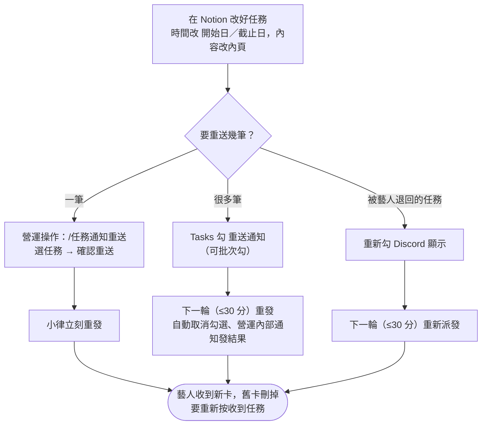

### 開始前要準備好

**一定先改 Notion，再重送。** 通知內容是重送當下從 Notion 讀的。

| 要改的 | 改哪裡 |
|---|---|
| 時間 | `開始日`／`截止日`／`提交期限` 欄位。**只改內頁寫的時間沒有用** |
| 內容、要求、地點 | 任務內頁 |
| 對象 | `關聯藝人`／`相關同仁` |

### 做法 A　一筆：`/任務通知重送`

**你要做的**：在 `營運操作` 打 `/任務通知重送`（任務多就加 `關鍵字:編曲` 縮小範圍）→ 選任務 → 「確認重送」。

| 系統 | 發生什麼 |
|---|---|
| 📒 Notion | 清空 `Discord 通知時間`、`Discord 收到時間`、`提醒確認(From 藝人)`；送出後重寫 `Discord 通知時間`；`Audit Log` 記一筆 |
| 💬 Discord | **立刻**私訊關聯藝人新的任務卡；同任務之前的舊卡先刪掉，私訊只留最新那則 |
| 📁 Drive | 不動 |

選單會標示每筆的狀態，未確認的排前面，最多 25 筆：

| 標示 | 意思 |
|---|---|
| `⏳ 未確認` | 藝人還沒按「收到任務」 |
| `✅ 已確認` | 藝人按過了，一樣可以重送 |

### 做法 B　很多筆：勾 `重送通知`

**你要做的**：在 `Tasks` 把要重送的任務勾 **`重送通知`**（可以多選後一次勾）。

| 系統 | 發生什麼 |
|---|---|
| 📒 Notion | 跟做法 A 一樣清空、重寫通知欄位；**自動取消** `重送通知` 的勾 |
| 💬 Discord | 下一輪（最多 30 分鐘）一起重送；同一位藝人好幾筆只收**一則合併通知**；`營運內部通知` 發一則重送結果摘要 |

沒勾 `Discord 顯示` 或已結案的任務會略過。

### 做法 C　被藝人退回的任務

藝人按過「有問題」的任務，`Discord 顯示` 已經被取消。改好後**重新勾 `Discord 顯示`** 就會重新派發，不用另外勾重送；兩個都勾也只會送一次。

### 最常見的情境：已確認的任務要改時間

1. Notion 改 `開始日`／`截止日`
2. `營運操作` 打 `/任務通知重送 關鍵字:（任務名稱片段）`
3. 選那筆（會顯示 ✅ 已確認）→「確認重送」
4. 藝人收到新卡，重新按「收到任務」

不用自己去清 `Discord 通知時間`、`Discord 收到時間`，小律會清。

> ⚠️ 延後期限的任務如果已經是 `已逾期`，記得把 `任務狀態` 改回 `進行中`，否則下一輪又會被判逾期（見「期限、逾期與結案」）。

> 💡 **不建議用「取消勾 `Discord 顯示` 再勾回來」來重送**：小律要等下一輪才清掉舊紀錄，馬上勾回去會被當成「已經通知過」而不重送；中間藝人在 `/我的任務` 也看不到這筆。

### 做完怎麼確認成功

| 看哪裡 | 應該看到 |
|---|---|
| Notion `Tasks` | `Discord 通知時間` 是剛剛的時間、`Discord 收到時間` 是空的 |
| 做法 B | `重送通知` 的勾已經被取消；`營運內部通知` 有結果摘要 |

### 出錯怎麼辦

| 狀況 | 原因 | 怎麼做 |
|---|---|---|
| 重送清單找不到那筆 | `Discord 顯示` 沒勾，或已結案 | 勾 `Discord 顯示` |
| 下拉超過 25 筆 | — | 加 `關鍵字` 縮小範圍 |
| 藝人說又要按一次確認 | 正常，內容變了舊確認不算數 | — |
| 藝人看到不該看的內容 | 內頁整頁都會送出 | 移到子頁面再重送；**已送出的私訊收不回來** |
| 重送後內容還是舊的 | 改的是內頁裡寫的時間，不是欄位 | 改 `開始日`／`截止日` 欄位再重送 |

---

## 每天的提醒與早報

**什麼時候用**：每天。這頁說明小律每天固定做的事，以及你每天早上要看什麼。

> 💡 **一句話看懂**：小律每天早上**重新讀一次 Notion**，照當下的狀態發早報。你前一天在 Notion 改了什麼，隔天的早報就會跟著變，不用按任何按鈕。

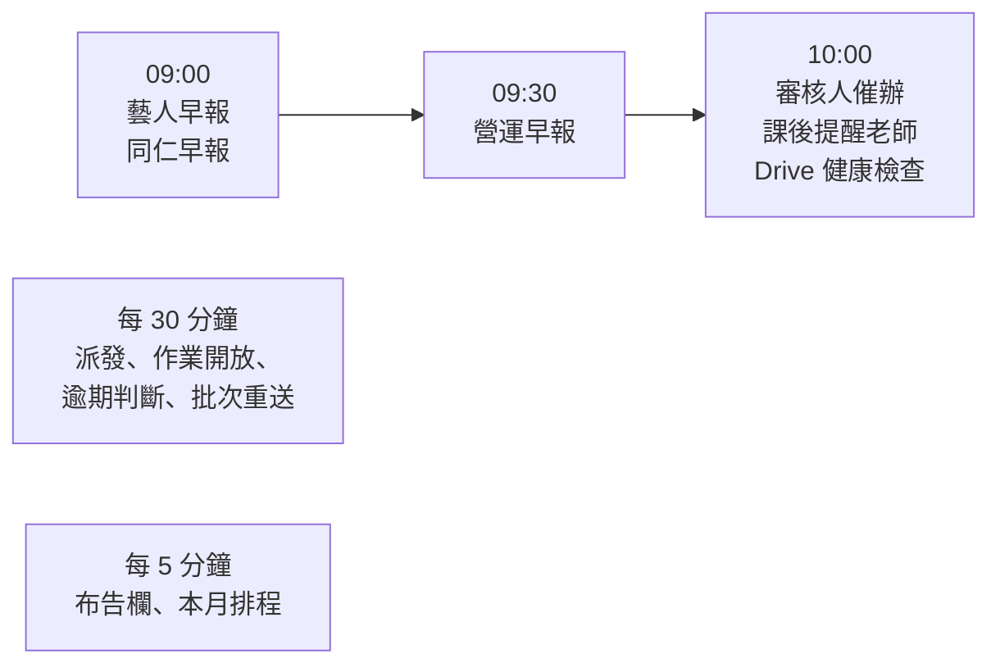

### 09:00　藝人早報（私訊）

每位藝人一則「☀️ 今天要注意的事」，沒事的藝人那天不發。

| 區塊 | 📒 讀 Notion 什麼 |
|---|---|
| 📌 還在等你按收到 | `Discord 顯示` 已勾、`Discord 收到時間` 空白的任務。**有這種任務時，早報先只問這件事**，藝人處理完，今天的提醒才以新的一則出現在最下面 |
| 🔴 已經過期限 | `任務狀態` = `已逾期` |
| 🛠 需修改 | `任務狀態` = `需修改` |
| ⏳ 已過截止，等公司確認 | 沒勾 `是否開放提交`、過了截止、還沒結案 |
| ⏰ 快到期 | 死線前 5 天、3 天，加上 `提醒規則` 勾的時間點。中間幾天不會出現 |

開頭和結尾各一句是小律依這位藝人的狀況寫的（見「小律」）；任務、日期、按鈕都是系統照 Notion 寫的。

**藝人按「👌 我看完了」時**

| 系統 | 發生什麼 |
|---|---|
| 📒 Notion | 早報裡每筆任務的 `提醒確認(From 藝人)` 加一行。送出時小律也會先記一行「已發送給 N 人」 |
| 💬 Discord | 早報收成一行「✅ 已讀」 |

```notion
早報｜10/20 09:00｜已發送給 2 人
早報｜10/20 09:12｜方晨
```

- 對照 `關聯藝人`，缺誰就知道要戳誰；分得出「還沒發」和「發了沒人按」
- 按一次會把整則的任務都記成看過，分不出藝人有沒有細看某一筆
- **「我看完了」不等於收到任務**，收到只看 `Discord 收到時間`
- 重送會清空這欄重來
- 已逾期、需修改的任務看完了隔天還是會列，標「⚠️ 仍未完成」
- 隔天的新早報發出時，前一天的會刪掉

### 09:00　同仁早報（私訊）

`相關同仁` 每人一則，列他相關任務中已逾期、需修改、快到期的。沒有按鈕，也不寫 Notion。

### 09:30　營運早報（`營運內部通知`）

一則列出今天要你處理的事，前一天的自動刪掉。每筆任務名稱都是 Notion 連結；下方選單可以在同一則看某一筆的詳細。

| 區塊 | 你在 Notion 做什麼，它隔天就不列 |
|---|---|
| ⏳ 已過截止，等你確認結案 | 改 `已完成`／`已完成發文`；延後 `截止日`；或改 `已逾期`（移到「仍逾期」） |
| 🔴 新逾期／仍逾期 | 結案；或延期限並改回 `進行中` |
| 🛠 修改期限已過 | 藝人重交（變 `待審核`）；或延後 `修改期限` |
| 📮 待審核超過 24 小時，沒人負責 | 審完；或填好有 Discord ID 的 `審核人員` |
| 📌 藝人還沒按收到超過 3 天 | 藝人按了收到 |
| 昨天的早報沒看的藝人 | 藝人按了「我看完了」 |
| 老師的課後作業（聯絡不到或催滿 7 天） | 確認老師發布後，任務改 `已完成` |
| 時間池進度 | 藝人填完 |
| 📣 發文待確認發布（**每週一**） | 改 `已完成發文` |

早報一天只發一次，是 09:30 當下的狀態；你處理完的事今天還會列著，明天就不會了。

### 隨時看進度：`/任務總覽`

早報之外，想看當下所有人的進度就在 `營運操作` 打 **`/任務總覽`**。**只讀，不寫 Notion。**

列出所有未結案任務，分成：🔴 已逾期／🛠 需修改／⏳ 已過截止，等公司確認／⏰ 三天內截止／📋 進行中・待提交／📮 待審核。任務多會分頁，下方**跳頁選單**標示每頁有哪些分區，想看逾期的直接跳那一頁。

**狀態是小律依實際動作改的，不是藝人自己回報**，所以這是判斷進度最快的方式：

| 停在 | 代表 |
|---|---|
| `尚未開始` | 連「收到任務」都還沒按 |
| `進行中` | 確認收到了 |
| `待審核` | 已經交了 |

每筆也會顯示最近一次早報的已讀狀況，例如 `提醒確認（10/20 早報）：1/2 ✓（方晨）`，昨天按過的不算今天。

### 10:00　催辦與檢查

| 項目 | 條件 | 💬 Discord |
|---|---|---|
| 審核人催辦 | `待審核` 滿 24 小時 | 審核人員每人一則，附「怎麼審」；沒填或聯絡不到就發 `營運內部通知` |
| 課後提醒老師 | 專案類型 `課程培訓`、課程結束（`截止日`）滿 2 小時、還沒結案 | 私訊 `負責老師` 到論壇發布作業與評語；之後每天一次，最多 7 天。同一位老師好幾堂課只收一則。老師沒有 Discord ID 就列營運早報請你轉告 |
| Drive 健康檢查 | 讀一次 Drive 總資料夾 | 正常不出聲；失敗發「⚙️ 系統警告｜Google Drive…」，恢復時同一則變 🟢。**看到要當天處理，否則藝人交不了件** |

> ⚠️ **課後作業要你手動結案**：小律只負責催老師，不會偵測論壇貼文。確認老師發布了，就把任務改成 `已完成`。

### 一天一次的發送失敗會重試

早報、營運早報、審核催辦如果有人送失敗或讀 Notion 失敗，30 分鐘後自動再試，同一天最多 3 次，已收到的人不會重複收到。

### 每 30 分鐘、每 5 分鐘

| 頻率 | 做什麼 | 詳見 |
|---|---|---|
| 每 30 分鐘 | 派發、作業開放通知、逾期判斷、批次重送 | 「派發與藝人回應」「交件與審核」「期限、逾期與結案」「改任務內容與重送」 |
| 每 5 分鐘 | 布告欄同步、本月排程更新 | 「布告欄、本月排程與使用回饋」 |
| bot 每次啟動 | 檢查 Notion 選項跟程式對不對得上，對不上發「⚠️ Notion 選項和程式對不上」 | 通常是有人改名或刪了選項，改回原名即可 |

所有重要動作都會記在 `Audit Log`（事件、操作類型、來源、操作者、前值後值、目標頁面、結果），查問題時看這裡。

### 出錯怎麼辦

| 狀況 | 原因 | 怎麼做 |
|---|---|---|
| 藝人說沒收到早報 | 那天沒有要注意的任務；或藝人沒有 `Discord User ID` | 看他的任務狀態；補 ID |
| 同仁沒收到早報 | 只列已逾期、需修改、快到期，沒有就不發；或 `People` 沒填 ID | — |
| 老師沒收到課後提醒 | 專案類型不是 `課程培訓`、沒填 `負責老師`、老師沒有 Discord ID | 補欄位；沒 ID 的看營運早報 |
| 營運早報上處理完的事今天還在 | 一天只發一次 | 不用管，明天就不列 |
| `提醒確認(From 藝人)` 沒有紀錄 | 欄位被改名 | 改回原名（半形括號、From 後一個空格） |

---

## 期限、逾期與結案

**什麼時候用**：要決定任務的期限怎麼填、任務過了期限、要延期、要結案。

> 💡 **一句話看懂**：`任務狀態` 大部分由小律依實際動作改，你只負責**延期**和**結案**。要交件的任務過了死線會自動變 `已逾期`；不用交件的不會，改由你在營運早報確認。

### 任務狀態怎麼變

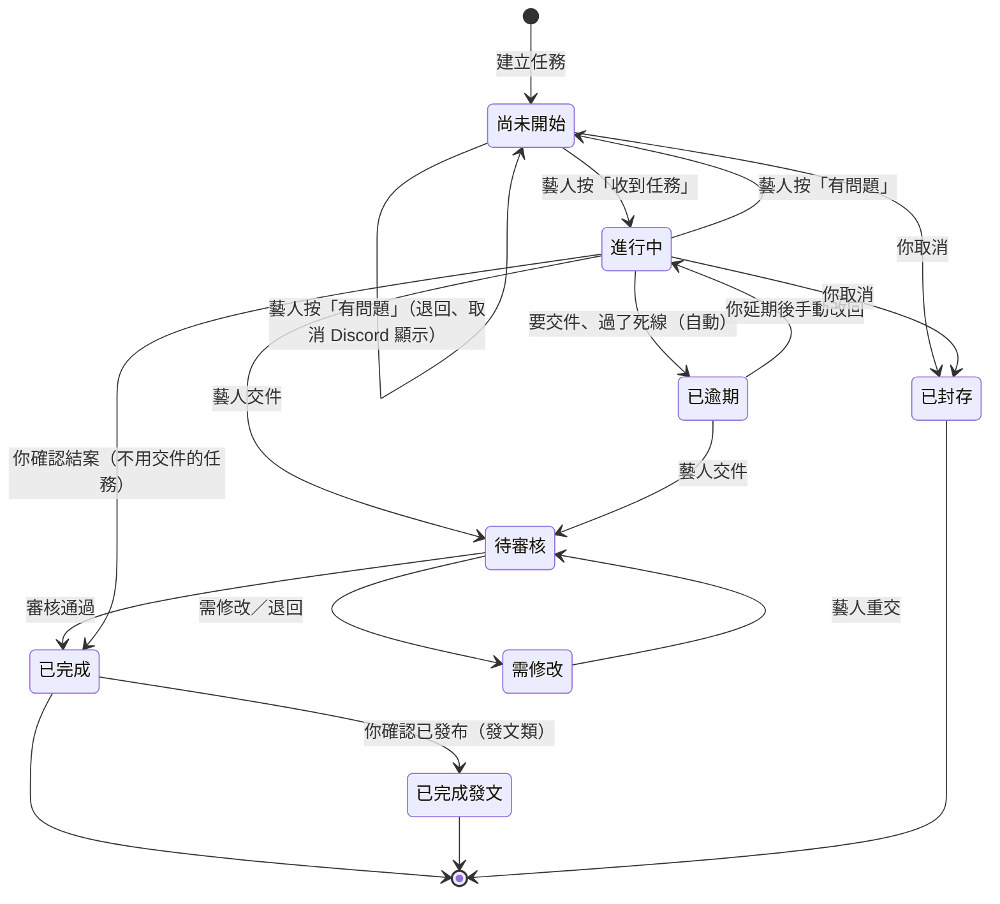

| `任務狀態` | 誰改的 | 小律還會提醒嗎 |
|---|---|---|
| `尚未開始` | 建立時；藝人回報問題時退回 | 有派發的話，早報會問他按收到 |
| `進行中` | 藝人按收到 | 期限前提醒 |
| `待提交` | 你手動（選用） | 同 `進行中` |
| `待審核` | 藝人交件 | 不催藝人，催審核人 |
| `需修改` | 審核結果 | 每天在早報 |
| `已逾期` | 小律（要交件的任務）或你手動 | 每天在早報 |
| `已完成`、`已完成發文`、`已封存` | 審核通過或你結案 | 不再提醒 |

### 三個日期欄位

這三欄**是任務一生中三個不同的時刻**，搞混的話提醒會發在錯的日子。

| 欄位 | 是什麼 | 誰填 |
|---|---|---|
| **`截止日`** | **事情發生的那天**：上課日、發布日、演出日 | 你 |
| **`提交期限`** | **第一輪**交件的死線 | 你，或勾 `提前交件` 讓系統算 |
| **`修改期限`** | **審核退回後**重交的死線 | 審核時選 1～7 天，小律寫入 |

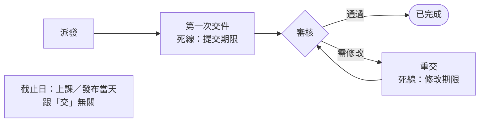

#### 小律現在追哪一天

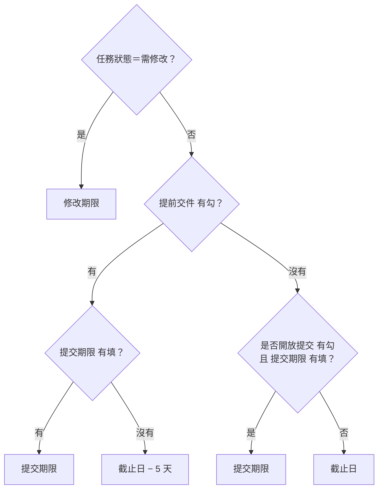

例：`截止日` 9/30、`提交期限`（有填時）9/27、`修改期限` 10/3

| # | `任務狀態` | `提前交件` | `是否開放提交` | `提交期限` | 死線 | 藝人看到 |
|---|---|---|---|---|---|---|
| 1 | 需修改 | 任意 | 任意 | 任意 | **10/3** | `修改期限 10/3` |
| 2 | 其他 | ☑ | 任意 | 9/27 | **9/27** | `交件 9/27` |
| 3 | 其他 | ☑ | 任意 | 空 | **9/25** | `交件 9/25` |
| 4 | 其他 | ☐ | ☑ | 9/27 | **9/27** | `交件 9/27` |
| 5 | 其他 | ☐ | ☐ | 9/27 | **9/30** | `截止 9/30` |
| 6 | 其他 | ☐ | 任意 | 空 | **9/30** | `截止 9/30` |

- **#3 最常用**：勾 `提前交件`、其他不動，系統自動算 9/25
- **#5 是陷阱**：填了 `提交期限` 但兩個開關都沒勾，`提交期限` 被忽略。填了就一定要勾其中一個
- 兩個日期都沒有就沒有死線，不提醒也不逾期

> 💡 `提前交件` 的任務：藝人看到的是「交件 9/25」，9/25 沒交 9/26 就逾期。一個任務進行到底不拆兩筆，代價是**發布日當天不會再提醒**，發布請自己盯。

### 過了死線會怎樣

| 任務 | 📒 Notion | 💬 Discord | 你要做的 |
|---|---|---|---|
| **要交件**（有勾 `是否開放提交`） | 小律把 `任務狀態` 改成 **`已逾期`** | 藝人早報列「🔴 已經過期限」；營運早報列「新逾期」 | 延期或結案 |
| **不用交件**（沒勾，例如發文、出席、行政） | **不改**，維持原本狀態 | 藝人早報列「⏳ 已過截止，等公司確認」；營運早報列「⏳ 已過截止，等你確認結案」 | 每天確認，見下方 |
| **課程培訓專案的任務** | 不判逾期 | — | 確認老師發布後結案 |
| **`需修改`** 過了 `修改期限` | **不改**，維持 `需修改` | 營運早報列「修改期限已過」 | 決定催或放棄 |
| **`待審核`** | 不判逾期 | — | 審核 |

> ⚠️ 要交件但**還沒勾開放提交**的任務，系統一樣當成「不用交件」。截止前記得勾。

### 不用交件的任務：每天確認

看營運早報的「⏳ 已過截止，等你確認結案」，點任務連結確認：

| 確認結果 | 在 Notion 怎麼改 | 隔天 |
|---|---|---|
| 做完了 | `已完成`（發文類改 `已完成發文`） | 不再列 |
| 沒做，希望他補 | 延後 `截止日` | 回到「⏰ 快到期」 |
| 沒做，要講重一點 | 手動改 `已逾期` | 藝人早報列「🔴 已經過期限」 |
| 還不確定 | 不動 | 每天繼續列 |

你不處理，它就每天列著。

### 延期

| 任務現在是 | 你要改的 |
|---|---|
| 一般任務 | 延後 `截止日` 或 `提交期限` |
| `已逾期` | 延後期限，**並把 `任務狀態` 改回 `進行中`**。只延期不改狀態，下一輪還是 `已逾期`；只改狀態不延期，下一輪又會被改回 `已逾期` |
| `需修改` | 延後 `修改期限` |

延期後要不要讓藝人收到新卡，見「改任務內容與重送」。

### 結案

| 情況 | 改成 |
|---|---|
| 交件任務審核通過 | 小律自動改 `已完成` |
| 不用交件的任務確認做完 | `已完成` |
| 發文類：審核通過後確認真的發布了 | `已完成發文`（每週一營運早報會列停在 `已完成` 超過 3 天的發文任務提醒你） |
| 取消、不做了 | `已封存`（不要刪頁面） |

### 出錯怎麼辦

| 狀況 | 原因 | 怎麼做 |
|---|---|---|
| 改回 `進行中` 又變回 `已逾期` | 沒延期限 | 先延期，再改狀態 |
| 提醒發在錯的日子 | 作業期限填在 `截止日`；或填了 `提交期限` 卻沒勾開關 | 照上面的判斷圖改 |
| 不用交件的任務一直在早報 | 你還沒結案 | 結案、延期或改 `已逾期` |
| 發布日當天沒有提醒 | `提前交件` 任務只追交件日 | 刻意設計，發布自己盯 |

---

## 處理營運內部通知

**什麼時候用**：`營運內部通知` 跳出新訊息時。

> 💡 **一句話看懂**：這個頻道的按鈕**只是 Discord 上的標記，不會改 Notion**。真正的處理一定要到 Notion 做；Notion 處理完，訊息也不會自己收起來，要回來按「✅ 已處理」。

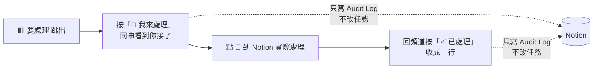

### 三種訊息

| 開頭 | 什麼時候 | 你要做的 |
|---|---|---|
| 📋 **營運早報** | 每天 09:30 一則，前一天的自動刪掉 | 逐項處理，見「每天的提醒與早報」 |
| 🟥 **要處理** | 即時 | 見下方 |
| ⚙️ **系統警告** | 很少：Drive 授權失效、Notion 選項對不上 | 照訊息裡的修法處理，或找工程端；Drive 恢復時同一則變 🟢 |

另外也會即時收到：時間收集**收齊**、排課時效提醒、批次重送結果。

每一則跟某筆任務有關的訊息都附那筆任務的 Notion 連結（早報裡是任務名稱本身；🟥 在最後一行 🔗）。連結只出現在這個頻道，藝人和同仁的訊息一律不帶。

### 三種 🟥 要處理

| 🟥 通知 | 為什麼會出現 | 到 Notion 做什麼 |
|---|---|---|
| **藝人回報任務問題** | 藝人按了「有問題」。小律已把任務退回 `尚未開始`、取消 `Discord 顯示`，原因在內頁「藝人回覆」（已逾期的任務不退回） | 看「藝人回覆」→ 改任務 → 重新勾 `Discord 顯示` |
| **新提交（沒有指定審核人）** | 藝人交件，但任務沒填 `審核人員`，或填的人沒有 Discord ID | 審這筆（`/審核提交` 或 Notion）；之後同類任務記得填 `審核人員` |
| **任務通知送不出去** | 勾了 `Discord 顯示`，但對象都沒有 `Discord User ID` | `Artists`／`People` 補 ID → 勾 `重送通知` |

### 營運的按鈕做什麼

| 按鈕／選單 | 📒 Notion | 💬 Discord |
|---|---|---|
| 🙋 **我來處理** | **不改任務**；`Audit Log` 記誰、幾點 | 訊息多一行「👤 名字 處理中」 |
| ✅ **已處理** | **不改任務**；`Audit Log` 記一筆 | 整則收成一行「✅ 已處理｜標題｜名字 時間」 |
| 營運早報的「看某一筆的詳細」 | 只讀 | 同一則下方展開那筆任務的內容、藝人、Notion 連結 |

這三種 🟥 在 Notion 上都沒有一個欄位能代表「處理完了」，所以小律沒辦法自己判斷，只能靠人按。不按也不影響任何功能，只是頻道裡看不出處理過沒。

### 常見誤會

| 你遇到的 | 原因 | 怎麼做 |
|---|---|---|
| Notion 處理完了，那則還是 🟥 | 🟥 不讀 Notion | 回頻道按「✅ 已處理」 |
| 按了「已處理」，任務沒變 | 按鈕只是標記 | 到 Notion 實際處理 |
| 同事按了「我來處理」，我還要處理嗎 | 不用 | 等他按「已處理」 |
| 按鈕按了沒反應 | bot 沒在線，或 Discord 一時沒回應 | 等一下再按；bot 重開後舊訊息的按鈕仍然能按 |
| 想知道誰處理了某則 | 收合那一行有名字和時間 | 訊息被刪了就查 `Audit Log` |

營運通知**只會**發到 `營運內部通知`。這個頻道沒設定時只寫記錄檔，不會改發到藝人看得到的地方。

---

## 布告欄、本月排程與使用回饋

**什麼時候用**：要發公告給所有人；想讓通告、演出列在本月排程；處理藝人回報的問題。

> 💡 **一句話看懂**：在 Notion `布告欄` 新增或修改，5 分鐘內同步到 `公告區`。本月排程是小律從 `Tasks` 自動整理的一則固定訊息。藝人按「回報問題」，會在 `布告欄` 建一筆「🙋 使用回饋」。

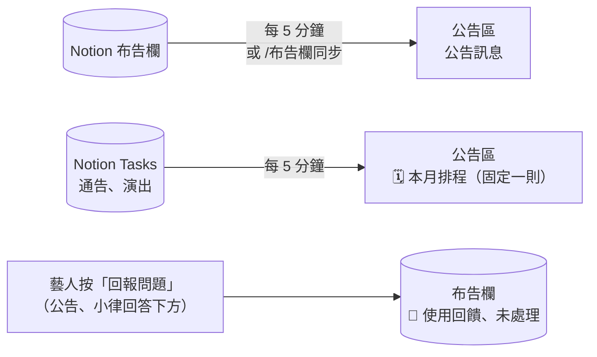

### 發公告

**你要做的**：在 Notion `布告欄` 新增一筆，填 `Name`、`類別`（📢 公告／💬 待討論／📝 會議摘要）、`狀態`、`Date`、`人員`，要置頂就勾 `📌 置頂`。

| 系統 | 發生什麼 |
|---|---|
| 📒 Notion | 只讀 |
| 💬 Discord | **5 分鐘內**發到 `公告區`。之後改了狀態、類別、日期、人員、置頂，就更新同一則；沒變的不會重發 |

想立刻同步就在 `營運操作` 打 **`/布告欄同步`**。

### 本月排程

`公告區` 每個月有一則「🗓️ YYYY 年 M 月排程」，小律自動維護，你不用做任何事。

| 會列進去的任務 | 📒 讀 Notion 什麼 |
|---|---|
| 已派發 | `Discord 顯示` 有勾 |
| 公開類型 | `任務類型` 是 `通告` 或 `演出` |
| 在當月 | `開始日`（或 `截止日`）落在這個月 |
| 沒結案 | 不是 `已封存` |

- 每 5 分鐘檢查，**內容有變就改同一則**，不會另發
- 被手動刪掉的話，下一輪自動補發
- 列入的類型跟公告區的公開類型同一個設定，要調整找工程端

### 使用回饋

公告下方的「回報／留言」、小律回答下方的「回報問題」（24 小時內有效），藝人填完送出：

| 系統 | 發生什麼 |
|---|---|
| 📒 Notion `布告欄` | 新增一筆：`類別`=🙋 使用回饋、`狀態`=未處理，內容含 Discord 使用者與原訊息連結 |

**你要做的**：定期看 `布告欄` 的「未處理」，處理後改 `狀態` 為 `處理中`／`已結案`。

### 出錯怎麼辦

| 狀況 | 原因 | 怎麼做 |
|---|---|---|
| 公告沒出現 | 還沒到 5 分鐘 | 打 `/布告欄同步` |
| 某個通告沒列進本月排程 | 沒勾 `Discord 顯示`、類型不是通告／演出、日期不在當月 | 補欄位，5 分鐘內更新 |

---

## 小律：問任務、聊天與語氣

**什麼時候用**：想知道藝人問小律時會看到什麼、小律的話是怎麼產生的、要調整小律的說話方式。

> 💡 **一句話看懂**：小律**只讀** Notion、不寫。任務、日期、筆數、回饋永遠照 Notion；AI 只負責語氣那一兩句。藝人能聊任何話題，但公司的事一律請藝人問公司。

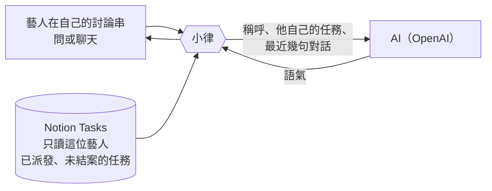

### 藝人怎麼問

在 `課程助教` 按置頂訊息的「💬 開始問小律」，小律開一個**只有他看得到**的私人討論串，之後都在裡面打字。

| 藝人問的 | 📒 小律讀 Notion 什麼 | 💬 回什麼 |
|---|---|---|
| 「這週有什麼任務」「還有哪些沒交」 | 這位藝人 `關聯藝人` 有他、`Discord 顯示` 已勾、還沒結案的任務（跟 `/我的任務` 一樣） | 清單＋小律一句話 |
| 「第 2 個的詳細內容」「哈根稿件的要求是什麼」 | 那筆任務的**內頁整頁**（略過「藝人回覆」「Drive 資料夾索引」） | 最多 1,500 字，Notion 網址拿掉 |
| 「聽力要做幾題」 | 同上 | 只照內頁回答，沒寫的請他問公司 |
| 打招呼、說累、練習方法、推薦歌 | 今天的任務（有要緊的才提一句） | 像一般聊天 |
| 合約、酬勞、排程怎麼排、公司規定 | — | 請他直接問公司 |

- 每次提問都重新讀 Notion，你剛改的內容馬上問得到
- 小律**只能查、不能操作**：交件、按收到還是用 `/我的任務`
- 回答下方有「回報問題」，送出後在 `布告欄` 建一筆使用回饋（見「布告欄、本月排程與使用回饋」）

> ⚠️ 所以**任務內頁要寫清楚做什麼、做多少、用什麼形式交**，而且**不要放不想讓藝人看到的東西**。

### 哪些話是 AI 寫的

| 地方 | 固定（照 Notion） | AI 寫的 |
|---|---|---|
| 每日早報 | 任務清單、日期、按鈕 | 開頭一句、看完後的結尾一句 |
| 審核結果 | 結果、回饋、重交說明 | 第二行那一句（依最近表現） |
| 派發卡、作業卡、交件流程、錯誤訊息 | 全部 | 沒有 |
| 問小律、聊天 | 任務清單本身 | 清單上面那段話、細節回答、聊天回覆 |

```discord
☀️ 方晨同學，早安！我是小律。
有一筆任務還沒收到、兩筆已過期限，別擔心，小律陪你一步一步處理。   ← AI 寫的
📌 有 1 筆任務還在等你按收到喔                                    ← 以下固定
・編曲作業｜截止 10/28（剩 5 天）
```

### 送了什麼給 AI

| 情境 | 送出 | 不送 |
|---|---|---|
| 早報、審核結果 | 只有狀況統計（例如「還沒按收到 1 筆、已過期限 2 筆」「第 2 次交、最近連續 3 件一次通過」） | 藝人名字、任務名稱、內容、回饋（名字是系統事後補的） |
| 問小律、聊天 | 稱呼、**他自己的**任務名稱／期限／狀態、他問的話、討論串最近幾句 | 別人的任務 |

對話只放在記憶裡、不存檔，隔天或 bot 重開就清掉。

### AI 用不了的時候

沒設定、連不上、太慢、寫出怪句子（例如有網址），或當天用量到上限，小律改用**固定的範本句**，訊息照常準時發。範本句也是小律的口吻，例如：

- 有逾期：「有 2 筆已經過期限了，小律陪你一起把它們解決吧。」
- 審核需修改：「別擔心，照著回饋調整就好，小律陪你。」

### 調整小律的語氣

人設、說話原則、範例句寫在一份「小律的說話方式」檔案裡，**改完隔天就生效，不用重開 bot**。把想調整的方向告訴工程端，例如「再活潑一點」「逾期時不要太輕鬆」「不要用 emoji」。

> ⚠️ 這份檔案會送給 AI，而且程式碼是公開的。**只放「怎麼說話」，不要放任何藝人或任務的資料。**

**成本**：以現在的藝人數一個月約台幣幾塊錢；30 位藝人也在 50 元以內。另有每日用量上限，超過就改用範本句。

### 會議紀錄（封存中）

<details>
<summary>2026-10-18 起小律不讀會議紀錄，恢復後才需要照這段做</summary>

藝人能問到的會議紀錄要符合：

1. 在 `課程與會議記錄` 建一筆，內容**用純文字貼在內頁**（PDF 很耗額度、掃描檔讀不到）
2. 掛 `關聯專案`（專案裡的藝人問得到），或在任務的 `課程與會議記錄` 連到這場會議（該任務的藝人問得到）。這個資料庫沒有「參與藝人」欄位
3. `會議類型` 是 `課程會議` 的一律不給藝人
4. 確定能讓藝人知道才勾 `藝人可見`；公司內部的不要勾

`藝人可見` 欄位**不要刪除**，刪了小律完全查不到，bot 啟動時會在 `營運內部通知` 警告。

</details>

### 常見問題

| 狀況 | 原因 | 怎麼做 |
|---|---|---|
| 藝人說小律查不到某筆任務 | 還沒派發，或已結案 | 正常；要給他看就派發 |
| 小律的話不太適合 | — | 截圖給工程端調整說話方式或範本句 |
| 兩位藝人同一天開頭不一樣 | 小律看各自的狀況寫 | 正常 |
| 今天開頭跟範本句一模一樣 | 當天 AI 沒用上 | 內容一樣正確，不用處理 |
| 藝人在頻道直接打字 | 頻道大家都看得到 | 小律會收掉，但請藝人改在自己的討論串問 |

---

## 伺服器初始化（一次性）

**什麼時候用**：第一次架設 Discord 伺服器，或頻道、權限被改亂了要對齊回來。

> 💡 **一句話看懂**：`/伺服器初始化` 只動 Discord，不碰 Notion 和 Drive。先預覽，按確認才動手；已有的同名頻道會沿用。

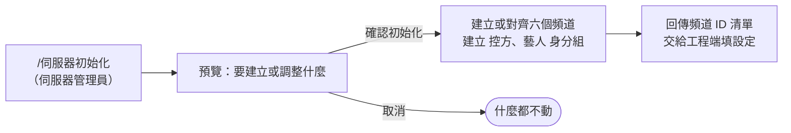

| 系統 | 發生什麼 |
|---|---|
| 📒 Notion | 不動 |
| 💬 Discord | 建立或對齊六個頻道（分類、主題、權限）與 `控方`／`藝人` 身分組 |
| 📁 Drive | 不動 |

**頻道權限**

| 頻道 | `控方` | `藝人` | 其他人 |
|---|---|---|---|
| `營運操作`、`營運內部通知` | 看得到、可發言、能打指令 | 看不到 | 看不到 |
| `時間管理`、`任務查詢入口` | 看得到 | 看得到、可發言、能打指令 | 看不到 |
| `課程助教` | 看得到 | 同上，另外可以開私人討論串 | 看不到 |
| `公告區` | 看得到 | 只能看、能按按鈕 | 看不到 |

- 只有伺服器管理員能用；預覽畫面 5 分鐘內要確認
- 已有同名頻道會沿用並更新設定，不會重建
- 完成後把回傳的頻道 ID 清單交給工程端

之後每位新成員的身分組要手動給，見「新藝人、新同仁上線」。

---

## 指令與 Notion 對照

這頁是**速查表**：想做某件事時，該打哪個指令、還是去 Notion 改哪個欄位；做了之後系統會在 Notion 寫什麼、會通知誰。細節請點每列最右邊的頁面。

判斷原則只有一條：**Notion 是資料的來源，Discord 是操作的入口**。你在 Notion 改的欄位，系統下一輪（最多 30 分鐘）會照著做；你在 Discord 打的指令，系統會馬上做，並把結果寫回 Notion。

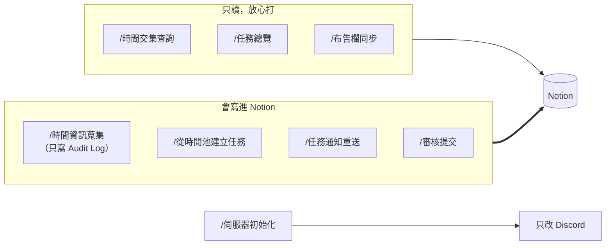

### 一、營運指令（在 `營運操作` 頻道打）

| 指令 | 用途 | Notion 會怎樣 | 會通知誰 | 細節 |
|---|---|---|---|---|
| `/時間資訊蒐集` | 發起下個月的可配合時間收集 | 讀 `Artists`（可排課的藝人）；寫一筆 `Audit Log`。藝人填的時段之後寫進 `Availability Slots` | `公告區` 發公告並提及藝人、每位藝人私訊 | 「每月收集可配合時間」 |
| `/取消時間蒐集` | 發錯了，停掉這次收集 | **不刪**藝人已填的時段；停掉催填與逾期通知 | 不通知（已發出的公告要自己刪） | 「每月收集可配合時間」 |
| `/時間交集查詢` | 看幾位藝人的共同空檔 | **只讀，完全不寫入** | 不通知 | 「排課」 |
| `/從時間池建立任務` | 從共同空檔建一筆任務草稿 | 先整理 `Availability Slots`（合併重疊、封存重複）；在 `Tasks` 建一筆**草稿**：`任務狀態`=尚未開始、`Discord 顯示`=**不勾**、`是否開放提交`=不勾 | **不通知藝人**（草稿）。補完內容再勾 `Discord 顯示` | 「排課」 |
| `/任務總覽` | 看全部未結案任務（待審核、逾期、即將到期） | **只讀** | 不通知 | 「每天的提醒與早報」 |
| `/任務通知重送` | 選一筆任務立刻重新通知藝人 | 清掉這筆的 `Discord 通知時間`、`Discord 收到時間`，送出後重寫 `Discord 通知時間`；寫 `Audit Log` | 關聯藝人（舊卡會先刪掉） | 「改任務內容與重送」 |
| `/審核提交` | 在 Discord 審核一筆提交 | `Submissions`：`審核狀態`、`審核回饋`、`審核者`、`審核來源`、`審核通知時間`。`Tasks`：通過 → `已完成`；需修改／退回 → `需修改`＋`修改期限` | 藝人（審核結果；附批改檔時再一則） | 「交件與審核」 |
| `/布告欄同步` | 不等 5 分鐘，立刻把布告欄同步到公告區 | **只讀** `布告欄` | `公告區` | 「布告欄、本月排程與使用回饋」 |
| `/伺服器初始化` | 建立或對齊頻道與身分組（一次性） | **不碰 Notion**，只改 Discord | 不通知 | 「伺服器初始化（一次性）」 |

> 💡 **只讀的指令可以放心打**：`/時間交集查詢`、`/任務總覽`、`/布告欄同步` 都不會改 Notion。會改 Notion 的只有 `/從時間池建立任務`（建草稿）、`/任務通知重送`（重設通知時間）、`/審核提交`（寫審核結果）。

### 二、藝人的指令與按鈕（藝人在 Discord 做的事）

| 藝人做的事 | 在哪裡 | Notion 會怎樣 | 你會收到 |
|---|---|---|---|
| `/管理可配合時間`：補填、刪除時段 | `時間管理` 頻道 | `Availability Slots` 新增一筆，或刪除的那筆改成封存 | 不通知（營運早報有收集進度） |
| 按「收到任務」／「全部收到」 | 私訊的任務卡、合併通知、早報第一段 | `任務狀態` → `進行中`；寫 `Discord 收到時間` | 不通知 |
| 按「有問題・無法配合」／「哪一筆不行？」 | 私訊 | 原因寫進任務內頁「藝人回覆」；`任務狀態` → `尚未開始`、`Discord 顯示` 取消、通知與收到時間清空（**已逾期的不退回**，只寫原因） | `營運內部通知` 🟥 要處理 |
| 按「👌 我看完了」 | 每日早報 | 早報裡每筆任務的 `提醒確認(From 藝人)` 加一行 | 不通知（營運早報會列誰昨天沒看） |
| `/我的任務` → 提交任務 → 我已上傳到 Drive | `任務查詢入口` | `Submissions` 新增一筆（舊的取消 `是否最新版`）；`任務狀態` → `待審核`；寫 `最新提交 URL`、`Google Drive Folder` | 審核人員私訊（沒填審核人員才發 `營運內部通知`） |
| 問小律、跟小律聊天 | 小律頻道的私人討論串 | **只讀**自己的任務 | 不通知；按「回報問題」才在 `布告欄` 建一筆使用回饋 |

各按鈕的完整流程見「派發與藝人回應」「交件與審核」「處理營運內部通知」。

### 三、你在 Notion 改什麼，系統會做什麼

改完不用打任何指令，系統下一輪（最多 30 分鐘）會照著做。

#### Tasks

| 你改的欄位 | 系統會做什麼 |
|---|---|
| 勾 **`Discord 顯示`** | 派發：私訊關聯藝人（同一輪好幾筆合併成一則）、知會相關同仁；`通告`／`演出` 另外發公告區。寫 `Discord 通知時間` |
| 取消 `Discord 顯示` | 藝人看不到這筆，也不再提醒。下次再勾會重新派發 |
| 勾 **`是否開放提交`** | 私訊藝人「作業開放囉，可以開始交了」；藝人可以在 `/我的任務` 交件。**沒勾的任務過了截止不判逾期**，改列在營運早報「等你確認結案」 |
| 勾 **`重送通知`** | 一起重送給藝人、自動取消勾選，`營運內部通知` 發一則重送結果 |
| 改 `截止日`／`提交期限`／`修改期限` | 早報的「快到期」「已經過期限」跟著新日期算。已經是 `已逾期` 的任務延後期限後，記得把 `任務狀態` 改回 `進行中`（見「期限、逾期與結案」） |
| 勾 `提醒規則` | 期限前那幾天，這筆會出現在藝人早報的「快到期」（預設已有 5 天前、3 天前） |
| 填 `審核人員` | 藝人交件時私訊這幾位；待審核超過 24 小時每天 10:00 再提醒 |
| 填 `相關同仁` | 派發時私訊他們一則知會（沒有按鈕），每天也收同仁早報 |
| 改 `任務狀態` 成 `已完成`／`已封存` | 結案：不再提醒、不再出現在早報 |
| 手動改成 `已逾期` | 藝人早報列在「已經過期限」（不用交件的任務，你確認真的沒做時才這樣改） |
| 填 `Google Drive Folder` | 藝人交件改交到這個資料夾（不照專案建）。單一藝人的任務第一次交件後系統會自己填；手動填的資料夾要自己分享給藝人（見「交件與審核」） |
| 在任務**內頁**寫內容 | 派發卡和小律都會讀內頁整頁當任務說明 |

#### Submissions

| 你改的欄位 | 系統會做什麼 |
|---|---|
| 先寫 `審核回饋`，再把 `審核狀態` 改成 `通過`／`需修改`／`退回` | 每分鐘檢查一次：私訊藝人審核結果；通過 → 任務 `已完成`；需修改／退回 → 任務 `需修改` |

#### 其他資料庫

| 資料庫與欄位 | 系統會做什麼 |
|---|---|
| `Artists` 的 `Discord User ID` | 系統靠這欄認人。**填錯會把別人的任務給錯的人看**，一定要填對 |
| `Artists` 的 `Google Drive 資料夾` | 藝人專區。交件資料夾都建在這底下；沒填就在公司 Drive 總資料夾下建一個以藝人名稱命名的。**系統不設分享權限**，專區要你分享給藝人 |
| `People` 的 `Discord User ID` | 同仁、老師、審核人員靠這欄收私訊；沒填就收不到 |
| `布告欄` 新增或修改 | 5 分鐘內同步到 `公告區` |

### 四、常用情境：該打指令還是改 Notion

| 我想要… | 做法 |
|---|---|
| 發一筆新任務給藝人 | Notion 建任務、填好欄位與內頁 → 勾 `Discord 顯示` |
| 任務內容改了，要藝人看新版 | 改完 → 一筆用 `/任務通知重送`，很多筆勾 `重送通知` |
| 讓藝人可以交件 | 勾 `是否開放提交` |
| 審核交件 | Notion 改 `審核狀態`（先寫回饋），或 `/審核提交` |
| 藝人回報問題、任務被退回了 | 改好任務 → 重新勾 `Discord 顯示` |
| 結案 | `任務狀態` 改 `已完成`（發文類確認發布後改 `已完成發文`） |
| 排課 | `/時間資訊蒐集` → 等藝人填 → `/時間交集查詢` 或 `/從時間池建立任務` |
| 查目前狀況 | `/任務總覽`，或看每天 09:30 的營運早報 |

---

## 時間與期限一覽

所有時間要改請找工程端。

### 每天固定時間

| 時間 | 發生什麼 | 詳見 |
|---|---|---|
| 09:00 | 藝人早報、同仁早報（私訊） | 「每天的提醒與早報」 |
| 09:30 | 營運早報（`營運內部通知`），前一天的自動刪掉 | 「每天的提醒與早報」 |
| 10:00 | 審核人催辦、課後提醒老師、Drive 健康檢查 | 「每天的提醒與早報」 |
| 每週一 09:30 | 營運早報多一區「發文待確認發布」 | 「期限、逾期與結案」 |
| 每 30 分鐘 | 派發、作業開放通知、逾期判斷、批次重送 | — |
| 每 5 分鐘 | 布告欄同步、本月排程更新 | 「布告欄、本月排程與使用回饋」 |

### 每次操作時決定的

| 項目 | 預設 | 在哪決定 |
|---|---|---|
| 月度收集截止 | 1 天（24 小時） | `/時間資訊蒐集` 的 `截止天數` |
| 修改期限 | 無預設 | 審核退回時選 **1～7 天** |
| 截止前提醒 | 死線前 5 天＋3 天 | 每筆任務的 `提醒規則` 只能再加 |
| 提前交件 | `截止日` 前 5 天 | 逐筆填 `提交期限` 就以它為準 |

### 各種自動通知的觸發條件

| 項目 | 觸發條件 | 什麼時候 |
|---|---|---|
| 任務派發 | 勾 `Discord 顯示`、有對象、未結案 | 下一輪（≤30 分）；同一位藝人 2 筆以上合併 |
| 作業開放通知 | 再勾 `是否開放提交` | 下一輪（≤30 分）；每筆只發一次 |
| 截止前提醒 | 死線前 5 天、3 天＋`提醒規則` | 排進當天 09:00 早報 |
| 自動逾期 | 要交件的任務過了死線 | 下一輪；改回 `進行中` 但沒延期會再被改回 |
| 等你確認結案 | 不用交件的任務過了死線 | 每天早報列出，狀態不改 |
| 審核人催辦 | `待審核` 滿 24 小時 | 每天 10:00 |
| 修改期限逾時 | 過了 `修改期限` 還是 `需修改` | 每天營運早報 |
| 課後提醒老師 | `課程培訓` 專案、課程結束滿 2 小時、未結案 | 第一次之後每天 10:00，最多 7 天 |
| 發文待確認發布 | 發文任務停在 `已完成`、截止日過 3 天 | 每週一營運早報 |
| 批次重送 | 勾 `重送通知` | 下一輪，排在派發前面 |
| 時間收集催填 | 收集期還沒填 | 截止前 6 小時、逾期後各一次 |
| 時間收集收齊 | 全員填完 | 立刻 |
| 排課時效 | 流程拖太久 | 48 小時升級、72 小時提示候選可能失效 |
| Notion 選項檢查 | bot 啟動 | 對不上就發 ⚙️ 警告 |
| 一天一次的發送失敗 | 早報、營運早報、催辦送失敗 | 30 分鐘後重試，同一天最多 3 次 |

### 操作畫面的逾時

按鈕與選單放著不動會失效，重打指令即可，**不會遺失已送出的資料**。

| 畫面 | 逾時 |
|---|---|
| 一般選單、任務清單、審核清單 | 10 分鐘 |
| 審核動作、批改檔選擇、伺服器初始化 | 5 分鐘 |
| 任務重送確認 | 3 分鐘 |
| 藝人上傳檔案、審核人附批改檔 | 3 小時 |
| 小律回答下方的「回報問題」 | 24 小時 |

---

## 出問題怎麼查

先照症狀找下表，每一列都寫了要去哪個系統看哪個欄位。每條流程頁最後也有各自的「出錯怎麼辦」。

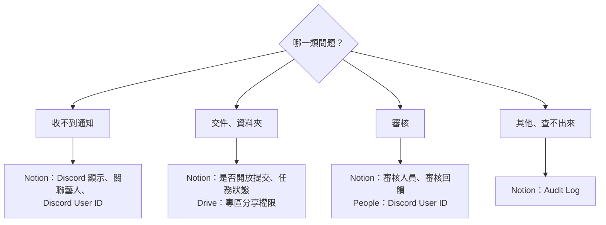

### 通知

| 狀況 | 檢查順序 |
|---|---|
| 藝人沒收到任務 | ① `Discord 顯示` 有勾？② 有 `關聯藝人`？③ `Artists` 有 `Discord User ID`？④ 都有就 `/任務通知重送` |
| 同仁沒收到 | ① 任務有填 `相關同仁`？② `People` 有 `Discord User ID`？（**沒填一定收不到，系統不會提醒你**）③ `Discord 顯示` 有勾？④ 同仁早報只列已逾期、需修改、快到期 |
| 老師沒收到課後提醒 | ① 專案類型是 `課程培訓`？② `負責老師` 有填？③ 老師有 `Discord User ID`？沒有會列在營運早報 |
| 勾了開放提交但沒通知 | 等一輪（≤30 分）；確認 `Discord 顯示` 也有勾 |
| 通知內容不對 | 先改 Notion 欄位（時間改 `開始日`／`截止日`），再 `/任務通知重送` |
| 通知寫「尚未填寫任務說明」 | ① 內容在子頁面？② 只有圖片、檔案？③ 整段都是 `名稱：` 開頭？④ 都不是就是那一輪讀取失敗，重送 |
| 通知沒有時間 | `開始日`／`截止日` 空白，補上後重送 |
| 藝人看到不該看的內容 | 移到子頁面再重送；已送出的收不回來 |

### 交件與審核

| 狀況 | 檢查順序 |
|---|---|
| 藝人看不到「提交任務」 | `是否開放提交` 有勾？`任務狀態` 不是 `待審核`／`已完成`／`已封存`？ |
| 藝人打不開資料夾 | Drive 藝人專區有分享給他（編輯者）？他登入的是同一個 Google 帳號？ |
| 藝人說小律打不開 Drive | `營運內部通知` 有沒有 ⚙️ Drive 警告；請工程端重新授權 |
| 審核人沒收到 | `審核人員` 有填？審核人在 `People` 有 `Discord User ID`？ |
| Notion 改了審核狀態沒通知藝人 | `審核回饋` 有寫？ |
| 審核寫入失敗 | `Submissions` 有 `審核回饋`、`審核者`、`審核來源`、`審核通知時間` 四欄？ |

### 排課與時間收集

| 狀況 | 檢查順序 |
|---|---|
| 可排課藝人 0 位 | `Artists` 有 `Discord User ID`？`合約狀態` 不是 `未簽`／`暫停`／`封存`？都對就請工程端確認 Notion 權限 |
| 比對不到共同空檔 | 月份選錯？有人沒填？時長太長？既有任務佔滿？ |
| 藝人填錯時間 | 請他用 `/管理可配合時間` 修改或刪除 |

### 指令與頻道

| 狀況 | 檢查順序 |
|---|---|
| 管理指令看不到 | 有 `控方` 身分組或伺服器管理員權限？Bot 在線？都正常請工程端重開 bot |
| 藝人說 `/我的任務` 沒反應 | 他在 `任務查詢入口` 打的嗎？有 `藝人` 身分組嗎？ |
| 重送後藝人又要按一次確認 | 正常，內容變了舊確認不算數 |

### 都查不出來

看 Notion 的 `Audit Log`，裡面有每個動作的成功／失敗與錯誤訊息。畫面出現「❌ …失敗，請稍後再試」而 Audit Log 也看不出原因，把那句話和時間給工程端查記錄檔。
