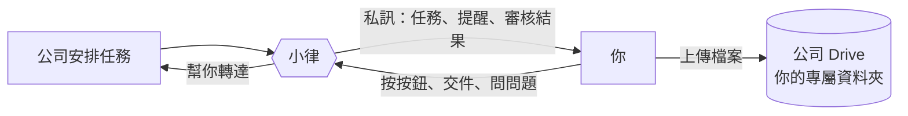
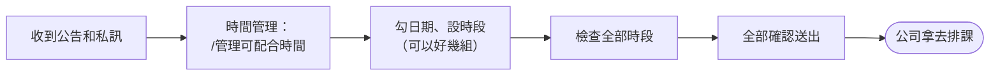
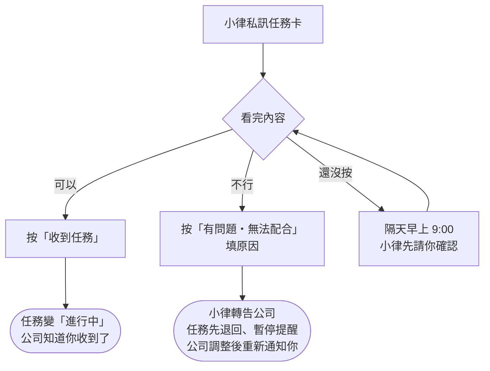
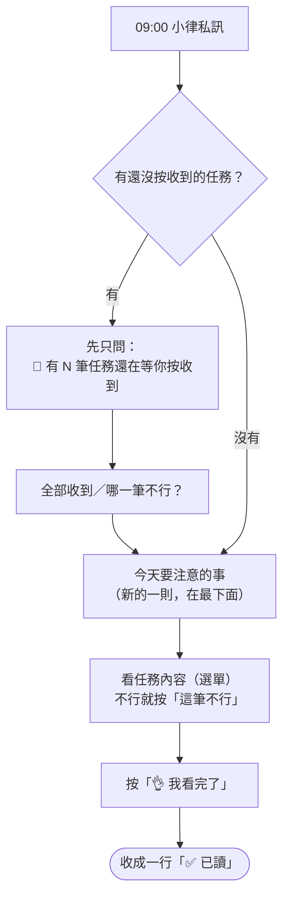
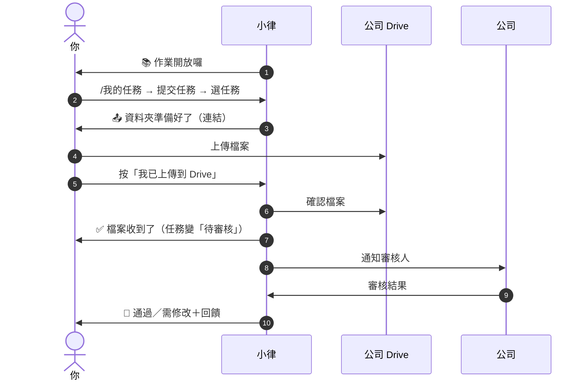
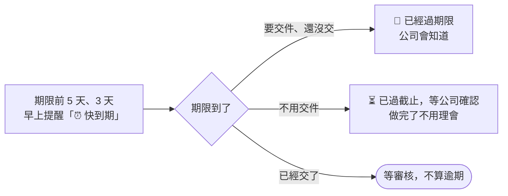
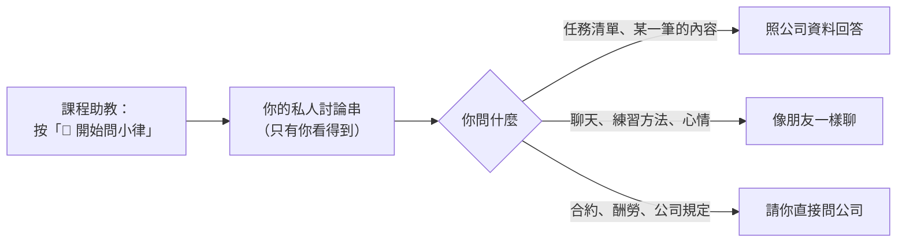

# 藝人操作 SOP

<!-- 這個檔案由 scripts/build_sop.py 從 docs/sop/artist/ 產生，不要直接改；改分頁後重新執行。 -->

你會用到的四件事：**回報時間、確認任務、交作業、問小律**。

## 目錄

- [開始使用](#開始使用)：小律是誰、四個頻道各做什麼、通知怎麼來、你會用到的四件事
- [每月回報可配合時間](#每月回報可配合時間)：收到通知 → 填時段 → 檢查 → 送出；填完可以改
- [收到任務通知](#收到任務通知)：小律私訊任務 → 按「收到任務」或「有問題・無法配合」；一次好幾筆、要再看內容
- [每天早上的任務提醒](#每天早上的任務提醒)：每天 9:00 一則：先確認還沒收的任務，再看今天要注意的事、按「我看完了」
- [交作業與審核結果](#交作業與審核結果)：作業開放 → 拿到資料夾 → 上傳 → 按我已上傳 → 等審核 → 通過或修改重交
- [期限與逾期](#期限與逾期)：「交件」和「截止」的差別、什麼時候會提醒、過了期限會怎樣、有時效的操作
- [問小律、跟小律聊天](#問小律跟小律聊天)：怎麼開始、查得到什麼、可以聊什麼、回答有問題
- [常見問題](#常見問題)：指令沒反應、沒收到通知、看不到提交按鈕…

---

## 開始使用

> 👋 **小律是誰？** 私訊你的那位就是小律，住在 Discord 裡的 AI 同學。她會提醒你今天要注意的事、幫你把「收到任務」或「這筆不行」轉達給公司、在交件和審核結果出來時告訴你。每天早上和審核結果那一兩句話，是小律看你最近的狀況寫的，所以每天不太一樣；任務、日期、按鈕這些事實不會變。



### 你會用到的四件事

| 要做的事 | 在哪裡 | 看哪一頁 |
|---|---|---|
| 每個月回報哪些時間有空 | `時間管理` 打 `/管理可配合時間` | 「每月回報可配合時間」 |
| 收到任務，按收到或說不行 | 小律的私訊 | 「收到任務通知」 |
| 每天早上看今天要注意的事 | 小律的私訊 | 「每天早上的任務提醒」 |
| 交作業 | `任務查詢入口` 打 `/我的任務` | 「交作業與審核結果」 |

想查任務或聊天，到 `課程助教` 問小律（見「問小律、跟小律聊天」）。

### 四個頻道

| 頻道 | 你在這裡做什麼 |
|---|---|
| `時間管理` | 回報、修改每個月的可配合時間 |
| `任務查詢入口` | 查自己的任務、交作業 |
| `課程助教` | 按「💬 開始問小律」，在自己的私人討論串裡問小律 |
| `公告區` | 看公告與**本月排程**（固定一則，會自動更新）。不能發言，但公告上的按鈕可以按 |

**任務通知、審核結果一律私訊給你本人**，不會出現在公開頻道，別人看不到。

指令只能在對的頻道用，打了沒反應先確認頻道。看不到這些頻道的話，請公司幫你開權限。

> 💡 小律不會給你 Notion 連結。公司的 Notion 裡有其他藝人的資料，所以藝人一律不從那邊進出；你需要的內容都在小律的訊息裡。

---

## 每月回報可配合時間

**什麼時候**：每個月公司會發起一次收集，你會在 `公告區` 看到公告，也會收到小律私訊。



### 怎麼填

1. 在 `時間管理` 打 **`/管理可配合時間`**，選月份
2. **勾日期 → 設時段**。同一個時段可以一次勾很多天
3. 不同時段就「繼續選日期」再加一組
4. 全部填完按「**檢查全部時段**」
5. 確認沒問題按「**全部確認送出**」

> 💡 **按「全部確認送出」之前都不會真的存檔。** 中途取消、關掉視窗都不影響，下次打開還在。

### 「檢查全部時段」會告訴你什麼

小律會比對你已經排定的任務，列出**實際會保留的時段**：

- 跟已排定任務衝突的部分 → 自動排除
- 整段都被佔用的 → 請你回去改
- 重複或重疊的時段 → 自動合併

所以你看到的清單跟你填的可能不一樣，這是正常的。

**只有已經正式通知你的任務會被排除。** 公司還在安排、還沒通知你的不會出現在這裡，照你真正有空的時間填就好，撞到的話公司會再跟你確認。

### 送出之後

- 你的時段會存進公司的系統，公司用它找大家都有空的時間排課
- **截止前 6 小時**、**過了截止**還沒填，小律各提醒一次，中間不會一直吵你。所以收到通知就盡早填

### 填完可以改

打開 `/管理可配合時間` 選月份：

- **修改單日**：只改某一天，同組其他日期不受影響
- **修改整組**：整組改時段
- **移除**：刪掉整組
- **新增／補填日期**：再加新的

送出的也能刪掉重填，**不用找公司重發公告**。送出的只是「可以配合的時間」，不是已經排定的行程。

---

## 收到任務通知

**什麼時候**：公司安排好任務後，小律會私訊你。



### 你會收到什麼

```discord
📌 方晨同學，有一筆新任務來囉！
任務：10/25（日）week4 聽力、歌唱、舞蹈、鋼琴、運動
類型：任務
截止：10/26

任務內容
• 聽力訓練：50題音程、20題三和弦、20題七和弦／截圖
• 歌唱課：用老師教的技巧練習指定歌曲／影片

看完沒問題就按「收到任務」，小律會幫你告訴公司；不行的話按「有問題・無法配合」跟小律說。
[收到任務] [有問題・無法配合]
```

### 可以做：按「收到任務」（一定要按）

| 你按了之後 | |
|---|---|
| 公司那邊 | 任務變成「進行中」，公司知道你收到了 |
| 你的私訊 | 這則收成一行「✅ 任務收好了，小律記下來囉」，後面留一顆「⚠️ 有問題／無法配合」，收到之後才發現不行也能回報 |
| 舊訊息 | 同一個任務之前的舊通知自動刪掉，私訊只留最新那則 |

沒按的話，隔天早上 9:00 那一則會**先請你確認**「📌 有 N 筆任務還在等你按收到喔」，之前那張任務卡會被收掉，不用回頭找。

> ⚠️ **早報的「👌 我看完了」不等於收到任務。** 收到一律按「收到任務」（或「全部收到」）。

### 不行：按「有問題・無法配合」

按下去填個原因就好：

| 你送出之後 | |
|---|---|
| 公司那邊 | 收到你寫的原因，任務先退回、**暫停提醒你**，調整後重新通知你 |
| 你的私訊 | 那張卡收成一行「⚠️ 小律已轉告公司｜任務｜等調整」，不用再按「收到任務」 |

真的有困難就按，不要放著不理。同一筆回報一次就好，再按會提醒你「已經回報過」。

可以回報的地方：任務卡的「有問題・無法配合」（收到前後都有）、合併通知的「⚠️ 哪一筆不行？」、早上任務提醒展開某一筆時的「⚠️ 這筆不行」。

> ⚠️ **已經交件、或正在修改中的任務不能用按鈕回報**，請直接聯絡公司。
>
> 💡 **已經逾期的任務還是可以回報**，例如需要延期：任務會先維持「已逾期」，公司會跟你確認怎麼處理。

### 一次來好幾筆的時候

公司同時安排（或重送）好幾筆時，你只會收到**一則**合併通知：

```discord
📌 任務通知（2）
・UAT 2026-10-21 A1 派發測試｜截止 10/28（剩 7 天）
・UAT 2026-10-21 A2 對照組｜截止 10/28（剩 7 天）

想看某一筆的完整內容，用下方選單；看過後按「✅ 全部收到」。某一筆不行就用「⚠️ 哪一筆不行？」。
[看任務內容…▾]
[✅ 全部收到]
[⚠️ 哪一筆不行？…▾]
```

1. 用「**看任務內容**」選一筆，內容展開在**同一則訊息**下面，再選別筆就換成那一筆
2. 都看過按「**✅ 全部收到**」，這則收成一行「✅ N 筆任務收好了」
3. 某一筆不行：用「**⚠️ 哪一筆不行？**」選那一筆、填原因，只有那一筆退回。按鈕會變成「**✅ 收下剩下 N 筆**」，送出後的確認訊息上也有同一顆，直接按就好。每一筆都回報了，這則就自動收起來

公司一次開放好幾筆作業時，也會合併成一則「📚 課後作業通知（N）」。

### 要再看一次任務內容

任務通知本身就是完整內容。想重看可以用：

- 每天早上任務提醒的「**看任務內容**」選單
- `/我的任務`
- 問小律，例如「第 2 個的詳細內容」

內容有缺漏請找公司補。公司改了內容會重送，你會收到新的一則、要再按一次「收到任務」，舊的會自動刪掉。

---

## 每天早上的任務提醒

**什麼時候**：每天早上 9:00，小律私訊你**一則**「今天要注意的事」。沒有要注意的任務那天不會發。



```discord
☀️ 10/21（三）今天要注意的事

🔴 已經過期限（1）
・10/20（二）開圈影片｜截止 10/20（已過 1 天）

⏳ 已過截止，等公司確認（1）
・10/20（二）發布：吃宵夜 POV｜截止 10/20（已過 1 天）
還沒做完請盡快完成；已經做完不用理會，公司會確認。

⏰ 快到期（1）
・11/6（五）編曲課作業 編曲仿作-Tom Misch｜截止 10/28（剩 7 天）

想看某一筆的內容，用下方選單；看完按「👌 我看完了」。要交件請用 /我的任務。
[看任務內容…▾] [👌 我看完了]
```

### 會列哪些任務

| 區塊 | 什麼時候出現 | 怎麼處理 |
|---|---|---|
| 📌 還在等你按收到 | 有任務你還沒按「收到任務」。這時候早報**先只問這件事** | 按「全部收到」或「哪一筆不行？」 |
| 🔴 已經過期限 | 要交件的任務過了期限還沒交，或公司確認你真的沒做 | 盡快交件，或跟公司說明 |
| 🛠 需修改 | 審核退回，等你修改重交 | 照回饋修改，在修改期限內重交 |
| ⏳ 已過截止，等公司確認 | 不用交件的任務（發文、出席這類）過了期限 | 做完了**不用理會**；還沒做完請盡快完成並跟公司說 |
| ⏰ 快到期 | 期限前 5 天、3 天（或公司另外加的時間點），中間幾天不會出現 | 照計畫進行 |

### 怎麼用

1. 想看某一筆：用「**看任務內容**」選單，內容展開在**同一則訊息**下面。展開時多一顆「**⚠️ 這筆不行**」，不行就直接按，那一行會標「⚠️ 已回報」
2. 看完按「**👌 我看完了**」，這則收成一行「✅ 已讀」，公司就知道你看過了。每一筆都回報了的話直接算已讀

- 一天只有**一則**，隔天新的來時前一天的會自動消失；前幾天處理完的通知也會一起清掉
- 開頭和結尾那一句是**小律今天想跟你說的話**，每天不一樣
- **已逾期、需修改**的任務，按了「我看完了」隔天還是會列（標「⚠️ 仍未完成」），直到你交件或公司處理好

> 💡 「我看完了」只代表你讀過，不代表每一筆都沒問題，也**不等於收到任務**。某一筆不行，請先用「這筆不行」回報。

---

## 交作業與審核結果

**什麼時候**：收到小律的「📚 作業開放囉，可以開始交了！」，或在 `/我的任務` 看到「提交任務」按鈕，就可以交了。



### 什麼時候可以交

有些任務會分兩次通知：

1. 第一次：「你有這件事」（任務卡）
2. 第二次：「📚 課後作業通知」← **收到這個才代表可以交**

看不到「提交任務」按鈕，就是公司還沒開放。

### 怎麼交

1. 到 `任務查詢入口` 打 **`/我的任務`**
2. 點「**提交任務（N）**」
3. 選你要交的那筆任務
4. 小律給你一個**專屬的公司 Drive 資料夾**連結（「📤 某某任務的資料夾準備好了！」）→ 把檔案上傳進去（可以多個）
5. 回到 Discord 按「**我已上傳到 Drive**」，小律會去資料夾幫你確認
6. 小律回「✅ 檔案收到了！」，任務變成「待審核」

> 💡 第 4 步那則訊息**只有你看得到**，切去 Drive 上傳再回來可能已經消失。**沒關係**：3 小時內重新打 `/我的任務` → 提交任務 → 選**同一筆**，會回到同一個資料夾，剛剛傳的檔案都還在，直接按「我已上傳到 Drive」。

**所有任務都是這一種交法**：上傳到公司 Drive。文字類的內容（例如企劃想法）請存成檔案（Word、PDF、文字檔都可以）再上傳。

> ⚠️ **檔案不要傳到 Discord**，系統不收 Discord 附件。

**檔案存在哪**：公司幫你開的專屬資料夾，只有你和公司看得到。每次交件是一個新的小資料夾（第 1 版、第 2 版…），舊版本會留著。打不開資料夾的話請告訴公司幫你開權限。

### 交出去之後

- **不能自己撤回**。內容有錯直接跟公司或老師說，審核回來會有機會重交
- 等審核期間不會被催，也不會被算逾期

### 審核結果

| 結果 | 會怎樣 |
|---|---|
| **通過** | 任務完成 🎉 |
| **需修改**／**退回** | 給你 1～7 天修改期限。修好之前每天早上的任務提醒會列在「🛠 需修改」 |

你會收到**一到兩則**私訊：

1. **審核結果**（審核一送出就到）：結果加上審核人的回饋。第二行是**小律想跟你說的一句話**，依你最近的表現不一樣。需修改會寫明修改期限
2. **批改檔**（有的話才有，晚一點到）：「📎 老師補充了批改檔」，點連結就能看老師批改過的檔案

沒看到第二則不代表有問題，是老師這次沒附批改檔。

### 需要修改時

照回饋改好，**用同樣的方式再交一次**（`/我的任務` → 提交任務 → 選同一筆）。小律會開一個新版本的資料夾，交完狀態回到「待審核」，等下一輪結果。

過了修改期限還是可以交，但請先跟公司說一聲。

---

## 期限與逾期



### 「交件」和「截止」不一樣

你看到的日期有兩種寫法：

| 寫法 | 意思 |
|---|---|
| **交件 9/25** | 要先給公司審核的任務（影片、貼文、企劃這類）。**交件日就是你的死線**，9/25 沒交 9/26 就算逾期。對外發布日是公司的事 |
| **截止 9/30** | 上課、通告這類不用先審的，照截止日 |
| **修改期限 10/3** | 審核退回後，重交的期限 |

### 什麼時候會提醒你

期限前 **5 天**、**3 天**（公司也可能另外加前 1 天、當天），這筆任務會出現在當天早上任務提醒的「⏰ 快到期」。不會再一則一則私訊你。

### 過了期限會怎樣

**要交件的任務**：過了期限還沒交，任務會變成「已逾期」，公司也會知道。每天早上的任務提醒會列在「🔴 已經過期限」，直到你交件或公司處理好。逾期了**還是可以交**。

**不用交件的任務**（發文、出席這類）：過了期限，早上的任務提醒會列在「⏳ **已過截止，等公司確認**」。

- 已經做完：**不用理會**，公司確認後就會結案
- 還沒做完：請盡快完成，並跟公司說一聲。公司可能會延後期限，或改成「已逾期」

需要延期的話，可以在任務上按「有問題・無法配合」跟小律說，或直接找公司。

### 系統什麼時候會來找你

| 情況 | 多久 |
|---|---|
| 公司安排好任務 | 30 分鐘內私訊你任務卡 |
| **每天早上 9:00** | 一則「今天要注意的事」 |
| 公司開放交作業 | 30 分鐘內私訊「📚 課後作業通知」 |
| 你交了作業 | 審核完成後私訊你結果 |
| 每月時間收集 | 發起時一次、**截止前 6 小時**一次、過了截止再一次 |

### 有時效的操作

| 情況 | 時限 |
|---|---|
| 拿到 Drive 資料夾連結後上傳 | **3 小時**內，逾時重新進入提交流程 |
| 審核退回後重交 | 審核人指定的 **1～7 天** |
| 選單、按鈕放著不動 | 約 10 分鐘後失效，重打指令即可 |
| 小律回答下方的「回報問題」 | 24 小時 |

---

## 問小律、跟小律聊天

小律可以幫你**查自己的任務**，也可以**陪你聊天**。她只能查、不能幫你操作（交件、收到任務還是用 `/我的任務`）。



### 怎麼用

1. 到小律頻道，按置頂訊息的「**💬 開始問小律**」。系統會開一個**只有你看得到**的討論串（已經有的話會帶你回去），之後都在討論串裡直接打字問
   - ⚠️ **不要直接在頻道裡打字**：那裡大家都看得到。bot 雖然會收掉，但收掉前別人可能已經看到
2. 想問什麼就問：
   - 看清單：「這週有什麼任務」「下週要交什麼」「我還有哪些沒交」「11 月有什麼行程」「10/25 要做什麼」
   - 看某一筆的內容：列出清單後問「第 2 個的詳細內容」，或直接講任務名稱，例如「哈根提供稿件的要求是什麼」
   - 問任務裡的細節：「week4 聽力要做幾題」「要用什麼格式交」「發布前要先做什麼」——任務裡沒寫的，小律會請你問公司
3. 問了小律看不懂的問題，它會告訴你可以怎麼問

### 小律會怎麼回你

列任務清單時，標題下面會有一句**小律看了你這次查到的任務狀況說的話**，例如有快到期的會提醒你一步一步來，都很順的時候會稱讚你。每次不太一樣；任務名稱、日期、狀態這些事實照 Notion 列，不會變。

```discord
🤖 小律

📑 方晨同學，這週的任務有 3 筆
有快到期的任務，先一步一步來，小律幫你盯著喔！
1. 編曲作業｜課程時間&作業繳交｜截止 10/25（剩 1 天）｜進行中
2. …

想看哪一筆的內容，跟小律說「第 2 個」或直接講任務名稱就好。要交件或按「收到任務」，請用 /我的任務。
```

### 也可以跟小律聊天

不一定要問任務，小律就像一般的聊天夥伴，**什麼都可以聊**：打招呼、說累、練唱或練琴的方法、推薦歌、創作靈感、心情。她是看**你今天的任務狀況**回的，有很要緊的事（今天到期、已經過期限）才會順便提一句。

幾個小律不會做的：

- **公司的事**（合約、酬勞、排程怎麼安排、公司規定）：小律不能代表公司回答，會請你直接問公司
- **需要即時資訊的**（天氣、新聞、票價）：小律查不到，會老實跟你說
- **健康、法律、財務**：小律只給一般建議，會提醒你找專業的人

- 同一個討論串裡，小律**記得剛剛聊過的幾句**，所以可以接著問「那下週呢」「那第一個要做什麼」
- 隔天會重新開始（小律只記得當天的對話）
- 小律說的任務名稱、日期、狀態都是照公司的資料；資料沒寫的，她會請你問公司

```discord
你：好累喔，今天不想動
🤖 小律
辛苦了，方晨同學，今天先休息一下也沒關係；那筆 10/28 要交的編曲作業小律先幫你記著，等有力氣再處理就好。
```

### 查得到什麼

跟 `/我的任務` 看到的一樣：派發給你、還沒結案的任務。日期可以說今天、明天、這週、下週、這個月、下個月、幾月、幾月幾號、最近。

每次提問都會重新去 Notion 抓最新的，公司剛改的內容你馬上問得到。回答不會附 Notion 連結。

小律**只能查、不能操作**：交件、按「收到任務」還是用 `/我的任務`。

### 回答有問題

按訊息下方的「**回報問題**」，填說明送出（例如任務列錯、日期不對）。公司會在 Notion 布告欄收到，狀態是「未處理」。

---

## 常見問題

<details>
<summary>打 <code>/我的任務</code> 沒反應、或選單裡找不到這個指令？</summary>

確認你在 `任務查詢入口` 頻道，其他頻道不能用。

</details>

<details>
<summary>一直沒收到任何通知？</summary>

找公司確認兩件事：你的 Discord 帳號有沒有填進系統、那筆任務有沒有設定要通知你。

</details>

<details>
<summary>看不到「提交任務」按鈕？</summary>

公司還沒開放提交。等第二次通知「📚 課後作業通知」。

</details>

<details>
<summary>時段送出後發現撞到別的事？</summary>

打 `/管理可配合時間` 刪掉再補。送出的只是「可配合時間」，不是已經排定的行程。

</details>

<details>
<summary>任務太多，訊息看不完？</summary>

清單會自動分頁。下方有「上一頁／下一頁」，也有**跳頁選單**可以直接跳：

```discord
跳到指定頁（目前第 1/2 頁）…
  第 1/2 頁   🔴 已逾期、🛠 需修改
  第 2/2 頁   📋 進行中／待提交
```

選單會標示每頁有哪些類別，想先看逾期的就直接挑那一頁。

</details>

<details>
<summary>小律說查不到我的任務？</summary>

小律只看得到已經派發給你、還沒結案的任務（跟 `/我的任務` 一樣）。公司還沒派發、或已經結案的任務查不到；有疑問跟公司確認。

</details>

<details>
<summary>想看整個月有哪些通告、演出？</summary>

看 `公告區` 的「本月排程」那一則，系統會自動更新內容。只列通告與演出；你自己的所有任務請用 `/我的任務`。

</details>

<details>
<summary>早上的任務提醒說「已過截止，等公司確認」，但我已經做完了？</summary>

不用理會。這是不用交件的任務（發文、出席這類），公司確認後就會結案，之後不會再列。

</details>
