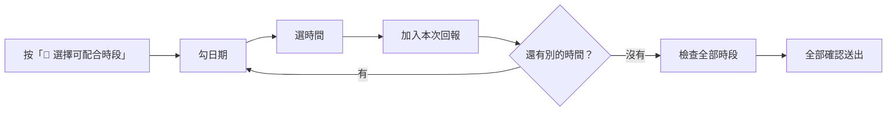
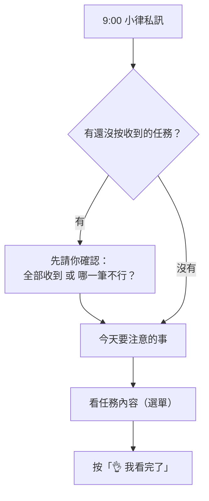
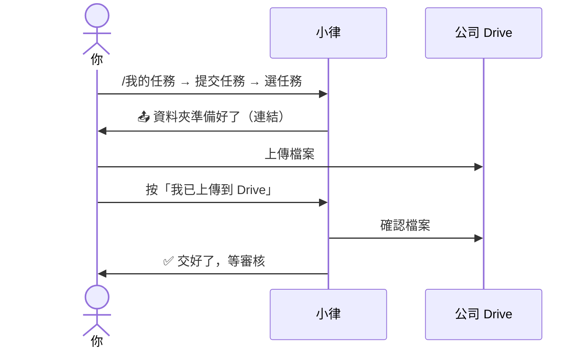
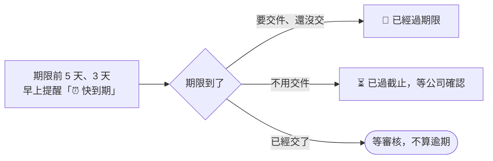
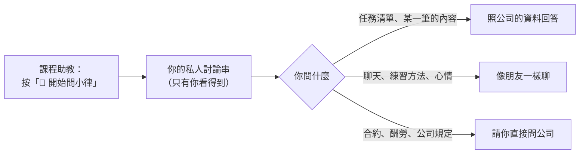

# 藝人操作 SOP

<!-- 這個檔案由 scripts/build_sop.py 從 docs/sop/artist/ 產生，不要直接改；改分頁後重新執行。 -->

你會用到的四件事：**回報時間、確認任務、交作業、問小律**。

## 目錄

- [開始使用](#開始使用)：小律是誰、四個頻道各做什麼、你會用到的四件事
- [回報下個月可配合時間](#回報下個月可配合時間)：收到時間收集通知後，勾日期、選時段、檢查、送出
- [修改或刪除已回報的時段](#修改或刪除已回報的時段)：已經送出的時段，刪掉或補填，不用找公司重發
- [收到任務通知](#收到任務通知)：小律私訊你一筆新任務，看完按「收到任務」；要再看內容的方法
- [一次收到好幾筆任務](#一次收到好幾筆任務)：好幾筆任務合併成一則：看內容、全部收到、挑出不行的那一筆
- [任務有問題，跟公司說](#任務有問題跟公司說)：時間不行、內容看不懂、想延期：按「有問題・無法配合」寫原因，小律幫你轉達
- [每天早上的任務提醒](#每天早上的任務提醒)：每天 9:00 一則：先確認還沒收的任務，再看今天要注意的事，按「我看完了」
- [交作業](#交作業)：打開交件入口、把檔案傳到小律給的 Drive 資料夾、按「我已上傳到 Drive」
- [看審核結果、修改後重交](#看審核結果修改後重交)：審核結果私訊、批改檔、需要修改時怎麼重交
- [期限與逾期](#期限與逾期)：「交件」和「截止」的差別、什麼時候會提醒、過了期限會怎樣、各種操作的時限
- [問小律、跟小律聊天](#問小律跟小律聊天)：打開自己的討論串、問任務、聊天、回報小律答錯的地方
- [常見問題](#常見問題)：指令沒反應、沒收到通知、看不到提交按鈕、公告怎麼回報…

---

## 開始使用

> 👋 **小律是誰？** 私訊你的那位就是小律，住在 Discord 裡的 AI 同學。她會通知你新任務、每天早上提醒你要注意的事、幫你把「收到了」或「這筆不行」轉達給公司，也會在審核結果出來時告訴你。


### 你會用到的四件事

| 想做的事 | 在哪裡 | 看哪一篇 |
|---|---|---|
| 回報下個月哪些時間可以 | `時間管理` 頻道 | 「回報下個月可配合時間」 |
| 收到任務，按收到或說不行 | 小律的私訊 | 「收到任務通知」 |
| 每天早上看今天要注意什麼 | 小律的私訊 | 「每天早上的任務提醒」 |
| 交作業 | `任務查詢入口` 頻道 | 「交作業」 |

想查任務或聊天，到 `課程助教` 問小律（見「問小律、跟小律聊天」）。

### 四個頻道

| 頻道 | 做什麼 |
|---|---|
| `時間管理` | 回報、修改每個月可以配合的時間 |
| `任務查詢入口` | 打 `/我的任務` 查任務、交作業 |
| `課程助教` | 按「💬 開始問小律」，在自己的私人討論串裡問小律 |
| `公告區` | 看公告、時間收集、本月排程。不能發言，但公告上的按鈕可以按 |

**任務通知、審核結果都是私訊給你本人**，別人看不到。

> 💡 指令只能在對的頻道用。打了沒反應，先確認是不是在對的頻道。看不到這些頻道的話，請找公司幫你開權限。

> 💡 小律不會給你 Notion 連結。你需要的內容，都寫在小律的訊息裡。

---

## 回報下個月可配合時間

每個月公司會請你回報下個月哪些時間可以。你會在 `公告區` 看到「📅 2026-11 可配合時間回報」，也會收到小律的私訊。



### 步驟

1. 在 `公告區` 那則公告下面按 **📅 選擇可配合時段**。（也可以到 `時間管理` 打 `/管理可配合時間`，再按 **➕ 新增／補填日期**）
2. 從 **選擇可配合日期（可多選）…** 勾日期。日期很多時用 **下一頁** 翻。同一個時間可以一次勾很多天。
3. 選時間：
   - **整天可（08:00–24:00）**
   - **某時間後**：填開始時間，例如 13:30
   - **某時間前**：填結束時間，例如 17:00
   - **指定時段**：填開始和結束時間

   選後面三種會跳出「補充可用時間」，填好時間送出。
4. 確認畫面沒問題，按 **加入本次回報**。要改就按 **返回修改**。
5. 還有別的時間，按 **繼續選日期**，回到第 2 步。勾錯日期可以按 **重新選日期**。
6. 全部選完，按 **檢查全部時段**。
7. 確認清單，按 **全部確認送出**。要改就按 **返回調整**。
8. 看到「✅ 已一次送出以下月度可配合時段」就完成了。

> 💡 **按「全部確認送出」之前都還沒存檔。** 想全部放棄，按 **取消本次回報**。

### 檢查時會發生什麼

小律會比對你已經排定的任務，列出**實際會保留的時段**：

- 跟已排定任務衝突的時間，會自動扣掉
- 重複或重疊的時段，會自動合併
- 整段都被佔掉的，會請你回去改

只有公司已經正式通知你的任務會被扣掉。還在安排、還沒通知你的不算，照你真正有空的時間填就好。

### 送出前想改

按 **管理全部已選**：

- 從 **選擇要修改或移除的暫存時段…** 選一組，按 **修改選取** 或 **移除選取**
- 只想改其中一天：從 **選擇要單獨修改的日期…** 選那天，按 **修改單日**；整組一起改按 **修改整組**
- 修改時選好新的日期、時間後按 **儲存修改**；不改了按 **取消修改**
- 按 **返回全部暫存**、**返回組內日期** 或 **返回** 回上一層

### 提醒

- 截止前 6 小時、過了截止，還沒填的話小律各提醒一次。中間不會一直吵你，收到通知就盡早填。
- 過了截止還是可以補填，但會記成逾期送出。

### 送出後想改

見「修改或刪除已回報的時段」。

---

## 修改或刪除已回報的時段

送出的只是「可以配合的時間」，不是排定的行程，隨時可以改，**不用找公司**。

### 刪掉時段

1. 到 `時間管理` 打 **`/管理可配合時間`**。
2. 從 **選擇要管理的月份…** 選月份。
3. 從 **選擇要刪除的既有時段（可多選）…** 勾要刪的時段。
4. 按 **🗑️ 刪除選取時段**。看到「🗑️ 已刪除並保存以下時段」就完成了。

### 補填新的時段

1. 同上，打開 `/管理可配合時間` 選月份。
2. 按 **➕ 新增／補填日期**。
3. 接著跟「回報下個月可配合時間」第 2 步以後一樣。

### 改時間

先刪掉舊的，再補填新的。

改完按 **✅ 完成並退出**。

> 💡 打開 `/管理可配合時間` 時，小律會順便把你重疊、重複的時段合併好。

---

## 收到任務通知

公司安排好任務後，小律會私訊你：

```discord
📌 方晨同學，有一筆新任務來囉！
任務：10/25（日）week4 聽力、歌唱、舞蹈
類型：課程時間&作業繳交
截止：10/26

任務內容
• 聽力訓練：50 題音程、20 題三和弦／截圖
• 歌唱課：用老師教的技巧練習指定歌曲／影片

看完沒問題就按「收到任務」，小律會幫你告訴公司；不行的話按「有問題・無法配合」跟小律說。
[收到任務] [有問題・無法配合]
```

### 看完沒問題：按「收到任務」

1. 看完任務內容。
2. 按 **收到任務**。

**之後會怎樣**

- 公司就知道你收到了
- 這則收成一行「✅ 任務收好了，小律記下來囉｜任務｜時間」，後面留一顆 **有問題・無法配合**，收到之後才發現不行也能回報
- 同一個任務之前的舊通知會自動刪掉

> ⚠️ **一定要按。** 沒按的話，隔天早上 9:00 小律會先請你確認；超過 3 天，公司也會知道。

> ⚠️ 早報上的「👌 我看完了」**不等於**收到任務。

### 不行：按「有問題・無法配合」

見「任務有問題，跟公司說」。

### 作業開放的通知

要交作業的任務，可以交的時候小律會再私訊一次：

```discord
📚 方晨同學，老師的作業開放囉，可以開始交了！
任務：10/25（日）week4 聽力、歌唱、舞蹈
截止：10/26

作業要求
…
[收到任務] [有問題・無法配合]
```

**收到這則才代表可以交了**，怎麼交見「交作業」。

### 要再看一次內容

- 每天早上任務提醒裡的 **看任務內容…** 選單
- 到 `任務查詢入口` 打 `/我的任務`
- 問小律，例如「第 2 個的詳細內容」

內容有缺或看不懂，請直接問公司。公司改了內容會重送，你會收到新的一則（舊的會刪掉），要再按一次 **收到任務**。

---

## 一次收到好幾筆任務

公司同時安排好幾筆任務時，你只會收到**一則**：

```discord
📌 任務通知（2）
・10/28 錄音：新歌 Demo｜截止 10/28（剩 2 天）
・10/30 發布：短影音｜截止 10/30（剩 4 天）

沒問題的話按「✅ 全部收到」，小律會幫你告訴公司。哪一筆不行，從「⚠️ 哪一筆不行？」選出來，小律幫你轉達。想看內容用「看任務內容」。
[看任務內容…▾]
[✅ 全部收到]
[⚠️ 哪一筆不行？…▾]
```

### 步驟

1. 從 **看任務內容…** 選一筆，內容會展開在同一則訊息下面。再選別筆就換成那一筆。
2. 都看過、都沒問題，按 **✅ 全部收到**。這則會收成一行「✅ 2 筆任務收好了，小律記下來囉」。
3. 有一筆不行：從 **⚠️ 哪一筆不行？** 選那一筆，寫原因（見「任務有問題，跟公司說」）。
   - 那一筆會被劃掉，標「⚠️ 小律已轉告公司，等調整」
   - 按鈕變成 **✅ 收下剩下 N 筆**，按它收下其他的
   - 每一筆都回報了，這則會自己收起來

> 💡 作業一次開放好幾筆時，也會合併成一則「📚 作業開放通知（N）」，用法一樣。

---

## 任務有問題，跟公司說

時間不行、內容看不懂、想延期，都可以跟小律說，小律會幫你轉達給公司。

### 在哪裡按

- 任務卡上的 **有問題・無法配合**（收到前、收到後都有）
- 好幾筆合併的那則：**⚠️ 哪一筆不行？** 選那一筆
- 每天早上的任務提醒：用 **看任務內容…** 展開那一筆，按 **⚠️ 這筆不行**

### 步驟

1. 按上面任一個按鈕。
2. 跳出「這筆任務哪裡不行呢？」，在 **跟小律說說原因** 寫原因，例如「那天有課沒辦法」「想延到 11/2」。
3. 送出。

### 之後會怎樣

- 小律回你「收到！小律已經把這筆的狀況轉告公司了」
- 這筆任務**先暫停**，不會再提醒你
- 任務卡收成一行「⚠️ 小律已轉告公司｜任務｜等調整」
- 公司調整好後，會重新通知你

同一筆回報一次就好，再按會提醒你「已經回報過」。

> 💡 **已經過期限的任務也可以回報**，例如想延期。這種任務不會暫停，公司會跟你確認怎麼處理。

> ⚠️ **已經交件、或正在修改的任務，不能用按鈕回報**，請直接找公司。

---

## 每天早上的任務提醒

每天早上 9:00，小律私訊你**一則**今天要注意的事。沒有要注意的事那天不會發。



### 有還沒按收到的任務時

早報會先只問這件事：

```discord
☀️ 方晨同學，早安！我是小律。
📌 有 2 筆任務還在等你按收到喔
・10/28 錄音：新歌 Demo｜截止 10/28（剩 2 天）
・10/30 發布：短影音｜截止 10/30（剩 4 天）
[看任務內容…▾]
[✅ 全部收到]
[⚠️ 哪一筆不行？…▾]
```

按 **✅ 全部收到**，或用 **⚠️ 哪一筆不行？** 回報。處理完，今天的提醒會以**新的一則**出現在私訊最下面。

### 今天要注意的事

```discord
☀️ 今天要注意的事（10/27 週二）

🔴 已經過期限（1）
・10/26 開圈影片｜截止 10/26（已過 1 天）

⏰ 快到期（1）
・11/6 編曲作業｜截止 10/31（剩 4 天）

[看任務內容…▾] [👌 我看完了]
```

| 區塊 | 意思 | 怎麼做 |
|---|---|---|
| 🔴 已經過期限 | 要交的任務過了期限還沒交 | 盡快交，或跟公司說明 |
| 🛠 需修改 | 審核退回，等你修改重交 | 照回饋改好重交 |
| ⏳ 已過截止，等公司確認 | 不用交件的任務（發文、出席這類）過了期限 | 做完了**不用理會**；還沒做請盡快完成並跟公司說 |
| ⏰ 快到期 | 期限前 5 天、3 天（或公司另外加的時間點）才出現 | 照計畫進行 |

### 步驟

1. 想看某一筆，從 **看任務內容…** 選。內容會展開在同一則下面，下面多一顆 **⚠️ 這筆不行**。
2. 都看完，按 **👌 我看完了**。這則收成一行「✅ 看完了，小律記下來囉」。

### 要知道的事

- 一天只有一則，隔天新的來時，前一天的會自動消失
- 開頭和結尾那一句，是小律看你最近的狀況寫的，每天不一樣
- 已經過期限、需修改的任務，按了「我看完了」隔天還是會列，直到你交件或公司處理好
- **「我看完了」不等於收到任務**，收到要按任務卡上的「收到任務」

---

## 交作業

**什麼時候可以交**：收到小律的「📚 作業開放囉，可以開始交了！」，或在 `/我的任務` 看到 **📤 提交任務** 按鈕。



### 步驟

1. 到 `任務查詢入口` 打 **`/我的任務`**。
2. 按 **📤 提交任務（N）**。
3. 從 **選擇要提交的任務…** 選你要交的那一筆。選錯了按 **↩️ 返回我的任務**。
4. 小律給你一個資料夾連結：「📤 「任務名稱」的資料夾準備好了！」。
5. 點連結，把檔案上傳到那個資料夾。可以傳好幾個。
6. 回到 Discord，按 **我已上傳到 Drive**。
7. 小律確認檔案後回你「✅ 已驗證 Drive 資料夾並提交」，任務變成「待審核」。

> 💡 **這則訊息只有你看得到**，切去 Drive 上傳再回來可能已經消失。沒關係：**3 小時內**重新打 `/我的任務` → 提交任務 → 選**同一筆**，會回到同一個資料夾，剛剛傳的檔案都還在，直接按 **我已上傳到 Drive** 就好。

> ⚠️ **檔案不要傳到 Discord**，小律不收 Discord 附件。一律傳到小律給的資料夾。

文字類的內容（例如企劃想法）請存成檔案再上傳，Word、PDF、文字檔都可以。

### 交出去之後

- 不能自己撤回。內容有錯，直接跟公司或老師說，審核回來會有機會重交
- 等審核期間不會被催，也不會算逾期
- 審核結果見「看審核結果、修改後重交」

### 常見問題

| 狀況 | 怎麼做 |
|---|---|
| 看不到「提交任務」 | 作業還沒開放，等「📚 作業開放囉」的通知 |
| 打不開資料夾 | 請公司幫你開資料夾的權限，並確認你登入的是正確的 Google 帳號 |
| 「⚠️ 目前找不到入口建立後新增的檔案」 | 檔案沒傳到那個資料夾（例如傳到上一層）。移進去後再按一次 |
| 「⚠️ 小律現在打不開公司的 Drive」 | 公司的 Drive 出狀況，請通知公司，稍後再交 |
| 「❌ 這次的上傳入口過期了」 | 超過 3 小時。重新打 `/我的任務` → 提交任務 |
| 想換一筆交 | 按 **↩️ 返回任務選擇** |

---

## 看審核結果、修改後重交

審核完，小律會私訊你結果：

| 結果 | 你會收到 | 任務 |
|---|---|---|
| **通過** | 「🎉 方晨同學，「編曲作業」通過了！」 | 完成 |
| **需修改** | 「🛠 方晨同學，「編曲作業」公司給了一些修改建議」＋修改期限 | 等你重交 |
| **退回** | 「↩️ 方晨同學，「編曲作業」這次先退回了」＋修改期限 | 等你重交 |

```discord
🛠 方晨同學，「編曲作業」公司給了一些修改建議
別擔心，照著回饋調整就好，小律陪你。

回饋
副歌的和聲再豐富一點。
審核：Johnny 老師
修改期限：10/29（四）

照回饋改好之後，到 /我的任務 按「提交任務」重新交就好，小律等你～
```

第二行是小律看你最近的表現說的一句話，每次不一樣。

### 批改檔

老師有附批改檔的話，會再收到一則「📎 老師補充了批改檔」，點連結就能看。沒收到這則不代表有問題，只是這次沒有附。

### 需要修改時

1. 照回饋改好。
2. 用同樣的方式再交一次：`/我的任務` → **📤 提交任務** → 選同一筆（見「交作業」）。
3. 小律會開一個新版本的資料夾，舊的版本會保留。
4. 交完任務回到「待審核」，等下一輪結果。

> 💡 修改期間，每天早上的任務提醒會列在「🛠 需修改」。過了修改期限還是可以交，但請先跟公司說一聲。

---

## 期限與逾期



### 你會看到的期限

| 寫法 | 意思 |
|---|---|
| **交件 9/25** | 要先給公司審的任務（影片、貼文、企劃這類）。**這天就是你的期限**，9/25 沒交，9/26 就算逾期 |
| **截止 9/30** | 上課、通告這類，照截止日 |
| **修改期限 10/3** | 審核退回後，重交的期限 |

### 什麼時候會提醒

期限前 **5 天**、**3 天**（公司也可能另外加前 1 天、當天），這筆會出現在當天早上任務提醒的「⏰ 快到期」。不會一則一則私訊你。

### 過了期限

**要交件的任務**：會變成「已經過期限」，公司也會知道。每天早上的任務提醒會列在「🔴 已經過期限」，直到你交件或公司處理好。**過期了還是可以交。**

**不用交件的任務**（發文、出席這類）：會列在「⏳ 已過截止，等公司確認」。

- 做完了：**不用理會**，公司確認後就會結案
- 還沒做：請盡快完成，並跟公司說一聲

需要延期，可以在任務上按 **有問題・無法配合** 跟小律說，或直接找公司。

### 有時間限制的操作

| 情況 | 時限 |
|---|---|
| 拿到交件資料夾後上傳 | **3 小時**，超過就重新打 `/我的任務` |
| 審核退回後重交 | 審核時給的修改期限 |
| 回報可配合時間的畫面 | 2 小時沒動會失效，重新打開就好 |
| 其他選單、按鈕 | 放著約 10 分鐘會失效，重打指令就好 |

---

## 問小律、跟小律聊天

小律可以幫你**查自己的任務**，也可以**陪你聊天**。



### 開始

1. 到 `課程助教`，按置頂訊息的 **💬 開始問小律**。
2. 小律會開一個**只有你看得到**的討論串（已經有的話會帶你回去）。
3. 之後都在討論串裡直接打字。

> ⚠️ **不要在頻道裡直接打字**，大家都看得到。小律會把那則收掉，並帶你到自己的討論串。

### 可以問什麼

- **看清單**：「這週有什麼任務」「下週要交什麼」「我還有哪些沒交」「11 月有什麼行程」
- **看某一筆**：列完清單後說「第 2 個」，或直接講任務名稱
- **問細節**：「聽力要做幾題」「要用什麼格式交」，任務裡沒寫的，小律會請你問公司
- **聊天**：打招呼、說累、練唱方法、推薦歌、創作靈感都可以。小律記得這個討論串剛剛聊過的幾句，隔天會重新開始

小律**不會**回答公司的事（合約、酬勞、排程怎麼排、規定）、查不到即時資訊（天氣、新聞），健康、法律、財務只給一般建議。

### 要知道的事

- 只查得到**已經通知你、還沒結案**的任務，跟 `/我的任務` 一樣
- 每次問都會抓最新的資料
- 小律**只能查、不能操作**：交作業、按收到還是要用 `/我的任務` 和任務卡

### 小律答錯了

1. 按那則回答下方的 **回報問題**（24 小時內有效）。
2. 跳出「回報小律的回答」，在 **問題說明** 寫哪裡不對，例如「任務列錯」「日期不對」。
3. 送出，看到「✅ 謝謝你告訴小律！」就完成了。公司會收到並處理。

---

## 常見問題

<details>
<summary>打 /我的任務 沒反應？</summary>

確認你是在 `任務查詢入口` 打的，其他頻道不能用。出現「找不到你的藝人資料」的話，請找公司確認你的 Discord 帳號有沒有設定好。

</details>

<details>
<summary>一直沒收到任何通知？</summary>

請公司確認兩件事：你的 Discord 帳號有沒有登記，那筆任務有沒有設定要通知你。

</details>

<details>
<summary>看不到「提交任務」按鈕？</summary>

作業還沒開放。等小律的「📚 作業開放囉」通知。

</details>

<details>
<summary>任務太多，訊息看不完？</summary>

清單會自動分頁。用 **上一頁**、**下一頁** 翻，或從 **跳到指定頁…** 直接跳到某一區，例如先看已經過期限的。

</details>

<details>
<summary>想看這個月所有的通告、演出？</summary>

看 `公告區` 的「🗓️ 本月排程」那一則，會自動更新。自己的所有任務請用 `/我的任務`。

</details>

<details>
<summary>對公告有問題或想補充？</summary>

按那則公告下面的 **回報／留言**，會跳出「回報這則公告」，在 **回饋內容** 寫你的問題，送出後公司會收到。直接用 Discord 的「回覆」回那則公告也可以。

</details>

<details>
<summary>早上的提醒寫「已過截止，等公司確認」，但我已經做完了？</summary>

不用理會。這是不用交件的任務，公司確認後就會結案。

</details>

<details>
<summary>回報的時段跟別的事撞到了？</summary>

打 `/管理可配合時間` 刪掉再補（見「修改或刪除已回報的時段」）。

</details>
