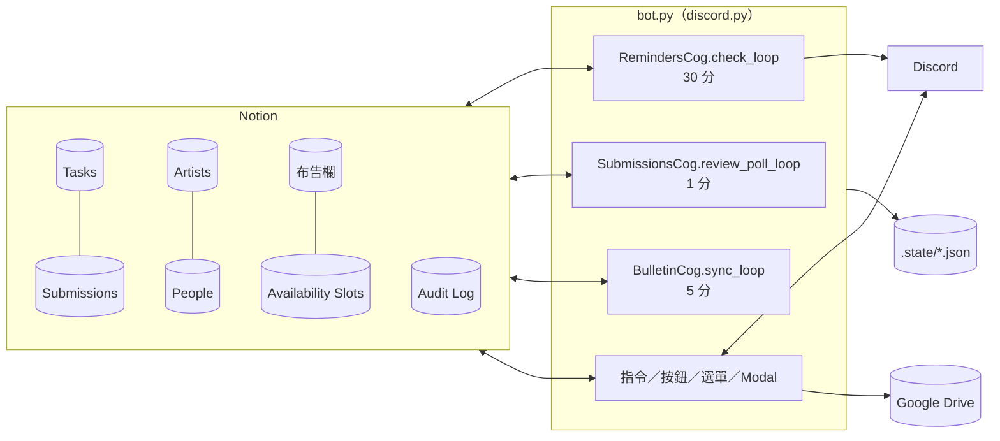

# 工程版：系統觸發與資料對照

<!-- 這個檔案由 scripts/build_sop.py 從 docs/sop/eng/ 產生，不要直接改；改分頁後重新執行。 -->

給工程師的參考資料：每一個操作或排程會觸發哪段程式、讀寫哪些 Notion 欄位、發出什麼訊息。操作步驟請看 [營運 SOP](ADMIN_SOP.md)、[藝人 SOP](ARTIST_SOP.md)。

## 目錄

- [架構總覽](#架構總覽)：三個背景迴圈、執行順序、訊息去向、狀態檔、Audit Log 與權限檢查
- [藝人觸發的流程](#藝人觸發的流程)：藝人每個指令、按鈕、選單、Modal：擋下條件、程式進入點、Notion 讀寫、Drive、通知誰
- [營運指令觸發的流程](#營運指令觸發的流程)：每個管理指令的畫面流程、Notion 讀寫、Drive、Discord 輸出；營運頻道按鈕
- [Notion 欄位變更觸發的流程](#notion-欄位變更觸發的流程)：營運在 Notion 改哪個欄位，bot 在哪一輪、用什麼條件、做什麼
- [自動排程](#自動排程)：每一項自動工作的時間、條件、輸出、去重，以及早報各區的判斷條件
- [Notion 欄位對照](#notion-欄位對照)：九個資料庫中程式會讀寫的欄位、型別、誰寫、用在哪；Drive 路徑規則
- [設定值](#設定值)：影響行為的 .env 設定與預設值；完整清單見 SETTINGS.md
- [狀態檔與去重](#狀態檔與去重)：.state/ 裡每個檔案記什麼、誰讀寫；重開 bot 為什麼不會重發
- [已知限制與未處理事項](#已知限制與未處理事項)：刻意的設計取捨、還沒處理的問題、沒有入口的程式碼

---

## 架構總覽

### 資料流

### 三個背景迴圈

| 迴圈 | 間隔 | 進入點 |
|---|---|---|
| `RemindersCog.check_loop` | `REMINDER_INTERVAL_MINUTES`（30） | `cogs/reminders.py` |
| `SubmissionsCog.review_poll_loop` | 1 分鐘（固定） | `cogs/submissions.py` |
| `BulletinCog.sync_loop` | `BULLETIN_SYNC_INTERVAL_MINUTES`（5） | `cogs/bulletin.py` |

`check_loop` 每輪依序執行：月度時間池 → 排課 SLA → 批次重送 → 任務派發 → 課後作業通知 → 未確認重推（早報關閉時才跑）→ Drive 健康檢查 → 藝人早報 → 營運早報 → 每日催辦 → 課後提醒老師 → 修改期限逾時（營運早報關閉時才跑）→ 截止提醒與逾期 → 發文待確認（營運早報關閉時才跑）。

- **全部步驟共用一個 try/except**：前面一步丟例外，後面的步驟這一輪都不跑，等下一輪
- **「幾點」是「該時間之後的第一輪」**，沒有 cron。09:00 的早報實際在 09:00～09:29 發；bot 15:00 啟動就 15:00 發
- 一天一次的工作（早報、營運早報、催辦）用 `services/daily_runs.py`：全部送達才算完成，否則下一輪重試，一天最多 3 次，已送達的人跳過

### 模式開關

| 設定 | 預設 | 開啟時 |
|---|---|---|
| `DAILY_BRIEFING_ENABLED` | true | 截止提醒、逾期、需修改改列在 09:00 藝人早報，不逐則私訊；未確認重推不跑 |
| `OPS_BRIEFING_ENABLED` | true | 逾期、修改期限逾時、時間池進度、發文待確認、無人審核改列在 09:30 營運早報，不逐則發頻道 |

### 訊息去向

| 去向 | 設定 | 備註 |
|---|---|---|
| 營運內部通知 | `ADMIN_NOTIFY_CHANNEL_ID` | `channel_guard.ops_channel()`；沒設定時只寫 log，**不會**改發其他頻道 |
| 公告區 | `ANNOUNCE_CHANNEL_ID`，退回 `SCHEDULE_CHANNEL_ID` | 公開任務、時間收集公告 |
| 布告欄 | `BULLETIN_CHANNEL_ID`，退回公告區 | 布告欄同步、本月排程 |

營運訊息三種樣式（`services/ops_notice.py`）：`🟥 **要處理｜…**`（附 `ops_claim`／`ops_done` 按鈕）、`⚙️ **系統警告｜…**`、`🟢 **系統恢復｜…**`。

### 權限與頻道檢查

- `services/permissions.is_admin()`：Discord Administrator，或有 `ADMIN_ROLE_ID` 身分組
- 管理指令另有 `default_permissions(administrator=True)`，並由 `channel_guard.ensure_admin_channel()` 限制在 `ADMIN_COMMAND_CHANNEL_ID`
- `/伺服器初始化` 只檢查 `is_admin`，不限頻道
- `/我的任務` 限 `TASK_CHANNEL_ID`；`/管理可配合時間` 限 `SCHEDULE_CHANNEL_ID`

### Audit Log

`services/audit.log_event()` 寫 `DS_AUDIT_LOG`：事件名稱、操作時間、操作類型、操作者、來源系統、結果、Discord User ID、目標資料庫、目標頁面 URL、前值、後值。寫入失敗不擋主流程。系統自動動作的操作者是 `System`。

### 啟動

- `main()`：缺 `DISCORD_TOKEN`、`NOTION_TOKEN` 或九個 `NOTION_DS_*` 任一個就停
- `setup_hook`：載入 cogs（啟動迴圈）、註冊持久按鈕、同步 slash commands
- `on_ready`：讀 Artists 測連線並寫 Audit「Bot 啟動」；`schema_check` 比對 Notion 選項，對不上發 `⚙️ 系統警告｜Notion 選項和程式對不上`
- 小律入口面板：`course_qa` 載入時確認 `AI_CHANNEL_ID` 有釘選的面板
- Windows 排程工作 `KariKariAIOps`（`install_autostart.ps1`）開機啟動、當掉 1 分鐘後重啟；重開用 `restart_bot.bat`（需系統管理員）

---

## 藝人觸發的流程

藝人身分一律用 `repositories.find_artist_by_discord_id()` 以 Artists.`Discord User ID` 比對；找不到就回「❌ 找不到你的藝人資料…」。

### 任務卡與合併通知

| 操作 | 進入點 | 擋下條件 | Notion 寫入 | 其他人收到 |
|---|---|---|---|---|
| **收到任務**（`task_receipt:{id}`） | `tasks_artist.TaskReceiptButton` | 不是關聯藝人；`Discord 顯示` 已取消（已回報）；狀態不在 尚未開始／進行中／待提交／空白 | Tasks `任務狀態`=進行中、`Discord 收到時間`=now；Audit「藝人收到任務」 | 無。同任務舊通知刪除 |
| **有問題・無法配合**（`task_concern:{id}`） | `TaskConcernButton` → Modal | `Discord 顯示` 已取消；狀態是待審核／需修改（`task_bundle.CONCERN_STATUSES`） | 送出才寫，見下 | — |
| Modal **這筆任務哪裡不行呢？**／**跟小律說說原因** | `TaskConcernModal.on_submit` | 原因空白；不是關聯藝人 | 內頁追加 heading「藝人回覆」＋段落；**非已逾期**：`任務狀態`=尚未開始、`Discord 顯示`=false、清 `Discord 通知時間`／`收到時間`／`提醒確認(From 藝人)`；**已逾期**：只寫藝人回覆（`KEEP_STATUS_ON_CONCERN`）；Audit「藝人回報任務問題」 | 營運內部通知 `🟥 要處理｜藝人回報任務問題：{任務}` |
| **看任務內容…**（`bundle_detail:{id}`） | `tasks_artist` bundle select | 任務已結案 | 無 | 無 |
| **✅ 全部收到**／**收下剩下 N 筆**（`bundle_receive:{id}`） | `receive_bundle()` | 已回報或 `Discord 顯示` 取消的略過 | 每筆同「收到任務」，Audit 註記「合併通知全部收到」 | 無 |
| **⚠️ 哪一筆不行？**（`bundle_concern:{id}`） | bundle concern select | 同「有問題・無法配合」 | 同 Modal | 同 Modal |
| **👌 收到通知**（`reminder_ack:{id}:{stage}`） | `ReminderAckButton` | 只在 `DAILY_BRIEFING_ENABLED=false` 時出現 | `提醒確認(From 藝人)` 追加 `{階段}｜時間｜藝人` | 無 |

### 每日早報

| 操作 | 進入點 | Notion 寫入 | 備註 |
|---|---|---|---|
| 第一段 **全部收到**／**哪一筆不行？** | 同合併通知（`KIND_BRIEFING`） | 同上 | 處理完 `briefing.show_reminders()` 刪掉第一段、發第二段 |
| **看任務內容…**（`briefing_detail:{日期}`） | `cogs/briefing.py` | 無 | 檢視者須是關聯藝人或相關同仁 |
| **⚠️ 這筆不行** | `TaskConcernButton` | 同 Modal | 早報該行劃掉；全部回報就自動算已讀 |
| **👌 我看完了**（`briefing_ack:{日期}`） | `ack_briefing()` | 每筆（未回報的）`提醒確認(From 藝人)` 追加 `早報｜時間｜藝人`；Audit「藝人確認每日早報」 | 舊早報按了回「這是之前的早報」；沒按的話隔天列進營運早報「👀 昨天的早報沒看」 |

### 交件

| 操作 | 進入點 | 擋下條件 | Notion／Drive | 其他人收到 |
|---|---|---|---|---|
| `/我的任務` | `tasks_artist.my_tasks` | 不在任務查詢入口；不是藝人 | 讀 Tasks（`Discord 顯示`=true 且直接關聯）＋內頁 | 無 |
| **📤 提交任務（N）** | `edit_submit_task_list()` | N=0 不顯示 | 讀；可提交＝`是否開放提交` 且狀態 ∈ 尚未開始／進行中／待提交／需修改／已逾期／空白 | 無 |
| **選擇要提交的任務…** | `start_file_upload_wait()` | — | Drive：找或建任務夾（見「Notion 欄位對照」Drive 段），建下一個 `ver.N`；3 小時內同人同任務沿用（`.state/pending_drive_uploads.json`）。單一藝人任務第一次建夾時寫 Tasks `Google Drive Folder`；多藝人寫內頁「Drive 資料夾索引」 | 無 |
| **我已上傳到 Drive** | `complete_drive_folder_submission()` | 不是開啟者；找不到入口建立後的新檔（查 3 次，間隔 2 秒） | 舊 Submissions `是否最新版`=false；新增 Submissions（提交名稱、提交藝人、關聯任務、提交來源=Discord、提交類型=檔案、檔案類型、審核狀態=待審核、權限等級=藝人本人、是否最新版、提交時間、Drive URL、Drive File ID、原始檔名、檔案大小 MB、備註）；Tasks `任務狀態`=待審核、`最新提交 URL`=提交頁、清 `修改期限`；Audit「提交任務（Drive 資料夾）」 | `審核人員`（People 身份類型 公司成員／老師且有 ID）私訊 `📥 **新提交待審核（Drive 資料夾）**`＋`REVIEW_HOW_TO`；都沒有則營運內部通知 `🟥 要處理｜…（沒有指定審核人）` |
| **↩️ 返回任務選擇**／**↩️ 返回我的任務** | — | — | 無（Drive 夾保留） | 無 |

在任務查詢入口貼附件：bot 回「此系統不接收 Discord 附件…」。

### 月度可配合時間

| 操作 | 進入點 | Notion 寫入 | 其他人收到 |
|---|---|---|---|
| **📅 選擇可配合時段**（`pool_avail:…`） | `scheduling_artist` | 無（讀 Tasks、Projects 算既定安排） | 無 |
| `/管理可配合時間 [月份]` | `scheduling_artist` | 自動整理：重疊合併（改 `可用開始時間`／`可用結束時間`）、多餘封存；Audit「整理重複可用時段」 | 無 |
| **🗑️ 刪除選取時段** | — | 選取的 Availability Slots 封存；Audit「刪除可用時段」 | 無 |
| 選日期、時間模式、**加入本次回報**、**繼續選日期**、**管理全部已選**、**修改選取**、**修改單日**、**修改整組** | — | **只存記憶體草稿**，不寫 Notion；bot 重開草稿消失 | 無 |
| **全部確認送出** | `_submit_pool_slots(finalize_batch=True)` | 每段新增 Availability Slots（可用時段名稱、填寫藝人、填寫人名稱、身份=藝人、來源=Discord、可用開始／結束時間、提交時間、是否逾期提交、備註）；再跑整理；Audit「批次填寫月度可配合時段」 | 有對應的收集且全員填完：營運內部通知 `✅ **{月} 月度時間池已收齊**`；營運早報關閉時另發每人完成通知 |

所有時段 View 逾時 7200 秒。

### 小律

| 操作 | 進入點 | Notion | 其他人收到 |
|---|---|---|---|
| **💬 開始問小律**（`xiaolu:start`） | `course_qa` | 讀 Artists；合約狀態 未簽／暫停／封存 擋下 | 無；建私人討論串 `小律｜{名稱}` |
| 在討論串打字 | `course_qa.on_message` | 讀 Tasks（`Discord 顯示`＋關聯藝人＋內頁）、Projects、People | 無；在公開頻道打字的訊息會被刪除並導到討論串 |
| **回報問題** → Modal **回報小律的回答**／**問題說明** | `course_qa` | 布告欄新增：Name=`AI 回報｜藝人｜時間`、類別=🙋 使用回饋、狀態=未處理；不存原問題與完整回答 | 無即時通知 |

### 布告欄

| 操作 | 進入點 | Notion | 其他人收到 |
|---|---|---|---|
| **回報／留言** → Modal **回報這則公告**／**回饋內容** | `bulletin.save_feedback()` | 布告欄新增：Name=`回饋｜{原公告}｜{使用者}`、類別=🙋 使用回饋、狀態=未處理 | 無；**不會**同步到公告區（M6-09） |
| 用 Discord「回覆」回布告 | `bulletin.on_message` | 同上 | 無 |

---

## 營運指令觸發的流程

除 `/伺服器初始化` 外，都要 `is_admin()` 並在 `ADMIN_COMMAND_CHANNEL_ID`。各 View 只給原操作者用（`/任務通知重送` 例外，靠 ephemeral）。

### /時間資訊蒐集（月份、截止天數 1–30、說明）

- 進入點：`scheduling_admin.create_availability_collection`
- 讀 Artists：有 `Discord User ID` 且 `合約狀態` ∉ {未簽, 暫停, 封存}（`filter_schedulable_artists`）
- 寫：`.state/time_collection.json`、`.state/scheduling_sla.json`；Audit「建立月度可配合時段收集」
- Discord：公告區標記藝人＋embed `📅 {月} 可配合時間回報`＋**📅 選擇可配合時段**；每位藝人私訊；回覆 `✅ 已建立 **{月}** 月度可配合時段收集。`，私訊失敗列 `⚠️ DM 未送達`
- 後續由 check_loop 的月度時間池步驟處理（見「自動排程」）

### /取消時間蒐集

- `CollectionCancelView`（180 秒）：**選擇要取消的收集…** → **🛑 確認取消收集**／**✖️ 取消**
- 寫：從兩個 state 檔移除；Audit「取消月度時段收集」。不動 Availability Slots
- 注意：公告上的按鈕仍可按，沒有進行中的收集時藝人填寫不會觸發收齊通知（M1-11）

### /時間交集查詢（月份、時長分鐘 15–600）

- **選擇要查詢交集的藝人（可多選）…** → 結果分頁（**上一頁**／**下一頁**／跳頁選單）→ **📝 直接建立任務**（跳到 /從時間池建立任務 的任務類型）／**✖️ 關閉**
- **只讀**：Availability Slots、Tasks、Projects；未派發草稿也算佔用。不整理時段、不寫 Audit

### /從時間池建立任務（月份、時長分鐘）

1. **選擇要比對的藝人（可多選）…** → `apply_availability_slot_compaction` 先整理時段（改開始／結束時間、封存多餘）→ Audit「月度時間池比對」
2. **選擇候選時段（第 p/P 頁）…**（每頁最多 5 個）→ **確認候選時段**（`scheduling_sla.mark_pool_matched`）／**↩️ 返回藝人選擇**
3. **選擇 Notion 任務類型…**（讀 Tasks `任務類型` 選項）／**↩️ 返回候選時段**
4. 課程（`COURSE_TASK_TYPE`）：**選擇課程類型…**（Tasks `課程類別` 選項）→ **選擇課程培訓 Project…**（Projects `專案類型`=課程培訓、未結案）→ **選擇老師／確認對象…**（People `身份類型` ∈ 老師、公司成員）→ Modal **課程安排設定**（**課程名稱**）
5. 其他類型：**選擇候選時段…**（單選）→ Modal **建立安排 Task 草稿**（**任務名稱**、**開始時間**、**地點／連結（選填）**）
- 寫 Tasks：`任務名稱`、`任務狀態`=尚未開始、`任務類型`、`關聯藝人`、`是否開放提交`=false、`Discord 顯示`=false；課程另有 `課程類別`、`負責老師`、`關聯專案`（**無日期**）；其他類型有 `開始日`、`截止日`。內頁：heading「任務說明」＋安排來源等系統行（藝人端過濾）
- `scheduling_sla.register_task`；Audit「建立課程 Task」／「建立安排 Task 草稿」
- 回覆附 Notion 連結；藝人不會收到任何東西

### /任務總覽

- 只讀 Tasks（active 狀態＋內頁）與 Artists；分區：已逾期／需修改／已過截止等確認／三天內截止／進行中・待提交／待審核；附 `提醒確認` 最近一次早報統計

### /任務通知重送 [關鍵字]

- `TaskResendView`（180 秒）：**選擇要重新通知的任務…**（`Discord 顯示`=true、未結案，未確認排前，最多 25）→ **✅ 確認重送**／**✖️ 取消**
- 寫：`reset_task_discord_notification`（清 `Discord 通知時間`、`Discord 收到時間`、`提醒確認(From 藝人)`，並清 `dispatch_delivered`）→ 派發（同「自動排程」的任務派發）→ 全部送達寫 `Discord 通知時間`；Audit「重送任務通知」
- 公開類型**不重貼**公告（`public_announced`，M2-15）

### /審核提交

1. **選擇要審核的提交…**（Submissions `審核狀態`=待審核 且 `是否最新版`，最多 25；不依審核人員過濾）
2. 詳細＋**通過**／**需修改**／**退回**／**↩️ 返回審核清單**（300 秒）
3. Modal `審核｜{結果}`：**給藝人的回饋（選填）**；需修改／退回另有 **修改期限（天數，1～7）**
4. `complete_discord_review()`：Submissions `審核狀態`、`審核回饋`、`審核者`=`{名稱}｜{id}`、`審核來源`=Discord、`審核通知時間`；Tasks 通過→已完成並清 `修改期限`，需修改／退回→需修改並寫 `修改期限`=now+N 天；私訊藝人（標題用任務名稱，M4-19）；Audit「審核提交」
5. **不需補批改檔**／**附批改檔**：附檔時**立即**建 Drive `…/老師回饋/老師回饋_YYYY.MM.DD_ver.N`；在頻道上傳（≤10MB）→ **完成回饋**：上傳到每位藝人的夾、`審核回饋` 附連結、私訊 `📎 老師補充了批改檔`、Audit「審核批改檔」；或 **貼 Drive 連結補回饋** → Modal（**Drive 批改檔或資料夾連結（必填）**、**補充回饋（選填）**）；**↩️ 返回回饋選擇**
- 沒權限：「❌ 這個指令僅限管理者使用。」（M4-19）

### /布告欄同步

- 只跑 `sync_bulletins()`（不含本月排程）。回覆「✅ 布告欄同步完成：新增 a、更新 b、未變更 c。」

### /伺服器初始化

- 預覽 → **確認初始化**（300 秒）／**✖️ 取消**；建立或對齊身分組 控方／藝人、分類、六個頻道與權限；回傳頻道 ID 與 OAuth 連結。不碰 Notion、Drive、Audit

### 營運頻道的按鈕

| 按鈕 | 寫入 | Discord |
|---|---|---|
| **🙋 我來處理**（`ops_claim`） | Audit「控方認領」 | 訊息加「👤 {名稱} 處理中（時間）」 |
| **✅ 已處理**（`ops_done`） | Audit「控方已處理」 | 收成一行，移除按鈕 |
| 營運早報 **看某一筆的詳細…**（`ops_detail:{日期}`） | 無 | 編輯同一則早報，加任務 embed（所有人都看得到） |

兩個按鈕沒有身分組檢查，靠頻道可見度保護。都**不改** Tasks。

---

## Notion 欄位變更觸發的流程

| 營運改的 | 偵測 | 條件 | bot 做什麼 |
|---|---|---|---|
| 勾 Tasks `Discord 顯示` | check_loop 派發（≤30 分） | 狀態 ∈ active 或空白、`Discord 通知時間` 空白、這輪沒批次重送過 | 派發（見下）。全部 `關聯藝人` 都送到才寫 `Discord 通知時間` |
| 取消 `Discord 顯示` | check_loop 派發前 | 有 `通知時間` 或 `收到時間` | 清兩個時間與 `提醒確認`、清送達紀錄與公告紀錄；Audit「取消派發」。不刪藝人已收到的私訊 |
| 勾 `是否開放提交` | check_loop 課後作業（≤30 分） | `Discord 顯示`、有關聯藝人、未結案、沒通知過（`.state/task_assignment_notifications.json`） | 私訊「📚 作業開放囉」（課程類型才加「老師的」）。每筆只發一次；同一輪又在派發 → 只發一張作業卡（M2-15） |
| 勾 `重送通知` | check_loop 批次重送（派發之前） | 欄位存在 | 先取消勾選；略過未顯示或已結案；`reset_task_discord_notification` 後派發；營運內部通知 `🔁 **批次重送結果**`；Audit「批次重送任務通知」 |
| 改 `審核狀態`（Submissions） | review_poll（1 分） | 狀態 ∈ 通過／需修改／退回、`是否最新版`、`審核通知時間` 空白、`審核回饋`／`審核者`／`審核來源` 至少一個有值 | Tasks 狀態（通過→已完成並清修改期限；需修改／退回→需修改，`修改期限` 空白就補 now+`REVIEW_DEFAULT_REVISION_DAYS`）；私訊藝人；寫 `審核來源`、`審核通知時間`；Audit「審核結果通知」 |
| 填 `審核人員` | 交件當下、10:00 催辦 | People `身份類型` ∈ 公司成員、老師 且有 ID | 私訊審核通知與每日催辦；沒有可通知的人 → 營運內部通知或營運早報 📮 |
| 填 `相關同仁` | 派發時 | People 有 ID | 同仁知會（無按鈕）、每日同仁早報。派發後才加的人要重送才收得到 |
| 改 `截止日`／`提交期限`／`修改期限`／`提前交件`／`提醒規則` | check_loop 截止提醒 | 見下方「追蹤期限」 | 重新計算提醒階段（去重 key 含期限日，改期限會重新觸發） |
| 手動改 `任務狀態` | 各查詢 | — | 已完成／已完成發文／已封存：離開所有 active 查詢；改回進行中但沒延期 → 下一輪再改回已逾期 |
| 布告欄新增或修改 | bulletin sync（5 分） | 非封存、`類別` ≠ 🙋 使用回饋 | 指紋（Name、類別、狀態、Date、人員、置頂、url）變了才發或編輯；內文修改不偵測 |
| 填 Artists `Discord User ID` | 派發時 | — | 原本缺 ID 的藝人下一輪自動補發，其他人不重收（M2-15） |

### 派發細節（`tasks_artist.send_task_notifications`）

- 每位藝人、同仁送到後記在 `dispatch_delivered`（`a:{頁}`、`p:{頁}`），下一輪略過
- 同一位藝人 1 筆 → 任務卡；2 筆以上 → 合併訊息（最多 25 筆一則）
- 送之前刪掉同任務發給同一人的舊訊息（`clear_old_notifications`）
- 第一次有人收到：`scheduling_sla.mark_completed`；公開類型（`PUBLIC_TASK_TYPES`）貼公告區一次並記 `public_announced`
- 關聯藝人缺 ID：其他人照送，`_warn_missing_artists` 發 `🟥 要處理｜有藝人收不到任務`（同一組名單只發一次）
- 全部沒人可通知：`🟥 要處理｜任務通知送不出去`（記憶體去重，重開會再發一次）

### 追蹤期限（`repositories.task_action_deadline`）

1. 狀態 需修改 → 不看這裡（修改期限另外處理）
2. 勾 `提前交件` → `提交期限`，空白則 `截止日` − `APPROVAL_LEAD_DAYS`（5）
3. 勾 `是否開放提交` 且 `提交期限` 有值 → `提交期限`
4. 否則 → `截止日`

只有日期沒有時間的，整天都算有效。

### 逾期判定

- 跳過：`Discord 顯示` 沒勾（M3-31）、狀態 已逾期／待審核／結案、課程培訓專案、沒勾開放提交且狀態是 尚未開始／進行中／空白（改列「等你確認結案」，M2-14）
- 其餘過了追蹤期限 → `任務狀態`=已逾期；營運早報開著時記 `ops_new_overdue`；Audit「任務逾期升級」

---

## 自動排程

### 一覽

| 工作 | 時間 | 進入點 | 條件 | 輸出 | 去重 |
|---|---|---|---|---|---|
| 月度時間池催填 | 每輪 | `reminders._check_monthly_pool_deadlines` | 進行中收集、藝人該月沒有時段 | 截止前 `REMIND_BEFORE_DEADLINE_HOURS`（6）小時、截止後各私訊一次；全員填完發收齊 | `collection_notice_once`；截止或收齊後移除收集 |
| 排課 SLA | 每輪 | `_check_scheduling_sla` | 收集截止 12 小時沒比對；任務 48、72 小時沒完成 | 營運內部通知純文字 | `sent_events`；派發成功即 `mark_completed`（M1-11） |
| 批次重送 | 每輪（派發前） | `_check_batch_resend` | 勾 `重送通知` | 見「Notion 欄位變更觸發的流程」 | 先取消勾選；`_resent_this_round` |
| 任務派發 | 每輪 | `_check_task_dispatch_notifications` | 見「Notion 欄位變更觸發的流程」 | 任務卡、合併通知、同仁知會、公告 | `Discord 通知時間`＋`dispatch_delivered` |
| 課後作業通知 | 每輪 | `_check_task_assignment_notifications` | 見「Notion 欄位變更觸發的流程」 | 作業卡 | assignment state |
| Drive 健康檢查 | 10:00 後一次 | `_check_drive_health` | 有設 `GOOGLE_DRIVE_ROOT_FOLDER_ID` | 失敗 `⚙️ 系統警告｜Google Drive 健康檢查失敗`；恢復改成 🟢 | 一天一次 |
| 藝人早報 | `DAILY_BRIEFING_HOUR`（9） | `briefing.send_daily_briefings` | 見下 | 私訊；寫 `提醒確認` | `daily_runs`，一天 3 次重試 |
| 同仁早報 | 同上 | 同上 | 相關同仁的任務（無「還沒按收到」） | 私訊，無確認按鈕 | 同上 |
| 營運早報 | `OPS_BRIEFING_TIME`（09:30） | `ops_briefing.send_ops_briefing` | 見下 | 營運內部通知；刪前一天 | 同上 |
| 每日催辦 | `DAILY_NAG_HOUR`（10） | `_send_daily_nags` | 待審核、最新版、≥`REVIEW_REMINDER_AFTER_HOURS`（24）、任務 active | 審核人私訊 `⏰ **每日待審核提醒**`；第 3 次仍失敗記 `ops_review_unreachable`（M4-19） | `daily_runs.delivered` |
| 課後提醒老師 | 結束 +2 小時，之後 10:00 | `_check_teacher_post_class` | 專案類型含 課程培訓、未結案、`截止日`+`TEACHER_REMINDER_AFTER_HOURS` 已過、7 天內 | 私訊負責老師 `📝 **課後提醒**`；滿 7 次升級到營運早報 🎓 | `teacher_reminders` |
| 截止提醒與逾期 | 每輪 | `_check_task_reminders` | 見下 | 早報模式排進 `briefing_queue`；逾期改狀態 | `reminders` key：任務｜階段｜期限日 |
| 審核結果通知 | 每 1 分 | `review_poll_loop` | 見「Notion 欄位變更觸發的流程」 | 藝人私訊 | `_review_notified`＋`審核通知時間` |
| 布告欄、本月排程 | 每 5 分 | `bulletin.sync_loop` | 見「Notion 欄位變更觸發的流程」；本月排程：當月、`Discord 顯示`、公開類型、非已取消／已封存 | 公告區 | `.state/bulletin_sync.json`、`monthly_board.json` |

早報或營運早報關閉時才跑的舊式逐則通知：未確認重推（每 12 小時）、修改期限逾時、發文待確認週報、逾期即時通知。

### 截止提醒階段

`提醒規則` ∪ `DEFAULT_REMINDER_RULES`（5 天前、3 天前），可選 5 天前／3 天前／1 天前／當天。距追蹤期限的天數 ≤ N 時觸發。跳過已逾期、待審核、結案、沒有期限、`Discord 顯示` 沒勾的任務。

### 藝人早報各區（`services/daily_briefing._section_for`）

| 區塊 | 條件 |
|---|---|
| `📌 有 N 筆任務還在等你按收到喔`（第一段） | `Discord 收到時間` 空白、狀態 ∈ 尚未開始／待提交／進行中／空白 |
| `🔴 **已經過期限**` | 已逾期；確認過的標「⚠️ 仍未完成」 |
| `🛠 **需修改**` | 需修改 |
| `⏳ **已過截止，等公司確認**` | 沒勾開放提交、狀態 尚未開始／進行中／空白、非課程培訓、期限已過 |
| `⏰ **快到期**` | 在 `briefing_queue` |

只看 `Discord 顯示` 且直接關聯的任務；排除結案與待審核；最多 25 筆。

### 營運早報各區（`services/ops_briefing`）

| 區塊 | 條件 |
|---|---|
| ⏳ 已過截止，等你確認結案 | 同藝人早報 ⏳ |
| 🔴 新逾期 | 已逾期且在 `ops_new_overdue` |
| 🔴 仍逾期 | 其他已逾期，依藝人計數 |
| 🛠 修改期限已過 | 需修改且 `修改期限` < now |
| 📮 待審核超過 N 小時，沒人負責 | 待審核超過門檻，且沒有可通知的審核人，或在 `ops_review_unreachable` |
| 📌 藝人還沒按收到超過 3 天 | 有關聯藝人、`Discord 顯示`、未收到、通知時間 ≥ 3 天 |
| 👀 昨天的早報沒看 | `briefing_unread` |
| 🎓 老師的課後作業 | `ops_teacher_notes` |
| 🗓 時間池 | 進行中收集的進度 |
| 📣 發文待確認發布 | 只在 `PUBLISH_CONFIRM_DIGEST_WEEKDAY`（週一）：已完成、專案類型含 `月度排程 （發文）`、截止日過 3 天 |

每區最多 8 筆。新逾期、老師、審核人私訊不到三個佇列在送出成功後清空。

---

## Notion 欄位對照

欄位名稱必須完全一致，程式照名稱讀寫。2026-10-24 以 bot 的 Notion token 實撈對照過。

### Tasks

| 欄位 | 型別 | 誰寫 | 用途 |
|---|---|---|---|
| 任務名稱 | title | 營運；時間池 | 所有訊息的標題（前後空白去掉） |
| 任務狀態 | select | 營運；bot（收到、回報、交件、審核、逾期） | active：尚未開始、進行中、待提交、待審核、需修改、已逾期；結案：已完成、已完成發文、已封存（舊資料的已取消也算結案） |
| 任務類型 | select | 營運 | 公開類型（`PUBLIC_TASK_TYPES`）、硬擋時段（`HARD_BLOCK_TASK_TYPES`）、課程（`課程時間&作業繳交`）、檔案類型對應 |
| 課程類別 | select | 時間池 | 課程分支；有值的課程任務擋時段 |
| 開始日、截止日 | date | 營運；時間池 | 行程時間、追蹤期限、本月排程、課後提醒 |
| 提交期限 | date | 營運 | 第一輪交件期限 |
| 修改期限 | date | bot（審核）；營運 | 需修改時的期限；Notion 審核沒填補 3 天 |
| 提前交件 | checkbox | 營運 | 追蹤期限＝提交期限或截止日−5 |
| 是否開放提交 | checkbox | 營運 | 作業開放通知、可提交、是否自動逾期 |
| Discord 顯示 | checkbox | 營運；bot（回報問題時取消） | 派發開關（舊名 `Discord 可見` 也相容） |
| 重送通知 | checkbox | 營運；bot（取消勾選） | 批次重送 |
| 提醒規則 | multi_select | 營運 | 額外提醒階段：3 天前、1 天前、當天、逾期 |
| Discord 通知時間、Discord 收到時間 | date | bot | 派發完成、藝人收到 |
| 提醒確認(From 藝人) | rich_text | bot | 早報送出與已讀紀錄 |
| 關聯藝人 | relation → Artists | 營運；時間池 | 派發、早報、交件對象 |
| 相關同仁 | relation → People | 營運 | 知會、同仁早報 |
| 審核人員 | relation → People | 營運 | 交件通知、催辦（身份類型 公司成員／老師） |
| 負責老師 | relation → People | 時間池 | 課後提醒 |
| 關聯專案 | relation → Projects | 營運；時間池 | Drive 專案資料夾、專案類型 |
| 專案類型 | rollup | — | 課程培訓（不判逾期、課後提醒）、月度排程 （發文） |
| 課程與會議記錄 | relation | 營運 | 會議查詢（封存中） |
| Google Drive Folder | url | bot（單一藝人第一次交件）；營運 | 交件資料夾 |
| 最新提交 URL | url | bot | 最新 Submissions 頁 |
| Task ID | unique_id | Notion | — |

內頁：派發卡、早報、小律讀整頁；bot 會寫「藝人回覆」「Drive 資料夾索引」兩段（藝人端略過）。

### Submissions

| 欄位 | 誰寫 | 用途 |
|---|---|---|
| 提交名稱、提交藝人、關聯任務、提交時間 | bot | 交件紀錄（名稱格式 `藝人｜任務｜MM/DD HH:MM`） |
| 提交來源（Discord）、提交類型（檔案）、檔案類型、權限等級（藝人本人） | bot | 標記；權限等級不做任何過濾 |
| 是否最新版 | bot | 新交件時舊的改 false |
| 審核狀態 | bot；審核人 | 待審核 → 通過／需修改／退回 |
| 審核回饋、審核者、審核來源 | bot；審核人 | Notion 審核要至少一個有值才通知 |
| 審核通知時間 | bot | 已通知藝人 |
| Drive URL、Drive File ID、原始檔名、檔案大小 MB、備註 | bot | 檔案資訊 |

### 其他資料庫

| 資料庫 | 程式用到的欄位 |
|---|---|
| Artists | 藝人名稱（title）、Discord User ID、合約狀態（未簽／暫停／封存 視為不可排課、不能用小律）、Google Drive 資料夾 |
| People | 姓名 / 名稱、Discord User ID、身份類型（老師、公司成員） |
| Projects | 專案名稱、專案類型、專案狀態、關聯藝人、開始日、截止日 |
| Availability Slots | 可用時段名稱、填寫藝人、填寫人名稱、身份、來源、可用開始時間、可用結束時間、提交時間、是否逾期提交、備註 |
| Audit Log | 事件名稱、操作時間、操作類型、操作者、來源系統、結果、Discord User ID、目標資料庫、目標頁面 URL、前值、後值 |
| 布告欄 | Name、類別（🙋 使用回饋 不同步）、狀態、Date、人員、📌 置頂 |
| 課程與會議記錄 | Name、Date、會議類型、藝人可見、關聯專案（會議查詢封存中；程式讀的「參與藝人」「會議摘要」在客戶 Notion 不存在，恢復前要處理） |

### Drive 路徑（`services/drive_archive.py`）

1. Tasks `Google Drive Folder` 有值 → 直接用
2. 否則 Artists `Google Drive 資料夾` → `{專案名稱或未分專案}/{YYYY.MM.DD_任務名稱}`
3. 否則 `GOOGLE_DRIVE_ROOT_FOLDER_ID/{藝人名}/…`（不寫回 Artists）

交件夾 `{任務名稱}_{YYYY.MM.DD}_ver.N`；批改檔 `老師回饋/老師回饋_{YYYY.MM.DD}_ver.N`。名稱非法字元換 `_`，截 70 字；找或建依名稱比對。**程式不設定任何分享權限。**

---

## 設定值

改 `.env` 後要重開 bot（`restart_bot.bat`）。完整清單與排查方式見 [設定與技術細節](../operations/SETTINGS.md)。

| 設定 | 預設 | 影響 |
|---|---|---|
| `REMINDER_INTERVAL_MINUTES` | 30 | check_loop 間隔，也是大部分通知的最慢延遲 |
| `BULLETIN_SYNC_INTERVAL_MINUTES` | 5 | 布告欄、本月排程 |
| `DAILY_BRIEFING_ENABLED` | true | 藝人早報模式 |
| `DAILY_BRIEFING_HOUR` | 9 | 藝人、同仁早報 |
| `OPS_BRIEFING_ENABLED` | true | 營運早報模式 |
| `OPS_BRIEFING_TIME` | 09:30 | 營運早報 |
| `DAILY_NAG_HOUR` | 10 | 每日催辦、Drive 檢查 |
| `DEFAULT_REMINDER_RULES` | 5 天前,3 天前 | 一定會有的截止提醒，和任務勾的取聯集 |
| `APPROVAL_LEAD_DAYS` | 5 | 提前交件的天數 |
| `REVIEW_REMINDER_AFTER_HOURS` | 24 | 待審核多久開始催；營運早報 📮 的時數 |
| `REVIEW_DEFAULT_REVISION_DAYS` | 3 | Notion 審核沒填修改期限時補幾天 |
| `FILE_UPLOAD_WAIT_MINUTES` | 180 | 交件、批改檔入口有效時間 |
| `REMIND_BEFORE_DEADLINE_HOURS` | 6 | 時間收集截止前多久催 |
| `TASK_ACK_REMINDER_HOURS` | 12 | 早報關閉時，未確認重推間隔 |
| `TEACHER_REMINDER_AFTER_HOURS`／`TEACHER_REMINDER_MAX_DAYS` | 2／7 | 課後提醒老師 |
| `PUBLISH_CONFIRM_DIGEST_WEEKDAY`／`_HOUR`／`_AFTER_DAYS` | 0（週一）／10／3 | 發文待確認 |
| `PUBLIC_TASK_TYPES` | 通告,演出 | 貼公告區、本月排程 |
| `HARD_BLOCK_TASK_TYPES` | 錄音,演出,會議溝通 | 排課時擋時段 |
| `MEETING_QA_ENABLED` | false | 小律會議查詢（封存中） |
| `RITSU_VOICE_DAILY_TOKEN_LIMIT` | 200000 | 小律 AI 語氣的每日用量上限，超過改用範本句 |

`NOTION_DS_*` 九組是正式環境的資料庫，**不要更改**。

---

## 狀態檔與去重

都在 `.state/`，重開 bot 會保留。測試一律改指暫存資料夾（`tests/conftest.py`），**不要在正式環境以外的地方寫這些檔案**。

| 檔案 | 內容 | 主要使用者 |
|---|---|---|
| `task_notification_log.json` | 共用狀態（`notification_log.shared()`，保留 45 天），見下 | 幾乎所有通知 |
| `time_collection.json` | 進行中的時間收集、通知過的階段 | 時間收集、營運早報 🗓 |
| `scheduling_sla.json` | 收集與排課流程的時效紀錄、已發事件 | 排課 SLA |
| `task_assignment_notifications.json` | 已發過作業開放通知的任務 | 課後作業通知 |
| `task_dispatch_notifications.json` | 舊的派發紀錄（已不作去重用） | 派發 |
| `pending_drive_uploads.json` | 3 小時內的交件入口（同人同任務沿用同一個 ver 夾） | 交件 |
| `bulletin_sync.json` | 布告 page → Discord 訊息、指紋 | 布告欄同步 |
| `monthly_board.json` | 本月排程訊息 | 本月排程 |
| `course_qa_threads.json`、`course_qa_memory.json` | 小律討論串、對話記憶 | 小律 |
| `xiaolu_panel.json` | 小律入口面板訊息 | 小律 |
| `llm_usage.json` | AI 用量 | 小律語氣 |

### task_notification_log.json 的主要欄位

| 欄位 | 用途 |
|---|---|
| `reminders` | 截止提醒已發的 `任務｜階段｜期限日` |
| `messages` | 每則任務私訊的頻道與訊息 ID（刪舊卡、收合用） |
| `bundles`、`briefings` | 合併通知、早報的內容與處理狀態 |
| `dispatch_delivered` | 派發已送到誰（M2-15） |
| `dispatch_missing_warned` | 已警告過的缺 ID 名單（M2-15） |
| `public_announced` | 已貼過公告區的任務（M2-15） |
| `briefing_queue` | 排進明天早報「快到期」的階段 |
| `briefing_acks`、`briefing_unread` | 早報已讀、未讀 |
| `ops_new_overdue`、`ops_teacher_notes`、`ops_review_unreachable` | 營運早報佇列，送出後清空 |
| `daily_runs` | 一天一次工作的嘗試次數與已送達名單 |
| `teacher_reminders` | 課後提醒次數 |
| `ritsu_voice` | 小律 AI 每日用量 |

### 為什麼重開不會重發

- 截止提醒看 `reminders`；派發看 Notion `Discord 通知時間`＋`dispatch_delivered`
- 逾期看 Notion 狀態本身（已是已逾期就跳過）
- 一天一次的工作看 `daily_runs` 的日期與已送達名單
- 例外：「任務通知送不出去」的警告只在記憶體去重，重開後會再發一次

---

## 已知限制與未處理事項

### 刻意的設計

| 行為 | 原因 |
|---|---|
| 藝人訊息不附任何 Notion 連結，內頁的 Notion 網址會被拿掉 | 藝人從任何頁面都能往上翻到整個資料庫（M7-04） |
| 不用交件的任務過了截止不自動逾期 | 系統不知道做完沒有，交給營運確認（M2-14） |
| 營運頻道的按鈕不改 Notion | 🟥 沒有對應的 Notion 欄位能代表「處理完」 |
| 只催兩次時間收集 | 避免騷擾藝人 |
| 提前交件的任務發布日當天不提醒 | 一筆任務只追一個期限 |
| 程式不設定 Drive 分享權限 | 權限由營運在藝人專區設定一次，往下繼承 |

### 還沒處理

| 問題 | 影響 |
|---|---|
| check_loop 所有步驟共用一個 try/except | 一步失敗，該輪後面的步驟都不跑 |
| 「任務通知送不出去」只在記憶體去重 | bot 重開後會再發一次 |
| 審核結果私訊失敗也記成已通知 | 不會重試，藝人可能沒收到 |
| 時間收集的草稿只存在記憶體 | bot 重開，藝人還沒送出的草稿會消失 |
| `/審核提交` 清單不依審核人員過濾 | 有身分組的人都看得到全部待審 |
| 營運早報的「看某一筆的詳細」會改同一則訊息 | 頻道裡所有人看到的內容一起變 |
| 布告欄只看欄位指紋 | 只改內文不會更新 Discord；刪掉 Notion 項目不會刪 Discord 訊息 |
| 課程任務是勾 `是否開放提交` 才當成要交件 | 要交件但還沒勾的任務過了截止不會逾期 |
| 會議查詢讀的「參與藝人」「會議摘要」在客戶 Notion 不存在 | 封存中沒影響；恢復前要改 |
| 每輪依「該時間之後的第一輪」觸發，沒有 cron | 09:00 早報可能晚到 09:29；bot 晚啟動就晚發 |

### 沒有入口的程式碼

- `PoolAvailabilityModal`（填寫可配合時段｜{月}）與它的「再填一筆」「完成」
- `AvailabilityConflictConfirmView`（確認調整後送出）
- `AvailabilityCleanupPreviewView`（套用全部整理、會合併更新、建議封存）
- `submissions._handle_file_submission`

這些在 `tests/test_sop_coverage.py` 列為例外，不要求寫進 SOP。要刪除時一併移除例外。
