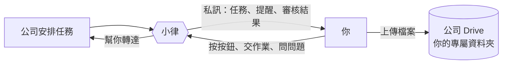

# 開始使用

> 👋 **小律是誰？** 私訊你的那位就是小律，住在 Discord 裡的 AI 同學。她會通知你新任務、每天早上提醒你要注意的事、幫你把「收到了」或「這筆不行」轉達給公司，也會在審核結果出來時告訴你。

## 你會用到的四件事

| 想做的事 | 在哪裡 | 看哪一篇 |
|---|---|---|
| 回報下個月哪些時間可以 | `時間管理` 頻道 | 「回報下個月可配合時間」 |
| 收到任務，按收到或說不行 | 小律的私訊 | 「收到任務通知」 |
| 每天早上看今天要注意什麼 | 小律的私訊 | 「每天早上的任務提醒」 |
| 交作業 | `任務查詢入口` 頻道 | 「交作業」 |

想查任務或聊天，到 `課程助教` 問小律（見「問小律、跟小律聊天」）。

## 四個頻道

| 頻道 | 做什麼 |
|---|---|
| `時間管理` | 回報、修改每個月可以配合的時間 |
| `任務查詢入口` | 打 `/我的任務` 查任務、交作業 |
| `課程助教` | 按「💬 開始問小律」，在自己的私人討論串裡問小律 |
| `公告區` | 看公告、時間收集、本月排程。不能發言，但公告上的按鈕可以按 |

**任務通知、審核結果都是私訊給你本人**，別人看不到。

> 💡 指令只能在對的頻道用。打了沒反應，先確認是不是在對的頻道。看不到這些頻道的話，請找公司幫你開權限。

> 💡 小律不會給你 Notion 連結。你需要的內容，都寫在小律的訊息裡。
