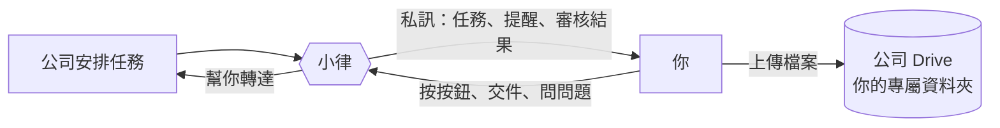

# 開始使用

> 👋 **小律是誰？** 私訊你的那位就是小律，住在 Discord 裡的 AI 同學。她會提醒你今天要注意的事、幫你把「收到任務」或「這筆不行」轉達給公司、在交件和審核結果出來時告訴你。每天早上和審核結果那一兩句話，是小律看你最近的狀況寫的，所以每天不太一樣；任務、日期、按鈕這些事實不會變。

## 你會用到的四件事

| 要做的事 | 在哪裡 | 看哪一頁 |
|---|---|---|
| 每個月回報哪些時間有空 | `時間管理` 打 `/管理可配合時間` | 「每月回報可配合時間」 |
| 收到任務，按收到或說不行 | 小律的私訊 | 「收到任務通知」 |
| 每天早上看今天要注意的事 | 小律的私訊 | 「每天早上的任務提醒」 |
| 交作業 | `任務查詢入口` 打 `/我的任務` | 「交作業與審核結果」 |

想查任務或聊天，到 `課程助教` 問小律（見「問小律、跟小律聊天」）。

## 四個頻道

| 頻道 | 你在這裡做什麼 |
|---|---|
| `時間管理` | 回報、修改每個月的可配合時間 |
| `任務查詢入口` | 查自己的任務、交作業 |
| `課程助教` | 按「💬 開始問小律」，在自己的私人討論串裡問小律 |
| `公告區` | 看公告與**本月排程**（固定一則，會自動更新）。不能發言，但公告上的按鈕可以按 |

**任務通知、審核結果一律私訊給你本人**，不會出現在公開頻道，別人看不到。

指令只能在對的頻道用，打了沒反應先確認頻道。看不到這些頻道的話，請公司幫你開權限。

> 💡 小律不會給你 Notion 連結。公司的 Notion 裡有其他藝人的資料，所以藝人一律不從那邊進出；你需要的內容都在小律的訊息裡。
