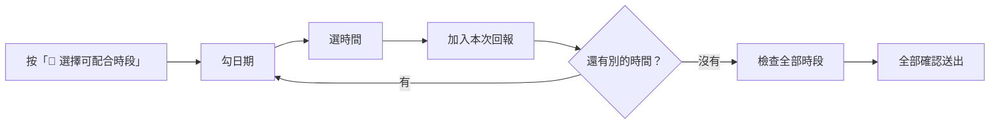

# 回報下個月可配合時間

每個月公司會請你回報下個月哪些時間可以。你會在 `公告區` 看到「📅 2026-11 可配合時間回報」，也會收到小律的私訊。

## 步驟

1. 在 `公告區` 那則公告下面按 **📅 選擇可配合時段**。（也可以到 `時間管理` 打 `/管理可配合時間`，再按 **➕ 新增／補填日期**）
2. 從 **選擇可配合日期（可多選）…** 勾日期。日期很多時用 **下一頁** 翻。同一個時間可以一次勾很多天。
3. 選時間：
   - **整天可（08:00–24:00）**
   - **某時間後**：填開始時間，例如 13:30
   - **某時間前**：填結束時間，例如 17:00
   - **指定時段**：填開始和結束時間

   選後面三種會跳出「補充可用時間」，填好時間送出。
4. 確認畫面沒問題，按 **加入本次回報**。要改就按 **返回修改**。
5. 還有別的時間，按 **繼續選日期**，回到第 2 步。勾錯日期可以按 **重新選日期**。
6. 全部選完，按 **檢查全部時段**。
7. 確認清單，按 **全部確認送出**。要改就按 **返回調整**。
8. 看到「✅ 已一次送出以下月度可配合時段」就完成了。

> 💡 **按「全部確認送出」之前都還沒存檔。** 想全部放棄，按 **取消本次回報**。

## 檢查時會發生什麼

小律會比對你已經排定的任務，列出**實際會保留的時段**：

- 跟已排定任務衝突的時間，會自動扣掉
- 重複或重疊的時段，會自動合併
- 整段都被佔掉的，會請你回去改

只有公司已經正式通知你的任務會被扣掉。還在安排、還沒通知你的不算，照你真正有空的時間填就好。

## 送出前想改

按 **管理全部已選**：

- 從 **選擇要修改或移除的暫存時段…** 選一組，按 **修改選取** 或 **移除選取**
- 只想改其中一天：從 **選擇要單獨修改的日期…** 選那天，按 **修改單日**；整組一起改按 **修改整組**
- 修改時選好新的日期、時間後按 **儲存修改**；不改了按 **取消修改**
- 按 **返回全部暫存**、**返回組內日期** 或 **返回** 回上一層

## 提醒

- 截止前 6 小時、過了截止，還沒填的話小律各提醒一次。中間不會一直吵你，收到通知就盡早填。
- 過了截止還是可以補填，但會記成逾期送出。

## 送出後想改

見「修改或刪除已回報的時段」。
