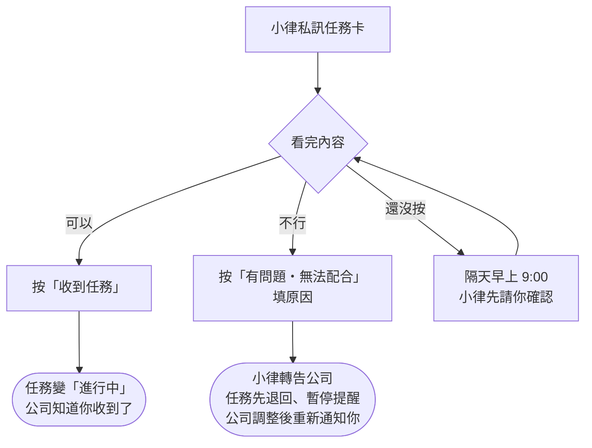

# 收到任務通知

**什麼時候**：公司安排好任務後，小律會私訊你。



## 你會收到什麼

```discord
📌 方晨同學，有一筆新任務來囉！
任務：10/25（日）week4 聽力、歌唱、舞蹈、鋼琴、運動
類型：任務
截止：10/26

任務內容
• 聽力訓練：50題音程、20題三和弦、20題七和弦／截圖
• 歌唱課：用老師教的技巧練習指定歌曲／影片

看完沒問題就按「收到任務」，小律會幫你告訴公司；不行的話按「有問題・無法配合」跟小律說。
[收到任務] [有問題・無法配合]
```

## 可以做：按「收到任務」（一定要按）

| 你按了之後 | |
|---|---|
| 公司那邊 | 任務變成「進行中」，公司知道你收到了 |
| 你的私訊 | 這則收成一行「✅ 任務收好了，小律記下來囉」，後面留一顆「⚠️ 有問題／無法配合」，收到之後才發現不行也能回報 |
| 舊訊息 | 同一個任務之前的舊通知自動刪掉，私訊只留最新那則 |

沒按的話，隔天早上 9:00 那一則會**先請你確認**「📌 有 N 筆任務還在等你按收到喔」，之前那張任務卡會被收掉，不用回頭找。

> ⚠️ **早報的「👌 我看完了」不等於收到任務。** 收到一律按「收到任務」（或「全部收到」）。

## 不行：按「有問題・無法配合」

按下去填個原因就好：

| 你送出之後 | |
|---|---|
| 公司那邊 | 收到你寫的原因，任務先退回、**暫停提醒你**，調整後重新通知你 |
| 你的私訊 | 那張卡收成一行「⚠️ 小律已轉告公司｜任務｜等調整」，不用再按「收到任務」 |

真的有困難就按，不要放著不理。同一筆回報一次就好，再按會提醒你「已經回報過」。

可以回報的地方：任務卡的「有問題・無法配合」（收到前後都有）、合併通知的「⚠️ 哪一筆不行？」、早上任務提醒展開某一筆時的「⚠️ 這筆不行」。

> ⚠️ **已經交件、或正在修改中的任務不能用按鈕回報**，請直接聯絡公司。
>
> 💡 **已經逾期的任務還是可以回報**，例如需要延期：任務會先維持「已逾期」，公司會跟你確認怎麼處理。

## 一次來好幾筆的時候

公司同時安排（或重送）好幾筆時，你只會收到**一則**合併通知：

```discord
📌 任務通知（2）
・UAT 2026-10-21 A1 派發測試｜截止 10/28（剩 7 天）
・UAT 2026-10-21 A2 對照組｜截止 10/28（剩 7 天）

想看某一筆的完整內容，用下方選單；看過後按「✅ 全部收到」。某一筆不行就用「⚠️ 哪一筆不行？」。
[看任務內容…▾]
[✅ 全部收到]
[⚠️ 哪一筆不行？…▾]
```

1. 用「**看任務內容**」選一筆，內容展開在**同一則訊息**下面，再選別筆就換成那一筆
2. 都看過按「**✅ 全部收到**」，這則收成一行「✅ N 筆任務收好了」
3. 某一筆不行：用「**⚠️ 哪一筆不行？**」選那一筆、填原因，只有那一筆退回。按鈕會變成「**✅ 收下剩下 N 筆**」，送出後的確認訊息上也有同一顆，直接按就好。每一筆都回報了，這則就自動收起來

公司一次開放好幾筆作業時，也會合併成一則「📚 課後作業通知（N）」。

## 要再看一次任務內容

任務通知本身就是完整內容。想重看可以用：

- 每天早上任務提醒的「**看任務內容**」選單
- `/我的任務`
- 問小律，例如「第 2 個的詳細內容」

內容有缺漏請找公司補。公司改了內容會重送，你會收到新的一則、要再按一次「收到任務」，舊的會自動刪掉。
