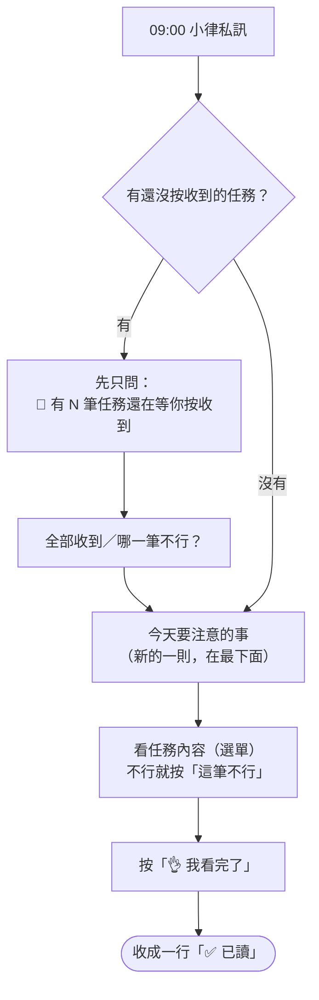

# 每天早上的任務提醒

**什麼時候**：每天早上 9:00，小律私訊你**一則**「今天要注意的事」。沒有要注意的任務那天不會發。



```discord
☀️ 10/21（三）今天要注意的事

🔴 已經過期限（1）
・10/20（二）開圈影片｜截止 10/20（已過 1 天）

⏳ 已過截止，等公司確認（1）
・10/20（二）發布：吃宵夜 POV｜截止 10/20（已過 1 天）
還沒做完請盡快完成；已經做完不用理會，公司會確認。

⏰ 快到期（1）
・11/6（五）編曲課作業 編曲仿作-Tom Misch｜截止 10/28（剩 7 天）

想看某一筆的內容，用下方選單；看完按「👌 我看完了」。要交件請用 /我的任務。
[看任務內容…▾] [👌 我看完了]
```

## 會列哪些任務

| 區塊 | 什麼時候出現 | 怎麼處理 |
|---|---|---|
| 📌 還在等你按收到 | 有任務你還沒按「收到任務」。這時候早報**先只問這件事** | 按「全部收到」或「哪一筆不行？」 |
| 🔴 已經過期限 | 要交件的任務過了期限還沒交，或公司確認你真的沒做 | 盡快交件，或跟公司說明 |
| 🛠 需修改 | 審核退回，等你修改重交 | 照回饋修改，在修改期限內重交 |
| ⏳ 已過截止，等公司確認 | 不用交件的任務（發文、出席這類）過了期限 | 做完了**不用理會**；還沒做完請盡快完成並跟公司說 |
| ⏰ 快到期 | 期限前 5 天、3 天（或公司另外加的時間點），中間幾天不會出現 | 照計畫進行 |

## 怎麼用

1. 想看某一筆：用「**看任務內容**」選單，內容展開在**同一則訊息**下面。展開時多一顆「**⚠️ 這筆不行**」，不行就直接按，那一行會標「⚠️ 已回報」
2. 看完按「**👌 我看完了**」，這則收成一行「✅ 已讀」，公司就知道你看過了。每一筆都回報了的話直接算已讀

- 一天只有**一則**，隔天新的來時前一天的會自動消失；前幾天處理完的通知也會一起清掉
- 開頭和結尾那一句是**小律今天想跟你說的話**，每天不一樣
- **已逾期、需修改**的任務，按了「我看完了」隔天還是會列（標「⚠️ 仍未完成」），直到你交件或公司處理好

> 💡 「我看完了」只代表你讀過，不代表每一筆都沒問題，也**不等於收到任務**。某一筆不行，請先用「這筆不行」回報。
