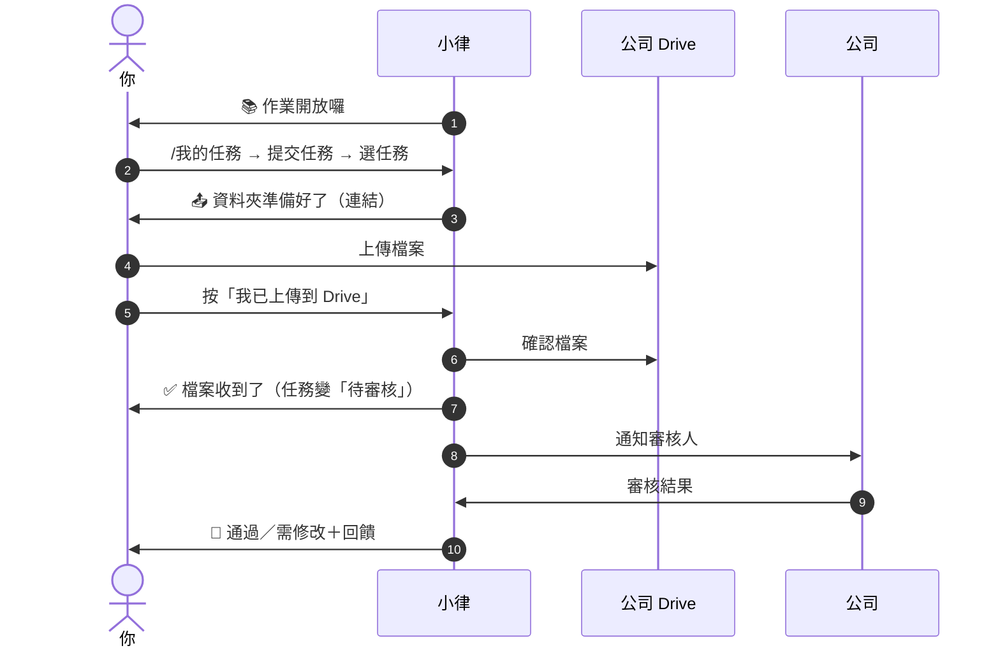

# 交作業與審核結果

**什麼時候**：收到小律的「📚 作業開放囉，可以開始交了！」，或在 `/我的任務` 看到「提交任務」按鈕，就可以交了。

## 什麼時候可以交

有些任務會分兩次通知：

1. 第一次：「你有這件事」（任務卡）
2. 第二次：「📚 課後作業通知」← **收到這個才代表可以交**

看不到「提交任務」按鈕，就是公司還沒開放。

## 怎麼交

1. 到 `任務查詢入口` 打 **`/我的任務`**
2. 點「**提交任務（N）**」
3. 選你要交的那筆任務
4. 小律給你一個**專屬的公司 Drive 資料夾**連結（「📤 某某任務的資料夾準備好了！」）→ 把檔案上傳進去（可以多個）
5. 回到 Discord 按「**我已上傳到 Drive**」，小律會去資料夾幫你確認
6. 小律回「✅ 檔案收到了！」，任務變成「待審核」

> 💡 第 4 步那則訊息**只有你看得到**，切去 Drive 上傳再回來可能已經消失。**沒關係**：3 小時內重新打 `/我的任務` → 提交任務 → 選**同一筆**，會回到同一個資料夾，剛剛傳的檔案都還在，直接按「我已上傳到 Drive」。

**所有任務都是這一種交法**：上傳到公司 Drive。文字類的內容（例如企劃想法）請存成檔案（Word、PDF、文字檔都可以）再上傳。

> ⚠️ **檔案不要傳到 Discord**，系統不收 Discord 附件。

**檔案存在哪**：公司幫你開的專屬資料夾，只有你和公司看得到。每次交件是一個新的小資料夾（第 1 版、第 2 版…），舊版本會留著。打不開資料夾的話請告訴公司幫你開權限。

## 交出去之後

- **不能自己撤回**。內容有錯直接跟公司或老師說，審核回來會有機會重交
- 等審核期間不會被催，也不會被算逾期

## 審核結果

| 結果 | 會怎樣 |
|---|---|
| **通過** | 任務完成 🎉 |
| **需修改**／**退回** | 給你 1～7 天修改期限。修好之前每天早上的任務提醒會列在「🛠 需修改」 |

你會收到**一到兩則**私訊：

1. **審核結果**（審核一送出就到）：結果加上審核人的回饋。第二行是**小律想跟你說的一句話**，依你最近的表現不一樣。需修改會寫明修改期限
2. **批改檔**（有的話才有，晚一點到）：「📎 老師補充了批改檔」，點連結就能看老師批改過的檔案

沒看到第二則不代表有問題，是老師這次沒附批改檔。

## 需要修改時

照回饋改好，**用同樣的方式再交一次**（`/我的任務` → 提交任務 → 選同一筆）。小律會開一個新版本的資料夾，交完狀態回到「待審核」，等下一輪結果。

過了修改期限還是可以交，但請先跟公司說一聲。
