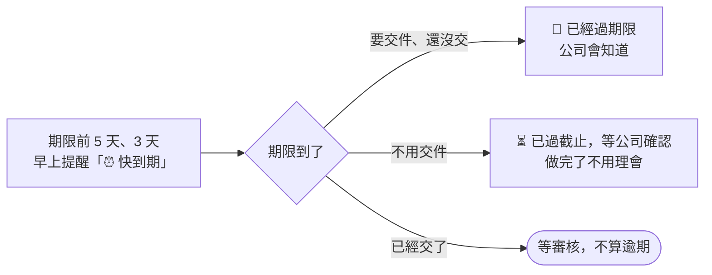

# 期限與逾期

## 「交件」和「截止」不一樣

你看到的日期有兩種寫法：

| 寫法 | 意思 |
|---|---|
| **交件 9/25** | 要先給公司審核的任務（影片、貼文、企劃這類）。**交件日就是你的死線**，9/25 沒交 9/26 就算逾期。對外發布日是公司的事 |
| **截止 9/30** | 上課、通告這類不用先審的，照截止日 |
| **修改期限 10/3** | 審核退回後，重交的期限 |

## 什麼時候會提醒你

期限前 **5 天**、**3 天**（公司也可能另外加前 1 天、當天），這筆任務會出現在當天早上任務提醒的「⏰ 快到期」。不會再一則一則私訊你。

## 過了期限會怎樣

**要交件的任務**：過了期限還沒交，任務會變成「已逾期」，公司也會知道。每天早上的任務提醒會列在「🔴 已經過期限」，直到你交件或公司處理好。逾期了**還是可以交**。

**不用交件的任務**（發文、出席這類）：過了期限，早上的任務提醒會列在「⏳ **已過截止，等公司確認**」。

- 已經做完：**不用理會**，公司確認後就會結案
- 還沒做完：請盡快完成，並跟公司說一聲。公司可能會延後期限，或改成「已逾期」

需要延期的話，可以在任務上按「有問題・無法配合」跟小律說，或直接找公司。

## 系統什麼時候會來找你

| 情況 | 多久 |
|---|---|
| 公司安排好任務 | 30 分鐘內私訊你任務卡 |
| **每天早上 9:00** | 一則「今天要注意的事」 |
| 公司開放交作業 | 30 分鐘內私訊「📚 課後作業通知」 |
| 你交了作業 | 審核完成後私訊你結果 |
| 每月時間收集 | 發起時一次、**截止前 6 小時**一次、過了截止再一次 |

## 有時效的操作

| 情況 | 時限 |
|---|---|
| 拿到 Drive 資料夾連結後上傳 | **3 小時**內，逾時重新進入提交流程 |
| 審核退回後重交 | 審核人指定的 **1～7 天** |
| 選單、按鈕放著不動 | 約 10 分鐘後失效，重打指令即可 |
| 小律回答下方的「回報問題」 | 24 小時 |
