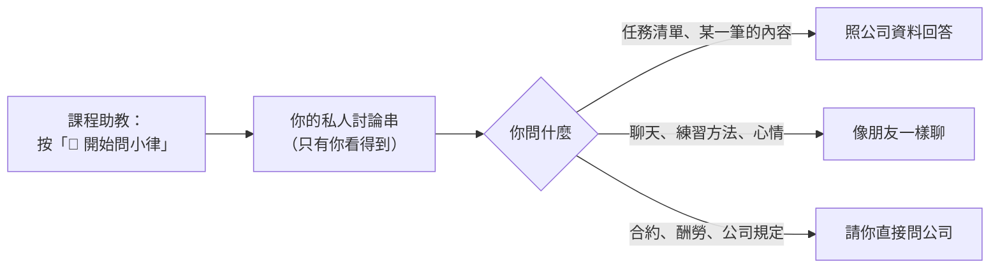

# 問小律、跟小律聊天

小律可以幫你**查自己的任務**，也可以**陪你聊天**。她只能查、不能幫你操作（交件、收到任務還是用 `/我的任務`）。



## 怎麼用

1. 到小律頻道，按置頂訊息的「**💬 開始問小律**」。系統會開一個**只有你看得到**的討論串（已經有的話會帶你回去），之後都在討論串裡直接打字問
   - ⚠️ **不要直接在頻道裡打字**：那裡大家都看得到。bot 雖然會收掉，但收掉前別人可能已經看到
2. 想問什麼就問：
   - 看清單：「這週有什麼任務」「下週要交什麼」「我還有哪些沒交」「11 月有什麼行程」「10/25 要做什麼」
   - 看某一筆的內容：列出清單後問「第 2 個的詳細內容」，或直接講任務名稱，例如「哈根提供稿件的要求是什麼」
   - 問任務裡的細節：「week4 聽力要做幾題」「要用什麼格式交」「發布前要先做什麼」——任務裡沒寫的，小律會請你問公司
3. 問了小律看不懂的問題，它會告訴你可以怎麼問

## 小律會怎麼回你

列任務清單時，標題下面會有一句**小律看了你這次查到的任務狀況說的話**，例如有快到期的會提醒你一步一步來，都很順的時候會稱讚你。每次不太一樣；任務名稱、日期、狀態這些事實照 Notion 列，不會變。

```discord
🤖 小律

📑 方晨同學，這週的任務有 3 筆
有快到期的任務，先一步一步來，小律幫你盯著喔！
1. 編曲作業｜課程時間&作業繳交｜截止 10/25（剩 1 天）｜進行中
2. …

想看哪一筆的內容，跟小律說「第 2 個」或直接講任務名稱就好。要交件或按「收到任務」，請用 /我的任務。
```

## 也可以跟小律聊天

不一定要問任務，小律就像一般的聊天夥伴，**什麼都可以聊**：打招呼、說累、練唱或練琴的方法、推薦歌、創作靈感、心情。她是看**你今天的任務狀況**回的，有很要緊的事（今天到期、已經過期限）才會順便提一句。

幾個小律不會做的：

- **公司的事**（合約、酬勞、排程怎麼安排、公司規定）：小律不能代表公司回答，會請你直接問公司
- **需要即時資訊的**（天氣、新聞、票價）：小律查不到，會老實跟你說
- **健康、法律、財務**：小律只給一般建議，會提醒你找專業的人

- 同一個討論串裡，小律**記得剛剛聊過的幾句**，所以可以接著問「那下週呢」「那第一個要做什麼」
- 隔天會重新開始（小律只記得當天的對話）
- 小律說的任務名稱、日期、狀態都是照公司的資料；資料沒寫的，她會請你問公司

```discord
你：好累喔，今天不想動
🤖 小律
辛苦了，方晨同學，今天先休息一下也沒關係；那筆 10/28 要交的編曲作業小律先幫你記著，等有力氣再處理就好。
```

## 查得到什麼

跟 `/我的任務` 看到的一樣：派發給你、還沒結案的任務。日期可以說今天、明天、這週、下週、這個月、下個月、幾月、幾月幾號、最近。

每次提問都會重新去 Notion 抓最新的，公司剛改的內容你馬上問得到。回答不會附 Notion 連結。

小律**只能查、不能操作**：交件、按「收到任務」還是用 `/我的任務`。

## 回答有問題

按訊息下方的「**回報問題**」，填說明送出（例如任務列錯、日期不對）。公司會在 Notion 布告欄收到，狀態是「未處理」。
