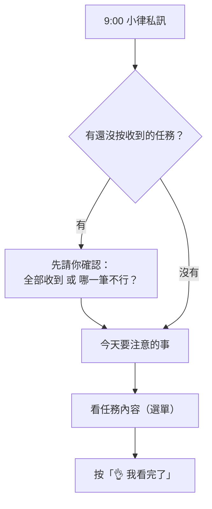

# 每天早上的任務提醒

每天早上 9:00，小律私訊你**一則**今天要注意的事。沒有要注意的事那天不會發。



## 有還沒按收到的任務時

早報會先只問這件事：

```discord
☀️ 方晨同學，早安！我是小律。
📌 有 2 筆任務還在等你按收到喔
・10/28 錄音：新歌 Demo｜截止 10/28（剩 2 天）
・10/30 發布：短影音｜截止 10/30（剩 4 天）
[看任務內容…▾]
[✅ 全部收到]
[⚠️ 哪一筆不行？…▾]
```

按 **✅ 全部收到**，或用 **⚠️ 哪一筆不行？** 回報。處理完，今天的提醒會以**新的一則**出現在私訊最下面。

## 今天要注意的事

```discord
☀️ 今天要注意的事（10/27 週二）

🔴 已經過期限（1）
・10/26 開圈影片｜截止 10/26（已過 1 天）

⏰ 快到期（1）
・11/6 編曲作業｜截止 10/31（剩 4 天）

[看任務內容…▾] [👌 我看完了]
```

| 區塊 | 意思 | 怎麼做 |
|---|---|---|
| 🔴 已經過期限 | 要交的任務過了期限還沒交 | 盡快交，或跟公司說明 |
| 🛠 需修改 | 審核退回，等你修改重交 | 照回饋改好重交 |
| ⏳ 已過截止，等公司確認 | 不用交件的任務（發文、出席這類）過了期限 | 做完了**不用理會**；還沒做請盡快完成並跟公司說 |
| ⏰ 快到期 | 期限前 5 天、3 天（或公司另外加的時間點）才出現 | 照計畫進行 |

## 步驟

1. 想看某一筆，從 **看任務內容…** 選。內容會展開在同一則下面，下面多一顆 **⚠️ 這筆不行**。
2. 都看完，按 **👌 我看完了**。這則收成一行「✅ 看完了，小律記下來囉」。

## 要知道的事

- 一天只有一則，隔天新的來時，前一天的會自動消失
- 開頭和結尾那一句，是小律看你最近的狀況寫的，每天不一樣
- 已經過期限、需修改的任務，按了「我看完了」隔天還是會列，直到你交件或公司處理好
- **「我看完了」不等於收到任務**，收到要按任務卡上的「收到任務」
