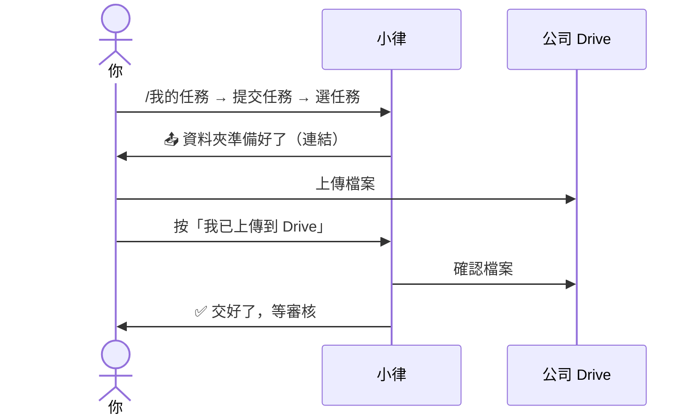

# 交作業

**什麼時候可以交**：收到小律的「📚 作業開放囉，可以開始交了！」，或在 `/我的任務` 看到 **📤 提交任務** 按鈕。

## 步驟

1. 到 `任務查詢入口` 打 **`/我的任務`**。
2. 按 **📤 提交任務（N）**。
3. 從 **選擇要提交的任務…** 選你要交的那一筆。選錯了按 **↩️ 返回我的任務**。
4. 小律給你一個資料夾連結：「📤 「任務名稱」的資料夾準備好了！」。
5. 點連結，把檔案上傳到那個資料夾。可以傳好幾個。
6. 回到 Discord，按 **我已上傳到 Drive**。
7. 小律確認檔案後回你「✅ 已驗證 Drive 資料夾並提交」，任務變成「待審核」。

> 💡 **這則訊息只有你看得到**，切去 Drive 上傳再回來可能已經消失。沒關係：**3 小時內**重新打 `/我的任務` → 提交任務 → 選**同一筆**，會回到同一個資料夾，剛剛傳的檔案都還在，直接按 **我已上傳到 Drive** 就好。

> ⚠️ **檔案不要傳到 Discord**，小律不收 Discord 附件。一律傳到小律給的資料夾。

文字類的內容（例如企劃想法）請存成檔案再上傳，Word、PDF、文字檔都可以。

## 交出去之後

- 不能自己撤回。內容有錯，直接跟公司或老師說，審核回來會有機會重交
- 等審核期間不會被催，也不會算逾期
- 審核結果見「看審核結果、修改後重交」

## 常見問題

| 狀況 | 怎麼做 |
|---|---|
| 看不到「提交任務」 | 作業還沒開放，等「📚 作業開放囉」的通知 |
| 打不開資料夾 | 請公司幫你開資料夾的權限，並確認你登入的是正確的 Google 帳號 |
| 「⚠️ 目前找不到入口建立後新增的檔案」 | 檔案沒傳到那個資料夾（例如傳到上一層）。移進去後再按一次 |
| 「⚠️ 小律現在打不開公司的 Drive」 | 公司的 Drive 出狀況，請通知公司，稍後再交 |
| 「❌ 這次的上傳入口過期了」 | 超過 3 小時。重新打 `/我的任務` → 提交任務 |
| 想換一筆交 | 按 **↩️ 返回任務選擇** |
