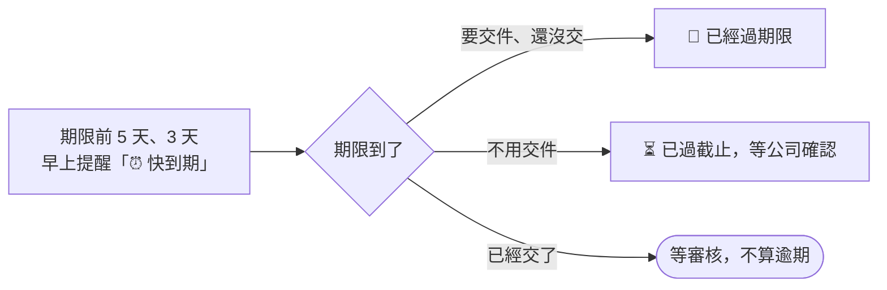

# 期限與逾期

## 你會看到的期限

| 寫法 | 意思 |
|---|---|
| **交件 9/25** | 要先給公司審的任務（影片、貼文、企劃這類）。**這天就是你的期限**，9/25 沒交，9/26 就算逾期 |
| **截止 9/30** | 上課、通告這類，照截止日 |
| **修改期限 10/3** | 審核退回後，重交的期限 |

## 什麼時候會提醒

期限前 **5 天**、**3 天**（公司也可能另外加前 1 天、當天），這筆會出現在當天早上任務提醒的「⏰ 快到期」。不會一則一則私訊你。

## 過了期限

**要交件的任務**：會變成「已經過期限」，公司也會知道。每天早上的任務提醒會列在「🔴 已經過期限」，直到你交件或公司處理好。**過期了還是可以交。**

**不用交件的任務**（發文、出席這類）：會列在「⏳ 已過截止，等公司確認」。

- 做完了：**不用理會**，公司確認後就會結案
- 還沒做：請盡快完成，並跟公司說一聲

需要延期，可以在任務上按 **有問題・無法配合** 跟小律說，或直接找公司。

## 有時間限制的操作

| 情況 | 時限 |
|---|---|
| 拿到交件資料夾後上傳 | **3 小時**，超過就重新打 `/我的任務` |
| 審核退回後重交 | 審核時給的修改期限 |
| 回報可配合時間的畫面 | 2 小時沒動會失效，重新打開就好 |
| 其他選單、按鈕 | 放著約 10 分鐘會失效，重打指令就好 |
