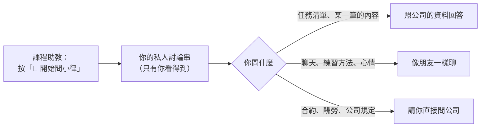

# 問小律、跟小律聊天

小律可以幫你**查自己的任務**，也可以**陪你聊天**。

## 開始

1. 到 `課程助教`，按置頂訊息的 **💬 開始問小律**。
2. 小律會開一個**只有你看得到**的討論串（已經有的話會帶你回去）。
3. 之後都在討論串裡直接打字。

> ⚠️ **不要在頻道裡直接打字**，大家都看得到。小律會把那則收掉，並帶你到自己的討論串。

## 可以問什麼

- **看清單**：「這週有什麼任務」「下週要交什麼」「我還有哪些沒交」「11 月有什麼行程」
- **看某一筆**：列完清單後說「第 2 個」，或直接講任務名稱
- **問細節**：「聽力要做幾題」「要用什麼格式交」，任務裡沒寫的，小律會請你問公司
- **聊天**：打招呼、說累、練唱方法、推薦歌、創作靈感都可以。小律記得這個討論串剛剛聊過的幾句，隔天會重新開始

小律**不會**回答公司的事（合約、酬勞、排程怎麼排、規定）、查不到即時資訊（天氣、新聞），健康、法律、財務只給一般建議。

## 要知道的事

- 只查得到**已經通知你、還沒結案**的任務，跟 `/我的任務` 一樣
- 每次問都會抓最新的資料
- 小律**只能查、不能操作**：交作業、按收到還是要用 `/我的任務` 和任務卡

## 小律答錯了

1. 按那則回答下方的 **回報問題**（24 小時內有效）。
2. 跳出「回報小律的回答」，在 **問題說明** 寫哪裡不對，例如「任務列錯」「日期不對」。
3. 送出，看到「✅ 謝謝你告訴小律！」就完成了。公司會收到並處理。
