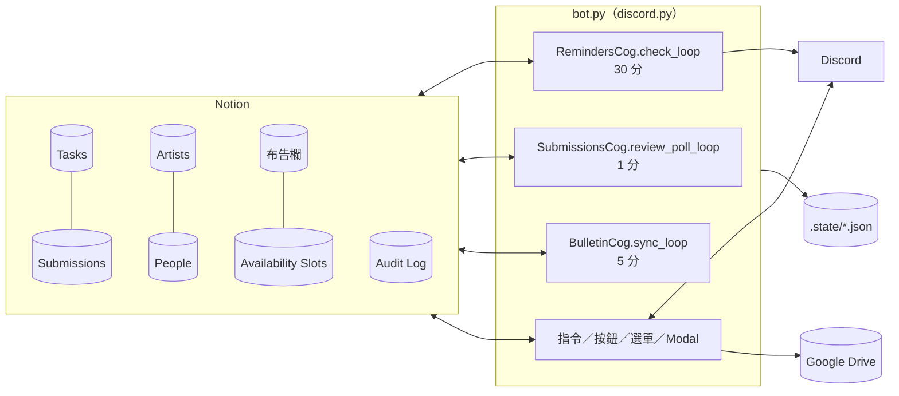

# 架構總覽

## 資料流

## 三個背景迴圈

| 迴圈 | 間隔 | 進入點 |
|---|---|---|
| `RemindersCog.check_loop` | `REMINDER_INTERVAL_MINUTES`（30） | `cogs/reminders.py` |
| `SubmissionsCog.review_poll_loop` | 1 分鐘（固定） | `cogs/submissions.py` |
| `BulletinCog.sync_loop` | `BULLETIN_SYNC_INTERVAL_MINUTES`（5） | `cogs/bulletin.py` |

`check_loop` 每輪依序執行：月度時間池 → 排課 SLA → 批次重送 → 任務派發 → 課後作業通知 → 未確認重推（早報關閉時才跑）→ Drive 健康檢查 → 藝人早報 → 營運早報 → 每日催辦 → 課後提醒老師 → 修改期限逾時（營運早報關閉時才跑）→ 截止提醒與逾期 → 發文待確認（營運早報關閉時才跑）。

- **全部步驟共用一個 try/except**：前面一步丟例外，後面的步驟這一輪都不跑，等下一輪
- **「幾點」是「該時間之後的第一輪」**，沒有 cron。09:00 的早報實際在 09:00～09:29 發；bot 15:00 啟動就 15:00 發
- 一天一次的工作（早報、營運早報、催辦）用 `services/daily_runs.py`：全部送達才算完成，否則下一輪重試，一天最多 3 次，已送達的人跳過

## 模式開關

| 設定 | 預設 | 開啟時 |
|---|---|---|
| `DAILY_BRIEFING_ENABLED` | true | 截止提醒、逾期、需修改改列在 09:00 藝人早報，不逐則私訊；未確認重推不跑 |
| `OPS_BRIEFING_ENABLED` | true | 逾期、修改期限逾時、時間池進度、發文待確認、無人審核改列在 09:30 營運早報，不逐則發頻道 |

## 訊息去向

| 去向 | 設定 | 備註 |
|---|---|---|
| 營運內部通知 | `ADMIN_NOTIFY_CHANNEL_ID` | `channel_guard.ops_channel()`；沒設定時只寫 log，**不會**改發其他頻道 |
| 公告區 | `ANNOUNCE_CHANNEL_ID`，退回 `SCHEDULE_CHANNEL_ID` | 公開任務、時間收集公告 |
| 布告欄 | `BULLETIN_CHANNEL_ID`，退回公告區 | 布告欄同步、本月排程 |

營運訊息三種樣式（`services/ops_notice.py`）：`🟥 **要處理｜…**`（附 `ops_claim`／`ops_done` 按鈕）、`⚙️ **系統警告｜…**`、`🟢 **系統恢復｜…**`。

## 權限與頻道檢查

- `services/permissions.is_admin()`：Discord Administrator，或有 `ADMIN_ROLE_ID` 身分組
- 管理指令另有 `default_permissions(administrator=True)`，並由 `channel_guard.ensure_admin_channel()` 限制在 `ADMIN_COMMAND_CHANNEL_ID`
- `/伺服器初始化` 只檢查 `is_admin`，不限頻道
- `/我的任務` 限 `TASK_CHANNEL_ID`；`/管理可配合時間` 限 `SCHEDULE_CHANNEL_ID`

## Audit Log

`services/audit.log_event()` 寫 `DS_AUDIT_LOG`：事件名稱、操作時間、操作類型、操作者、來源系統、結果、Discord User ID、目標資料庫、目標頁面 URL、前值、後值。寫入失敗不擋主流程。系統自動動作的操作者是 `System`。

## 啟動

- `main()`：缺 `DISCORD_TOKEN`、`NOTION_TOKEN` 或九個 `NOTION_DS_*` 任一個就停
- `setup_hook`：載入 cogs（啟動迴圈）、註冊持久按鈕、同步 slash commands
- `on_ready`：讀 Artists 測連線並寫 Audit「Bot 啟動」；`schema_check` 比對 Notion 選項，對不上發 `⚙️ 系統警告｜Notion 選項和程式對不上`
- 小律入口面板：`course_qa` 載入時確認 `AI_CHANNEL_ID` 有釘選的面板
- Windows 排程工作 `KariKariAIOps`（`install_autostart.ps1`）開機啟動、當掉 1 分鐘後重啟；重開用 `restart_bot.bat`（需系統管理員）
