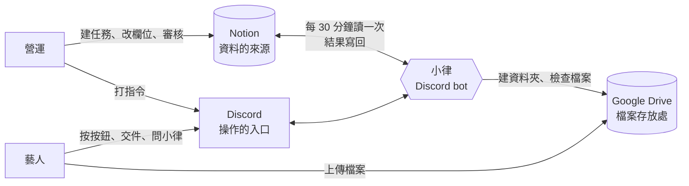

# 系統地圖與頻道

整套系統由三個地方組成，中間由小律（Discord bot）串起來。這份 SOP 每一條流程，都會寫清楚這三個地方各自發生什麼事。

| 系統 | 負責什麼 | 誰會打開它 |
|---|---|---|
| 📒 **Notion** | 所有正式資料：任務、專案、藝人、提交紀錄、時段。**有衝突時一律以 Notion 為準** | 營運、審核人員。**藝人完全不進 Notion** |
| 💬 **Discord** | 操作入口：營運打指令、藝人收通知、按按鈕、交件、問小律 | 所有人 |
| 📁 **Google Drive** | 交件檔案與老師批改檔。資料夾由小律自動建立 | 營運、藝人（只看得到自己的專區） |

> 💡 **一句話判斷**：你在 Notion 改的欄位，小律下一輪（最多 30 分鐘）照著做；你在 Discord 打的指令，小律馬上做，並把結果寫回 Notion。

## 九個 Notion 資料庫

| 資料庫 | 存什麼 | 誰會寫 |
|---|---|---|
| `Tasks` | 每一筆要做的事 | 營運建立；小律改狀態、通知時間 |
| `Projects` | 上層企劃，決定交件放哪個 Drive 資料夾 | 營運 |
| `Artists` | 藝人資料、`Discord User ID`、Drive 專區 | 營運 |
| `People` | 公司同仁、老師、審核人員 | 營運 |
| `Submissions` | 每一次交件與審核結果 | 小律建立；審核人填結果 |
| `Availability Slots` | 藝人回報的可配合時間（不是正式行程） | 小律 |
| `Audit Log` | 每個重要動作的紀錄，查問題用 | 小律 |
| `布告欄` | 公告、待討論、使用回饋 | 營運；小律寫使用回饋 |
| `課程與會議記錄` | 會議紀錄（小律目前不讀） | 營運 |

## 六個頻道

**管理指令一律在 `營運操作` 打**，在別的頻道會被擋下來並提示你換頻道。

| 頻道 | 誰看得到 | 做什麼 |
|---|---|---|
| `營運操作` | 營運 | 打所有管理指令 |
| `營運內部通知` | 營運 | 系統通知：營運早報、🟥 要處理、系統警告 |
| `公告區` | 全體（只能看） | 公開任務、時間收集公告、布告欄、本月排程 |
| `時間管理` | 藝人 | 回報可配合時間 |
| `任務查詢入口` | 藝人 | 查任務、交作業 |
| `課程助教` | 藝人 | 問小律、跟小律聊天（各自的私人討論串） |

誰看得到哪個頻道，由 Discord 身分組決定：`控方` 看營運的兩個頻道並能打管理指令，`藝人` 看藝人的四個頻道。設定方式見「新藝人、新同仁上線」。

> 💡 每個指令的參數與分支細節見 [DISCORD_COMMANDS.md](../../operations/DISCORD_COMMANDS.md)。

## 不能忘的原則

- **藝人零 Notion 入口**：藝人從任何一個 Notion 頁面都能往上翻到整個資料庫、看到別人的任務，所以小律給藝人的訊息**一律不附 Notion 連結**，任務內頁貼的 Notion 網址也會被拿掉。
- **任務內頁就是藝人看到的任務說明**，整頁都會被看到；內部資訊放子頁面。
- **`Availability Slots` 不是正式行程**。正式安排一律在 `Tasks`；候選空檔、藝人補填的時段都不算。
- **改欄位名稱會讓系統失效**。新增資料、新增選項都安全；**改名、刪欄位、改型別、刪掉重建資料庫會出事**，動之前先問工程端。
- **不要硬刪 Notion 資料**，用封存。改時間要保留紀錄，不要刪頁面重建。
- **TimeTree 不會自動同步**：正式任務確認、通知發出後人工補登；兩邊不一致以 Notion 為準。
- **課程時間有異動**：沒有自動的老師確認表單，你和老師協調好後，直接改同一筆任務的 `開始日`／`截止日`，再重送（見「改任務內容與重送」）。
