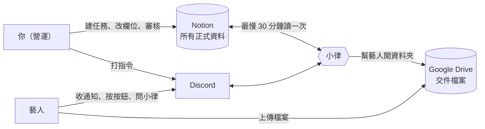

# 系統怎麼運作

整套系統有三個地方，中間由 Discord 上的機器人「小律」串起來。你在 Notion 建任務、改欄位；小律把結果通知藝人，藝人在 Discord 回應、在 Drive 交檔案。

| 地方 | 用來做什麼 | 誰會用 |
|---|---|---|
| **Notion** | 任務、專案、藝人、交件紀錄的正式資料。有衝突時**以 Notion 為準** | 營運、審核人。**藝人不會進 Notion** |
| **Discord** | 收通知、按按鈕、交件、問小律、打管理指令 | 所有人 |
| **Google Drive** | 藝人交的檔案、老師的批改檔 | 營運、藝人（只看得到自己的資料夾） |

> 💡 **記住這一句**：你在 Notion 改的東西，小律最慢 30 分鐘內會照著做；你在 Discord 打的指令，小律馬上做。

## 六個頻道

| 頻道 | 誰看得到 | 做什麼 |
|---|---|---|
| `營運操作` | 營運 | 打管理指令。**管理指令只能在這裡打** |
| `營運內部通知` | 營運 | 小律發給你的通知：營運早報、🟥 要處理、系統警告 |
| `公告區` | 所有人（只能看） | 公告、時間收集、通告與演出、本月排程 |
| `時間管理` | 藝人 | 回報每個月可配合的時間 |
| `任務查詢入口` | 藝人 | 查任務、交作業 |
| `課程助教` | 藝人 | 問小律、跟小律聊天 |

誰看得到哪些頻道，由 Discord 身分組決定：有 `控方` 身分組的人看得到營運的兩個頻道，有 `藝人` 身分組的人看得到藝人的四個頻道。

## 一定要記得的原則

- **藝人拿不到 Notion 連結**。從任何一個 Notion 頁面都能往上翻到整個資料庫，看到別人的資料，所以小律給藝人的訊息從不附 Notion 連結。
- **任務頁面的內文，藝人會整頁看到**。內部備註請放在子頁面。
- **藝人回報的「可配合時間」不是正式行程**。正式安排一律是 Notion 的任務。
- **不要改 Notion 欄位的名稱、不要刪欄位**。小律是照名稱找欄位的，改了就讀不到。新增資料、新增選項都沒問題。
- **不要刪 Notion 頁面**，用「已封存」。
- **TimeTree 不會自動同步**。任務發出後自己補登；兩邊不一樣時以 Notion 為準。

## 下一步

- 「新藝人上線」
- 「派一筆任務給藝人」
