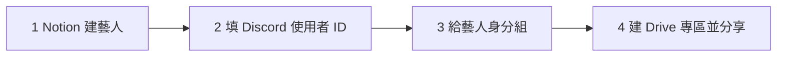

# 新藝人上線

> 💡 **誰可以做**：能編輯 Notion「Artists」、能管理 Discord 身分組、能在公司 Drive 建資料夾的人。
>
> **大約要多久**：10 分鐘。

小律靠 Notion 上的 Discord 使用者 ID 認人。下面四步**系統都不會幫你做**，少一步藝人就會卡住。

## 1. 在 Notion 建藝人

1. 打開 Notion 的 **Artists**，按 **New**。
2. **藝人名稱**：小律會用這個名字叫藝人，例如「方晨同學」。
3. **合約狀態**：選目前的狀態。選 **未簽**、**暫停**、**封存** 的藝人，不會被算進每月時間收集，也不能用小律。

## 2. 填 Discord 使用者 ID

1. 請藝人加入公司的 Discord 伺服器。
2. 在你的 Discord：**使用者設定 → 進階 → 打開「開發者模式」**。
3. 在藝人的名字上按右鍵 → **複製使用者 ID**。這是一串 17～19 位的數字，不是帳號名稱。
4. 貼到 Notion 那位藝人的 **Discord User ID**。

> ⚠️ ID 貼錯人，小律會把這位藝人的任務私訊給別人。貼完請再核對一次。

## 3. 給藝人身分組

1. Discord **伺服器設定 → 成員**，找到藝人。
2. 加上 **藝人** 身分組。

加完後，藝人就看得到 `時間管理`、`任務查詢入口`、`課程助教`、`公告區`。

## 4. 建 Drive 專區並分享給藝人

1. 在公司 Drive 的總資料夾裡，建一個以藝人名稱命名的資料夾。
2. 按 **共用**，加入藝人的 Google 帳號，權限選 **編輯者**。
3. 複製資料夾連結，貼到 Notion 那位藝人的 **Google Drive 資料夾**。

之後藝人每次交件，小律都會在這個資料夾底下自動開新資料夾（見「交件的檔案存在哪裡」）。

> ⚠️ **小律不會幫資料夾設定分享**。沒分享的話，藝人點開交件連結會被拒絕。

## 怎麼確認成功

請藝人到 `任務查詢入口` 打 `/我的任務`：
- 出現他的任務清單，或「🎉 目前沒有進行中的任務。」→ 成功
- 出現「❌ 找不到你的藝人資料」→ Discord User ID 沒填對

## 常見問題

| 狀況 | 怎麼做 |
|---|---|
| 藝人說看不到頻道 | 沒給 **藝人** 身分組 |
| 藝人說收不到任何通知 | Discord User ID 沒填、填成帳號名稱，或多了空白。重新複製貼上 |
| 藝人打不開交件資料夾 | Drive 專區沒分享給他，或他登入的是別的 Google 帳號 |
| 時間收集沒有找他 | 合約狀態是未簽、暫停或封存 |
| 藝人改名了 | Notion 的藝人名稱可以改；只要 Google Drive 資料夾有填，交件資料夾不受影響 |

## 下一步

- 「新同仁、老師、審核人上線」
- 「派一筆任務給藝人」
