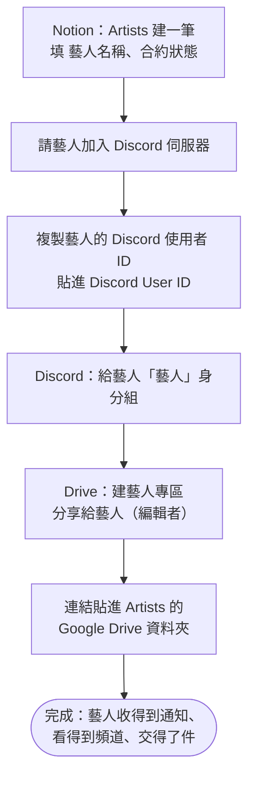

# 新藝人、新同仁上線

**什麼時候用**：簽了新藝人、來了新同仁或老師、有人換了 Discord 帳號。

> 💡 **一句話看懂**：小律靠 Notion 上的 `Discord User ID` 認人，靠 Discord 身分組決定誰看得到哪些頻道，靠 Drive 專區的分享權限決定藝人能不能交件。三樣都要設，**系統不會幫你設任何一樣**。

## 藝人上線

| 步驟 | 你要做的 | 📒 Notion | 💬 Discord | 📁 Drive |
|---|---|---|---|---|
| 1 | 在 `Artists` 建一筆 | `藝人名稱`（小律用這個名字叫藝人，也是 Drive 專區的預設名稱）、`合約狀態` | — | — |
| 2 | 請藝人加入伺服器，複製他的使用者 ID | 貼進 `Discord User ID` | — | — |
| 3 | 給藝人 `藝人` 身分組 | — | 看得到 `時間管理`、`任務查詢入口`、`課程助教`、`公告區` | — |
| 4 | 在公司 Drive 建藝人專區，**分享給藝人的 Google 帳號（編輯者）** | 專區連結貼進 `Google Drive 資料夾` | — | 之後的交件資料夾都建在這底下 |

**怎麼複製 Discord 使用者 ID**：Discord 設定 → 進階 → 打開「開發者模式」→ 在成員名字上按右鍵 →「複製使用者 ID」。是一串 17～19 位的數字，不是帳號名稱。

`合約狀態` 決定藝人會不會被算進每月時間收集：`未簽`、`暫停`、`封存` 的不會；其他（含 `洽談中`、`已簽約`、沒填）都會。任務通知不看合約狀態，只要任務的 `關聯藝人` 有他就會收到。

## 同仁、老師、審核人員上線

| 步驟 | 你要做的 | 📒 Notion | 💬 Discord |
|---|---|---|---|
| 1 | 在 `People` 建一筆 | `姓名 / 名稱`、`身份類型`（`公司成員` 或 `老師`，排課時才選得到他）、`Discord User ID` | — |
| 2 | 要操作系統的人（營運、會用 `/審核提交` 的審核人）給 `控方` 身分組 | — | 看得到 `營運操作`、`營運內部通知`，能打管理指令 |

只收通知、不操作的人（例如只是 `相關同仁`、只在 Notion 審核的老師）**不用**給身分組：知會、早報、審核提醒都是私訊。

## 做完怎麼確認成功

| 看哪裡 | 應該看到 |
|---|---|
| Notion `Artists` | `Discord User ID` 是一串數字、`Google Drive 資料夾` 有連結 |
| Discord | 藝人看得到 `任務查詢入口`，打 `/我的任務` 有回應（沒有任務也會說沒有） |
| Google Drive | 專區的「共用」裡有藝人的帳號，權限是編輯者 |

## 出錯怎麼辦

| 狀況 | 原因 | 怎麼做 |
|---|---|---|
| 藝人收不到任何通知 | `Discord User ID` 沒填、填成帳號名稱，或多打空白 | 重新複製使用者 ID 貼上 |
| 藝人說看不到頻道 | 沒給 `藝人` 身分組 | Discord 伺服器設定 → 成員 → 加上身分組 |
| 藝人打開交件資料夾說沒有權限 | 專區沒分享給他，或分享到別的 Google 帳號 | 到 Drive 重新分享；請藝人確認登入的帳號 |
| 時間收集沒有找他 | `合約狀態` 是 `未簽`／`暫停`／`封存`，或沒有 `Discord User ID` | 改合約狀態、補 ID |
| 排課選不到這位老師 | `People` 的 `身份類型` 不是 `老師` 或 `公司成員` | 改身份類型 |
| 同仁說沒收到知會 | `People` 沒填 `Discord User ID`。**系統不會提醒你** | 補 ID，再重送那筆任務 |
| 藝人專區名稱跟藝人改名後不一樣 | Drive 照名稱找資料夾，改名＝開新專區 | 有填 `Google Drive 資料夾` 就不受影響，所以第 4 步一定要做 |

> ⚠️ `Discord User ID` 填錯人，小律會把這位藝人的任務私訊給別人。換帳號或貼 ID 時務必再核對一次。
