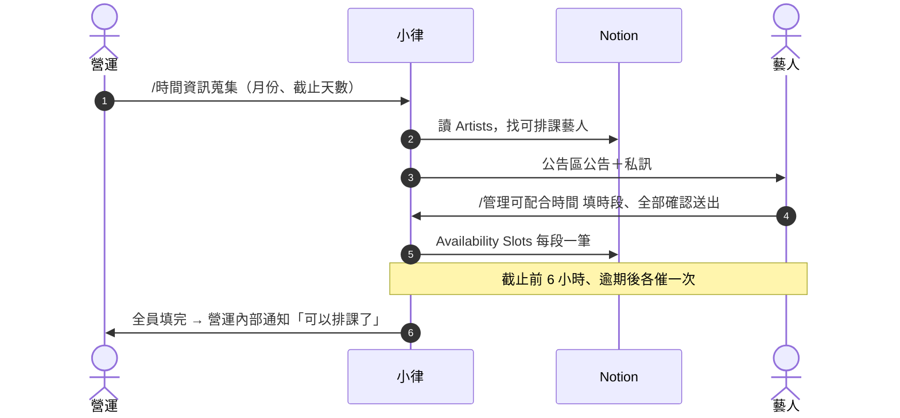

# 每月收集可配合時間

**什麼時候用**：每個月固定一次（例如 25 號前收集下個月），讓藝人回報哪些時間可以排課、排行程。

> 💡 **一句話看懂**：你打 `/時間資訊蒐集` → 小律在公告區發公告、私訊每位藝人 → 藝人用 `/管理可配合時間` 填 → 每一段寫進 Notion `Availability Slots` → 全員填完通知你排課。

## 開始前要準備好

| 要準備的 | 在哪裡設 | 少了會怎樣 |
|---|---|---|
| 藝人有 `Discord User ID` | Notion `Artists` | 不會被算進這次收集 |
| `合約狀態` 不是 `未簽`／`暫停`／`封存` | Notion `Artists` | 不會被算進這次收集 |

## 階段 1　營運發起

**你要做的**：在 `營運操作` 打 **`/時間資訊蒐集`**。

| 參數 | 填什麼 |
|---|---|
| `月份` | 要收集的月份，例如 `2026-11` |
| `截止天數` | 幾天內要填完，預設 1（24 小時） |
| `說明` | 選填，例如「請優先填週末」 |

| 系統 | 發生什麼 |
|---|---|
| 📒 Notion | 讀 `Artists` 找出可排課藝人；`Audit Log` 記一筆 |
| 💬 Discord | `公告區` 發公告並標記這些藝人；每位藝人另收一則私訊 |
| 📁 Drive | 不動 |

## 階段 2　藝人填時段

**藝人做的**：在 `時間管理` 打 `/管理可配合時間` → 選月份 → 勾日期、設時段 → 「檢查全部時段」→「全部確認送出」。按送出之前都只是草稿。

| 系統 | 發生什麼 |
|---|---|
| 📒 Notion | `Availability Slots` 每一段寫一筆：`可用時段名稱`、`填寫藝人`、`填寫人名稱`、`身份`=藝人、`來源`=Discord、`可用開始時間`、`可用結束時間`、`提交時間`、`是否逾期提交`、`備註`（收集月份與藝人備註）。藝人刪掉的時段會被封存 |
| 💬 Discord | 藝人看到確認畫面。檢查時會自動排除跟**已派發任務**衝突的時間、合併重疊的時段 |
| 📁 Drive | 不動 |

## 階段 3　催填與收齊

| 時間點 | 💬 Discord |
|---|---|
| 截止前 6 小時 | 還沒填的藝人收一則私訊 |
| 過了截止 | 還沒填的藝人再收一則私訊 |
| 每天 09:30 | 營運早報列「已填幾位、還沒填誰」 |
| 全員填完 | `營運內部通知` 立刻收到「收齊了」，這次收集自動結束 |

> 💡 **只催兩次是刻意的**，避免騷擾藝人。截止天數設得長（例如 3 天），中間會有一大段不提醒，需要的話自己在群組補一句。

收齊後接著做「排課」。

## 有人沒填

請他自己打 `/管理可配合時間` 補，**不用重發公告**。藝人私訊失敗（例如關了私訊）時，手動提醒他到 `時間管理` 補。

## 發錯了要取消

打 **`/取消時間蒐集`** → 選那一筆 → 確認。

| 系統 | 發生什麼 |
|---|---|
| 📒 Notion | **不動**藝人已填的時段，之後排課照樣可用 |
| 💬 Discord | 停掉催填、逾期通知、排課時效提醒。**已發出的公告和私訊收不回來**，請自己到 `公告區` 刪掉那則公告，並在群組說一聲 |

已經收齊、或逾期通知發過的收集會自己結束，不需要取消。

## 做完怎麼確認成功

| 看哪裡 | 應該看到 |
|---|---|
| `營運內部通知` | 「收齊了」那則 |
| Notion `Availability Slots` | 依 `填寫藝人` 篩選，每位藝人都有這個月的時段 |

## 出錯怎麼辦

| 狀況 | 原因 | 怎麼做 |
|---|---|---|
| 可排課藝人 0 位 | 藝人都沒有 `Discord User ID`，或合約狀態都是未簽／暫停／封存 | 補資料；都對的話請工程端確認 Notion 權限 |
| 藝人填錯時間 | — | 請他用 `/管理可配合時間` 修改單日、修改整組或移除 |
| 藝人說他填的時段變少了 | 跟已派發的任務衝突的部分被自動排除 | 正常；草稿任務不會排除，談定的時間要盡快派發 |
