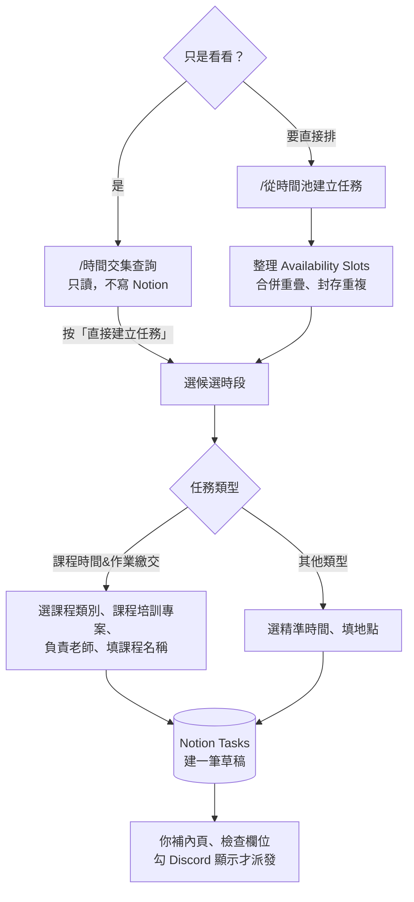

# 排課

**什麼時候用**：時間收集完，要找幾位藝人（和老師）都有空的時段，排課程、錄音、會議。

> 💡 **一句話看懂**：`/時間交集查詢` 只看不寫；`/從時間池建立任務` 會先整理時段，再讓你一路選到底，最後在 Notion 建一筆**草稿任務**（`Discord 顯示` 不勾，藝人收不到）。補完內容後，照「建立任務」與「派發與藝人回應」把它發出去。

## 開始前要準備好

| 要準備的 | 在哪裡設 | 少了會怎樣 |
|---|---|---|
| 這個月的時間已收齊 | 「每月收集可配合時間」 | 比對不到空檔 |
| 老師在 `People` 的 `身份類型` 是 `老師` 或 `公司成員` | Notion `People` | 選不到負責老師 |
| 課程有一筆 `專案類型`=`課程培訓` 的專案 | Notion `Projects` | 選不到課程專案 |

## 階段 1　找共同空檔

**只想看看**：打 **`/時間交集查詢`** → 選月份、時長、勾藝人 → 看共同空檔。

| 系統 | 發生什麼 |
|---|---|
| 📒 Notion | **只讀，完全不寫入** |
| 💬 Discord | 只有你看得到的候選清單。多的話會分頁，下方有**跳頁選單**，每頁標日期範圍 |

**要直接排**：打 **`/從時間池建立任務`**，參數一樣（月份、時長分鐘）。差別是它會先整理時間池：

| 系統 | 發生什麼 |
|---|---|
| 📒 Notion | `Availability Slots` 合併重疊、封存重複；`Audit Log` 記一筆 |
| 💬 Discord | 候選清單，接著選時段 |

**候選時段怎麼算**

- 依需要的時長切好，起點每 30 分鐘一個，例如 `13:30-14:30`、`14:00-15:00`
- 會扣掉 `Tasks` 裡有正式時間的硬性任務：`錄音`、`演出`、`會議溝通`，以及有 `課程類別` 的課程。作業、創作交付、企劃、行政、發布上架只提醒，不擋時段
- **草稿也算佔用**：還沒派發的草稿，這裡仍會當成已排掉，不會把同一段推給你兩次

## 階段 2　選時段與類型

選完候選時段，選 `任務類型`（選項直接讀 Notion，Notion 新增選項這裡就有）。

- **`課程時間&作業繳交`** → 依序選課程類別、課程培訓專案、負責老師，最後填課程名稱
- **其他類型** → 選精準時間、填地點等資訊

每一層都能「返回上一步」，取消也不會寫入任何東西。**只有走到最後一步才會真的建立。**

## 階段 3　系統建立草稿

| 系統 | 發生什麼 |
|---|---|
| 📒 Notion `Tasks` | 新增一筆，見下表 |
| 💬 Discord | 回覆你這筆任務的 Notion 連結，直接點進去編輯。**藝人收不到任何東西** |
| 📁 Drive | 不動 |

| 欄位 | 寫入值 |
|---|---|
| `任務名稱` | 你填的 |
| `任務狀態` | `尚未開始` |
| `任務類型` | 你選的 |
| `關聯藝人` | 你勾的藝人 |
| `Discord 顯示` | **不勾**（草稿） |
| `是否開放提交` | 不勾 |
| `課程類別`／`負責老師`／`關聯專案` | 課程流程才有 |
| `開始日`／`截止日` | 有選精準時間才有 |
| 任務內頁 | `## 任務說明` 標題底下寫安排來源、候選時段等資訊 |

> ⚠️ **內頁那些資訊藝人一行都看不到**（系統會濾掉 `安排來源：`、`課程類別：` 這類開頭的行）。派發前一定要在下面另起一行寫給藝人的內容，寫法見「建立任務」。

> ⚠️ **談定就要盡快派發**。藝人填時段時看不到草稿，可能把同一段回報成「可以配合」。

## 階段 4　補完、派發、補登行事曆

1. 補內頁、檢查欄位（見「建立任務」）
2. 勾 `Discord 顯示` 派發（見「派發與藝人回應」）
3. 派發後人工補登 TimeTree。兩邊不一致以 Notion 為準

## 拖太久系統會提醒

| 時間 | 💬 Discord（`營運內部通知`） |
|---|---|
| 收集截止後半天還沒比對 | 提醒你排課 |
| 整個流程超過 48 小時 | 升級通知 |
| 超過 72 小時 | 提示候選時段可能已經失效 |

## 出錯怎麼辦

| 狀況 | 原因 | 怎麼做 |
|---|---|---|
| 比對不到共同空檔 | 月份選錯、有人沒填、時長太長、既有任務佔滿 | 縮短時長、改選藝人，或請藝人補時段 |
| 有人沒填 | — | 請他用 `/管理可配合時間` 補 |
| 選單選不到老師 | `People` 的 `身份類型` 不對 | 改成 `老師` 或 `公司成員` |
| 藝人收到通知卻沒內容 | 只有系統寫的那段，沒補給藝人看的內容 | 補內頁後重送（見「改任務內容與重送」） |
