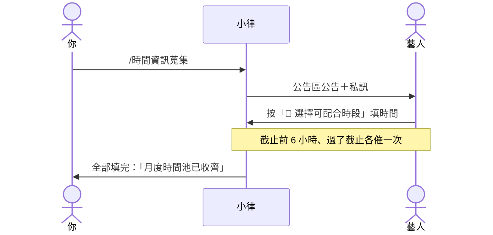

# 發起每月時間收集

> 💡 **誰可以做**：有 `控方` 身分組的人。
>
> **建議時間**：每月固定一天，例如 25 號前收集下個月。

## 開始前

- [ ] 要收集的藝人，在 Notion「Artists」都有 **Discord User ID**，合約狀態不是未簽、暫停、封存

## 步驟

1. 到 `營運操作` 頻道，打 **`/時間資訊蒐集`**。
2. 填三個欄位：
   - **月份**：要收集哪個月，格式像 `2026-11`
   - **截止天數**：幾天內要填完，預設 1 天（24 小時）
   - **說明**（選填）：例如「請優先填週末」
3. 送出。看到「✅ 已建立 **2026-11** 月度可配合時段收集。」就完成了。

> 💡 如果出現「⚠️ DM 未送達：…」，那幾位藝人關了私訊。請私下提醒他們到 `公告區` 按按鈕填。

## 接下來會發生什麼

| 時間 | 誰收到什麼 |
|---|---|
| 馬上 | `公告區` 出現「📅 2026-11 可配合時間回報」，標記所有藝人，下面有 **📅 選擇可配合時段** 按鈕；每位藝人也收到一則私訊 |
| 截止前 6 小時 | 還沒填的藝人收到「⏰ 2026-11 月度可配合時段即將截止」 |
| 過了截止 | 還沒填的藝人收到「🔴 2026-11 月度可配合時段已截止，你還沒有完成回填」 |
| 每天 09:30 | 營運早報的「🗓 時間池」寫出：已填幾位、誰還沒填、截止時間 |
| 全部填完 | `營運內部通知` 收到「✅ 2026-11 月度時間池已收齊」 |
| 截止 12 小時還沒排課 | `營運內部通知` 收到「⏰ 2026-11 時間池已截止超過半天」 |

藝人怎麼填，見藝人版的「回報下個月可配合時間」。

> 💡 系統只催兩次，避免打擾藝人。截止天數設得長的話，中間不會再提醒，需要時請自己在群組提醒。

## 你下一步

收齊後，用「從時間池建立任務草稿」排課。

## 常見問題

| 狀況 | 怎麼做 |
|---|---|
| 有藝人沒填 | 請他到 `公告區` 按 **📅 選擇可配合時段**，或到 `時間管理` 打 `/管理可配合時間` 補。**不用重發公告** |
| 發錯月份或日期 | 見「取消時間收集」 |
| 系統說可排課藝人 0 位 | 藝人都沒有 Discord User ID，或合約狀態都是未簽、暫停、封存 |
