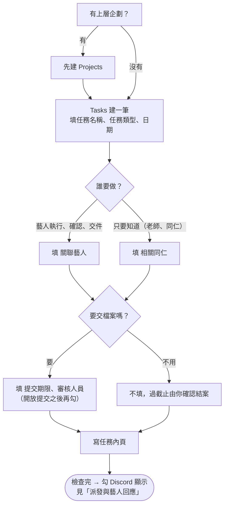

# 建立任務

**什麼時候用**：例會或討論確定了一件要做的事，要排給藝人（或通知同仁）。系統從時間池建的草稿也照這頁補完。

> 💡 **一句話看懂**：任務只在 Notion 建。欄位決定**誰收到、什麼時候提醒、要不要交件**；內頁就是藝人看到的任務內容。這一頁全部做完，再勾 `Discord 顯示` 派發。



## 開始前要準備好

| 要準備的 | 在哪裡設 | 少了會怎樣 |
|---|---|---|
| 藝人、同仁都已上線（有 `Discord User ID`） | 「新藝人、新同仁上線」 | 收不到通知 |
| 有上層企劃就先建 `Projects` | Notion `Projects` | 交件檔案進「未分專案」資料夾 |

> ⚠️ 例會確認的正式事項**不要寫成 Availability Slot**，一律建 `Projects`／`Tasks`。

## 階段 1　填欄位

### 一定要填

| 欄位 | 讓系統做什麼 |
|---|---|
| `任務名稱` | 藝人看到的標題；前後空白、換行會自動拿掉 |
| `任務類型` | 決定要不要擋藝人的時段（`錄音`、`演出`、`會議溝通`）、要不要發公告區（`通告`、`演出`）。課程固定選 `課程時間&作業繳交`，再填 `課程類別` |
| `關聯藝人` | **收到任務卡、早報、可以交件的人**。沒填就沒有藝人會收到 |
| `開始日`／`截止日` | 正式行程時間（上課日、發布日、演出日），也是提醒與逾期的依據。**作業期限不要填在 `截止日`**，填 `提交期限` |
| `關聯專案` | 交件檔案放在 Drive 的哪個專案資料夾；沒掛進「未分專案」 |

`任務狀態` 不用選，空白時系統當成 `尚未開始`。

### 任務相關對象：`關聯藝人` 和 `相關同仁`

| 對象 | 填哪一欄 | 💬 Discord 收到什麼 | 能改任務狀態嗎 |
|---|---|---|---|
| 藝人：要執行、確認、交件 | `關聯藝人`（連到 `Artists`） | 任務卡（收到任務／有問題）、每日早報、交件與審核結果 | 可以（按按鈕） |
| 老師、公司同仁：只要知道 | `相關同仁`（連到 `People`） | 派發時一則純知會、每日同仁早報，沒有按鈕 | 不可以 |

同一筆可以兩欄都填。`相關同仁` 不是 `負責老師` 的替代欄位。

### 要交件才填

| 欄位 | 讓系統做什麼 |
|---|---|
| `提交期限` | 第一輪交件的死線，提醒和逾期照它算（詳見「期限、逾期與結案」） |
| `審核人員` | 藝人交件時私訊這幾位；待審核超過 24 小時每天 10:00 再提醒。不填就發到 `營運內部通知` 由營運審 |
| `提前交件` | 勾了，交件死線自動變成 `截止日` 前 5 天（或你填的 `提交期限`）。**上課、通告不要勾** |
| `是否開放提交` | **建立時先不用勾**。勾下去藝人就能交件，並收到「作業開放」通知（見「交件與審核」） |

> 💡 交件一律上傳到公司 Drive，沒有「提交方式」可以選；文字內容請藝人存成檔案上傳。

### 選填

| 欄位 | 讓系統做什麼 |
|---|---|
| `提醒規則` | **不勾也會在死線前 5 天、3 天提醒**（系統預設）。勾的是額外再加：`3 天前`／`1 天前`／`當天`／`逾期`。只能加，不能減 |
| `負責老師`／`課程類別` | 課程任務用。課程結束 2 小時後小律私訊負責老師去論壇發布作業 |
| `Google Drive Folder` | 通常留空讓系統填。手動填的話，藝人交件改進這個資料夾，**要自己分享給藝人** |

### 這些欄位不要動

| 欄位 | 為什麼 |
|---|---|
| `Discord 通知時間`、`Discord 收到時間` | 小律寫的，記錄通知與藝人按收到的時間 |
| `最新提交 URL` | 小律寫的，指向最新一筆提交 |
| `提醒確認(From 藝人)` | 小律寫的早報已讀紀錄。**欄位名稱不能改**（半形括號、From 後一個空格），改了系統寫不進去 |

## 階段 2　寫任務內頁

點進任務，直接在內頁寫。**整頁就是藝人看到的任務內容**：派發卡、截止前提醒、早報「看內容」、小律回答細節，讀的都是這一頁。

寫清楚**做什麼、做多少、用什麼形式交、什麼時候交**，例如「聽力訓練：50 題音程／截圖」。藝人沒有別的地方可以查。

| 會讀到 | 不會讀到 |
|---|---|
| 段落、標題、條列、待辦、引用、callout、切換清單裡面、分欄裡面、表格（每列變「欄｜欄」）、書籤和嵌入的網址；巢狀最多 3 層 | **子頁面、連結的資料庫**（內部資料放這裡）；**圖片、檔案、PDF**（要給檔案請貼 Drive 連結）；系統寫的「藝人回覆」「Drive 資料夾索引」兩段 |

| ⚠️ 注意 | 為什麼 |
|---|---|
| 整頁都會被藝人看到 | 內部備註、報價、其他藝人的資訊放子頁面 |
| Notion 網址會被拿掉 | 藝人零 Notion 入口；Drive、YouTube 等其他網址保留 |
| `名稱：` 開頭的行會被濾掉 | `安排來源：`、`課程類別：`、`負責老師：`、`需要時長：`、`候選時段` 開頭的行是營運欄位。要交代就寫成一句話：「這週改由 B 老師上課」 |
| 太長會被截斷 | 派發卡約 900 字、截止前提醒 700 字、小律和「看內容」1,500 字。重點寫最前面 |
| 時間寫在內頁不算數 | 正式時間只看 `開始日`／`截止日` 欄位 |
| 不要改系統段落的標題 | 「藝人回覆」「Drive 資料夾索引」改名後，會被當成任務內容念給藝人 |

**課程任務一定要自己補一段**。時間池建的內頁長這樣，濾完是空的：

```notion
安排來源：/從時間池建立任務
課程類別：舞蹈課
負責老師：lurasupa
需要時長：2 小時
候選時段（由營運最後確認）：
2026-09-17 19:30~21:30
```

在下面另起一行寫給藝人的內容，上面那段不用刪：

```notion
這週練上次那支編舞的後半段，記得帶練習服。
```

## 做完怎麼確認

派發前對一次：

- [ ] `任務名稱`、`任務類型`、`開始日`／`截止日` 都對
- [ ] `關聯藝人` 是要做事的人；只要知道的放 `相關同仁`
- [ ] 要交件的填了 `提交期限`、`審核人員`
- [ ] 內頁有寫給藝人看的內容，沒有內部資訊
- [ ] 有上層企劃的掛了 `關聯專案`

全部打勾就到「派發與藝人回應」。
