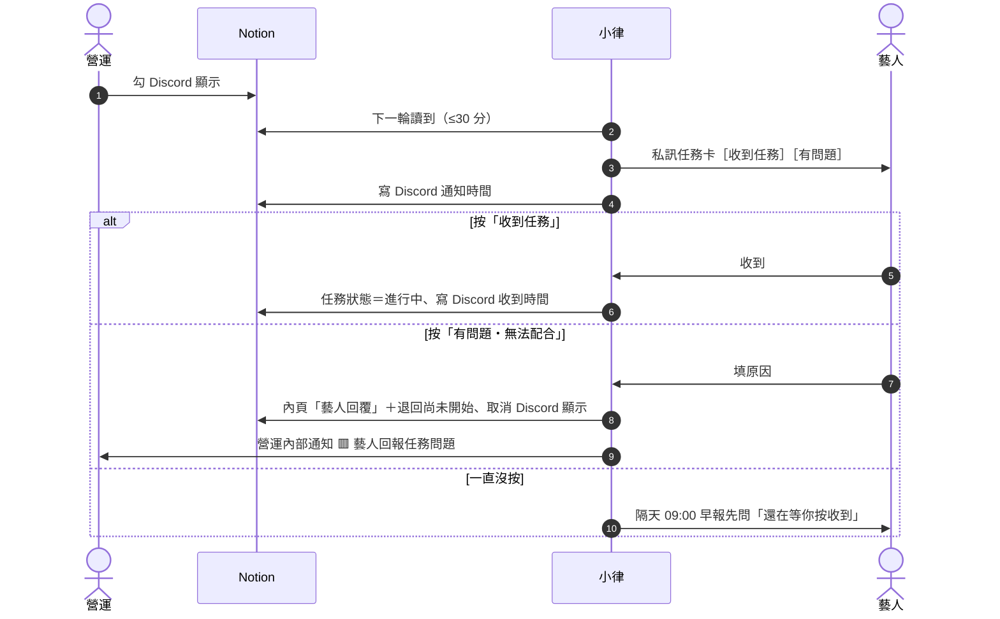

# 派發與藝人回應

**什麼時候用**：任務建好、檢查完，要讓藝人知道。

> 💡 **一句話看懂**：勾 `Discord 顯示` → 最多 30 分鐘內小律私訊任務卡 → 藝人按「收到任務」，`任務狀態` 變 `進行中`；按「有問題」，任務退回給你、`營運內部通知` 跳一則 🟥。

## 開始前要準備好

| 要準備的 | 在哪裡設 | 少了會怎樣 |
|---|---|---|
| 「建立任務」的檢查清單都打勾 | Notion `Tasks` | 藝人收到錯的或空白的內容 |
| `關聯藝人`、`相關同仁` 都有 `Discord User ID` | `Artists`／`People` | 送不出去，`營運內部通知` 跳 🟥 |

## 階段 1　營運派發

**你要做的**：勾 **`Discord 顯示`**。

| 系統 | 發生什麼 |
|---|---|
| 📒 Notion | 送出後寫 `Discord 通知時間` |
| 💬 Discord | **最多 30 分鐘內**私訊每位 `關聯藝人`：任務名稱、類型、截止日、內頁內容，附「收到任務」「有問題・無法配合」兩顆按鈕。`相關同仁` 收一則純知會。`任務類型` 是 `通告`／`演出` 的另外發到 `公告區`、列進本月排程 |
| 📁 Drive | 不動 |

**同一輪好幾筆會合併**：同一位藝人這一輪有 2 筆以上，只收**一則**「📌 任務通知（N）」：清單＋「看任務內容」選單＋「✅ 全部收到」＋「⚠️ 哪一筆不行？」。同仁也合併成一則「👥 同仁知會（N）」。

> 💡 **作業分兩段發**：課程、需要先上課才交的作業，不要建兩筆任務。先只勾 `Discord 顯示`（藝人知道有這件事），上完課再補作業要求、`提交期限`、`審核人員`，勾 `是否開放提交`，藝人才收到「📚 作業開放」通知。見「交件與審核」。

## 階段 2　藝人回應

| 藝人做了什麼 | 📒 Notion 怎麼變 | 💬 Discord 怎麼變 | 你要做的 |
|---|---|---|---|
| 按「**收到任務**」或「**✅ 全部收到**」 | `任務狀態` → `進行中`；`Discord 收到時間` → 按的時間 | 那則收成一行「✅ 任務收好了」，後面留「有問題」入口；同任務的舊通知刪掉 | 不用做事 |
| 按「**有問題・無法配合**」「**哪一筆不行？**」或早報的「**這筆不行**」，填原因 | 原因**追加**到內頁「藝人回覆」段落；`任務狀態` → `尚未開始`；`Discord 顯示` 取消；`Discord 通知時間`、`Discord 收到時間`、`提醒確認(From 藝人)` 清空 | 藝人那則標「⚠️ 小律已轉告公司」；`營運內部通知` 一則 🟥 藝人回報任務問題 | 見階段 3 |
| **一直沒按** | 不變（停在 `尚未開始`） | 隔天 09:00 早報先問「有 N 筆任務還在等你按收到喔」；超過 3 天列在營運早報 | 私下聯絡，或重送（見「改任務內容與重送」） |

**例外**

| 任務狀態 | 藝人按「有問題」會怎樣 |
|---|---|
| `待審核`、`需修改` | 不能用按鈕回報，小律請他直接聯絡公司（避免打亂審核） |
| `已逾期` | 可以回報，原因寫進「藝人回覆」，但**不退回**：狀態維持 `已逾期`、`Discord 顯示` 不取消。🟥 會寫「維持已逾期，沒有退回」，由你決定延期或結案 |

## 階段 3　處理藝人回報的問題

1. 在 `營運內部通知` 那則 🟥 按「🙋 我來處理」（讓同事知道你接了）
2. 點 🔗 打開任務，看內頁「藝人回覆」
3. 改任務：時間、內容、換人
4. **重新勾 `Discord 顯示`**，下一輪重新派發
5. 回頻道按「✅ 已處理」

> ⚠️ 頻道的按鈕**不會改 Notion**；在 Notion 改完，那則 🟥 也**不會**自己收起來。兩邊都要做。見「處理營運內部通知」。

## 做完怎麼確認成功

| 看哪裡 | 應該看到 |
|---|---|
| Notion `Tasks` | `Discord 通知時間` 有值；藝人按收到後 `任務狀態`=`進行中`、`Discord 收到時間` 有值 |
| `/任務總覽` | 這筆在「📋 進行中」 |

## 出錯怎麼辦

| 狀況 | 原因 | 怎麼做 |
|---|---|---|
| 藝人沒收到 | `Discord 顯示` 沒勾、沒有 `關聯藝人`、藝人沒有 `Discord User ID` | 補好後重送 |
| 等了 30 分鐘還沒發 | 剛好錯過一輪 | 再等一輪，或用 `/任務通知重送` 立刻發 |
| `營運內部通知` 跳「任務通知送不出去」 | 對象都沒有 `Discord User ID` | 補 ID，勾 `重送通知` |
| 藝人收到「Notion 尚未填寫任務說明」 | 內頁空白、只有子頁面或圖片、或全是 `名稱：` 開頭的行 | 補內頁後重送 |
| 同仁沒收到 | `People` 沒填 `Discord User ID`，系統**不會**提醒你 | 補 ID 後重送 |
