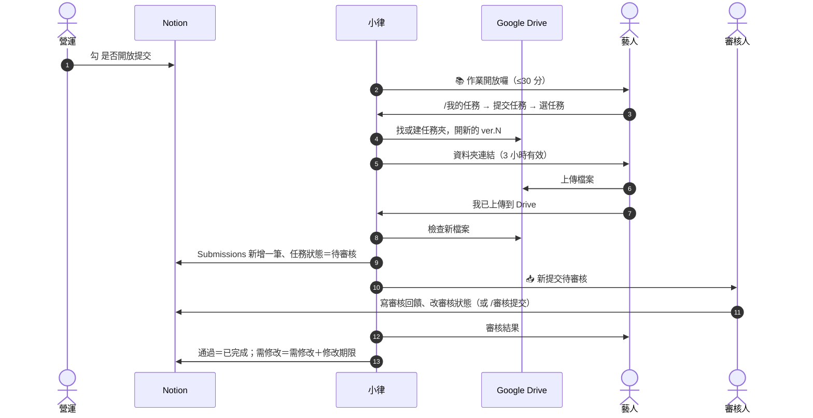

# 交件與審核

**什麼時候用**：任務需要藝人交檔案（課後作業、Demo、錄音、企劃書…），交了之後要有人審。

> 💡 **一句話看懂**：營運勾 `是否開放提交` → 藝人在 Discord 拿到一個 Drive 資料夾、把檔案傳進去 → 小律在 Notion 記一筆提交、通知審核人 → 審核人給結果 → 小律通知藝人。需修改就再交一輪。



## 開始前要準備好

| 要準備的 | 在哪裡設 | 少了會怎樣 |
|---|---|---|
| 藝人的 `Discord User ID` | Notion `Artists` | 認不出藝人，收不到通知、看不到任務 |
| 藝人專區已建好、**已分享給藝人（編輯者）** | Google Drive，連結貼在 `Artists` 的 `Google Drive 資料夾` | 藝人點開資料夾會被拒絕，無法上傳 |
| 任務掛好 `關聯藝人`、`關聯專案` | Notion `Tasks` | 沒掛藝人＝沒人收到；沒掛專案＝檔案進「未分專案」 |
| 任務填好 `審核人員`，審核人在 `People` 有 `Discord User ID` | Notion `Tasks`／`People` | 審核人收不到私訊，改發到 `營運內部通知` |
| 任務已派發（`Discord 顯示` 已勾） | Notion `Tasks` | 藝人看不到這筆任務 |

## 流程總覽

| 階段 | 誰做 | 在哪做 | `任務狀態` |
|---|---|---|---|
| 1. 開放交件 | 營運 | Notion | 不變 |
| 2. 打開交件入口 | 藝人 | Discord `/我的任務` | 不變 |
| 3. 上傳檔案 | 藝人 | Google Drive | 不變 |
| 4. 確認交件 | 藝人 | Discord | → `待審核` |
| 5. 審核 | 審核人 | Notion 或 Discord | → `已完成` 或 `需修改` |
| 6. 附批改檔（選用） | 審核人 | Discord | 不變 |
| 7. 重交（需修改時） | 藝人 | 回到階段 2 | → `待審核` |

---

## 階段 1　營運開放交件

**你要做的**：打開那筆任務，補好作業要求（內頁）、`提交期限`、`審核人員`，勾 **`是否開放提交`**。

| 系統 | 發生什麼 |
|---|---|
| 📒 Notion | 小律讀到勾選，不改任何欄位；`Audit Log` 記一筆「課後作業通知｜任務名稱」 |
| 💬 Discord | **最多 30 分鐘內**私訊 `關聯藝人`：「📚 老師的作業開放囉，可以開始交了！」，附截止日與作業要求。同一位藝人這一輪好幾筆就合併成一則。**每筆任務只通知一次** |
| 📁 Drive | 還沒有動作，資料夾要等藝人打開交件入口才建 |

> ⚠️ 沒勾 `是否開放提交` 的任務，藝人在 Discord **完全交不了**，過了截止也不會被判逾期（改列在營運早報「等你確認結案」）。

## 階段 2　藝人打開交件入口

**藝人做的**：在 `任務查詢入口` 打 `/我的任務` → 按「提交任務」→ 選這筆任務。

清單只會出現 `是否開放提交` 已勾，而且 `任務狀態` 是 `尚未開始`／`進行中`／`待提交`／`需修改`／`已逾期` 的任務。`待審核`、`已完成`、`已封存` 的不會出現。

| 系統 | 發生什麼 |
|---|---|
| 📁 Drive | 找到或建好這筆任務的資料夾，在裡面**開一個新的交件夾** `任務名稱_YYYY.MM.DD_ver.N`（規則見下方） |
| 📒 Notion | 單一藝人的任務：第一次建好任務夾時，連結寫進 `Tasks` 的 `Google Drive Folder`。多位藝人的任務：改在內頁最下面「Drive 資料夾索引」加一行（藝人、小律都看不到這段） |
| 💬 Discord | 只有藝人看得到的訊息：資料夾連結＋「我已上傳到 Drive」，**3 小時內有效** |

### 資料夾建在哪

小律照順序找：

| 順序 | 看哪個欄位 | 結果 |
|---|---|---|
| 1 | `Tasks` 的 `Google Drive Folder` 有填 | 交件夾開在這個資料夾裡 |
| 2 | `Artists` 的 `Google Drive 資料夾`（藝人專區） | `專區 / 專案名稱 / YYYY.MM.DD_任務名稱 / 交件夾` |
| 3 | 都沒有 | 在公司 Drive 總資料夾下建一個**以藝人名稱命名**的專區，再往下建。**這個專區沒分享給藝人，要你去分享**；也不會寫回 `Artists` |

```text
方晨（藝人專區）/
  方晨 2610 課程/                    ← 關聯專案 的名稱；沒掛 → 未分專案
    2026.10.25_編曲作業/             ← 截止日＋任務名稱（沒截止日用建立日）
      編曲作業_2026.10.20_ver.1/     ← 第一次交件（日期＝藝人打開入口那天）
      編曲作業_2026.10.23_ver.2/     ← 需修改後重交
      老師回饋/
        老師回饋_2026.10.24_ver.1/   ← 審核人附的批改檔
```

> ⚠️ **小律不會設定任何分享權限。** 新資料夾的權限跟著上一層走，所以藝人專區一定要先分享給藝人。手動填 `Google Drive Folder` 的話，那個資料夾也要分享；多位藝人的任務填了它，所有人會交到同一個資料夾、彼此看得到。

- 資料夾是**照名稱找**的：同名就沿用，名稱變了就開新的。專案、藝人名稱建好後盡量不要改
- 名稱裡 Drive 不接受的字元（`/ \ : * ? " < > |`）會換成 `_`，太長截在 70 字
- 讀不到專案時小律**不會**亂放，會請藝人稍後再試

## 階段 3　藝人上傳檔案

**藝人做的**：點資料夾連結，把檔案傳進去（可以多個）。

這一步只發生在 Google Drive，Notion 和 Discord 都沒有變化。訊息消失的話，**3 小時內**回 `/我的任務` 選同一筆任務，會回到**同一個** `ver.N`，已傳的檔案都還在。

## 階段 4　藝人確認交件

**藝人做的**：回到 Discord 按「**我已上傳到 Drive**」。

小律去交件夾找**入口打開之後新增的檔案**。找不到會請藝人確認後再按；找到就往下走：

| 系統 | 發生什麼 |
|---|---|
| 📒 Notion `Submissions` | 新增一筆：`提交名稱`、`提交藝人`、`關聯任務`、`提交來源`=Discord、`提交類型`=檔案、`檔案類型`（依任務類型自動選）、`審核狀態`=**待審核**、`權限等級`=藝人本人、`是否最新版`=勾、`提交時間`、`Drive URL`（交件夾）、`Drive File ID`、`原始檔名`、`檔案大小 MB`。同一任務先前的提交，`是否最新版` 自動取消 |
| 📒 Notion `Tasks` | `任務狀態` → **`待審核`**；`最新提交 URL` → 這筆 Submissions 的頁面；`修改期限` 清空 |
| 💬 Discord | 藝人看到「✅ 檔案收到了」。`審核人員` 收到私訊「📥 新提交待審核」，附 Drive 和 Notion 連結與「怎麼審」。沒填審核人員、或審核人沒有 Discord ID，改發 `營運內部通知` 成為一則 🟥 |
| 📁 Drive | 不動，檔案留在交件夾 |

審核人收到的私訊：

```discord
📥 新提交待審核（檔案）
任務：10/25（日）編曲作業｜方晨｜2 個檔案（12.4MB）
Drive：（這次交件的資料夾）
Notion：（這筆提交的頁面）

怎麼審（擇一）
・Notion：打開上面的提交頁，先在 審核回饋 寫幾句，再把 審核狀態 改成「通過」或「需修改」。小律每分鐘檢查一次，改完就會通知藝人。
・Discord：到 營運操作 頻道打 /審核提交，選這筆提交，按「通過」或「需修改」，再填回饋。
```

> 💡 待審核超過 24 小時，小律每天 10:00 再私訊審核人一次。`待審核` 期間藝人不會被催、也不會被判逾期。

## 階段 5　審核

兩種方式擇一，結果一樣。

**A. 在 Notion 審**（任何人都可以）：打開那筆 Submissions → **先**寫 `審核回饋` → **再**把 `審核狀態` 改成 `通過`／`需修改`／`退回`。

**B. 在 Discord 審**（要有 `控方` 身分組）：在 `營運操作` 打 **`/審核提交`**：

1. 選一筆待審核的提交
2. 小律列出 Drive 連結、關聯任務，**先看過檔案再判斷**
3. 選 `通過`／`需修改`／`退回`
4. 填給藝人的回饋（可留空）
5. 需修改或退回要選 **1～7 天的修改期限**
6. 送出後小律**馬上**私訊藝人結果，接著問你要不要附批改檔（見階段 6）

| 系統 | 發生什麼 |
|---|---|
| 📒 Notion `Submissions` | `審核狀態`、`審核回饋`、`審核者`、`審核來源`（Notion／Discord）；通知送出後寫 `審核通知時間` |
| 📒 Notion `Tasks` | 通過 → `任務狀態` = **`已完成`**。需修改／退回 → **`需修改`**，寫入 `修改期限` |
| 💬 Discord | 私訊藝人審核結果、回饋、修改期限（不附 Notion 連結）。Notion 審的話小律**每分鐘**檢查一次 |
| 📁 Drive | 不動 |

> ⚠️ 在 Notion 審時**順序不能反**：先改狀態再寫回饋，藝人可能先收到沒有回饋的結果。只改狀態、`審核回饋`／`審核者`／`審核來源` 一個都沒填的話，小律會當成歷史資料整理，**不通知藝人**。

## 階段 6　附批改檔（選用，只有 Discord 審有）

**審核人做的**：按「附批改檔」→ 在同一個頻道上傳檔案（可以多個）→ 按「完成回饋」。不需要就按「不需補批改檔」。

| 系統 | 發生什麼 |
|---|---|
| 📁 Drive | 檔案放進 `任務夾 / 老師回饋 / 老師回饋_YYYY.MM.DD_ver.N` |
| 📒 Notion `Submissions` | 批改檔連結加進 `審核回饋` |
| 💬 Discord | 私訊藝人第二則「📎 老師補充了批改檔」，附連結 |

- 每個檔案 **10MB 以下**。更大的先傳到小律給的老師回饋資料夾，再按「貼 Drive 連結補回饋」
- 這則訊息只有你看得到，切去 Drive 回來可能消失：**3 小時內**在同一個頻道隨便打一句話（例如「好了」），按鈕會再出現
- 超過 3 小時就沒有 Discord 入口了：把 Drive 連結直接貼進那筆 Submissions 的 `審核回饋`，自己私訊藝人
- 只有原本審核的那個人能操作；按錯用「返回回饋選擇」

## 階段 7　需修改 → 重交

藝人收到「需修改」，回到**階段 2** 再交一次：

| 系統 | 發生什麼 |
|---|---|
| 📁 Drive | 同一個任務夾裡開**下一個** `ver.N`，舊版本留著 |
| 📒 Notion | Submissions 多一筆（舊的取消 `是否最新版`）；Tasks 回到 `待審核`、`修改期限` 清空 |
| 💬 Discord | 審核人再收到「📥 新提交待審核」，回到階段 5 |

停在 `需修改` 期間藝人每天都會在早報看到；過了 `修改期限` 狀態**仍是 `需修改`**，不會自動變 `已逾期`，營運早報會列「修改期限已過」讓你決定要催還是放棄。

---

## 做完怎麼確認成功

| 看哪裡 | 應該看到 |
|---|---|
| Notion `Tasks` | `任務狀態` = `已完成`；`最新提交 URL` 有值；單一藝人任務的 `Google Drive Folder` 有值 |
| Notion `Submissions` | 最新一筆 `是否最新版` 有勾、`審核狀態` = `通過`、`審核通知時間` 有值 |
| Google Drive | 任務夾裡有 `ver.N` 資料夾，檔案都在 |

## 出錯怎麼辦

| 狀況 | 原因 | 怎麼做 |
|---|---|---|
| 藝人說提交清單裡沒有這筆 | 沒勾 `是否開放提交`；或狀態已是 `待審核`／`已完成`／`已封存` | 勾開放提交；要讓藝人重交就把狀態改回 `需修改` |
| 勾了開放提交，藝人沒收到通知 | 還沒到下一輪；或 `Discord 顯示` 沒勾 | 等 30 分鐘；確認兩個都勾 |
| 藝人打開資料夾說沒有權限 | 專區沒分享給藝人 | 到 Drive 分享藝人專區（編輯者） |
| 藝人按「我已上傳」說找不到檔案 | 傳到上一層或別的資料夾；或傳的是入口打開**之前**就在的舊檔 | 請藝人把檔案移進訊息裡那個 `ver.N` 再按 |
| 藝人看到「小律現在打不開公司的 Drive」 | Drive 授權失效（`營運內部通知` 也會有 ⚙️ 系統警告） | 請工程端重新授權，當天處理 |
| 審核人沒收到私訊 | 沒填 `審核人員`，或審核人沒有 `Discord User ID` | 看 `營運內部通知` 的 🟥；補欄位 |
| 審核人打不了 `/審核提交` | 沒有 `控方` 身分組 | 改在 Notion 審，或給身分組 |
| Notion 改了審核狀態，藝人沒收到 | 回饋欄位一個都沒填 | 補寫 `審核回饋`，一分鐘內會發出 |
| 審核寫入失敗 | `Submissions` 少了 `審核回饋`、`審核者`、`審核來源`、`審核通知時間` 其中一欄 | 請工程端確認欄位 |
| 檔案跑到「未分專案」 | 任務沒掛 `關聯專案` | 掛上專案；已交的檔案自己在 Drive 搬 |
| 專案改名後，新交件跑到另一個資料夾 | 照名稱找，改名＝開新資料夾 | 單一藝人任務第一次交件後就固定了；多位藝人的任務要自己在 Drive 合併 |
