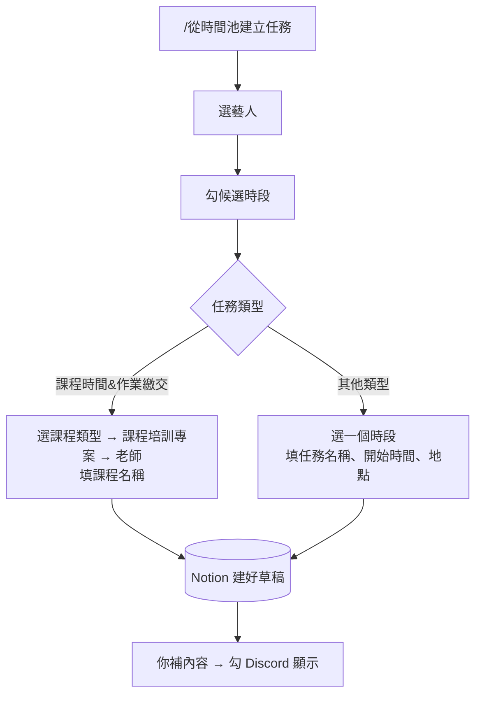

# 從時間池建立任務草稿

> 💡 **誰可以做**：有 `控方` 身分組的人。
>
> **建好的是草稿**：藝人**不會**收到通知，要你補完內容、勾「Discord 顯示」才會發出。

## 開始前

- [ ] 這個月的時間收集已經收齊（見「發起每月時間收集」）
- [ ] 排課程的話：Notion 有一筆專案類型是 **課程培訓** 的專案；老師在 People 的身份類型是 **老師** 或 **公司成員**

## 步驟

1. 到 `營運操作` 打 **`/從時間池建立任務`**，填 **月份** 和 **時長分鐘**。
2. 從 **選擇要比對的藝人（可多選）…** 勾藝人。小律會先整理藝人的時段（合併重疊、清掉重複），再列出共同空檔。
3. 從 **選擇候選時段…** 勾想排的時段，可以翻頁勾。勾好按 **確認候選時段**。要換藝人就按 **↩️ 返回藝人選擇**。
4. 從 **選擇 Notion 任務類型…** 選類型。選項跟 Notion 的「任務類型」同步。

**排課程**（選 **課程時間&作業繳交**）

5. 從 **選擇課程類型…** 選，例如歌唱課。
6. 從 **選擇課程培訓 Project…** 選這堂課屬於哪個專案。
7. 從 **選擇老師／確認對象…** 選老師。
8. 跳出 **課程安排設定**，填 **課程名稱**（例如「八月歌唱課｜Johnny Chenhua」），送出。

**排其他行程**（錄音、通告、會議…）

5. 從 **選擇候選時段…** 選定案的那一個時段。
6. 跳出 **建立安排 Task 草稿**，填：
   - **任務名稱**，例如「八月錄音安排」
   - **開始時間**：已經幫你填好，通常不用改
   - **地點／連結（選填）**
7. 送出。

每一層都可以回上一步：**↩️ 返回候選時段**、**↩️ 返回任務類型**、**↩️ 返回課程類型**、**↩️ 返回 Project**。**走到最後一步送出之前，什麼都不會建立。**

## 接下來會發生什麼

小律回你「✅ 已建立…」和一個 Notion 連結。Notion「Tasks」多了一筆草稿：

| 欄位 | 內容 |
|---|---|
| 任務名稱、任務類型、關聯藝人 | 你剛剛選的 |
| 任務狀態 | 尚未開始 |
| Discord 顯示、是否開放提交 | **都沒勾**（所以藝人收不到） |
| 開始日、截止日 | 排其他行程才有；**排課程的要自己填** |
| 頁面內文 | 安排來源、候選時段等資訊，**藝人看不到** |

## 你下一步

1. 點連結打開這筆任務。
2. 排課程的：填 **開始日**、**截止日**（上課時間）。
3. 在頁面內文**另起一行**寫給藝人看的內容（見「寫任務內容」）。系統寫的那段藝人看不到，不寫的話藝人會收到「尚未填寫任務說明」。
4. 勾 **Discord 顯示** 發出去（見「派一筆任務給藝人」）。
5. 自己補登 TimeTree。

> ⚠️ **談定就盡快派發**。藝人填時間時看不到草稿，可能把同一段時間又回報成「可以配合」。

## 常見問題

| 狀況 | 怎麼做 |
|---|---|
| 選不到老師 | 老師在 People 的身份類型不是老師或公司成員 |
| 選不到課程專案 | 沒有專案類型是課程培訓、而且還沒結案的專案 |
| 「❌ 此時間超出候選窗」 | 開始時間改成預設那個 |
| 收到「🔴 排課流程已超過 48 小時」 | 草稿建了很久還沒派發。派發後就不會再提醒 |
