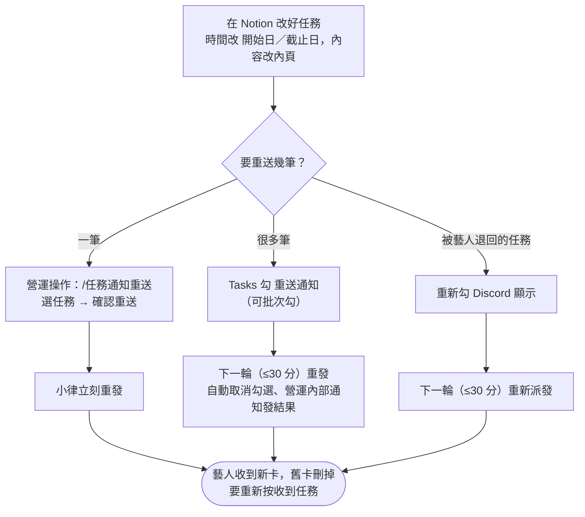

# 改任務內容與重送

**什麼時候用**：任務已經發出，才發現時間、地點、要求要改；藝人一直沒反應想再推一次；補了某人的 Discord ID 要補發。

> 💡 **一句話看懂**：已發出的私訊**不會自己更新**。先在 Notion 改好，再重送：一筆用 `/任務通知重送`（馬上），很多筆勾 `重送通知`（最多 30 分鐘）。重送會清掉舊的收到紀錄，藝人要重新按一次「收到任務」。

## 開始前要準備好

**一定先改 Notion，再重送。** 通知內容是重送當下從 Notion 讀的。

| 要改的 | 改哪裡 |
|---|---|
| 時間 | `開始日`／`截止日`／`提交期限` 欄位。**只改內頁寫的時間沒有用** |
| 內容、要求、地點 | 任務內頁 |
| 對象 | `關聯藝人`／`相關同仁` |

## 做法 A　一筆：`/任務通知重送`

**你要做的**：在 `營運操作` 打 `/任務通知重送`（任務多就加 `關鍵字:編曲` 縮小範圍）→ 選任務 → 「確認重送」。

| 系統 | 發生什麼 |
|---|---|
| 📒 Notion | 清空 `Discord 通知時間`、`Discord 收到時間`、`提醒確認(From 藝人)`；送出後重寫 `Discord 通知時間`；`Audit Log` 記一筆 |
| 💬 Discord | **立刻**私訊關聯藝人新的任務卡；同任務之前的舊卡先刪掉，私訊只留最新那則 |
| 📁 Drive | 不動 |

選單會標示每筆的狀態，未確認的排前面，最多 25 筆：

| 標示 | 意思 |
|---|---|
| `⏳ 未確認` | 藝人還沒按「收到任務」 |
| `✅ 已確認` | 藝人按過了，一樣可以重送 |

## 做法 B　很多筆：勾 `重送通知`

**你要做的**：在 `Tasks` 把要重送的任務勾 **`重送通知`**（可以多選後一次勾）。

| 系統 | 發生什麼 |
|---|---|
| 📒 Notion | 跟做法 A 一樣清空、重寫通知欄位；**自動取消** `重送通知` 的勾 |
| 💬 Discord | 下一輪（最多 30 分鐘）一起重送；同一位藝人好幾筆只收**一則合併通知**；`營運內部通知` 發一則重送結果摘要 |

沒勾 `Discord 顯示` 或已結案的任務會略過。

## 做法 C　被藝人退回的任務

藝人按過「有問題」的任務，`Discord 顯示` 已經被取消。改好後**重新勾 `Discord 顯示`** 就會重新派發，不用另外勾重送；兩個都勾也只會送一次。

## 最常見的情境：已確認的任務要改時間

1. Notion 改 `開始日`／`截止日`
2. `營運操作` 打 `/任務通知重送 關鍵字:（任務名稱片段）`
3. 選那筆（會顯示 ✅ 已確認）→「確認重送」
4. 藝人收到新卡，重新按「收到任務」

不用自己去清 `Discord 通知時間`、`Discord 收到時間`，小律會清。

> ⚠️ 延後期限的任務如果已經是 `已逾期`，記得把 `任務狀態` 改回 `進行中`，否則下一輪又會被判逾期（見「期限、逾期與結案」）。

> 💡 **不建議用「取消勾 `Discord 顯示` 再勾回來」來重送**：小律要等下一輪才清掉舊紀錄，馬上勾回去會被當成「已經通知過」而不重送；中間藝人在 `/我的任務` 也看不到這筆。

## 做完怎麼確認成功

| 看哪裡 | 應該看到 |
|---|---|
| Notion `Tasks` | `Discord 通知時間` 是剛剛的時間、`Discord 收到時間` 是空的 |
| 做法 B | `重送通知` 的勾已經被取消；`營運內部通知` 有結果摘要 |

## 出錯怎麼辦

| 狀況 | 原因 | 怎麼做 |
|---|---|---|
| 重送清單找不到那筆 | `Discord 顯示` 沒勾，或已結案 | 勾 `Discord 顯示` |
| 下拉超過 25 筆 | — | 加 `關鍵字` 縮小範圍 |
| 藝人說又要按一次確認 | 正常，內容變了舊確認不算數 | — |
| 藝人看到不該看的內容 | 內頁整頁都會送出 | 移到子頁面再重送；**已送出的私訊收不回來** |
| 重送後內容還是舊的 | 改的是內頁裡寫的時間，不是欄位 | 改 `開始日`／`截止日` 欄位再重送 |
