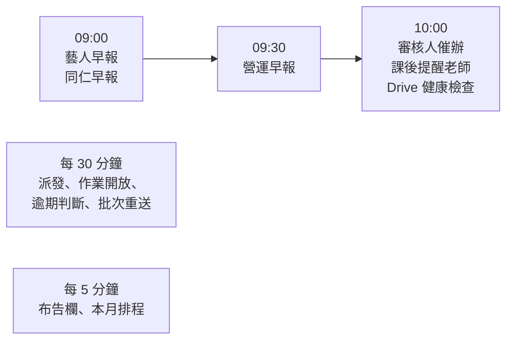

# 每天的提醒與早報

**什麼時候用**：每天。這頁說明小律每天固定做的事，以及你每天早上要看什麼。

> 💡 **一句話看懂**：小律每天早上**重新讀一次 Notion**，照當下的狀態發早報。你前一天在 Notion 改了什麼，隔天的早報就會跟著變，不用按任何按鈕。



## 09:00　藝人早報（私訊）

每位藝人一則「☀️ 今天要注意的事」，沒事的藝人那天不發。

| 區塊 | 📒 讀 Notion 什麼 |
|---|---|
| 📌 還在等你按收到 | `Discord 顯示` 已勾、`Discord 收到時間` 空白的任務。**有這種任務時，早報先只問這件事**，藝人處理完，今天的提醒才以新的一則出現在最下面 |
| 🔴 已經過期限 | `任務狀態` = `已逾期` |
| 🛠 需修改 | `任務狀態` = `需修改` |
| ⏳ 已過截止，等公司確認 | 沒勾 `是否開放提交`、過了截止、還沒結案 |
| ⏰ 快到期 | 死線前 5 天、3 天，加上 `提醒規則` 勾的時間點。中間幾天不會出現 |

開頭和結尾各一句是小律依這位藝人的狀況寫的（見「小律」）；任務、日期、按鈕都是系統照 Notion 寫的。

**藝人按「👌 我看完了」時**

| 系統 | 發生什麼 |
|---|---|
| 📒 Notion | 早報裡每筆任務的 `提醒確認(From 藝人)` 加一行。送出時小律也會先記一行「已發送給 N 人」 |
| 💬 Discord | 早報收成一行「✅ 已讀」 |

```notion
早報｜10/20 09:00｜已發送給 2 人
早報｜10/20 09:12｜方晨
```

- 對照 `關聯藝人`，缺誰就知道要戳誰；分得出「還沒發」和「發了沒人按」
- 按一次會把整則的任務都記成看過，分不出藝人有沒有細看某一筆
- **「我看完了」不等於收到任務**，收到只看 `Discord 收到時間`
- 重送會清空這欄重來
- 已逾期、需修改的任務看完了隔天還是會列，標「⚠️ 仍未完成」
- 隔天的新早報發出時，前一天的會刪掉

## 09:00　同仁早報（私訊）

`相關同仁` 每人一則，列他相關任務中已逾期、需修改、快到期的。沒有按鈕，也不寫 Notion。

## 09:30　營運早報（`營運內部通知`）

一則列出今天要你處理的事，前一天的自動刪掉。每筆任務名稱都是 Notion 連結；下方選單可以在同一則看某一筆的詳細。

| 區塊 | 你在 Notion 做什麼，它隔天就不列 |
|---|---|
| ⏳ 已過截止，等你確認結案 | 改 `已完成`／`已完成發文`；延後 `截止日`；或改 `已逾期`（移到「仍逾期」） |
| 🔴 新逾期／仍逾期 | 結案；或延期限並改回 `進行中` |
| 🛠 修改期限已過 | 藝人重交（變 `待審核`）；或延後 `修改期限` |
| 📮 待審核超過 24 小時，沒人負責 | 審完；或填好有 Discord ID 的 `審核人員` |
| 📌 藝人還沒按收到超過 3 天 | 藝人按了收到 |
| 昨天的早報沒看的藝人 | 藝人按了「我看完了」 |
| 老師的課後作業（聯絡不到或催滿 7 天） | 確認老師發布後，任務改 `已完成` |
| 時間池進度 | 藝人填完 |
| 📣 發文待確認發布（**每週一**） | 改 `已完成發文` |

早報一天只發一次，是 09:30 當下的狀態；你處理完的事今天還會列著，明天就不會了。

## 隨時看進度：`/任務總覽`

早報之外，想看當下所有人的進度就在 `營運操作` 打 **`/任務總覽`**。**只讀，不寫 Notion。**

列出所有未結案任務，分成：🔴 已逾期／🛠 需修改／⏳ 已過截止，等公司確認／⏰ 三天內截止／📋 進行中・待提交／📮 待審核。任務多會分頁，下方**跳頁選單**標示每頁有哪些分區，想看逾期的直接跳那一頁。

**狀態是小律依實際動作改的，不是藝人自己回報**，所以這是判斷進度最快的方式：

| 停在 | 代表 |
|---|---|
| `尚未開始` | 連「收到任務」都還沒按 |
| `進行中` | 確認收到了 |
| `待審核` | 已經交了 |

每筆也會顯示最近一次早報的已讀狀況，例如 `提醒確認（10/20 早報）：1/2 ✓（方晨）`，昨天按過的不算今天。

## 10:00　催辦與檢查

| 項目 | 條件 | 💬 Discord |
|---|---|---|
| 審核人催辦 | `待審核` 滿 24 小時 | 審核人員每人一則，附「怎麼審」；沒填或聯絡不到就發 `營運內部通知` |
| 課後提醒老師 | 專案類型 `課程培訓`、課程結束（`截止日`）滿 2 小時、還沒結案 | 私訊 `負責老師` 到論壇發布作業與評語；之後每天一次，最多 7 天。同一位老師好幾堂課只收一則。老師沒有 Discord ID 就列營運早報請你轉告 |
| Drive 健康檢查 | 讀一次 Drive 總資料夾 | 正常不出聲；失敗發「⚙️ 系統警告｜Google Drive…」，恢復時同一則變 🟢。**看到要當天處理，否則藝人交不了件** |

> ⚠️ **課後作業要你手動結案**：小律只負責催老師，不會偵測論壇貼文。確認老師發布了，就把任務改成 `已完成`。

## 一天一次的發送失敗會重試

早報、營運早報、審核催辦如果有人送失敗或讀 Notion 失敗，30 分鐘後自動再試，同一天最多 3 次，已收到的人不會重複收到。

## 每 30 分鐘、每 5 分鐘

| 頻率 | 做什麼 | 詳見 |
|---|---|---|
| 每 30 分鐘 | 派發、作業開放通知、逾期判斷、批次重送 | 「派發與藝人回應」「交件與審核」「期限、逾期與結案」「改任務內容與重送」 |
| 每 5 分鐘 | 布告欄同步、本月排程更新 | 「布告欄、本月排程與使用回饋」 |
| bot 每次啟動 | 檢查 Notion 選項跟程式對不對得上，對不上發「⚠️ Notion 選項和程式對不上」 | 通常是有人改名或刪了選項，改回原名即可 |

所有重要動作都會記在 `Audit Log`（事件、操作類型、來源、操作者、前值後值、目標頁面、結果），查問題時看這裡。

## 出錯怎麼辦

| 狀況 | 原因 | 怎麼做 |
|---|---|---|
| 藝人說沒收到早報 | 那天沒有要注意的任務；或藝人沒有 `Discord User ID` | 看他的任務狀態；補 ID |
| 同仁沒收到早報 | 只列已逾期、需修改、快到期，沒有就不發；或 `People` 沒填 ID | — |
| 老師沒收到課後提醒 | 專案類型不是 `課程培訓`、沒填 `負責老師`、老師沒有 Discord ID | 補欄位；沒 ID 的看營運早報 |
| 營運早報上處理完的事今天還在 | 一天只發一次 | 不用管，明天就不列 |
| `提醒確認(From 藝人)` 沒有紀錄 | 欄位被改名 | 改回原名（半形括號、From 後一個空格） |
