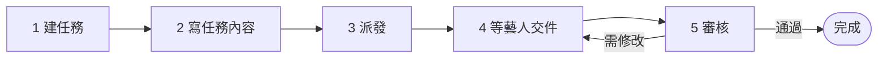

# 派一筆要交作業的任務

> 💡 **誰可以做**：能編輯 Notion「Tasks」的人。在 Discord 用 `/審核提交` 審核，要有 `控方` 身分組；沒有的話一樣可以在 Notion 審核。
>
> **大約要多久**：建任務 5 分鐘。藝人最慢 30 分鐘內收到通知。



## 開始前

- [ ] 藝人在 Notion「Artists」有填 **Discord User ID**
- [ ] 藝人的 Drive 專區已經**分享給藝人**（見「新藝人上線」）
- [ ] 審核人在 Notion「People」有填 **Discord User ID**

## 1. 在 Notion 建任務

1. 打開 Notion 的 **Tasks**，按 **New** 新增一筆。
2. **任務名稱**：藝人會看到的標題，例如「11/5 編曲作業：仿作一首」。
3. **任務類型**：選最接近的類型。課程請選 **課程時間&作業繳交**。
4. **關聯藝人**：選要交作業的藝人（可以多選）。
5. **截止日**：事情發生的那天，例如上課日。
6. **提交期限**：藝人最晚哪天要交。
7. **審核人員**：選誰來審。老師、公司同仁都可以。
8. **關聯專案**：選這個任務屬於哪個專案。交件的檔案會放在這個專案的 Drive 資料夾。

> ⚠️ 作業期限填在「提交期限」，**不要填在「截止日」**。截止日是上課或發布那天，提醒會照錯的日子發。

## 2. 寫任務內容

1. 點進任務，在頁面內文直接寫作業要求。
2. 寫清楚四件事：**做什麼、做多少、交什麼格式、什麼時候交**。

```notion
仿作 Tom Misch〈Movie〉前 16 小節。
交 WAV 檔＋專案檔，檔名寫自己的名字。
11/3 前交。
```

> 💡 這一頁**藝人會整頁看到**。內部備註請放在子頁面裡，子頁面藝人看不到。

## 3. 派發給藝人

1. 回到任務欄位，勾 **Discord 顯示**。
2. 作業現在就能交的話，**是否開放提交**也一起勾。要等上完課才開放的，先只勾 Discord 顯示，之後再回來勾。

**接下來會發生什麼**：最慢 30 分鐘內，藝人會收到小律的私訊。

```discord
📚 方晨同學，作業開放囉，可以開始交了！
任務：11/5 編曲作業：仿作一首
截止：11/03

作業要求
仿作 Tom Misch〈Movie〉前 16 小節。…
[收到任務] [有問題・無法配合]
```

藝人按 **收到任務** 之後，Notion 上的「任務狀態」會變成「進行中」，你不用做任何事。

| 藝人的反應 | 你會看到 | 你要做什麼 |
|---|---|---|
| 按「收到任務」 | 「任務狀態」變成「進行中」 | 不用做事 |
| 按「有問題・無法配合」 | 營運內部通知出現 `🟥 要處理｜藝人回報任務問題` | 見「處理藝人回報的問題」 |
| 3 天都沒按 | 營運早報出現「📌 藝人還沒按收到超過 3 天」 | 私下聯絡藝人，或重送通知 |

## 4. 等藝人交件

藝人會在 Discord 打 `/我的任務` → **提交任務**，把檔案傳到小律給的 Drive 資料夾。

**藝人交件後**：
- Notion 上的「任務狀態」變成「待審核」
- 審核人收到小律的私訊：

```discord
📥 新提交待審核（Drive 資料夾）
任務：11/5 編曲作業：仿作一首｜方晨｜2 個檔案（12.4MB）
Drive：（這次交件的資料夾）
Notion：（這筆提交的頁面）

怎麼審（擇一）
・Notion：打開上面的提交頁，先在 審核回饋 寫幾句，再把 審核狀態 改成「通過」或「需修改」。
・Discord：到 營運操作 頻道打 /審核提交，選這筆提交，按「通過」或「需修改」，再填回饋。
```

> 💡 沒填審核人員，或審核人沒有 Discord ID 的話，這則改發到營運內部通知，標成 🟥 要處理。

## 5. 審核

兩種方式結果一樣，選順手的用。

**在 Notion 審**
1. 點私訊裡的 Notion 連結，打開這筆提交。
2. 在 **審核回饋** 寫給藝人的話。
3. 把 **審核狀態** 改成 **通過** 或 **需修改**。
4. 1 分鐘內，藝人會收到結果。

> ⚠️ **先寫回饋，再改狀態**。只改狀態、不寫回饋的話，藝人不會收到通知。

**在 Discord 審**
1. 到 `營運操作` 頻道打 `/審核提交`。
2. 從 **選擇要審核的提交…** 選這一筆。
3. 點 Drive 連結看過檔案，按 **通過**、**需修改** 或 **退回**。
4. 填 **給藝人的回饋**。選需修改的話，再填 **修改期限**（1～7 天）。
5. 送出後，問你要不要附批改檔：不用就按 **不需補批改檔**；要附就按 **附批改檔**，把檔案上傳到同一個頻道，再按 **完成回饋**。

**接下來會發生什麼**

| 結果 | 藝人收到 | Notion 上 |
|---|---|---|
| 通過 | 「🎉 方晨同學，「11/5 編曲作業：仿作一首」通過了！」 | 任務狀態變「已完成」 |
| 需修改 | 「🛠 …公司給了一些修改建議」＋修改期限 | 任務狀態變「需修改」。在 Notion 審、沒填修改期限的話，系統自動給 3 天 |

藝人改好重交後，會回到第 4 步。

## 常見問題

| 狀況 | 怎麼做 |
|---|---|
| 藝人說沒收到通知 | 確認「Discord 顯示」有勾、「關聯藝人」有他、他在 Artists 有 Discord User ID。都有的話打 `/任務通知重送` |
| 藝人說提交清單裡沒有這筆 | 「是否開放提交」還沒勾，或任務已經是「待審核」「已完成」 |
| 藝人打不開 Drive 資料夾 | 他的 Drive 專區沒有分享給他。到 Drive 分享（編輯者） |
| 改了審核狀態，藝人沒收到 | 「審核回饋」沒寫。補寫後 1 分鐘內會發出 |
| 任務發出去後內容要改 | 先改 Notion，再打 `/任務通知重送`（見「改了任務內容，重新通知藝人」） |

## 下一步

- 「處理藝人回報的問題」
- 「改了任務內容，重新通知藝人」
- 「在 Discord 審核作業」
- 「延期」
