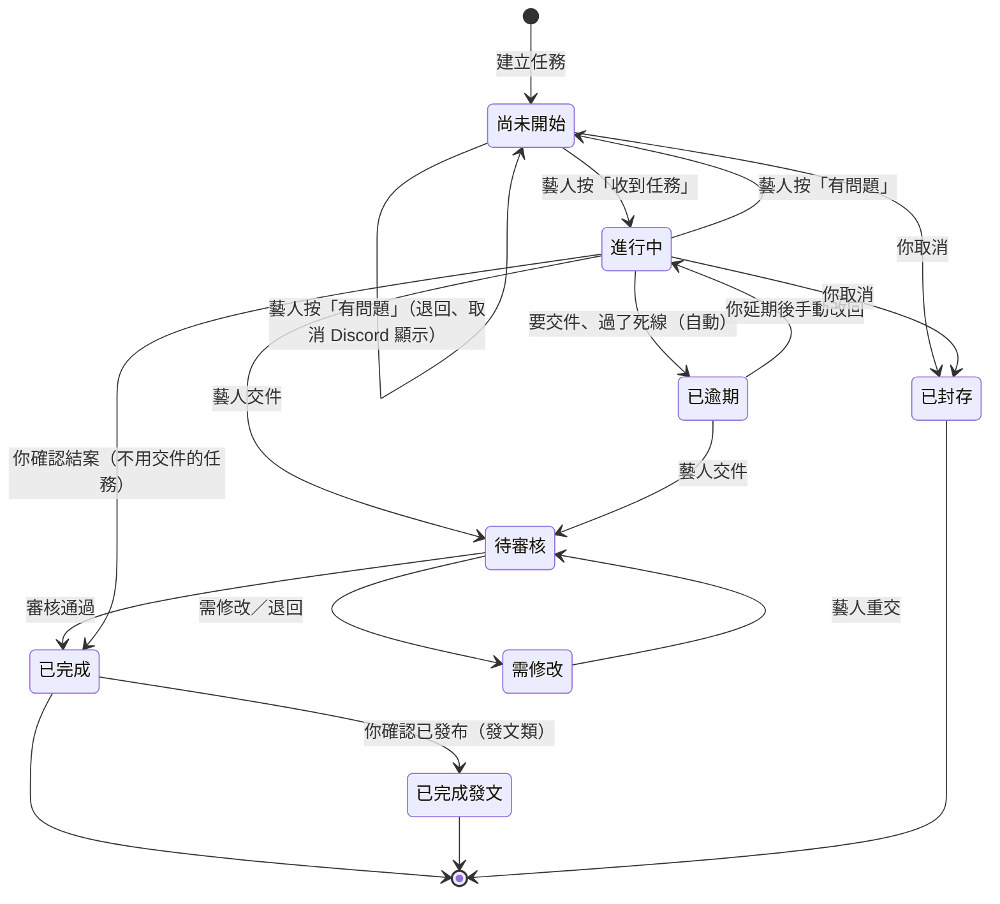
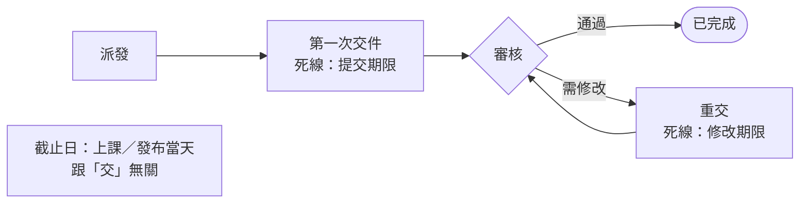
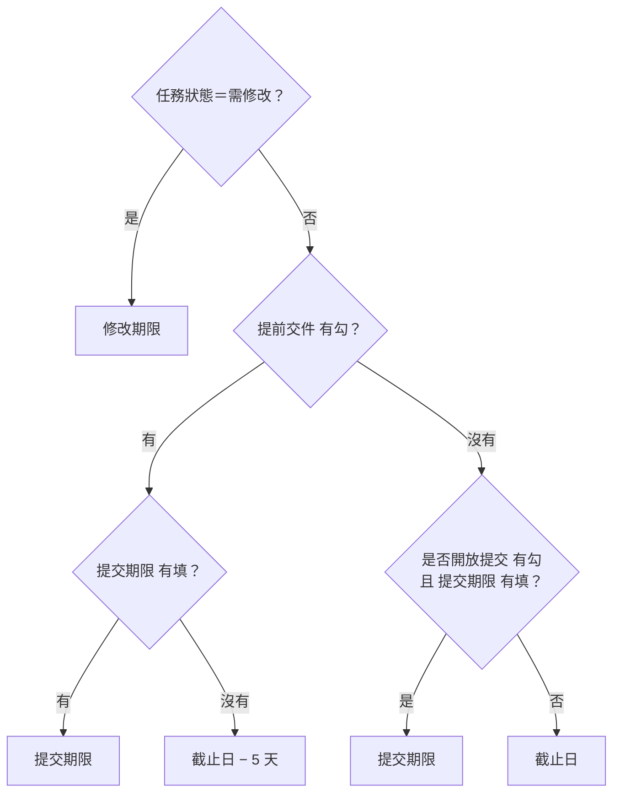

# 期限、逾期與結案

**什麼時候用**：要決定任務的期限怎麼填、任務過了期限、要延期、要結案。

> 💡 **一句話看懂**：`任務狀態` 大部分由小律依實際動作改，你只負責**延期**和**結案**。要交件的任務過了死線會自動變 `已逾期`；不用交件的不會，改由你在營運早報確認。

## 任務狀態怎麼變

| `任務狀態` | 誰改的 | 小律還會提醒嗎 |
|---|---|---|
| `尚未開始` | 建立時；藝人回報問題時退回 | 有派發的話，早報會問他按收到 |
| `進行中` | 藝人按收到 | 期限前提醒 |
| `待提交` | 你手動（選用） | 同 `進行中` |
| `待審核` | 藝人交件 | 不催藝人，催審核人 |
| `需修改` | 審核結果 | 每天在早報 |
| `已逾期` | 小律（要交件的任務）或你手動 | 每天在早報 |
| `已完成`、`已完成發文`、`已封存` | 審核通過或你結案 | 不再提醒 |

## 三個日期欄位

這三欄**是任務一生中三個不同的時刻**，搞混的話提醒會發在錯的日子。

| 欄位 | 是什麼 | 誰填 |
|---|---|---|
| **`截止日`** | **事情發生的那天**：上課日、發布日、演出日 | 你 |
| **`提交期限`** | **第一輪**交件的死線 | 你，或勾 `提前交件` 讓系統算 |
| **`修改期限`** | **審核退回後**重交的死線 | 審核時選 1～7 天，小律寫入 |

### 小律現在追哪一天

例：`截止日` 9/30、`提交期限`（有填時）9/27、`修改期限` 10/3

| # | `任務狀態` | `提前交件` | `是否開放提交` | `提交期限` | 死線 | 藝人看到 |
|---|---|---|---|---|---|---|
| 1 | 需修改 | 任意 | 任意 | 任意 | **10/3** | `修改期限 10/3` |
| 2 | 其他 | ☑ | 任意 | 9/27 | **9/27** | `交件 9/27` |
| 3 | 其他 | ☑ | 任意 | 空 | **9/25** | `交件 9/25` |
| 4 | 其他 | ☐ | ☑ | 9/27 | **9/27** | `交件 9/27` |
| 5 | 其他 | ☐ | ☐ | 9/27 | **9/30** | `截止 9/30` |
| 6 | 其他 | ☐ | 任意 | 空 | **9/30** | `截止 9/30` |

- **#3 最常用**：勾 `提前交件`、其他不動，系統自動算 9/25
- **#5 是陷阱**：填了 `提交期限` 但兩個開關都沒勾，`提交期限` 被忽略。填了就一定要勾其中一個
- 兩個日期都沒有就沒有死線，不提醒也不逾期

> 💡 `提前交件` 的任務：藝人看到的是「交件 9/25」，9/25 沒交 9/26 就逾期。一個任務進行到底不拆兩筆，代價是**發布日當天不會再提醒**，發布請自己盯。

## 過了死線會怎樣

| 任務 | 📒 Notion | 💬 Discord | 你要做的 |
|---|---|---|---|
| **要交件**（有勾 `是否開放提交`） | 小律把 `任務狀態` 改成 **`已逾期`** | 藝人早報列「🔴 已經過期限」；營運早報列「新逾期」 | 延期或結案 |
| **不用交件**（沒勾，例如發文、出席、行政） | **不改**，維持原本狀態 | 藝人早報列「⏳ 已過截止，等公司確認」；營運早報列「⏳ 已過截止，等你確認結案」 | 每天確認，見下方 |
| **課程培訓專案的任務** | 不判逾期 | — | 確認老師發布後結案 |
| **`需修改`** 過了 `修改期限` | **不改**，維持 `需修改` | 營運早報列「修改期限已過」 | 決定催或放棄 |
| **`待審核`** | 不判逾期 | — | 審核 |

> ⚠️ 要交件但**還沒勾開放提交**的任務，系統一樣當成「不用交件」。截止前記得勾。

## 不用交件的任務：每天確認

看營運早報的「⏳ 已過截止，等你確認結案」，點任務連結確認：

| 確認結果 | 在 Notion 怎麼改 | 隔天 |
|---|---|---|
| 做完了 | `已完成`（發文類改 `已完成發文`） | 不再列 |
| 沒做，希望他補 | 延後 `截止日` | 回到「⏰ 快到期」 |
| 沒做，要講重一點 | 手動改 `已逾期` | 藝人早報列「🔴 已經過期限」 |
| 還不確定 | 不動 | 每天繼續列 |

你不處理，它就每天列著。

## 延期

| 任務現在是 | 你要改的 |
|---|---|
| 一般任務 | 延後 `截止日` 或 `提交期限` |
| `已逾期` | 延後期限，**並把 `任務狀態` 改回 `進行中`**。只延期不改狀態，下一輪還是 `已逾期`；只改狀態不延期，下一輪又會被改回 `已逾期` |
| `需修改` | 延後 `修改期限` |

延期後要不要讓藝人收到新卡，見「改任務內容與重送」。

## 結案

| 情況 | 改成 |
|---|---|
| 交件任務審核通過 | 小律自動改 `已完成` |
| 不用交件的任務確認做完 | `已完成` |
| 發文類：審核通過後確認真的發布了 | `已完成發文`（每週一營運早報會列停在 `已完成` 超過 3 天的發文任務提醒你） |
| 取消、不做了 | `已封存`（不要刪頁面） |

## 出錯怎麼辦

| 狀況 | 原因 | 怎麼做 |
|---|---|---|
| 改回 `進行中` 又變回 `已逾期` | 沒延期限 | 先延期，再改狀態 |
| 提醒發在錯的日子 | 作業期限填在 `截止日`；或填了 `提交期限` 卻沒勾開關 | 照上面的判斷圖改 |
| 不用交件的任務一直在早報 | 你還沒結案 | 結案、延期或改 `已逾期` |
| 發布日當天沒有提醒 | `提前交件` 任務只追交件日 | 刻意設計，發布自己盯 |
