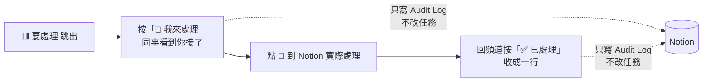

# 處理營運內部通知

**什麼時候用**：`營運內部通知` 跳出新訊息時。

> 💡 **一句話看懂**：這個頻道的按鈕**只是 Discord 上的標記，不會改 Notion**。真正的處理一定要到 Notion 做；Notion 處理完，訊息也不會自己收起來，要回來按「✅ 已處理」。

## 三種訊息

| 開頭 | 什麼時候 | 你要做的 |
|---|---|---|
| 📋 **營運早報** | 每天 09:30 一則，前一天的自動刪掉 | 逐項處理，見「每天的提醒與早報」 |
| 🟥 **要處理** | 即時 | 見下方 |
| ⚙️ **系統警告** | 很少：Drive 授權失效、Notion 選項對不上 | 照訊息裡的修法處理，或找工程端；Drive 恢復時同一則變 🟢 |

另外也會即時收到：時間收集**收齊**、排課時效提醒、批次重送結果。

每一則跟某筆任務有關的訊息都附那筆任務的 Notion 連結（早報裡是任務名稱本身；🟥 在最後一行 🔗）。連結只出現在這個頻道，藝人和同仁的訊息一律不帶。

## 三種 🟥 要處理

| 🟥 通知 | 為什麼會出現 | 到 Notion 做什麼 |
|---|---|---|
| **藝人回報任務問題** | 藝人按了「有問題」。小律已把任務退回 `尚未開始`、取消 `Discord 顯示`，原因在內頁「藝人回覆」（已逾期的任務不退回） | 看「藝人回覆」→ 改任務 → 重新勾 `Discord 顯示` |
| **新提交（沒有指定審核人）** | 藝人交件，但任務沒填 `審核人員`，或填的人沒有 Discord ID | 審這筆（`/審核提交` 或 Notion）；之後同類任務記得填 `審核人員` |
| **任務通知送不出去** | 勾了 `Discord 顯示`，但對象都沒有 `Discord User ID` | `Artists`／`People` 補 ID → 勾 `重送通知` |

## 營運的按鈕做什麼

| 按鈕／選單 | 📒 Notion | 💬 Discord |
|---|---|---|
| 🙋 **我來處理** | **不改任務**；`Audit Log` 記誰、幾點 | 訊息多一行「👤 名字 處理中」 |
| ✅ **已處理** | **不改任務**；`Audit Log` 記一筆 | 整則收成一行「✅ 已處理｜標題｜名字 時間」 |
| 營運早報的「看某一筆的詳細」 | 只讀 | 同一則下方展開那筆任務的內容、藝人、Notion 連結 |

這三種 🟥 在 Notion 上都沒有一個欄位能代表「處理完了」，所以小律沒辦法自己判斷，只能靠人按。不按也不影響任何功能，只是頻道裡看不出處理過沒。

## 常見誤會

| 你遇到的 | 原因 | 怎麼做 |
|---|---|---|
| Notion 處理完了，那則還是 🟥 | 🟥 不讀 Notion | 回頻道按「✅ 已處理」 |
| 按了「已處理」，任務沒變 | 按鈕只是標記 | 到 Notion 實際處理 |
| 同事按了「我來處理」，我還要處理嗎 | 不用 | 等他按「已處理」 |
| 按鈕按了沒反應 | bot 沒在線，或 Discord 一時沒回應 | 等一下再按；bot 重開後舊訊息的按鈕仍然能按 |
| 想知道誰處理了某則 | 收合那一行有名字和時間 | 訊息被刪了就查 `Audit Log` |

營運通知**只會**發到 `營運內部通知`。這個頻道沒設定時只寫記錄檔，不會改發到藝人看得到的地方。
