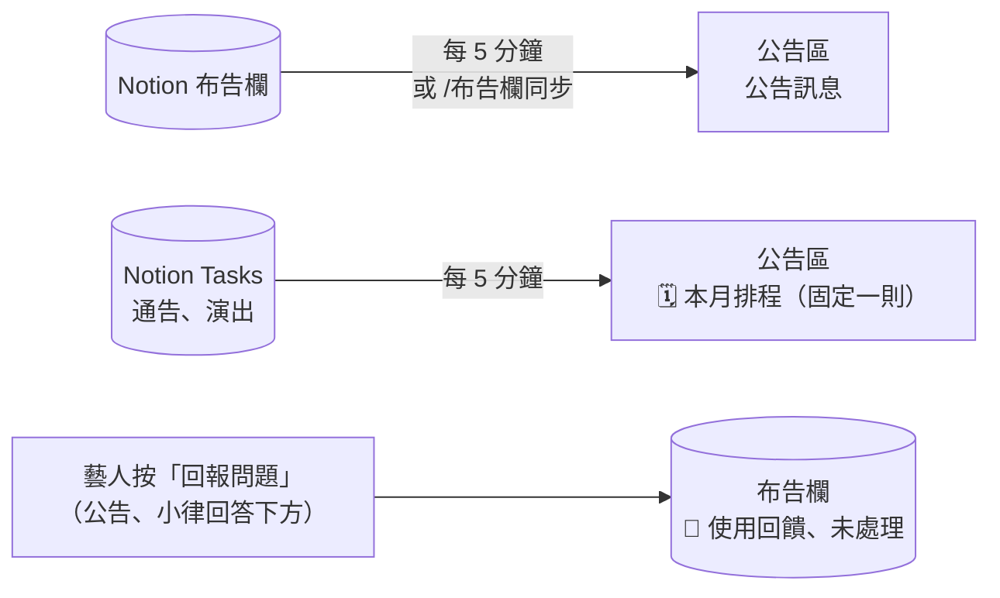

# 布告欄、本月排程與使用回饋

**什麼時候用**：要發公告給所有人；想讓通告、演出列在本月排程；處理藝人回報的問題。

> 💡 **一句話看懂**：在 Notion `布告欄` 新增或修改，5 分鐘內同步到 `公告區`。本月排程是小律從 `Tasks` 自動整理的一則固定訊息。藝人按「回報問題」，會在 `布告欄` 建一筆「🙋 使用回饋」。

## 發公告

**你要做的**：在 Notion `布告欄` 新增一筆，填 `Name`、`類別`（📢 公告／💬 待討論／📝 會議摘要）、`狀態`、`Date`、`人員`，要置頂就勾 `📌 置頂`。

| 系統 | 發生什麼 |
|---|---|
| 📒 Notion | 只讀 |
| 💬 Discord | **5 分鐘內**發到 `公告區`。之後改了狀態、類別、日期、人員、置頂，就更新同一則；沒變的不會重發 |

想立刻同步就在 `營運操作` 打 **`/布告欄同步`**。

## 本月排程

`公告區` 每個月有一則「🗓️ YYYY 年 M 月排程」，小律自動維護，你不用做任何事。

| 會列進去的任務 | 📒 讀 Notion 什麼 |
|---|---|
| 已派發 | `Discord 顯示` 有勾 |
| 公開類型 | `任務類型` 是 `通告` 或 `演出` |
| 在當月 | `開始日`（或 `截止日`）落在這個月 |
| 沒結案 | 不是 `已封存` |

- 每 5 分鐘檢查，**內容有變就改同一則**，不會另發
- 被手動刪掉的話，下一輪自動補發
- 列入的類型跟公告區的公開類型同一個設定，要調整找工程端

## 使用回饋

公告下方的「回報／留言」、小律回答下方的「回報問題」（24 小時內有效），藝人填完送出：

| 系統 | 發生什麼 |
|---|---|
| 📒 Notion `布告欄` | 新增一筆：`類別`=🙋 使用回饋、`狀態`=未處理，內容含 Discord 使用者與原訊息連結 |

**你要做的**：定期看 `布告欄` 的「未處理」，處理後改 `狀態` 為 `處理中`／`已結案`。

## 出錯怎麼辦

| 狀況 | 原因 | 怎麼做 |
|---|---|---|
| 公告沒出現 | 還沒到 5 分鐘 | 打 `/布告欄同步` |
| 某個通告沒列進本月排程 | 沒勾 `Discord 顯示`、類型不是通告／演出、日期不在當月 | 補欄位，5 分鐘內更新 |
