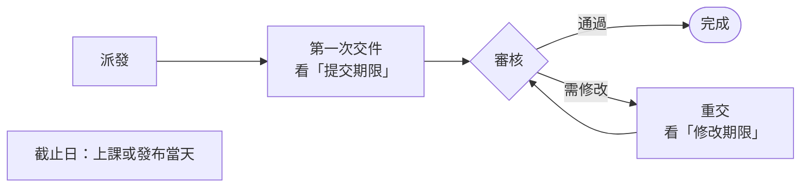

# 延期

> 💡 **誰可以做**：能編輯 Notion「Tasks」的人。

## 先分清楚三個日期

| 欄位 | 是什麼 | 誰填 |
|---|---|---|
| **截止日** | 事情發生的那天：上課日、發布日、演出日 | 你 |
| **提交期限** | 第一次交件的期限 | 你 |
| **修改期限** | 審核退回後，重交的期限 | 審核時決定（Discord 選 1～7 天；Notion 沒填就自動給 3 天） |

## 要延哪一個

| 任務現在的狀態 | 要改的欄位 |
|---|---|
| 要交作業、還沒交 | **提交期限** |
| 不用交作業（通告、發文、出席…） | **截止日** |
| 需修改（審核退回了） | **修改期限** |

## 步驟

1. 打開那筆任務，改上表對應的日期欄位。
2. 如果任務狀態是 **已逾期**，**把任務狀態改回「進行中」**。
3. 要讓藝人收到新日期，用 `/任務通知重送` 重送（見「改了任務內容，重新通知藝人」）。不重送的話，藝人會在隔天的早報看到新日期。

> ⚠️ 第 1、2 步**兩個都要做**：只改狀態不延期，30 分鐘內又會被改回「已逾期」；只延期不改狀態，任務會一直停在「已逾期」。

## 接下來會發生什麼

- 截止前 5 天、3 天的提醒，會照新日期重新算
- 隔天的營運早報不會再列這筆逾期

## 「提前交件」是什麼

要先給公司審、再對外發布的任務（影片、貼文、企劃），可以勾 **提前交件**：

- 沒填提交期限 → 交件期限自動是 **截止日前 5 天**
- 有填提交期限 → 用你填的

藝人看到的會是「交件 9/25」，不是「截止 9/30」。9/25 沒交，9/26 就算逾期。發布日當天系統不會再提醒，發布請自己盯。**上課、通告不要勾。**

## 常見問題

| 狀況 | 怎麼做 |
|---|---|
| 改回進行中，又變成已逾期 | 期限沒延。先延期限，再改狀態 |
| 提醒在錯的日子發 | 作業期限填在「截止日」了。作業期限請填「提交期限」 |
| 填了提交期限但沒用 | 「提前交件」和「是否開放提交」都沒勾的話，系統只看截止日。勾其中一個 |
