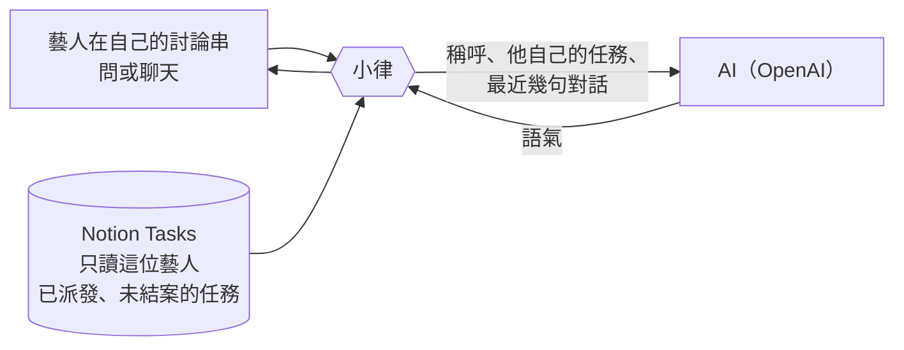

# 小律：問任務、聊天與語氣

**什麼時候用**：想知道藝人問小律時會看到什麼、小律的話是怎麼產生的、要調整小律的說話方式。

> 💡 **一句話看懂**：小律**只讀** Notion、不寫。任務、日期、筆數、回饋永遠照 Notion；AI 只負責語氣那一兩句。藝人能聊任何話題，但公司的事一律請藝人問公司。



## 藝人怎麼問

在 `課程助教` 按置頂訊息的「💬 開始問小律」，小律開一個**只有他看得到**的私人討論串，之後都在裡面打字。

| 藝人問的 | 📒 小律讀 Notion 什麼 | 💬 回什麼 |
|---|---|---|
| 「這週有什麼任務」「還有哪些沒交」 | 這位藝人 `關聯藝人` 有他、`Discord 顯示` 已勾、還沒結案的任務（跟 `/我的任務` 一樣） | 清單＋小律一句話 |
| 「第 2 個的詳細內容」「哈根稿件的要求是什麼」 | 那筆任務的**內頁整頁**（略過「藝人回覆」「Drive 資料夾索引」） | 最多 1,500 字，Notion 網址拿掉 |
| 「聽力要做幾題」 | 同上 | 只照內頁回答，沒寫的請他問公司 |
| 打招呼、說累、練習方法、推薦歌 | 今天的任務（有要緊的才提一句） | 像一般聊天 |
| 合約、酬勞、排程怎麼排、公司規定 | — | 請他直接問公司 |

- 每次提問都重新讀 Notion，你剛改的內容馬上問得到
- 小律**只能查、不能操作**：交件、按收到還是用 `/我的任務`
- 回答下方有「回報問題」，送出後在 `布告欄` 建一筆使用回饋（見「布告欄、本月排程與使用回饋」）

> ⚠️ 所以**任務內頁要寫清楚做什麼、做多少、用什麼形式交**，而且**不要放不想讓藝人看到的東西**。

## 哪些話是 AI 寫的

| 地方 | 固定（照 Notion） | AI 寫的 |
|---|---|---|
| 每日早報 | 任務清單、日期、按鈕 | 開頭一句、看完後的結尾一句 |
| 審核結果 | 結果、回饋、重交說明 | 第二行那一句（依最近表現） |
| 派發卡、作業卡、交件流程、錯誤訊息 | 全部 | 沒有 |
| 問小律、聊天 | 任務清單本身 | 清單上面那段話、細節回答、聊天回覆 |

```discord
☀️ 方晨同學，早安！我是小律。
有一筆任務還沒收到、兩筆已過期限，別擔心，小律陪你一步一步處理。   ← AI 寫的
📌 有 1 筆任務還在等你按收到喔                                    ← 以下固定
・編曲作業｜截止 10/28（剩 5 天）
```

## 送了什麼給 AI

| 情境 | 送出 | 不送 |
|---|---|---|
| 早報、審核結果 | 只有狀況統計（例如「還沒按收到 1 筆、已過期限 2 筆」「第 2 次交、最近連續 3 件一次通過」） | 藝人名字、任務名稱、內容、回饋（名字是系統事後補的） |
| 問小律、聊天 | 稱呼、**他自己的**任務名稱／期限／狀態、他問的話、討論串最近幾句 | 別人的任務 |

對話只放在記憶裡、不存檔，隔天或 bot 重開就清掉。

## AI 用不了的時候

沒設定、連不上、太慢、寫出怪句子（例如有網址），或當天用量到上限，小律改用**固定的範本句**，訊息照常準時發。範本句也是小律的口吻，例如：

- 有逾期：「有 2 筆已經過期限了，小律陪你一起把它們解決吧。」
- 審核需修改：「別擔心，照著回饋調整就好，小律陪你。」

## 調整小律的語氣

人設、說話原則、範例句寫在一份「小律的說話方式」檔案裡，**改完隔天就生效，不用重開 bot**。把想調整的方向告訴工程端，例如「再活潑一點」「逾期時不要太輕鬆」「不要用 emoji」。

> ⚠️ 這份檔案會送給 AI，而且程式碼是公開的。**只放「怎麼說話」，不要放任何藝人或任務的資料。**

**成本**：以現在的藝人數一個月約台幣幾塊錢；30 位藝人也在 50 元以內。另有每日用量上限，超過就改用範本句。

## 會議紀錄（封存中）

<details>
<summary>2026-10-18 起小律不讀會議紀錄，恢復後才需要照這段做</summary>

藝人能問到的會議紀錄要符合：

1. 在 `課程與會議記錄` 建一筆，內容**用純文字貼在內頁**（PDF 很耗額度、掃描檔讀不到）
2. 掛 `關聯專案`（專案裡的藝人問得到），或在任務的 `課程與會議記錄` 連到這場會議（該任務的藝人問得到）。這個資料庫沒有「參與藝人」欄位
3. `會議類型` 是 `課程會議` 的一律不給藝人
4. 確定能讓藝人知道才勾 `藝人可見`；公司內部的不要勾

`藝人可見` 欄位**不要刪除**，刪了小律完全查不到，bot 啟動時會在 `營運內部通知` 警告。

</details>

## 常見問題

| 狀況 | 原因 | 怎麼做 |
|---|---|---|
| 藝人說小律查不到某筆任務 | 還沒派發，或已結案 | 正常；要給他看就派發 |
| 小律的話不太適合 | — | 截圖給工程端調整說話方式或範本句 |
| 兩位藝人同一天開頭不一樣 | 小律看各自的狀況寫 | 正常 |
| 今天開頭跟範本句一模一樣 | 當天 AI 沒用上 | 內容一樣正確，不用處理 |
| 藝人在頻道直接打字 | 頻道大家都看得到 | 小律會收掉，但請藝人改在自己的討論串問 |
