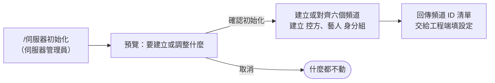

# 伺服器初始化（一次性）

**什麼時候用**：第一次架設 Discord 伺服器，或頻道、權限被改亂了要對齊回來。

> 💡 **一句話看懂**：`/伺服器初始化` 只動 Discord，不碰 Notion 和 Drive。先預覽，按確認才動手；已有的同名頻道會沿用。

| 系統 | 發生什麼 |
|---|---|
| 📒 Notion | 不動 |
| 💬 Discord | 建立或對齊六個頻道（分類、主題、權限）與 `控方`／`藝人` 身分組 |
| 📁 Drive | 不動 |

**頻道權限**

| 頻道 | `控方` | `藝人` | 其他人 |
|---|---|---|---|
| `營運操作`、`營運內部通知` | 看得到、可發言、能打指令 | 看不到 | 看不到 |
| `時間管理`、`任務查詢入口` | 看得到 | 看得到、可發言、能打指令 | 看不到 |
| `課程助教` | 看得到 | 同上，另外可以開私人討論串 | 看不到 |
| `公告區` | 看得到 | 只能看、能按按鈕 | 看不到 |

- 只有伺服器管理員能用；預覽畫面 5 分鐘內要確認
- 已有同名頻道會沿用並更新設定，不會重建
- 完成後把回傳的頻道 ID 清單交給工程端

之後每位新成員的身分組要手動給，見「新藝人、新同仁上線」。
