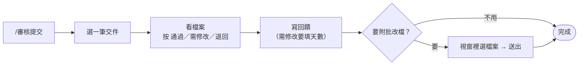

# 在 Discord 審核作業

> 💡 **誰可以做**：有 `控方` 身分組的人。沒有的話請用「在 Notion 審核作業」，結果一樣。

## 步驟

1. 到 `營運操作` 打 **`/審核提交`**。
2. 從 **選擇要審核的提交…** 選一筆。清單只列還沒審、而且是最新一版的交件，最多 25 筆。
3. 小律列出這筆交件的 Drive 連結、Notion 頁面、關聯任務。**先點 Drive 連結看過檔案。**
4. 按 **通過**、**需修改** 或 **退回**。選錯了按 **↩️ 返回審核清單**。
5. 跳出審核視窗：
   - **給藝人的回饋（選填）**：例如「這次節奏很穩」或「請重修副歌音準」
   - **修改期限（天數，1～7）**：選需修改或退回時才有，必填
6. 送出。小律馬上私訊藝人結果，並問你要不要附批改檔。
7. 不用附就按 **不需補批改檔**，審核完成。

## 附批改檔

> 💡 整段**只有你看得到**，頻道裡不會出現檔案，也不會有任何訊息。每則訊息開頭都會寫任務、藝人、交件時間和審核結果，看那幾行就知道是哪一筆。

1. 按 **附批改檔**，會跳出一個視窗。
2. 在視窗裡選檔案，可以選好幾個（最多 10 個），每個要在 **10MB 以下**。
3. 按送出。看到「✅ … 個批改檔已歸檔並通知藝人」就完成了。

### 檔案超過 10MB

1. 按 **檔案太大，用 Drive**。小律會**私訊**你「老師回饋」Drive 資料夾的連結。
2. 把檔案傳到那個資料夾。
3. 回到私訊按 **貼 Drive 連結補回饋**，跳出 **批改檔連結** 視窗。
4. 在 **Drive 批改檔或資料夾連結（必填）** 貼上連結，**補充回饋（選填）** 可以再寫一段，然後送出。

這則私訊會一直留著，晚點再按也可以，小律重新啟動過也不影響。

### 常見狀況

| 狀況 | 怎麼做 |
|---|---|
| 不想附了 | 在視窗按取消，再按 **不需補批改檔** |
| 存檔失敗 | 訊息會寫原因，按鈕還在，可以再試一次 |
| 那則「只有你看得到」的訊息不見了，或按了沒反應 | **審核結果已經存好，不用重審。** 把檔案放到 Drive，連結貼到那筆提交的「審核回饋」，並自己私訊藝人 |

只有原本審核的那個人能按這些按鈕。

## 接下來會發生什麼

| 結果 | 藝人收到 | 任務狀態 |
|---|---|---|
| 通過 | 「🎉 方晨同學，「11/5 編曲作業」通過了！」＋回饋 | 已完成 |
| 需修改 | 「🛠 …公司給了一些修改建議」＋回饋＋「修改期限：10/29（四）」 | 需修改 |
| 退回 | 「↩️ …這次先退回了」＋回饋＋修改期限 | 需修改 |
| 附了批改檔 | 第二則「📎 老師補充了批改檔」，附連結 | 不變 |

批改檔會放在任務資料夾裡的「老師回饋」資料夾（見「交件的檔案存在哪裡」）。

## 你下一步

- 通過：不用做事
- 需修改：等藝人重交，你會再收到一次「📥 新提交待審核」。過了修改期限還沒交，營運早報會列在「🛠 修改期限已過」

## 常見問題

| 狀況 | 怎麼做 |
|---|---|
| 「❌ 這個指令僅限管理者使用。」 | 你沒有 `控方` 身分組。改用 Notion 審核 |
| 「目前沒有待審核提交。」 | 都審完了，或藝人還沒按「我已上傳到 Drive」 |
| 「❌ 修改期限只能填 1～7 的整數天數」 | 只能填 1 到 7 的數字 |
