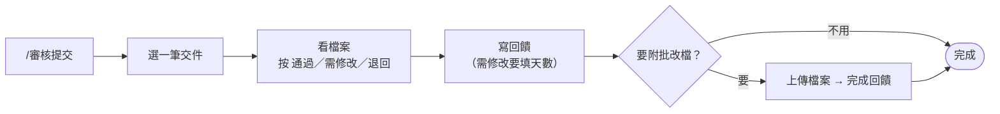

# 在 Discord 審核作業

> 💡 **誰可以做**：有 `控方` 身分組的人。沒有的話請用「在 Notion 審核作業」，結果一樣。

## 步驟

1. 到 `營運操作` 打 **`/審核提交`**。
2. 從 **選擇要審核的提交…** 選一筆。清單只列還沒審、而且是最新一版的交件，最多 25 筆。
3. 小律列出這筆交件的 Drive 連結、Notion 頁面、關聯任務。**先點 Drive 連結看過檔案。**
4. 按 **通過**、**需修改** 或 **退回**。選錯了按 **↩️ 返回審核清單**。
5. 跳出審核視窗：
   - **給藝人的回饋（選填）**：例如「這次節奏很穩」或「請重修副歌音準」
   - **修改期限（天數，1～7）**：選需修改或退回時才有，必填
6. 送出。小律馬上私訊藝人結果，並問你要不要附批改檔。
7. 不用附就按 **不需補批改檔**，審核完成。

## 附批改檔

1. 按 **附批改檔**。
2. 在**同一個頻道**直接上傳批改檔，可以傳好幾個。每個檔案要在 **10MB 以下**。
3. 傳完按 **完成回饋**。

| 狀況 | 怎麼做 |
|---|---|
| 檔案超過 10MB | 先傳到小律給的「老師回饋」Drive 資料夾，再按 **貼 Drive 連結補回饋**，在 **Drive 批改檔或資料夾連結（必填）** 貼上連結，**補充回饋（選填）** 可以再寫一段 |
| 訊息不見了（切去 Drive 再回來時） | 3 小時內在同一個頻道隨便打一句話，例如「好了」，按鈕會再出現 |
| 想改成不附檔 | 按 **↩️ 返回回饋選擇** |
| 超過 3 小時 | 沒有 Discord 入口了。把 Drive 連結貼到那筆提交的「審核回饋」，並自己私訊藝人 |

只有原本審核的那個人能操作這些按鈕。

## 接下來會發生什麼

| 結果 | 藝人收到 | 任務狀態 |
|---|---|---|
| 通過 | 「🎉 方晨同學，「11/5 編曲作業」通過了！」＋回饋 | 已完成 |
| 需修改 | 「🛠 …公司給了一些修改建議」＋回饋＋「修改期限：10/29（四）」 | 需修改 |
| 退回 | 「↩️ …這次先退回了」＋回饋＋修改期限 | 需修改 |
| 附了批改檔 | 第二則「📎 老師補充了批改檔」，附連結 | 不變 |

批改檔會放在任務資料夾裡的「老師回饋」資料夾（見「交件的檔案存在哪裡」）。

## 你下一步

- 通過：不用做事
- 需修改：等藝人重交，你會再收到一次「📥 新提交待審核」。過了修改期限還沒交，營運早報會列在「🛠 修改期限已過」

## 常見問題

| 狀況 | 怎麼做 |
|---|---|
| 「❌ 這個指令僅限管理者使用。」 | 你沒有 `控方` 身分組。改用 Notion 審核 |
| 「目前沒有待審核提交。」 | 都審完了，或藝人還沒按「我已上傳到 Drive」 |
| 「❌ 修改期限只能填 1～7 的整數天數」 | 只能填 1 到 7 的數字 |
