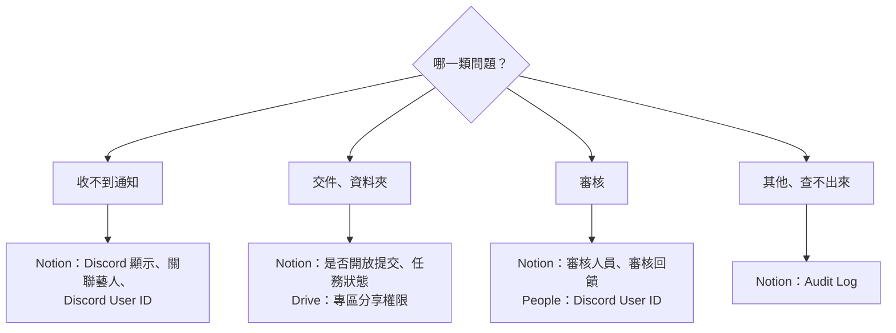

# 出問題怎麼查

先照症狀找下表，每一列都寫了要去哪個系統看哪個欄位。每條流程頁最後也有各自的「出錯怎麼辦」。

## 通知

| 狀況 | 檢查順序 |
|---|---|
| 藝人沒收到任務 | ① `Discord 顯示` 有勾？② 有 `關聯藝人`？③ `Artists` 有 `Discord User ID`？④ 都有就 `/任務通知重送` |
| 同仁沒收到 | ① 任務有填 `相關同仁`？② `People` 有 `Discord User ID`？（**沒填一定收不到，系統不會提醒你**）③ `Discord 顯示` 有勾？④ 同仁早報只列已逾期、需修改、快到期 |
| 老師沒收到課後提醒 | ① 專案類型是 `課程培訓`？② `負責老師` 有填？③ 老師有 `Discord User ID`？沒有會列在營運早報 |
| 勾了開放提交但沒通知 | 等一輪（≤30 分）；確認 `Discord 顯示` 也有勾 |
| 通知內容不對 | 先改 Notion 欄位（時間改 `開始日`／`截止日`），再 `/任務通知重送` |
| 通知寫「尚未填寫任務說明」 | ① 內容在子頁面？② 只有圖片、檔案？③ 整段都是 `名稱：` 開頭？④ 都不是就是那一輪讀取失敗，重送 |
| 通知沒有時間 | `開始日`／`截止日` 空白，補上後重送 |
| 藝人看到不該看的內容 | 移到子頁面再重送；已送出的收不回來 |

## 交件與審核

| 狀況 | 檢查順序 |
|---|---|
| 藝人看不到「提交任務」 | `是否開放提交` 有勾？`任務狀態` 不是 `待審核`／`已完成`／`已封存`？ |
| 藝人打不開資料夾 | Drive 藝人專區有分享給他（編輯者）？他登入的是同一個 Google 帳號？ |
| 藝人說小律打不開 Drive | `營運內部通知` 有沒有 ⚙️ Drive 警告；請工程端重新授權 |
| 審核人沒收到 | `審核人員` 有填？審核人在 `People` 有 `Discord User ID`？ |
| Notion 改了審核狀態沒通知藝人 | `審核回饋` 有寫？ |
| 審核寫入失敗 | `Submissions` 有 `審核回饋`、`審核者`、`審核來源`、`審核通知時間` 四欄？ |

## 排課與時間收集

| 狀況 | 檢查順序 |
|---|---|
| 可排課藝人 0 位 | `Artists` 有 `Discord User ID`？`合約狀態` 不是 `未簽`／`暫停`／`封存`？都對就請工程端確認 Notion 權限 |
| 比對不到共同空檔 | 月份選錯？有人沒填？時長太長？既有任務佔滿？ |
| 藝人填錯時間 | 請他用 `/管理可配合時間` 修改或刪除 |

## 指令與頻道

| 狀況 | 檢查順序 |
|---|---|
| 管理指令看不到 | 有 `控方` 身分組或伺服器管理員權限？Bot 在線？都正常請工程端重開 bot |
| 藝人說 `/我的任務` 沒反應 | 他在 `任務查詢入口` 打的嗎？有 `藝人` 身分組嗎？ |
| 重送後藝人又要按一次確認 | 正常，內容變了舊確認不算數 |

## 都查不出來

看 Notion 的 `Audit Log`，裡面有每個動作的成功／失敗與錯誤訊息。畫面出現「❌ …失敗，請稍後再試」而 Audit Log 也看不出原因，把那句話和時間給工程端查記錄檔。
