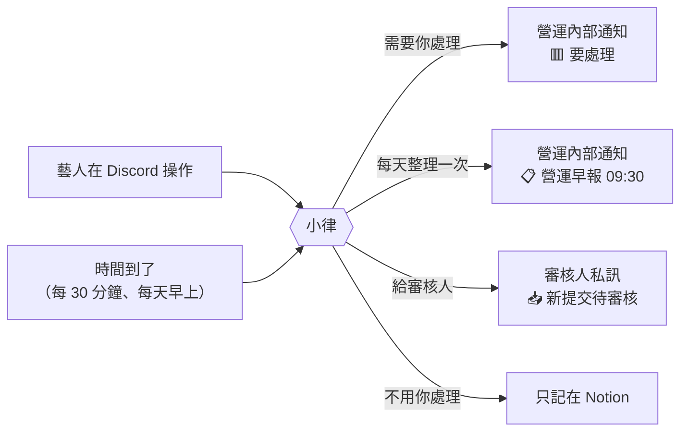

# 看到這則通知，我要做什麼

> 💡 **怎麼用**：找到你看到的那則訊息開頭（例如 `🟥 要處理｜藝人回報任務問題`），照「你要做什麼」那一欄處理。

## 藝人做了什麼 → 你要做什麼

| 藝人做了什麼 | 你會看到 | 在哪裡、多久 | 你要做什麼 |
|---|---|---|---|
| 按「收到任務」或「全部收到」 | 「任務狀態」變成「進行中」 | Notion，立刻 | 不用做事 |
| 按「有問題・無法配合」並寫原因 | `🟥 要處理｜藝人回報任務問題：任務名稱` | 營運內部通知，立刻 | 見「處理藝人回報的問題」 |
| 交件，任務有指定審核人 | 審核人收到 `📥 新提交待審核` | 審核人私訊，立刻 | 審核人照私訊裡的「怎麼審」審核 |
| 交件，任務沒指定審核人 | `🟥 要處理｜新提交待審核（Drive 資料夾）（沒有指定審核人）` | 營運內部通知，立刻 | 用 `/審核提交` 審；之後這類任務記得填「審核人員」 |
| 按早報的「👌 我看完了」 | 不會通知你；任務的「提醒確認(From 藝人)」多一行 | Notion | 不用做事 |
| 昨天的早報沒按「我看完了」 | 營運早報「👀 昨天的早報沒看：名字」 | 隔天 09:30 | 需要的話私下提醒 |
| 回報完可配合時間，所有人都填完了 | `✅ 2026-11 月度時間池已收齊` | 營運內部通知，立刻 | 打 `/從時間池建立任務` 排課 |
| 在小律的回答下方按「回報問題」 | 不會即時通知你；「布告欄」多一筆「🙋 使用回饋」，狀態是「未處理」 | Notion | 定期到布告欄看「未處理」，處理完改狀態 |
| 在公告下方按「回報／留言」 | 同上 | Notion | 同上 |

## 系統自動發的通知 → 你要做什麼

| 你看到的訊息 | 為什麼會出現 | 你要做什麼 |
|---|---|---|
| `📋 營運早報` | 每天 09:30，列出今天要處理的事 | 逐區處理，見下方「營運早報每一區」 |
| `🟥 要處理｜任務通知送不出去：任務名稱` | 勾了「Discord 顯示」，但所有藝人和同仁都沒有 Discord User ID | 到 Artists／People 補 Discord User ID，再勾「重送通知」 |
| `🟥 要處理｜有藝人收不到任務：任務名稱` | 其他人收到了，但訊息裡寫的那幾位藝人沒有 Discord User ID | 到 Artists 補上 Discord User ID。下一輪（最多 30 分鐘）只會補發給他們，已收到的人不會重收 |
| `🔁 批次重送結果` | 你在 Notion 勾了「重送通知」 | 看有沒有 ❌，有的話照那行的說明處理 |
| `⏰ 2026-11 時間池已截止超過半天` | 時間收集截止 12 小時了，還沒排課 | 打 `/從時間池建立任務` |
| `⚙️ 系統警告｜Google Drive 健康檢查失敗` | 每天 10:00 檢查 Drive，發現連不上 | **當天處理**，不然藝人交不了件。照訊息裡的「怎麼修」做，或找工程端 |
| `🟢 系統恢復｜Google Drive 恢復正常` | Drive 修好了 | 不用做事 |
| `⚙️ 系統警告｜Notion 選項和程式對不上` | 有人把 Notion 的選項改名或刪掉 | 把訊息裡列出的選項改回原名 |

## 營運早報每一區

| 區塊 | 意思 | 你要做什麼 |
|---|---|---|
| ⏳ 已過截止，等你確認結案 | 不用交件的任務過了截止日，系統不知道做完沒有 | 做完了→改「已完成」；沒做→延後「截止日」或改「已逾期」 |
| 🔴 新逾期 | 要交件的任務昨天起逾期了 | 跟藝人確認；要延期就改「提交期限」，**並把狀態改回「進行中」** |
| 🔴 仍逾期 | 之前就逾期、還沒處理的筆數 | 同上，或結案 |
| 🛠 修改期限已過 | 審核退回後，藝人沒在期限內重交 | 催藝人，或延後「修改期限」 |
| 📮 待審核超過 24 小時，沒人負責 | 交件沒人審：沒指定審核人，或審核人一直收不到私訊 | 用 `/審核提交` 審；補「審核人員」 |
| 📌 藝人還沒按收到超過 3 天 | 派發 3 天了，藝人還沒按「收到任務」 | 私下聯絡，或打 `/任務通知重送` |
| 👀 昨天的早報沒看 | 藝人昨天沒按「我看完了」 | 需要的話私下提醒 |
| 🎓 老師的課後作業 | 老師沒有 Discord ID，或已經催滿 7 天還沒結案 | 轉告老師；確認老師發布後，把任務改「已完成」 |
| 🗓 時間池 | 時間收集的進度：已填幾位、誰還沒填 | 快截止還有人沒填，就私下提醒 |
| 📣 發文待確認發布（每週一） | 發文任務審核通過、停在「已完成」超過 3 天 | 確認真的發布了，就改「已完成發文」 |

> 💡 早報一天只發一次，內容是 09:30 那一刻的狀態。你處理完的事今天還會列著，明天就不會再出現。

## 下一步

- 「處理藝人回報的問題」
- 「看營運早報」
